# Paper 3

↑ **Parent:** [2024](../2024.md)

Source release: [https://www.whatdotheyknow.com/request/earth_science_past_papers_and_ex/response/3419815/attach/4/Papers.zip?cookie_passthrough=1](https://www.whatdotheyknow.com/request/earth_science_past_papers_and_ex/response/3419815/attach/4/Papers.zip?cookie_passthrough=1)

**Table of contents**

- [1](#1)
  - [a](#1/a)
    - [Solution](#1/a/solution)
  - [b](#1/b)
    - [Solution](#1/b/solution)
  - [c](#1/c)
    - [Solution](#1/c/solution)
  - [d](#1/d)
    - [Solution](#1/d/solution)
- [2](#2)
  - [a](#2/a)
    - [Solution](#2/a/solution)
  - [b](#2/b)
    - [Solution](#2/b/solution)
  - [c](#2/c)
    - [Solution](#2/c/solution)
  - [d](#2/d)
    - [Solution](#2/d/solution)
  - [e](#2/e)
    - [Solution](#2/e/solution)
- [3](#3)
  - [a](#3/a)
    - [Solution](#3/a/solution)
  - [b](#3/b)
    - [Solution](#3/b/solution)
  - [c](#3/c)
    - [Solution](#3/c/solution)
  - [d](#3/d)
    - [Solution](#3/d/solution)
  - [e](#3/e)
    - [i](#3/e/i)
      - [Solution](#3/e/i/solution)
    - [ii](#3/e/ii)
      - [Solution](#3/e/ii/solution)
    - [iii](#3/e/iii)
      - [Solution](#3/e/iii/solution)
    - [iv](#3/e/iv)
      - [Solution](#3/e/iv/solution)
    - [v](#3/e/v)
      - [Solution](#3/e/v/solution)
- [4](#4)
  - [a](#4/a)
    - [Solution](#4/a/solution)
  - [b](#4/b)
    - [Solution](#4/b/solution)
  - [c](#4/c)
    - [Solution](#4/c/solution)
- [5](#5)
  - [a](#5/a)
    - [Solution](#5/a/solution)
  - [b](#5/b)
    - [Solution](#5/b/solution)
  - [c](#5/c)
    - [Solution](#5/c/solution)
  - [d](#5/d)
    - [Solution](#5/d/solution)
  - [e](#5/e)
    - [Solution](#5/e/solution)
- [6](#6)
  - [a](#6/a)
    - [Solution](#6/a/solution)
  - [b](#6/b)
    - [Solution](#6/b/solution)
  - [c](#6/c)
    - [Solution](#6/c/solution)
  - [d](#6/d)
    - [Solution](#6/d/solution)
  - [e](#6/e)
    - [Solution](#6/e/solution)
  - [f](#6/f)
    - [Solution](#6/f/solution)
- [7](#7)
  - [a](#7/a)
    - [Solution](#7/a/solution)
  - [b](#7/b)
    - [Solution](#7/b/solution)
  - [c](#7/c)
    - [i](#7/c/i)
      - [Solution](#7/c/i/solution)
    - [ii](#7/c/ii)
      - [Solution](#7/c/ii/solution)
    - [iii](#7/c/iii)
      - [Solution](#7/c/iii/solution)
    - [iv](#7/c/iv)
      - [Solution](#7/c/iv/solution)
    - [v](#7/c/v)
      - [Solution](#7/c/v/solution)
  - [d](#7/d)
    - [Solution](#7/d/solution)
  - [e](#7/e)
    - [Solution](#7/e/solution)
  - [f](#7/f)
    - [Solution](#7/f/solution)
  - [g](#7/g)
    - [Solution](#7/g/solution)
  - [h](#7/h)
    - [Solution](#7/h/solution)
- [8](#8)
  - [a](#8/a)
    - [i](#8/a/i)
      - [Solution](#8/a/i/solution)
    - [ii](#8/a/ii)
      - [Solution](#8/a/ii/solution)
    - [iii](#8/a/iii)
      - [Solution](#8/a/iii/solution)
    - [iv](#8/a/iv)
      - [Solution](#8/a/iv/solution)
    - [v](#8/a/v)
      - [Solution](#8/a/v/solution)
    - [vi](#8/a/vi)
      - [Solution](#8/a/vi/solution)
  - [b](#8/b)
    - [Solution](#8/b/solution)
  - [c](#8/c)
    - [i](#8/c/i)
      - [Solution](#8/c/i/solution)
    - [ii](#8/c/ii)
      - [Solution](#8/c/ii/solution)
    - [iii](#8/c/iii)
      - [Solution](#8/c/iii/solution)
- [9](#9)
  - [a](#9/a)
    - [Solution](#9/a/solution)
  - [b](#9/b)
    - [Solution](#9/b/solution)
  - [c](#9/c)
    - [Solution](#9/c/solution)
  - [d](#9/d)
    - [Solution](#9/d/solution)
- [10](#10)
  - [i](#10/i)
    - [Solution](#10/i/solution)
  - [ii](#10/ii)
    - [Solution](#10/ii/solution)
  - [iii](#10/iii)
    - [Solution](#10/iii/solution)
  - [iv](#10/iv)
    - [Solution](#10/iv/solution)
  - [v](#10/v)
    - [Solution](#10/v/solution)

## 1

↑ **Parent:** [Paper 3](paper-3.md)

<h3 id="1/a">a</h3>

↑ **Parent:** [1](#1)

<h4 id="1/a/solution">Solution</h4>

↑ **Parent:** [A](#1/a)

For an approximately [isotropic](../../continuum-mechanics.md#isotropy) [rock](../../planetary-science.md#rock-geology), the [P wave](../../wave-equation.md#p-wave) and [S wave](../../wave-equation.md#s-wave) speeds are

$$
V_p=\sqrt{\frac{K+4\mu/3}{\rho}},\qquad V_s=\sqrt{\frac{\mu}{\rho}},
$$

where $K$ is [bulk modulus](../../elasticity-physics.md#bulk-modulus), $\mu$ is [shear modulus](../../elasticity-physics.md#shear-modulus), and $\rho$ is [density](../../fluid-mechanics.md#density). Five important controls are:

- **Mineralogy and cementation.** Stiff, well-cemented [mineral](../../planetary-science.md#mineral) frameworks usually have higher [elastic modulus](../../elasticity-physics.md#elastic-modulus) values and faster [seismic velocities](../../geophysics.md#seismic-velocity) than poorly consolidated [sediments](../../planetary-science.md#sediment). [Density](../../fluid-mechanics.md#density) alone is insufficient: both stiffness and [density](../../fluid-mechanics.md#density) enter the equations.
- **Porosity and cracks.** Larger [porosity](../../porous-media-flow.md#porosity), especially compliant cracks, usually lowers effective [elastic modulus](../../elasticity-physics.md#elastic-modulus) values and [seismic velocities](../../geophysics.md#seismic-velocity). Crack orientation can make the [seismic velocities](../../geophysics.md#seismic-velocity) direction-dependent through [seismic anisotropy](../../geophysics.md#seismic-anisotropy).
- **Pore-fluid composition and saturation.** Replacing liquid [water](../../chemical-substance.md#water) by [gas](../../thermodynamics.md#gas) generally lowers the effective [bulk modulus](../../elasticity-physics.md#bulk-modulus) sharply and reduces $V_p$. [Pore fluids](../../porous-media-flow.md#pore-fluid) have negligible static [shear modulus](../../elasticity-physics.md#shear-modulus); $V_s$ responds chiefly through the solid framework and the changed bulk [density](../../fluid-mechanics.md#density), rather than through a shear restoring force in the fluid.
- **Effective confining pressure.** Increasing [effective stress](../../continuum-mechanics.md#effective-stress) closes cracks and improves grain contacts, usually increasing both [seismic velocities](../../geophysics.md#seismic-velocity). Increasing [pore fluid pressure](../../porous-media-flow.md#pore-fluid-pressure) at fixed total [stress](../../continuum-mechanics.md#stress) reduces [effective stress](../../continuum-mechanics.md#effective-stress) and can reverse this trend.
- **Temperature.** At otherwise comparable conditions, increasing [temperature](../../temperature.md) generally softens [minerals](../../planetary-science.md#mineral) and lowers [seismic velocities](../../geophysics.md#seismic-velocity); thermal cracking or partial [melting](../../critical-phenomenon.md#melting) can lower them further. Increasing burial commonly increases both [temperature](../../temperature.md) and [pressure](../../pressure.md), so their separate effects need not have the same sign.

The measured core [seismic velocities](../../geophysics.md#seismic-velocity) should therefore be checked against in-situ saturation, [effective stress](../../continuum-mechanics.md#effective-stress), and [temperature](../../temperature.md); laboratory values need not transfer unchanged offshore.

<h3 id="1/b">b</h3>

↑ **Parent:** [1](#1)

<h4 id="1/b/solution">Solution</h4>

↑ **Parent:** [B](#1/b)

The normal-incidence [acoustic impedance](../../elasticity-physics.md#acoustic-impedance) is $Z=\rho V_p$, with units $\mathrm{kg\,m^{-2}\,s^{-1}}$. Thus

$$
\boxed{Z_1=1.50\times10^6,\qquad Z_2=2.25\times10^6,\qquad Z_3=5.00\times10^6.}
$$

Define the [pressure-amplitude reflection coefficient](../../partial-differential-equation.md#pressure-amplitude-reflection-coefficient) and [pressure-amplitude transmission coefficient](../../partial-differential-equation.md#pressure-amplitude-transmission-coefficient) for incidence downwards from layer $i$ into layer $j$ by

$$
r_p=\frac{p_r}{p_i}=\frac{Z_j-Z_i}{Z_j+Z_i},\qquad t_p=\frac{p_t}{p_i}=\frac{2Z_j}{Z_j+Z_i}=1+r_p.
$$

Here $p$ denotes compressional normal-stress amplitude; in the [water](../../chemical-substance.md#water) it is the acoustic [pressure](../../pressure.md). Continuity of normal [traction](../../continuum-mechanics.md#traction) and normal particle [velocity](../../classical-mechanics.md#velocity) gives these expressions. They describe each interface separately, before any layer [layer reverberation](../../geophysics.md#layer-reverberation).

| Interface, downward incidence | $r_p$ | $t_p$ | Reflected [energy](../../energy.md) fraction $R_E$ | Transmitted [energy](../../energy.md) fraction $T_E$ |
| --- | --- | --- | --- | --- |
| Water to sediment | $1/5=0.2000$ | $6/5=1.2000$ | $1/25=0.0400$ | $24/25=0.9600$ |
| Sediment to basement | $11/29=0.37931$ | $40/29=1.37931$ | $121/841=0.14388$ | $720/841=0.85612$ |

For a lossless normal-incidence [plane wave](../../wave-function.md#plane-wave), intensity is proportional to $p^2/Z$, so

$$
R_E=r_p^2,\qquad T_E=\frac{Z_i}{Z_j}t_p^2=\frac{4Z_iZ_j}{(Z_i+Z_j)^2},\qquad R_E+T_E=1.
$$

A transmitted pressure amplitude exceeding unity is therefore compatible with [conservation of energy](../../mathematical-physics.md#conservation-of-energy). If instead the coefficient is defined for particle [velocity](../../classical-mechanics.md#velocity) measured along the same downward coordinate, $r_v=-r_p$ and $t_v=2Z_i/(Z_i+Z_j)=1-r_p$: the two transmitted velocity coefficients are $0.8000$ and $18/29=0.62069$. Upward incidence reverses the sign of $r_p$, interchanges the transmitted pressure and velocity coefficients, and leaves $R_E,T_E$ unchanged. At normal incidence between these ideal [isotropic](../../continuum-mechanics.md#isotropy) layers there is no P-to-S [seismic mode conversion](../../wave-equation.md#seismic-mode-conversion).

<h3 id="1/c">c</h3>

↑ **Parent:** [1](#1)

<h4 id="1/c/solution">Solution</h4>

↑ **Parent:** [C](#1/c)

Take horizontal interfaces, [water](../../chemical-substance.md#water) depth $h_w=50\ \mathrm m$, and [sediment](../../planetary-science.md#sediment) thickness $h_s=20\ \mathrm m$. Both source and receiver are just below the sea surface. Every angle below is measured from the **vertical interface normal**. [Snell's law](../../partial-differential-equation.md#snell-s-law) preserves the horizontal [seismic ray parameter](../../geophysics.md#seismic-ray-parameter-in-horizontal-layering)

$$
p=\frac{\sin\theta_w}{1500}=\frac{\sin\theta_{sP}}{1500}=\frac{\sin\theta_{sS}}{900}.
$$

A basement [seismic head wave](../../wave-equation.md#seismic-head-wave) of speed $V_h$ has horizontal propagation at the basement interface, so $p=1/V_h$. The two possibilities are:

| Basement head mode | $p$ / $\mathrm{s\,m^{-1}}$ | Water P angle | Sediment P angle | Sediment S angle |
| --- | --- | --- | --- | --- |
| P, $V_h=2500\ \mathrm{m\,s^{-1}}$ | $0.000400$ | $36.870^\circ$ | $36.870^\circ$ | $21.100^\circ$ |
| S, $V_h=1600\ \mathrm{m\,s^{-1}}$ | $0.000625$ | $69.636^\circ$ | $69.636^\circ$ | $34.229^\circ$ |

The [water](../../chemical-substance.md#water) supports only [P waves](../../wave-equation.md#p-wave). At oblique incidence the seabed can convert a [P wave](../../wave-equation.md#p-wave) into an [SV-wave](../../wave-equation.md#sv-wave) in the [sediment](../../planetary-science.md#sediment), and the return [SV-wave](../../wave-equation.md#sv-wave) can convert back to a [P wave](../../wave-equation.md#p-wave) in the [water](../../chemical-substance.md#water). Further [seismic mode conversion](../../wave-equation.md#seismic-mode-conversion) can occur at the basement. Thus the down-going and up-going sediment legs can independently be P or S. The S entries refer to [SV-waves](../../wave-equation.md#sv-wave); a fluid [P wave](../../wave-equation.md#p-wave) source in this two-dimensional [isotropic](../../continuum-mechanics.md#isotropy) geometry does not excite the decoupled [SH-wave](../../wave-equation.md#sh-wave) sector.

Let $L_h\geq0$ be the distance travelled along the basement interface. For sediment legs $a,b\in\{P,S\}$,

$$
x=2h_w\tan\theta_w+h_s(\tan\theta_{sa}+\tan\theta_{sb})+L_h.
$$

The **first-appearance distance** is the limiting value at $L_h=0$:

| Basement head mode | Sediment down/up modes | $x_{\min}$ / m |
| --- | --- | --- |
| P | P/P | $105.00$ |
| P | P/S or S/P | $97.72$ |
| P | S/S | $90.43$ |
| S | P/P | $377.17$ |
| S | P/S or S/P | $336.90$ |
| S | S/S | $296.62$ |

For example, the unconverted P branch gives $2(50+20)\tan36.870^\circ=105\ \mathrm m$. The earliest geometrically permitted basement P [seismic head wave](../../wave-equation.md#seismic-head-wave) is the doubly converted path with sediment S legs, at approximately $90\ \mathrm m$. The corresponding basement S family first appears at approximately $297\ \mathrm m$. These limiting distances describe existence of ray branches; a finite detectable [wave amplitude](../../wave.md#wave-amplitude) also depends on conversion efficiency and acquisition noise.

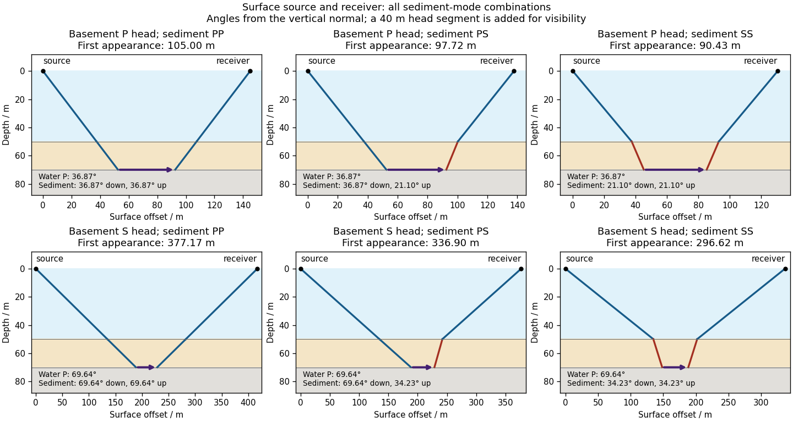

**[Figure 1](#1/c/image-surface-to-surface-p-and-converted-s-head-wave-paths-through-the-water-and-sediment-layers). Surface-to-surface P and converted-S head-wave paths through the water and sediment layers**. Each panel adds an illustrative 40 m basement head segment; the tabulated first-appearance limit removes that segment. Angles are measured from the vertical normal. Reversing the mixed sediment path gives its reciprocal S/P case.

There is **no separate finite-distance P head wave at the water–sediment interface**: $V_{p,w}=V_{p,s}=1500\ \mathrm{m\,s^{-1}}$, so the nominal critical angle is $90^\circ$, and a ray from a source 50 m above the interface cannot reach it at finite horizontal distance. Nor can the slower sediment S speed, $900\ \mathrm{m\,s^{-1}}$, support a [seismic head wave](../../wave-equation.md#seismic-head-wave) launched from [water](../../chemical-substance.md#water): it would require $\sin\theta_w=1500/900>1$. A [seismic reflection](../../geophysics.md#seismic-reflection) still exists at the seabed because the [densities](../../fluid-mechanics.md#density), hence the [acoustic impedances](../../elasticity-physics.md#acoustic-impedance), differ.

**First appearance and first arrival differ.** For each permitted branch the [travel time](../../dispersion-relation.md#travel-time) is

$$
t_h(x)=\frac{x}{V_h}+2h_w\sqrt{1500^{-2}-V_h^{-2}}+h_s\left(\sqrt{V_{sa}^{-2}-V_h^{-2}}+\sqrt{V_{sb}^{-2}-V_h^{-2}}\right),\qquad x\geq x_{\min}.
$$

The all-P basement P branch has $t_h=x/2500+0.0746667\ \mathrm s$. It overtakes the direct [water](../../chemical-substance.md#water) [P wave](../../wave-equation.md#p-wave), $t_d=x/1500$, only at $x=280\ \mathrm m$. The converted P-head branches have larger [seismic intercept times](../../geophysics.md#seismic-intercept-time), so even where they exist at shorter offsets they are later arrivals. The S-head branches are likewise later than the all-P P-head branch wherever they exist in this model. Reflections and [layer reverberations](../../geophysics.md#layer-reverberation) can supply additional later phases.

<h3 id="1/d">d</h3>

↑ **Parent:** [1](#1)

<h4 id="1/d/solution">Solution</h4>

↑ **Parent:** [D](#1/d)

Use a **high-resolution multichannel [seismic reflection survey](../../geophysics.md#seismic-reflection-survey)**, with closely spaced crossing lines or a suitable small three-dimensional survey over the turbine locations. It should map the seabed, the [sediment](../../planetary-science.md#sediment)–[sandstone](../../planetary-science.md#sandstone) boundary, local [faults](../../geophysics.md#geological-fault), buried channels, and lateral changes relevant to foundations. [Seismic reflection](../../geophysics.md#seismic-reflection) responds to [acoustic impedance](../../elasticity-physics.md#acoustic-impedance) contrasts and can image an irregular boundary without requiring it to be a first-arrival refractor. Here even the seabed has a useful normal-incidence [reflection coefficient](../../partial-differential-equation.md#reflection-coefficient) of $+0.20$ despite its zero P-velocity contrast.

A [seismic refraction survey](../../geophysics.md#seismic-refraction-survey) can provide complementary [seismic velocities](../../geophysics.md#seismic-velocity) and geotechnical information, particularly using seabed multicomponent receivers for [S waves](../../wave-equation.md#s-wave). Its limitations as the principal imaging method here include the missing water–sediment P refractor, required offsets of hundreds of metres to obtain useful basement first arrivals, and weaker constraints on thin layers or velocity inversions. Variable [bathymetry](../../planetary-science.md#bathymetry) and [sediment](../../planetary-science.md#sediment) thickness further complicate simple refraction interpretations.

A shallow-towed **[boomer seismic source](../../geophysics.md#boomer-seismic-source) or small [sparker seismic source](../../geophysics.md#sparker-seismic-source)** is a sensible initial [seismic source](../../geophysics.md#seismic-source) for penetrating about 20 m of [sediment](../../planetary-science.md#sediment) beneath a 50 m water column. A [chirp sub-bottom profiler](../../geophysics.md#chirp-sub-bottom-profiler) can add finer imaging of the upper cover where penetration permits; penetration depends on grain size, consolidation, [gas](../../thermodynamics.md#gas), and [seismic attenuation](../../geophysics.md#seismic-attenuation). A pilot line should establish the minimum useful source energy and [bandwidth](../../electrical-engineering.md#bandwidth-signal-processing). Large low-frequency air-gun arrays are unnecessary for this shallow target. Small coastal vessels, sea state, tow stability and acoustic background constrain usable [frequencies](../../wave.md#frequency) and operations. Marine mammals and other local receptors motivate a low-energy effective source, monitoring and appropriate operational mitigation.[The institutional instrument description lists configurable boomer, sparker, hydrophone-streamer and complementary chirp equipment for shallow subsurface mapping.](../../physics-bibliography.md#high-resolution-multichannel-seismic-system-by-united-states-geological-survey)

The expected normal-incidence two-way [travel times](../../dispersion-relation.md#travel-time) are $2(50)/1500\simeq0.0667\ \mathrm s$ for the seabed and $2(50+20)/1500\simeq0.0933\ \mathrm s$ for basement, separated by $26.7\ \mathrm{ms}$. Source duration, recording sample interval and [bandwidth](../../electrical-engineering.md#bandwidth-signal-processing) must distinguish them. As an initial [vertical seismic resolution](../../geophysics.md#vertical-seismic-resolution) estimate, $\Delta z\sim\lambda/4=V_p/(4f)$: $f=1000\ \mathrm{Hz}$ gives about $0.38\ \mathrm m$ in the [sediment](../../planetary-science.md#sediment), although usable resolution depends on the whole [seismic wavelet](../../geophysics.md#seismic-wavelet) and [signal-to-noise ratio](../../electrical-engineering.md#signal-to-noise-ratio).

Choose shot and receiver spacing from the shortest useful [wavelength](../../wave-equation.md#wavelength), target size, maximum [reflector dip](../../geophysics.md#reflector-dip), [seismic migration](../../geophysics.md#seismic-migration) needs and achievable navigation accuracy. For a plane event of horizontal [seismic ray parameter](../../geophysics.md#seismic-ray-parameter-in-horizontal-layering) $p$, avoiding spatial [aliasing](../../fourier-analysis.md#aliasing) requires approximately $\Delta x\leq1/(2f_{\max}|p|)$. Source spacing and receiver spacing also set midpoint coverage and [seismic acquisition fold](../../geophysics.md#seismic-acquisition-fold); adequate offsets enable [moveout correction](../../geophysics.md#moveout-correction) and velocity estimation. For nearly horizontal shallow reflectors a few-metre shot interval can be practical, whereas steep events at high frequency require denser spatial sampling. These values must be designed together rather than imposing one spacing for every target. Cross-line spacing must resolve lateral features between turbine sites, not merely along each track.

At a vessel speed of $2\ \mathrm{m\,s^{-1}}$, one shot per second gives 2 m shot spacing and ample separation relative to a roughly $0.1\ \mathrm s$ target return, subject to the longer record needed for [seismic multiples](../../geophysics.md#seismic-multiple) and source recovery. Shallow towing limits [seismic source ghosts](../../geophysics.md#seismic-source-ghost) and receiver ghosts, but requires stable tow depth. Accurate positioning, tides, measured water sound speed, [bathymetry](../../planetary-science.md#bathymetry) and checks for seabed [seismic multiples](../../geophysics.md#seismic-multiple) are essential for correct target depths.

## 2

↑ **Parent:** [Paper 3](paper-3.md)

<h3 id="2/a">a</h3>

↑ **Parent:** [2](#2)

<h4 id="2/a/solution">Solution</h4>

↑ **Parent:** [A](#2/a)

A [gravity anomaly](../../geophysics.md#gravity-anomaly) is the difference between observed gravitational acceleration and a specified reference prediction after defined reductions. A [free-air gravity anomaly](../../geophysics.md#free-air-gravity-anomaly), a [Bouguer gravity anomaly](../../geophysics.md#bouguer-gravity-anomaly), and a residual local [gravity anomaly](../../geophysics.md#gravity-anomaly) differ because they remove different reference contributions. State the reference [ellipsoid](../../euclidean-geometry.md#ellipsoid), datum, reference [density](../../fluid-mechanics.md#density), and regional trend before interpreting an anomaly as a subsurface [geophysical density contrast](../../geophysics.md#geophysical-density-contrast).

On land, tie [gravimeter](../../geophysics.md#gravimeter) observations to a gravity base, calibrate them, correct instrumental drift and Earth tides, and determine station [latitude](../../astrophysics.md#geographical-latitude) and elevation accurately. Subtract latitude-dependent normal gravity $\gamma(\varphi)$. Reduce to the reference elevation using a positive [free-air correction](../../geophysics.md#free-air-correction) for a station above that datum: about $+0.3086h\ \mathrm{mGal}$ for $h$ in metres. A simple [Bouguer gravity anomaly](../../geophysics.md#bouguer-gravity-anomaly) then subtracts attraction of the intervening rock slab and adds the conventional [terrain correction](../../geophysics.md#terrain-correction):

$$
\Delta g_B\simeq g_{\mathrm{obs,corr}}-\gamma(\varphi)+0.3086h-2\pi G\rho_{\mathrm{ref}}h+C_{\mathrm{terrain}},
$$

with all acceleration terms expressed consistently. In SI units $1\ \mathrm{mGal}=10^{-5}\ \mathrm{m\,s^{-2}}$.

At sea, also correct vessel-motion effects, especially the [Eötvös correction](../../geophysics.md#eotvos-correction) from east–west vessel motion and Earth rotation, and vertical ship acceleration; average or filter the moving-platform data appropriately. GPS navigation and tide information specify position and measurement height. Sea-surface measurements give a marine [free-air gravity anomaly](../../geophysics.md#free-air-gravity-anomaly) after motion, latitude, tide and height reductions. A marine [Bouguer gravity anomaly](../../geophysics.md#bouguer-gravity-anomaly) additionally allows for measured [bathymetry](../../planetary-science.md#bathymetry) and the replacement of low-density [water](../../chemical-substance.md#water) by reference [rock](../../planetary-science.md#rock-geology); the simple water-column replacement correction is positive, $2\pi G(\rho_{\mathrm{ref}}-\rho_w)H$, relative to the sea-surface free-air value. A consistent three-dimensional bathymetric correction is preferable near irregular coasts. Remove a justified broad regional field if the intended quantity is a residual anomaly of the local body.

<h3 id="2/b">b</h3>

↑ **Parent:** [2](#2)

<h4 id="2/b/solution">Solution</h4>

↑ **Parent:** [B](#2/b)

For a wide horizontal [Bouguer slab](../../geophysics.md#bouguer-slab) replacing surrounding basement, use the **density contrast** $\Delta\rho=\rho_{\mathrm{sed}}-\rho_{\mathrm{base}}$, not the absolute [sediment](../../planetary-science.md#sediment) [density](../../fluid-mechanics.md#density):

$$
\Delta g=2\pi G\Delta\rho\,h.
$$

Take downward attraction as positive. The negative anomaly therefore requires $\Delta\rho<0$. With $\Delta g=-40\ \mathrm{mGal}=-4.0\times10^{-4}\ \mathrm{m\,s^{-2}}$, $h=3000\ \mathrm m$, and $G=6.67430\times10^{-11}\ \mathrm{m^3\,kg^{-1}\,s^{-2}}$,

$$
\Delta\rho=\frac{-4.0\times10^{-4}}{2\pi(6.67430\times10^{-11})(3000)}=-317.95\ \mathrm{kg\,m^{-3}},
$$

so

$$
\boxed{\rho_{\mathrm{base}}=2300-(-317.95)\simeq2618\ \mathrm{kg\,m^{-3}}\simeq2.62\ \mathrm{Mg\,m^{-3}}.}
$$

This is the requested [Bouguer slab](../../geophysics.md#bouguer-slab) approximation: a flat observation surface, laterally infinite constant-thickness material, uniform average [geophysical density contrast](../../geophysics.md#geophysical-density-contrast), and a regional anomaly already removed. The actual basin in Figure 1 narrows downwards and is finite. For a fixed maximum thickness, finite width reduces the central anomaly magnitude, so this calculation can underestimate the true magnitude of the average [geophysical density contrast](../../geophysics.md#geophysical-density-contrast). It does not establish a unique basement [density](../../fluid-mechanics.md#density) without the geometrical assumption.

<h3 id="2/c">c</h3>

↑ **Parent:** [2](#2)

<h4 id="2/c/solution">Solution</h4>

↑ **Parent:** [C](#2/c)

Use the same surrounding basement [density](../../fluid-mechanics.md#density) inferred in [solution](#2/b/solution), carrying its unrounded value through the arithmetic. The intrusion's [geophysical density contrast](../../geophysics.md#geophysical-density-contrast) is

$$
\Delta\rho_i=2498-2617.9458=-119.9458\ \mathrm{kg\,m^{-3}}.
$$

The [Bouguer slab](../../geophysics.md#bouguer-slab) thickness needed to produce the same negative peak is therefore

$$
\boxed{h_i=\frac{-4.0\times10^{-4}}{2\pi G(-119.9458)}\simeq7952\ \mathrm m\simeq8.0\ \mathrm{km}.}
$$

The smaller absolute [geophysical density contrast](../../geophysics.md#geophysical-density-contrast) requires a thicker body. This is an approximate **vertical thickness** and, if the top is close to the surface as drawn in Figure 1, an approximate base depth below that top. It is not an independent estimate of the intrusion's burial depth. For an infinite slab the anomaly does not depend on top depth; a buried top would require additional geometry. Finite width and the downward-widening outline in Figure 1 make 8 km a slab-equivalent estimate rather than a uniquely determined geological depth.

<h3 id="2/d">d</h3>

↑ **Parent:** [2](#2)

<h4 id="2/d/solution">Solution</h4>

↑ **Parent:** [D](#2/d)

For the two negative [gravity anomalies](../../geophysics.md#gravity-anomaly) in the actual Figure 1, examine **where the steepest flanks occur within the total fall into the trough**. The solid upper intrusion profile has maximum slope relatively low on its flanks, close to the flat trough; its body widens downwards. The lower basin profile has maximum slope relatively high on its flanks, near the shoulders; its body narrows downwards. The dashed gradient traces and arrows mark these transitions. The signed [derivative](../../calculus.md#derivative) changes sign on opposite sides of a symmetric trough; a plot of gradient magnitude instead gives two positive peaks.

A shallow edge controls a relatively abrupt local change, whereas deeper [geophysical density contrast](../../geophysics.md#geophysical-density-contrast) spreads its effect over greater horizontal distance. Downward-narrowing geometry leaves relatively more of the anomaly associated with the shallow broad part, placing the strong flank change nearer the outer shoulders. Downward-widening geometry adds a broader deep contribution beneath the narrow outcrop, shifting the inflection towards the lower part of the trough. Thus the location of a flank's maximum slope relative to its shoulder and minimum is more useful here than the shared $-40\ \mathrm{mGal}$ peak alone.

A symmetric constant-density body with **vertical sides** gives a symmetric negative trough with paired rounded flanks; for a broad shallow body the main slope changes occur approximately halfway down those flanks. It is intermediate between the two end members, rather than a triangular anomaly or a rectangular discontinuity. Exact fractional inflection heights depend on width, depth, burial and rounding. The following independently calculated infinite-strike models illustrate the distinction without copying Figure 1.

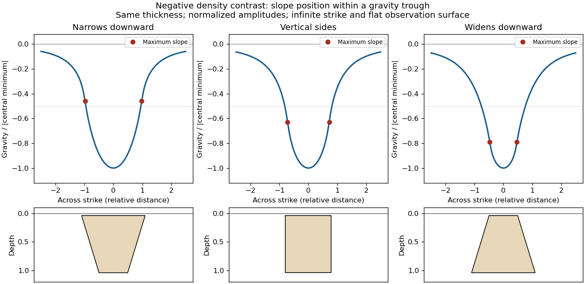

**[Figure 2](#2/d/image-gravity-trough-shapes-for-bodies-narrowing-downward-having-vertical-sides-and-widening-downward). Gravity-trough shapes for bodies narrowing downward, having vertical sides, and widening downward**. The bodies have the same vertical thickness and negative density contrast; each profile is normalized by its own central anomaly. Markers identify maximum flank slopes. A small burial depth regularizes the near-surface edge response.

This qualitative inference assumes approximately comparable simple bodies, uniform [geophysical density contrast](../../geophysics.md#geophysical-density-contrast), and a properly removed regional field. [Gravity inversion](../../inverse-problem.md#gravity-inversion) is non-unique: lateral [density](../../fluid-mechanics.md#density) changes, multiple bodies, and a buried top can imitate changes of wall slope. Use the [seismic reflection](../../geophysics.md#seismic-reflection) constraints to test the interpretation.

<h3 id="2/e">e</h3>

↑ **Parent:** [2](#2)

<h4 id="2/e/solution">Solution</h4>

↑ **Parent:** [E](#2/e)

Assume that the intrusion has a positive [magnetic susceptibility](../../statistical-physics.md#magnetic-susceptibility) contrast, that [induced magnetization](../../statistical-physics.md#induced-magnetization) dominates its [remanent magnetization](../../electromagnetism.md#remanent-magnetization), and that the local present-day [geomagnetic field](../../electromagnetism.md#geomagnetic-field) points roughly **northward and downward**, as in this northern mid-latitude setting. Write

$$
\Delta\mathbf M\simeq\Delta\chi\,\mathbf H_0,\qquad \Delta T=|\mathbf B_0+\mathbf b|-|\mathbf B_0|\simeq\widehat{\mathbf B}_0\cdot\mathbf b,
$$

where $\mathbf b$ is the anomalous [magnetic field](../../magnetic-field.md) and the last expression assumes $|\mathbf b|\ll|\mathbf B_0|$. A [total-field magnetic anomaly](../../geophysics.md#total-field-magnetic-anomaly) measures a field projection, so it need not have the same sign everywhere above a high-susceptibility body.[The buried-dipole construction obtains total-field response by projecting the anomalous field along the inducing field and shows how the pattern changes with field orientation.](../../physics-bibliography.md#magnetic-surveying-induced-magnetization-by-ubc-geophysical-inversion-facility)

The 100 km east–west extent makes an approximately **two-dimensional, east–west-striking body** a useful model away from its ends. On a profile drawn **north on the left, south on the right**, the expected normally induced response has a subsidiary **negative lobe on the northern side** and a stronger **positive lobe over the body, displaced towards the south**. The northward horizontal field component makes the anomaly asymmetric; its downward component produces the dominant positive response. The field falls back towards the regional value away from the intrusion. Broad bodies can have edge shoulders or a broad central high, so the sketch represents a qualitative shape rather than one uniquely specified curve.

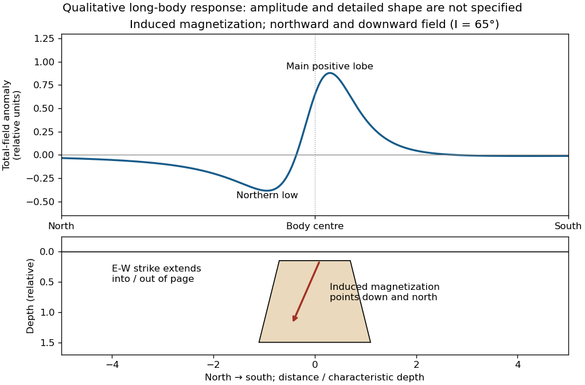

**[Figure 3](#2/e/image-north-south-total-field-anomaly-of-a-normally-induced-long-east-west-magnetic-body). North–south total-field anomaly of a normally induced long east–west magnetic body**. An original infinite-strike line-dipole calculation illustrates the northern low and southward-displaced main high. The 65-degree downward inclination is illustrative; the geometry underneath is schematic and is not a quantitative model of the source intrusion.

An exactly vertical inducing field would remove this north–south skew for a symmetric induced body. Real [magnetic inclination](../../electromagnetism.md#magnetic-inclination) and [magnetic declination](../../electromagnetism.md#magnetic-declination) should be taken from a suitable [geomagnetic field](../../electromagnetism.md#geomagnetic-field) model for the survey date and location; no exact local value is supplied here. Strong oblique or reversed [remanent magnetization](../../electromagnetism.md#remanent-magnetization) can shift or reverse the lobes, and heterogeneous [magnetic susceptibility](../../statistical-physics.md#magnetic-susceptibility), body dip and three-dimensional end effects can alter the profile. Higher [magnetic susceptibility](../../statistical-physics.md#magnetic-susceptibility) alone does not determine a unique amplitude or polarity pattern without these qualifications.

## 3

↑ **Parent:** [Paper 3](paper-3.md)

<h3 id="3/a">a</h3>

↑ **Parent:** [3](#3)

<h4 id="3/a/solution">Solution</h4>

↑ **Parent:** [A](#3/a)

Use compression-positive [principal stresses](../../continuum-mechanics.md#principal-stress), $\sigma_1\geq\sigma_2\geq\sigma_3$. For the intended [thrust fault](../../geophysics.md#thrust-fault) regime during approximately north–south [tectonic shortening](../../planetary-science.md#tectonic-shortening), the likely orientations are

$$
\boxed{\sigma_1:\ \text{horizontal N--S};\quad\sigma_2:\ \text{horizontal E--W};\quad\sigma_3:\ \text{vertical}.}
$$

A locally horizontal traction-free surface motivates taking one principal direction as vertical, while the strong north–south compression selects the maximum horizontal [principal stress](../../continuum-mechanics.md#principal-stress). The expected [fault strike](../../geophysics.md#fault-strike) is then approximately east–west.

This ordering assumes the two horizontal compressions exceed the vertical [principal stress](../../continuum-mechanics.md#principal-stress). North–south shortening by itself does not establish the magnitudes of all three: if the vertical [principal stress](../../continuum-mechanics.md#principal-stress) were intermediate, [strike-slip faulting](../../geophysics.md#strike-slip-faulting) would instead be possible. The answer above is the simple compressional end member used in the following parts.

<h3 id="3/b">b</h3>

↑ **Parent:** [3](#3)

<h4 id="3/b/solution">Solution</h4>

↑ **Parent:** [B](#3/b)

A **reverse or [thrust fault](../../geophysics.md#thrust-fault) earthquake** is the expected end member: a [hanging wall](../../geophysics.md#hanging-wall) moves upwards relative to its [footwall](../../geophysics.md#footwall), accommodating north–south [tectonic shortening](../../planetary-science.md#tectonic-shortening). A plausible [double-couple seismic source](../../wave-equation.md#double-couple-seismic-source) [focal mechanism](../../wave-equation.md#focal-mechanism) has an approximately east–west [fault strike](../../geophysics.md#fault-strike), a moderately north- or south-dipping [fault plane](../../geophysics.md#fault-plane), and up-dip [fault slip](../../geophysics.md#fault-slip). For example, right-hand-rule strike $090^\circ$, southward [fault dip](../../geophysics.md#fault-dip) about $32^\circ$, and [fault rake](../../geophysics.md#fault-rake) $+90^\circ$ specify a pure thrust mechanism.

In a lower-hemisphere equal-area plot, with shaded regions denoting compressional P first motions, this [focal mechanism](../../wave-equation.md#focal-mechanism) has a shaded central region and two unshaded outer lobes. The P axis is approximately horizontal north–south and the T axis approximately vertical for a symmetric idealization; for a single $32^\circ$ plane their axes are slightly tilted. The P and T axes of a [double-couple seismic source](../../wave-equation.md#double-couple-seismic-source) need not exactly equal the regional [principal stress](../../continuum-mechanics.md#principal-stress) axes. The nodal curves represent both the [fault plane](../../geophysics.md#fault-plane) and its auxiliary plane; additional evidence is needed to choose between them.[Lower-hemisphere compression shading and the ambiguity between the two nodal planes.](../../physics-bibliography.md#focal-mechanisms-or-beachballs-by-united-states-geological-survey)

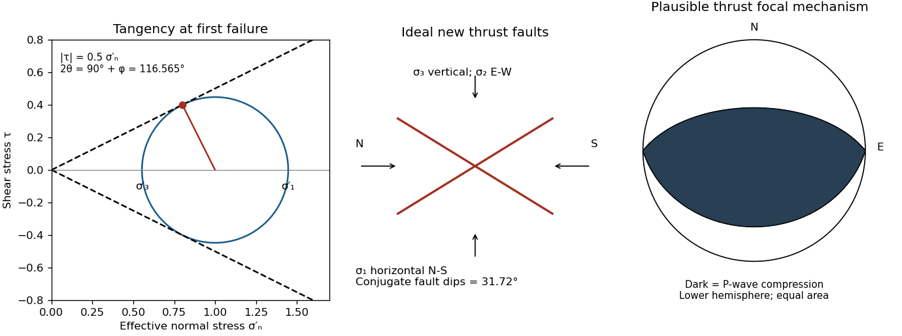

**[Figure 4](#3/b/image-mohr-coulomb-tangency-conjugate-thrust-dips-and-a-plausible-thrust-focal-mechanism). Mohr-Coulomb tangency, conjugate thrust dips, and a plausible thrust focal mechanism**. The stress scale is arbitrary. The Mohr circle touches a friction envelope of slope 0.5; the physical fault dip is 31.72 degrees. The original lower-hemisphere mechanism uses an east–west-striking reverse fault; dark shading denotes P-wave compression.

<h3 id="3/c">c</h3>

↑ **Parent:** [3](#3)

<h4 id="3/c/solution">Solution</h4>

↑ **Parent:** [C](#3/c)

Assume an initially unfractured homogeneous [isotropic](../../continuum-mechanics.md#isotropy) material described by a linear [Mohr-Coulomb failure criterion](../../continuum-mechanics.md#mohr-coulomb-failure-criterion), with the given [coefficient of friction](../../newtonian-mechanics.md#coefficient-of-friction) $\mu_f=0.5$ representing the relevant [internal friction angle](../../continuum-mechanics.md#internal-friction-angle). Use spatially uniform [pore fluid pressure](../../porous-media-flow.md#pore-fluid-pressure), [effective stresses](../../continuum-mechanics.md#effective-stress) $\sigma_i'=\sigma_i-P_f$, and compression-positive signs. Then

$$
|\tau|=c+\mu_f\sigma_n',\qquad\varphi=\arctan\mu_f=26.565^\circ.
$$

The [Mohr circle](../../continuum-mechanics.md#mohr-s-circle) in the $\sigma_1',\sigma_3'$ plane has centre $C=(\sigma_1'+\sigma_3')/2$ and radius $R=(\sigma_1'-\sigma_3')/2$. At first failure it is tangent to the [failure envelope](../../continuum-mechanics.md#failure-envelope). The radius to the positive-shear tangent point is perpendicular to the line of slope $\tan\varphi$, hence makes angle $90^\circ+\varphi$ with the positive normal-stress axis.

If $\theta$ is the angle between the **fault normal** and $\sigma_1$, the [stress transformation](../../continuum-mechanics.md#stress-transformation) is

$$
\sigma_n'=C+R\cos2\theta,\qquad\tau=R\sin2\theta.
$$

Thus $2\theta=90^\circ+\varphi$, $\theta=58.2825^\circ$, and the angle of the fault itself to horizontal $\sigma_1$ is

$$
\boxed{\delta=90^\circ-\theta=45^\circ-\frac\varphi2=31.7175^\circ.}
$$

The two conjugate [thrust faults](../../geophysics.md#thrust-fault) therefore strike approximately east–west and dip about **$32^\circ$ north and $32^\circ$ south**. This is the [fault dip](../../geophysics.md#fault-dip), not the $58.3^\circ$ fault-normal angle. Both [sediments](../../planetary-science.md#sediment) and basement have the same optimum orientation under these assumptions because their stipulated friction slopes are equal; their [cohesion](../../continuum-mechanics.md#cohesion) and absolute failure [stresses](../../continuum-mechanics.md#stress) could still differ.

The first two panels in [solution](#3/b/solution) give the labeled construction. Constant [cohesion](../../continuum-mechanics.md#cohesion) shifts the straight [failure envelope](../../continuum-mechanics.md#failure-envelope) without changing its slope, and uniform [pore fluid pressure](../../porous-media-flow.md#pore-fluid-pressure) translates the [Mohr circle](../../continuum-mechanics.md#mohr-s-circle) in normal-stress coordinates; neither changes this tangency angle. In the illustrative cohesionless case, $R/C=\sin\varphi$, giving $\sigma_1'/\sigma_3'=(1+\sin\varphi)/(1-\sin\varphi)\simeq2.618$. Pre-existing weaknesses, a nonuniform [stress](../../continuum-mechanics.md#stress) field, anisotropic strength, or a nonlinear [failure envelope](../../continuum-mechanics.md#failure-envelope) invalidate the simple optimum-orientation prediction.[Lecture 10 develops the traction, pore-pressure and Mohr-circle framework; the signs and angle definitions above specify the convention used here.](../../physics-bibliography.md#stress-and-strength-lecture-notes-by-mit-opencourseware)

<h3 id="3/d">d</h3>

↑ **Parent:** [3](#3)

<h4 id="3/d/solution">Solution</h4>

↑ **Parent:** [D](#3/d)

The $31.7^\circ$ result predicts **initial failure in a uniform material under the assumed principal-stress orientations**. The actual Figure 3 is a present-day NW–SE cross section through a thick, heterogeneous Alpine stack, extending to about 50 km depth. It contains near-horizontal basal stretches, curved ramps, tightly bent contacts, and steep structures in the internal zones around Viso and the Dora Maira complex. It does not show a single undeformed conjugate pair newly formed in horizontal uniform [rock](../../planetary-science.md#rock-geology).

Several processes explain the departures:

- **Mechanical layering and inherited weaknesses.** [Faults](../../geophysics.md#geological-fault) can follow weak bedding, old [fault planes](../../geophysics.md#fault-plane), or contacts with lower [friction](../../newtonian-mechanics.md#friction) or [cohesion](../../continuum-mechanics.md#cohesion) than the surrounding [rock](../../planetary-science.md#rock-geology). These can form shallow [décollements](../../geophysics.md#decollement) linked by steeper ramps. Figure 2 explicitly distinguishes the near-surface red “geophysical bedrock” boundary at a few hundred metres from the much deeper crystalline basement beneath the [Jurassic](../../planetary-science.md#jurassic), [Triassic](../../planetary-science.md#triassic) and [Permian](../../planetary-science.md#permian) cover. An age label or a seismic contrast alone does not establish a friction coefficient; clay-rich or [evaporite](../../planetary-science.md#evaporite) detachments are possibilities to test, not lithologies proved by that drawing.
- **Rotation after formation.** Continuing [tectonic shortening](../../planetary-science.md#tectonic-shortening), [folding](../../planetary-science.md#folding), stacking and [fault slip](../../geophysics.md#fault-slip) can rotate an initially optimal [fault plane](../../geophysics.md#fault-plane) to steeper or shallower present-day [fault dips](../../geophysics.md#fault-dip). A steep older structure may be inherited from an earlier deformation episode rather than created at its present orientation.
- **Curved faults and local stresses.** [Faults](../../geophysics.md#geological-fault) bend through a layered [crust](../../geophysics.md#planetary-crust); local [principal stress](../../continuum-mechanics.md#principal-stress) axes rotate near topography, ramps and interacting faults. The optimum angle is measured relative to the local $\sigma_1$, not necessarily to the regional horizontal direction everywhere.
- **Changing strength and deformation mechanism.** Spatial changes in [pore fluid pressure](../../porous-media-flow.md#pore-fluid-pressure), [coefficient of friction](../../newtonian-mechanics.md#coefficient-of-friction), [cohesion](../../continuum-mechanics.md#cohesion) and [temperature](../../temperature.md) alter which surfaces reactivate. At depth, [ductile deformation](../../planetary-science.md#ductile-deformation) can replace frictional brittle failure, so the same new-fracture construction need not apply throughout the section.

Finally, a section shows **apparent dip** unless it is perpendicular to [fault strike](../../geophysics.md#fault-strike). For an ideal plane, $\tan\delta_{\mathrm{app}}=\tan\delta_{\mathrm{true}}\sin\alpha$, where $\alpha$ is the angle between the section direction and [fault strike](../../geophysics.md#fault-strike). Obliquity can make a plane look shallower, but cannot on its own explain an apparent dip steeper than its true dip. Do not infer that each black curve is a currently active brittle [earthquake](../../geophysics.md#earthquake) fault.

<h3 id="3/e">e</h3>

↑ **Parent:** [3](#3)

<h4 id="3/e/i">i</h4>

↑ **Parent:** [E](#3/e)

<h5 id="3/e/i/solution">Solution</h5>

↑ **Parent:** [I](#3/e/i)

The **northern station is closer**, under comparable [P wave](../../wave-equation.md#p-wave) and [S wave](../../wave-equation.md#s-wave) paths through the same [velocity model](../../geophysics.md#velocity-model). In the actual Figure 4 the northern P and S pulses are separated by about **6 s**, whereas the southern separation is roughly **8–8.5 s**. The [S–P time](../../geophysics.md#s-p-time) removes the unknown [earthquake origin time](../../geophysics.md#earthquake-origin-time):

$$
\Delta t=t_S-t_P=D\left(\frac1{V_s}-\frac1{V_p}\right).
$$

Both northern pulses also occur earlier on the shared absolute clock, consistent with the smaller distance. Earlier arrival alone would not be sufficient if clocks or [velocity models](../../geophysics.md#velocity-model) differed.

For reproducible graph readings, the northern positive-to-negative zero crossings are approximately $13.3\ \mathrm s$ for P and $19.3\ \mathrm s$ for S; the southern crossings are approximately $16.7\ \mathrm s$ and $25.0\ \mathrm s$. These are convenient corresponding pulse landmarks, not sharply defined first-break onsets. The first visible motion begins earlier: approximately 12 s and 18 s in the north, and 14–15 s and 22–23 s in the south, depending on the amplitude threshold. The horizontal axis is **seconds since midnight on 1 January 2000**, not elapsed time since rupture initiation.

<h4 id="3/e/ii">ii</h4>

↑ **Parent:** [E](#3/e)

<h5 id="3/e/ii/solution">Solution</h5>

↑ **Parent:** [Ii](#3/e/ii)

Use the northern [S–P time](../../geophysics.md#s-p-time), approximately $\Delta t_N=6\ \mathrm s$, rather than multiplying an absolute-clock arrival by a [wave speed](../../wave-equation.md#wave-speed). For common approximately straight paths,

$$
\boxed{D_N=\frac{\Delta t_N}{1/V_s-1/V_p}=\frac{V_pV_s}{V_p-V_s}\,\Delta t_N.}
$$

**No numerical crustal velocities are specified in Q3.** If the usual illustrative crustal values $V_p=6.0\ \mathrm{km\,s^{-1}}$ and $V_s=3.5\ \mathrm{km\,s^{-1}}$ are adopted, the distance is

$$
\boxed{D_N\simeq8.4\times6\simeq50\ \mathrm{km}.}
$$

These assumed crustal speeds are unrelated to Q1's offshore layer values. They are representative rather than measurements of the Swiss column; the [British Geological Survey](../../geophysics.md#british-geological-survey) gives broad typical crustal ranges of 5–7 km/s for [P waves](../../wave-equation.md#p-wave) and 3–4 km/s for [S waves](../../wave-equation.md#s-wave).[The seismic-wave table provides typical crustal speed ranges, not a velocity model for this particular earthquake.](../../physics-bibliography.md#how-are-earthquakes-detected-by-british-geological-survey)

Using the corresponding northern central pulse times gives an effective source time near $13.3-50.4/6\simeq4.9\ \mathrm s$ after midnight, and the S estimate is the same to graph accuracy. The southern central landmarks similarly give a distance near 70 km and an effective source time near 5 s. That consistency supports the example, but pulse landmarks need not mark the rupture's true onset. $D_N$ is a source-to-station path or [hypocentral distance](../../geophysics.md#hypocentral-distance) in the uniform-speed approximation. An [epicentral distance](../../geophysics.md#epicentral-distance) additionally needs the [hypocenter](../../geophysics.md#hypocenter) depth; it cannot simply be equated to 50 km for an unknown depth.

<h4 id="3/e/iii">iii</h4>

↑ **Parent:** [E](#3/e)

<h5 id="3/e/iii/solution">Solution</h5>

↑ **Parent:** [Iii](#3/e/iii)

Distinguish **the duration of one phase pulse** from the P-to-S separation. Figure 4 shows northern pulses with most visible motion over roughly **3–4 s** each, compared with roughly **4–5 s or more** in the south. Reading the low-amplitude tails gives approximately 11.5–15.2 s for the northern P pulse, 17.7–20.9 s for the northern S pulse, 14.2–19.0 s for the southern P pulse, and 22.3 s to beyond the right plot boundary near 27 s for the southern S pulse. Thus the latter duration is censored by the plotting window; it should not be assigned an exact ending at 27 s. The positive-to-negative extremum separations are only about 1 s in the northern pulses, 1.3 s in the southern P pulse and 1.4 s in the southern S pulse; those much shorter numbers are not full source durations. Smooth tails have no unique onset or ending at the precision of this drawing.

A [finite-source rupture](../../geophysics.md#finite-source-rupture) has an intrinsic duration $T$ that differs from the apparent pulse duration through [rupture directivity](../../geophysics.md#rupture-directivity). In an ideal unilateral line-source model, neglecting local slip rise time, instrument filtering and path broadening,

$$
D_N^{(\mathrm{phase})}=T-\frac{L_\parallel}{c},\qquad D_S^{(\mathrm{phase})}=T+\frac{L_\parallel}{c},\qquad T=\frac{D_N^{(\mathrm{phase})}+D_S^{(\mathrm{phase})}}2.
$$

Here $c$ is the chosen phase [wave speed](../../wave-equation.md#wave-speed) and $L_\parallel$ is the rupture's projection along equal-and-opposite takeoff directions. Averaging **corresponding full pulses** in that model suggests an intrinsic timescale of **roughly 4–5 s**. This is an order-of-magnitude graph estimate, not an exact rupture duration; the figure does not supply a [seismic source time function](../../geophysics.md#seismic-source-time-function) definition, receiver responses, phase deconvolution, or geometry sufficient to determine one uniquely. A finite local slip rise time would also contribute to the observed width.

In particular, neither 13 s nor 19 s is a rupture duration: those numbers locate phase motion on the absolute clock. The northern P–S gap of 6 s is a propagation delay rather than the rupture duration.

<h4 id="3/e/iv">iv</h4>

↑ **Parent:** [E](#3/e)

<h5 id="3/e/iv/solution">Solution</h5>

↑ **Parent:** [Iv](#3/e/iv)

For a unilateral [finite-source rupture](../../geophysics.md#finite-source-rupture) advancing at approximately constant [rupture velocity](../../geophysics.md#rupture-velocity) $V_r$, the along-fault propagation length is

$$
\boxed{L=V_rT.}
$$

There is no supplied $V_r$ or calibrated [seismic source time function](../../geophysics.md#seismic-source-time-function), so **a unique spatial extent cannot be read directly from Figure 4**. For illustration, $T\sim4\ \mathrm s$ and an assumed $V_r\sim2.5\ \mathrm{km\,s^{-1}}$ would give $L\sim10\ \mathrm{km}$. Allowing $T\sim4$–$5\ \mathrm s$ and assumed $V_r\sim2$–$3\ \mathrm{km\,s^{-1}}$ gives lengths of order **8–15 km**. These are explicitly conditional scale estimates, not measured fault dimensions.

If equal-and-opposite ray geometry and phase pulse durations were known, the directivity model in [solution](#3/e/iii/solution) would instead constrain a projected length,

$$
L_\parallel=\frac c2\left(D_S^{(\mathrm{phase})}-D_N^{(\mathrm{phase})}\right),\qquad L_\parallel=L\cos\psi,
$$

where $\psi$ is the angle between the rupture direction and the northern ray. Distinct P and S [wave speeds](../../wave-equation.md#wave-speed), unknown takeoff angles, smooth pulse boundaries and the clipped southern S tail prevent a reliable independent numerical inversion here. This observation is consistent with a few-kilometre projected extent while the actual along-fault length can be larger. A rupture length is not the accumulated [fault slip](../../geophysics.md#fault-slip), the width of the whole [fault plane](../../geophysics.md#fault-plane), or the approximately 50 km station distance.

<h4 id="3/e/v">v</h4>

↑ **Parent:** [E](#3/e)

<h5 id="3/e/v/solution">Solution</h5>

↑ **Parent:** [V](#3/e/v)

The shorter, stronger northern pulses and broader southern pulses suggest propagation **from south to north**, towards the northern station. The useful evidence is the difference in **pulse widths**, not just the earlier northern arrivals: the latter chiefly reflect station distance.

As rupture reaches successively more northerly patches, each patch radiates a new [P wave](../../wave-equation.md#p-wave) and [S wave](../../wave-equation.md#s-wave) pulse. Towards the north, the later emission time is partly cancelled by a shorter propagation path; those contributions arrive closer together. Towards the south, later emission and a longer path add, stretching the signal. This is [rupture directivity](../../geophysics.md#rupture-directivity). It refers to the advance of the slipping region along the [fault](../../geophysics.md#geological-fault), not necessarily the direction of the local [fault slip](../../geophysics.md#fault-slip) vector. A thrust can slip up-dip while its rupture front advances in a direction with a northward component.

More generally, emission from a patch at distance $s$ along the rupture arrives at

$$
t_{\mathrm{arr}}(s)=t_{\mathrm{start}}+\frac{s}{V_r}+\frac{R(s)}c,\qquad \frac{dt_{\mathrm{arr}}}{ds}\simeq\frac1{V_r}-\frac{\cos\psi}{c}.
$$

The forward direction has a smaller arrival-time spread. This is the same travel-time compression captured by isochrone-based [rupture directivity](../../geophysics.md#rupture-directivity) calculations.[The primary report relates directivity to rupture geometry, seismic speed and the arrival-time distribution of radiation from successive fault patches.](../../physics-bibliography.md#a-formulation-of-directivity-for-earthquake-sources-using-isochrone-theory-by-paul-spudich-and-others) Larger northern amplitude supports the interpretation but is not decisive on its own because [geometrical spreading](../../geophysics.md#geometrical-spreading), [seismic attenuation](../../geophysics.md#seismic-attenuation), [seismic radiation patterns](../../wave-equation.md#seismic-radiation-pattern) and site response also affect amplitude. With only two traces, propagation, filtering and site effects remain alternatives to test; the idealized exercise is most naturally explained by northward directivity.

## 4

↑ **Parent:** [Paper 3](paper-3.md)

<h3 id="4/a">a</h3>

↑ **Parent:** [4](#4)

<h4 id="4/a/solution">Solution</h4>

↑ **Parent:** [A](#4/a)

The [geomorphology](../../planetary-science.md#geomorphology) of active [normal faulting](../../geophysics.md#normal-faulting) records a competition between accumulated tectonic displacement and the ability of [erosion](../../planetary-science.md#erosion), transport and deposition to modify it. A [hanging wall](../../geophysics.md#hanging-wall) moves down relative to a [footwall](../../geophysics.md#footwall), producing a [fault scarp](../../geophysics.md#fault-scarp), mountain-front relief, and accommodation space for a [sedimentary basin](../../planetary-science.md#sedimentary-basin). Repeated earthquakes can build a large front even though each individual surface break is much smaller.[The primary mapping report's table of geomorphic features lists scarps, faceted spurs, oversteepened mountain fronts and rejuvenated valley floors as common normal-slip indicators.](../../planetary-science.md#normal-fault-geomorphic-features-by-united-states-geological-survey)

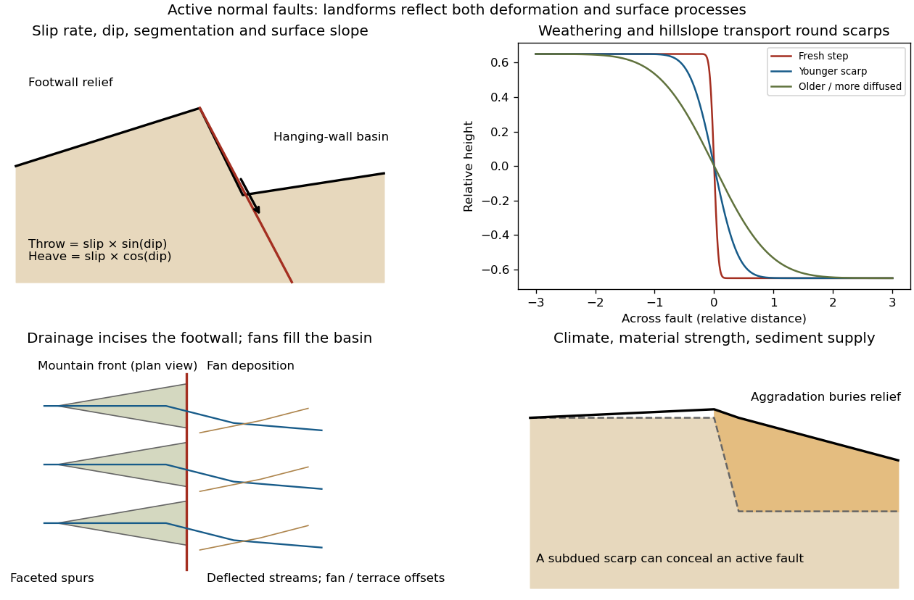

**[Figure 5](#4/a/image-original-sketches-of-tectonic-erosional-and-depositional-controls-on-normal-fault-landforms). Original sketches of tectonic, erosional and depositional controls on normal-fault landforms**. The panels distinguish cumulative block displacement, progressive scarp rounding, drainage and faceted mountain fronts, and burial of a scarp by sediment. Geometries and relative scales are illustrative.

The principal controls and their observable effects are:

- **Displacement, rate and timing.** Larger single-event [fault slip](../../geophysics.md#fault-slip) creates a higher fresh scarp; repeated slip builds cumulative offsets of fans and [river terraces](../../planetary-science.md#river-terrace). The interval since the latest rupture controls degradation. For pure [dip-slip faulting](../../geophysics.md#dip-slip-faulting) on a plane dipping $\delta$, vertical [fault throw](../../geophysics.md#fault-throw) is $D\sin\delta$ and horizontal [fault heave](../../geophysics.md#fault-heave) is $D\cos\delta$. Scarp height on an inclined eroded surface need not equal either the slip or the original vertical throw.
- **Geometry and structural history.** [Fault dip](../../geophysics.md#fault-dip), strike, curvature, segmentation, splays and along-strike variations in [fault slip](../../geophysics.md#fault-slip) control scarp orientation and continuity. Linked faults can create a stepped front; synthetic and antithetic faults can create a [graben](../../geophysics.md#graben). Cumulative deformation includes broad footwall uplift and hanging-wall tilting as well as a sharp break.
- **Lithology and cover.** Strong exposed [bedrock](../../planetary-science.md#bedrock) can preserve steep scarps and fresh fault surfaces. Weak fractured [rock](../../planetary-science.md#rock-geology), thick [regolith](../../geophysics.md#regolith) and loose [alluvium](../../planetary-science.md#alluvium) weather and slump more rapidly, spread deformation, and produce debris at the scarp base. Differential [erosion](../../planetary-science.md#erosion) can make a lithological front without recent tectonic movement, so a straight cliff alone is not sufficient evidence of activity.
- **Climate and surface transport.** Rainfall, runoff, frost action, vegetation and slope processes control scarp rounding and [colluvium](../../planetary-science.md#colluvium) production. Steep new faces collapse towards stable slopes; later hillslope transport rounds the crest and fills the toe. A simple [scarp diffusion model](../../geophysics.md#scarp-diffusion-model) broadens a step over a length proportional to $\sqrt{\kappa t}$, but only if a suitable transport law and comparable material and climate apply.
- **Drainage and sediment supply.** Footwall uplift can incise channels and produce [river terraces](../../planetary-science.md#river-terrace), knickpoints and triangular [faceted spurs](../../planetary-science.md#faceted-spur). Hanging-wall subsidence can pond drainage, deflect streams and promote [alluvial fans](../../planetary-science.md#alluvial-fan) and basin filling. Rapid [aggradation](../../planetary-science.md#aggradation) can bury an active scarp, while stream incision can remove or exaggerate local relief.
- **Preservation and initial landscape.** Pre-existing slopes, relief, surface ages, glacial modification and human disturbance determine where offsets can be recognized. A fan abandoned long before the latest earthquake can accumulate more offset than a younger nearby surface. Compare like-age markers across a fault, and distinguish a mountain front's long history from a single event.

Useful observations therefore include scarp profiles, repeated offsets of dated surfaces, drainage organization, and continuity along strike. A high rugged front is not by itself evidence of a high present [fault slip rate](../../geophysics.md#fault-slip-rate); conversely, a muted or buried scarp need not mark an inactive [fault](../../geophysics.md#geological-fault).

<h3 id="4/b">b</h3>

↑ **Parent:** [4](#4)

<h4 id="4/b/solution">Solution</h4>

↑ **Parent:** [B](#4/b)

A surface-reaching [normal fault](../../geophysics.md#normal-fault) earthquake commonly produces a **down-facing step towards the [hanging wall](../../geophysics.md#hanging-wall)**, accompanied by extension across the break. A fresh free face can expose [bedrock](../../planetary-science.md#bedrock), polish or striations, roots or offset soil. The actual rupture is usually irregular: [fault slip](../../geophysics.md#fault-slip) changes along strike, separate strands overlap or step, and [tension fissures](../../geophysics.md#tension-fissure), small [grabens](../../geophysics.md#graben) and secondary cracks distribute part of the extension.

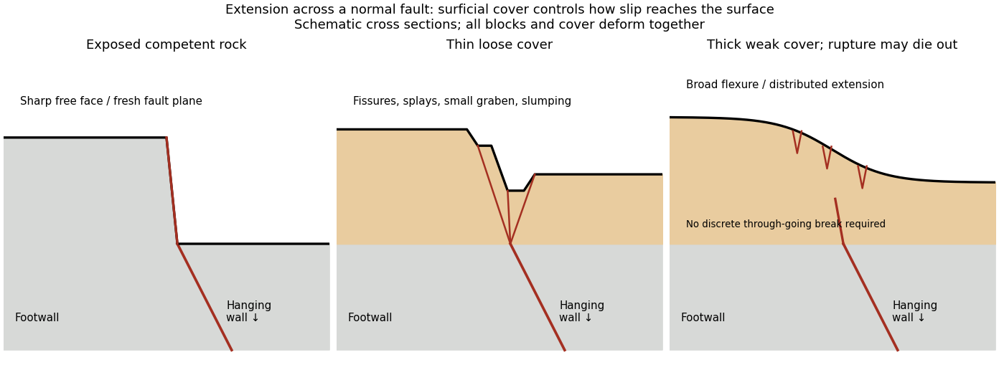

**[Figure 6](#4/b/image-original-cross-sections-showing-how-surficial-cover-changes-normal-fault-surface-rupture). Original cross sections showing how surficial cover changes normal-fault surface rupture**. Competent exposed rock localizes a sharp free face; thin loose cover permits splays and a small graben; thick weak cover can accommodate a buried fault tip by broad flexure and distributed extension.

**Exposed competent rock or very thin cover:** a relatively narrow, sharp break can closely follow the principal [fault plane](../../geophysics.md#fault-plane). A steep free face can be recognizable immediately, then weather and shed debris. The face need not be vertical or maintain the same height along strike.

**Loose granular or poorly consolidated cover:** the main shear can splay upwards through [alluvium](../../planetary-science.md#alluvium) or [regolith](../../geophysics.md#regolith). Open fissures, step-like scarps, rotated blocks, synthetic and antithetic [normal faults](../../geophysics.md#normal-fault), and a small intervening [graben](../../geophysics.md#graben) can form across a wider zone. Collapse and raveling quickly build [colluvium](../../planetary-science.md#colluvium) at the toe. A single rupture event can therefore create several parallel breaks; counting them does not count earthquakes.

**Thick weak or cohesive cover:** deeper [fault slip](../../geophysics.md#fault-slip) can be transferred into distributed [shear strain](../../continuum-mechanics.md#shear-strain), tilted beds, broad warping or [monoclines](../../planetary-science.md#monocline), with tension cracks above a propagating tip. A discrete break may be attenuated or absent if the [fault](../../geophysics.md#geological-fault) remains blind. Cover thickness alone is not enough to predict the response: cohesion, grain size, layering, saturation, rupture displacement and fault depth also matter. Saturated loose [sediment](../../planetary-science.md#sediment) can additionally develop [soil liquefaction](../../planetary-science.md#soil-liquefaction), [sand blows](../../planetary-science.md#sand-blow) or lateral spreading; these are secondary shaking effects and do not independently locate the tectonic rupture.

The observed vertical step, crack aperture and total width of disturbed ground should be measured separately. Reconstruct the total displacement across all strands and account for the original ground slope. [Landslides](../../planetary-science.md#landslide) or gravitational spreading can imitate normal-fault scarps, so map connections to the main [fault](../../geophysics.md#geological-fault) and displaced markers rather than assuming every open crack is primary tectonic slip.

<h3 id="4/c">c</h3>

↑ **Parent:** [4](#4)

<h4 id="4/c/solution">Solution</h4>

↑ **Parent:** [C](#4/c)

Excavate across the mapped [fault scarp](../../geophysics.md#fault-scarp), approximately perpendicular to its strike, at a site where young [sediments](../../planetary-science.md#sediment) record and preserve deformation. On cleaned trench walls log bedding, [soil horizons](../../planetary-science.md#soil-horizon), shear zones, fissure fills, buried surfaces and [colluvial wedges](../../planetary-science.md#colluvial-wedge). Correlate the same marker beds across the [fault](../../geophysics.md#geological-fault) before reconstructing individual displacements.

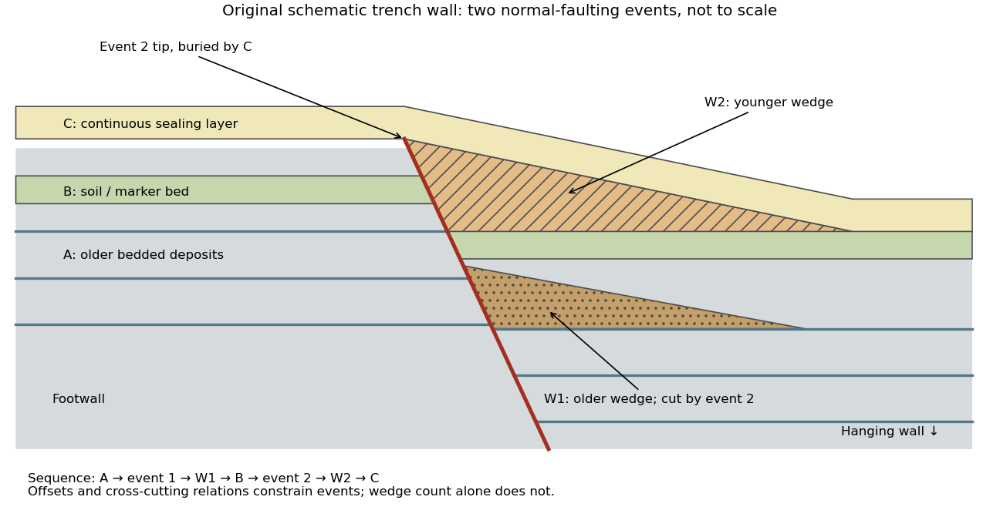

**[Figure 7](#4/c/image-original-two-event-paleoseismic-trench-interpretation-across-a-normal-fault). Original two-event paleoseismic trench interpretation across a normal fault**. Older deposits A record two events; the intervening soil or marker B records one; the youngest layer C seals the second rupture. W1 is cut by the later fault, whereas W2 forms after it. This is an invented schematic stratigraphy, not a copied field log.

Look for **event horizons**, not merely a stack of sediments:

- A [fault](../../geophysics.md#geological-fault) or fissure cuts older layers but terminates below an undeformed sealing deposit. The event occurred after deposition of the youngest demonstrably displaced material and before deposition of the oldest demonstrably sealing material.
- A fresh free face sheds coarse angular debris, often thickest against the scarp and thinning into the [hanging wall](../../geophysics.md#hanging-wall); later finer slopewash can overlie it. A buried [soil horizon](../../planetary-science.md#soil-horizon) between successive [colluvial wedges](../../planetary-science.md#colluvial-wedge) can indicate a period of stability separating events. Fissures filled from above can preserve collapsed soil blocks or distinctive younger sediment.
- Older markers may have larger offsets than younger markers. A lower wedge or soil cut and displaced by a younger shear, then overlain by a new wedge and an intact seal, gives a cross-cutting basis for at least two events. Changes in displacement should be reconstructed across all fault strands.
- Rapid tilting, growth of accommodation space, abrupt changes in deposit thickness, and locally ponded beds can corroborate the structural evidence. [Soil liquefaction](../../planetary-science.md#soil-liquefaction) structures or shaking-induced [landslides](../../planetary-science.md#landslide) may support a chronology, but do not alone prove surface rupture on the trenched fault.

In the drawing, A was faulted in event 1; W1 accumulated; B buried and stabilized that surface. Event 2 displaced A, W1 and B, after which W2 accumulated and C sealed the fault tip. Thus A records two events, B one and C none. This combination of offset and sealing relationships is stronger evidence than identifying two wedge-shaped units alone.

Bracket event ages with multiple samples just below and above the event horizons. Suitable short-lived organic material can be dated by [radiocarbon dating](../../physics.md#radiocarbon-dating); [optically stimulated luminescence dating](../../planetary-science.md#optically-stimulated-luminescence-dating) can constrain deposition of appropriate mineral grains. Reworked old charcoal, younger roots, incomplete bleaching, erosional gaps and time elapsed between rupture and wedge deposition must enter the age interpretation. For calendar dates, $t_{\mathrm{youngest\ cut}}<t_{\mathrm{event}}<t_{\mathrm{oldest\ seal}}$ only when those deposits genuinely bracket the rupture; a radiocarbon age in years before present reverses the numerical ordering.[“Finding Paleoearthquakes” explains disrupted layers followed by unbroken cover; “Determining the Age of a Paleoearthquake” explains dating deposits above and below the event horizon.](../../planetary-science.md#introduction-to-paleoseismology-by-united-states-geological-survey)

One earthquake can generate several debris pulses and wedges; repeated earthquakes may reuse one strand without leaving separable deposits. [Erosion](../../planetary-science.md#erosion), [bioturbation](../../ecology.md#bioturbation), nondeposition, lateral facies changes and upward-dying splays can hide events or mimic terminations. Confirm relationships on both trench walls and, when possible, in adjacent exposures. The result is a minimum supported event sequence with age intervals, not an assumption of perfectly periodic recurrence or one earthquake per wedge.

## 5

↑ **Parent:** [Paper 3](paper-3.md)

<h3 id="5/a">a</h3>

↑ **Parent:** [5](#5)

<h4 id="5/a/solution">Solution</h4>

↑ **Parent:** [A](#5/a)

Put $h=\Delta x$ and suppose $L=(n+1)h$, so there are $n$ interior grid points $x_j=jh$, $j=1,\ldots,n$. Write $u_j(t)\simeq u(x_j,t)$. The fixed ends impose homogeneous [Dirichlet boundary conditions](../../differential-equation.md#dirichlet-boundary-condition),

$$
u_0(t)=u_{n+1}(t)=0.
$$

For a sufficiently smooth [displacement](../../classical-mechanics.md#displacement) field, the two [Taylor series](../../calculus.md#taylor-series) at fixed time give

$$
\begin{aligned}
u(x_j+h,t)&=u(x_j,t)+hu_x+\frac{h^2}{2}u_{xx}+\frac{h^3}{6}u_{xxx}+O(h^4),\\
u(x_j-h,t)&=u(x_j,t)-hu_x+\frac{h^2}{2}u_{xx}-\frac{h^3}{6}u_{xxx}+O(h^4),
\end{aligned}
$$

where all displayed [derivatives](../../calculus.md#derivative) on the right are evaluated at $(x_j,t)$. Adding cancels the odd terms, leaving the [second-order central difference](../../finite-difference.md#second-order-central-difference)

$$
u_{xx}(x_j,t)=\frac{u(x_j-h,t)-2u(x_j,t)+u(x_j+h,t)}{h^2}+O(h^2).
$$

Substitute this [finite difference](../../finite-difference.md) into the [wave equation](../../wave-equation.md) and retain continuous time. The resulting [method of lines](../../finite-difference.md#method-of-lines) gives coupled second-order [ordinary differential equations](../../differential-equation.md#ordinary-differential-equation),

$$
\ddot u_j=\frac{c^2}{h^2}(u_{j-1}-2u_j+u_{j+1}),\qquad j=1,\ldots,n.
$$

In particular, the first and last equations are $\ddot u_1=(c^2/h^2)(-2u_1+u_2)$ and $\ddot u_n=(c^2/h^2)(u_{n-1}-2u_n)$ for $n\ge2$. With the interior [displacement](../../classical-mechanics.md#displacement) [vector](../../vector-space.md#vector) only,

$$
\boxed{\ddot{\mathbf u}=A\mathbf u,\qquad
\mathbf u=(u_1,\ldots,u_n)^T,\qquad
A=\frac{c^2}{h^2}\begin{pmatrix}
-2&1&0&\cdots&0\\
1&-2&1&\ddots&\vdots\\
0&\ddots&\ddots&\ddots&0\\
\vdots&\ddots&1&-2&1\\
0&\cdots&0&1&-2
\end{pmatrix}.}
$$

Equivalently, $A_{jj}=-2c^2/h^2$, $A_{j,j+1}=A_{j+1,j}=c^2/h^2$, and all other entries vanish. This entrywise definition also covers small $n$, including $A=(-2c^2/h^2)$ when $n=1$. The [matrix](../../vector-space.md#matrix) is a [symmetric matrix](../../linear-algebra.md#symmetric-matrix) and a [tridiagonal matrix](../../vector-space.md#tridiagonal-matrix). The spatial approximation has error $O(h^2)$ in [Big O notation](../../real-analysis.md#big-o-notation); time has not yet been discretized.

<h3 id="5/b">b</h3>

↑ **Parent:** [5](#5)

<h4 id="5/b/solution">Solution</h4>

↑ **Parent:** [B](#5/b)

For a nonzero, time-independent [vector](../../vector-space.md#vector) $\hat{\mathbf u}$, substitute $\mathbf u(t)=\hat{\mathbf u}e^{i\omega t}$. Taking two time [derivatives](../../calculus.md#derivative) gives

$$
\ddot{\mathbf u}=(i\omega)^2\hat{\mathbf u}e^{i\omega t}=-\omega^2\hat{\mathbf u}e^{i\omega t}.
$$

Cancel the nonzero exponential to obtain the [eigenvalue](../../linear-operator-theory.md#eigenvalue) problem

$$
\boxed{A\hat{\mathbf u}=\lambda\hat{\mathbf u},\qquad \lambda=-\omega^2,\qquad \hat{\mathbf u}\ne0.}
$$

Thus an [eigenvector](../../linear-operator-theory.md#eigenvector) specifies a [normal mode](../../wave-equation.md#normal-mode) shape and its negative [eigenvalue](../../linear-operator-theory.md#eigenvalue) specifies the square of its [angular frequency](../../lagrangian-mechanics.md#angular-frequency), $\omega=\sqrt{-\lambda}$. Real [displacements](../../classical-mechanics.md#displacement) are obtained by taking the [real part](../../complex-analysis.md#real-part), or by combining the two temporal solutions as $\hat{\mathbf u}(a\cos\omega t+b\sin\omega t)$.

<h3 id="5/c">c</h3>

↑ **Parent:** [5](#5)

<h4 id="5/c/solution">Solution</h4>

↑ **Parent:** [C](#5/c)

The interior grid is $x=1,2,3$, with fixed-end [displacements](../../classical-mechanics.md#displacement) $u_0=u_4=0$. Hence

$$
\boxed{A=\begin{pmatrix}-2&1&0\\1&-2&1\\0&1&-2\end{pmatrix}.}
$$

Use the monic [characteristic polynomial](../../linear-operator-theory.md#characteristic-polynomial) convention $p(\lambda)=\det(\lambda I-A)$, where $I$ is the [identity matrix](../../vector-space.md#identity-matrix). Expansion of the [determinant](../../multilinear-algebra.md#determinant) along the first row gives

$$
\begin{aligned}
p(\lambda)
&=\det\begin{pmatrix}\lambda+2&-1&0\\-1&\lambda+2&-1\\0&-1&\lambda+2\end{pmatrix}\\
&=(\lambda+2)\bigl((\lambda+2)^2-1\bigr)-(\lambda+2)\\
&=\boxed{(\lambda+2)\bigl((\lambda+2)^2-2\bigr)
=\lambda^3+6\lambda^2+10\lambda+4.}
\end{aligned}
$$

The [eigenvalues](../../linear-operator-theory.md#eigenvalue) are the [roots of a polynomial](../../polynomial.md#root-of-a-polynomial) $p(\lambda)=0$. With the alternative [determinant](../../multilinear-algebra.md#determinant) convention $\det(A-\lambda I)$, the [characteristic polynomial](../../linear-operator-theory.md#characteristic-polynomial) is $-p(\lambda)$ because the [matrix](../../vector-space.md#matrix) has odd size; its [roots of a polynomial](../../polynomial.md#root-of-a-polynomial) are unchanged.

<h3 id="5/d">d</h3>

↑ **Parent:** [5](#5)

<h4 id="5/d/solution">Solution</h4>

↑ **Parent:** [D](#5/d)

For each row, a [Gershgorin disc](../../numerical-analysis.md#gershgorin-disc) has centre $a_{jj}=-2$ and radius $r_j=\sum_{k\ne j}|a_{jk}|$. Here $r_1=r_3=1$ and $r_2=2$, so the [Gershgorin circle theorem](../../numerical-analysis.md#gershgorin-circle-theorem) gives

$$
D_1=D_3=\{z:|z+2|\le1\},\qquad D_2=\{z:|z+2|\le2\}.
$$

Since $A$ is a real [symmetric matrix](../../linear-algebra.md#symmetric-matrix), its [eigenvalues](../../linear-operator-theory.md#eigenvalue) are real. Intersecting the union of these [Gershgorin discs](../../numerical-analysis.md#gershgorin-disc) with the real axis yields

$$
\boxed{-4\le\lambda\le0.}
$$

This bound permits zero but does not assert a zero [eigenvalue](../../linear-operator-theory.md#eigenvalue). The fixed-end [Dirichlet boundary conditions](../../differential-equation.md#dirichlet-boundary-condition) exclude it: for any nonzero real [vector](../../vector-space.md#vector) $v=(v_1,v_2,v_3)^T$, extend by $v_0=v_4=0$ and calculate

$$
v^T(-A)v=v_1^2+(v_2-v_1)^2+(v_3-v_2)^2+v_3^2
=\sum_{j=0}^{3}(v_{j+1}-v_j)^2>0.
$$

Indeed, equality would force every adjacent value to agree with the zero endpoint. Thus $-A$ is a [symmetric positive-definite matrix](../../linear-algebra.md#symmetric-positive-definite-matrix), $A$ is a [negative-definite matrix](../../quadratic-form.md#negative-definite-matrix), and the [eigenvalues](../../linear-operator-theory.md#eigenvalue) satisfy **$-4\le\lambda<0$**. The same argument works for any number of interior grid points, with prefactor $c^2/h^2>0$ in the sum. The fixed string has no zero-[frequency](../../wave.md#frequency) rigid translation.

<h3 id="5/e">e</h3>

↑ **Parent:** [5](#5)

<h4 id="5/e/solution">Solution</h4>

↑ **Parent:** [E](#5/e)

Each supplied [eigenvector](../../linear-operator-theory.md#eigenvector) gives relative [displacements](../../classical-mechanics.md#displacement) at $x=1,2,3$ in a [standing wave](../../mathematical-physics.md#standing-wave). Insert zero at $x=0,4$ to describe the whole sampled string. A real [normal mode](../../wave-equation.md#normal-mode) is $u_j(t)=C v_j\cos(\omega t+\phi)$: its shape stays fixed while its [amplitude](../../wave.md#wave-amplitude) oscillates.

- $(0,1/2,-1/\sqrt2,1/2,0)$ is the highest-[frequency](../../wave.md#frequency) resolved [normal mode](../../wave-equation.md#normal-mode). Adjacent interior [displacements](../../classical-mechanics.md#displacement) alternate in sign: the middle point moves opposite to both outer interior points. Its interpolated shape has three lobes, corresponding to the third string [normal mode](../../wave-equation.md#normal-mode).
- $(0,1/\sqrt2,0,-1/\sqrt2,0)$ is the middle-[frequency](../../wave.md#frequency) [normal mode](../../wave-equation.md#normal-mode). The midpoint is a [node of a standing wave](../../wave-equation.md#node-physics), and the two sides move in opposite directions. It corresponds to the second string [normal mode](../../wave-equation.md#normal-mode).
- $(0,1/2,1/\sqrt2,1/2,0)$ is the lowest-[frequency](../../wave.md#frequency) [normal mode](../../wave-equation.md#normal-mode), corresponding to the [fundamental frequency](../../wave-equation.md#fundamental-frequency). All interior points move in the same direction, with greatest [displacement](../../classical-mechanics.md#displacement) at the centre; the only [nodes of a standing wave](../../wave-equation.md#node-physics) are the endpoints in the smooth shape through these samples.

These [semidiscrete fixed-string normal modes](../../wave-equation.md#semidiscrete-fixed-string-normal-mode) are samples of $\sin(k\pi x/4)$, with $k=3,2,1$ in the order listed. More precisely, their interior [vectors](../../vector-space.md#vector) are $v_j^{(k)}=2^{-1/2}\sin(k\pi j/4)$, which have unit [Euclidean norm](../../normed-vector-space.md#euclidean-norm) and form an [orthonormal basis](../../inner-product.md#orthonormal-basis) of $\mathbb R^3$. Their [eigenvalues](../../linear-operator-theory.md#eigenvalue) and [angular frequencies](../../lagrangian-mechanics.md#angular-frequency) obey

$$
\lambda_k=-4\sin^2\!\left(\frac{k\pi}{8}\right),\qquad
\omega_k=2\sin\!\left(\frac{k\pi}{8}\right),\qquad k=1,2,3.
$$

Thus larger [absolute value](../../real-analysis.md#absolute-value) of a negative [eigenvalue](../../linear-operator-theory.md#eigenvalue) means faster [oscillation](../../wave.md#oscillation), rather than faster decay. The numerical [angular frequencies](../../lagrangian-mechanics.md#angular-frequency) approximate the continuous fixed-string values $k\pi c/L$; the [finite difference](../../finite-difference.md) spatial approximation changes them. Only three independent interior [normal modes](../../wave-equation.md#normal-mode) exist on this grid, and any interior [displacement](../../classical-mechanics.md#displacement) or initial velocity [vector](../../vector-space.md#vector) can be expanded in this [orthonormal basis](../../inner-product.md#orthonormal-basis).

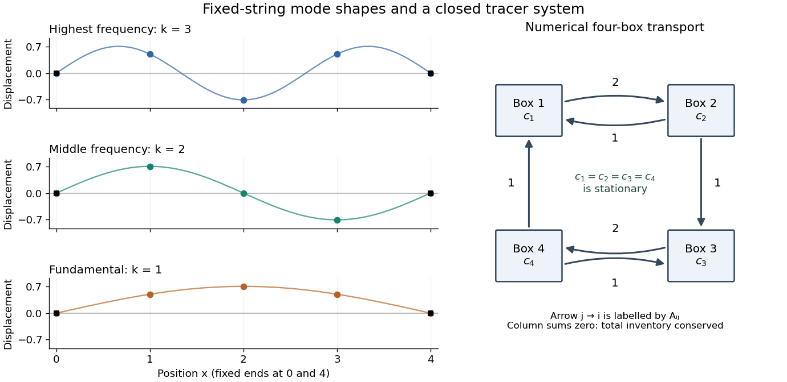

**[Figure 8](#5/e/image-three-fixed-string-normal-modes-and-conservative-four-box-transport). Three fixed-string normal modes and conservative four-box transport**. The left panels show the supplied unit [eigenvectors](../../linear-operator-theory.md#eigenvector) with zero endpoints; smooth sine curves guide the eye through the samples. The right panel is an original directed graph of the numerical transport [matrix](../../vector-space.md#matrix) in Question 6: every arrow from j to i is labelled by Aij. It is not a reproduction of source Figure 6.

## 6

↑ **Parent:** [Paper 3](paper-3.md)

<h3 id="6/a">a</h3>

↑ **Parent:** [6](#6)

<h4 id="6/a/solution">Solution</h4>

↑ **Parent:** [A](#6/a)

Apply [Gaussian elimination](../../numerical-linear-algebra.md#gaussian-elimination) to the supplied nonsymmetric [matrix](../../vector-space.md#matrix),

$$
A=\begin{pmatrix}-2&1&0&1\\2&-2&0&0\\0&1&-2&1\\0&0&2&-2\end{pmatrix}.
$$

The first [pivot element](../../numerical-linear-algebra.md#pivot-element) is $-2$, with [elimination multiplier](../../numerical-linear-algebra.md#elimination-multiplier) $l_{21}=2/(-2)=-1$. Perform $R_2\leftarrow R_2+R_1$, giving

$$
\begin{pmatrix}-2&1&0&1\\0&-1&0&1\\0&1&-2&1\\0&0&2&-2\end{pmatrix}.
$$

The second [pivot element](../../numerical-linear-algebra.md#pivot-element) is $-1$, with [elimination multiplier](../../numerical-linear-algebra.md#elimination-multiplier) $l_{32}=-1$. Perform $R_3\leftarrow R_3+R_2$, then use the third [pivot element](../../numerical-linear-algebra.md#pivot-element) $-2$ and [elimination multiplier](../../numerical-linear-algebra.md#elimination-multiplier) $l_{43}=-1$ to perform $R_4\leftarrow R_4+R_3$. The [LU factorization](../../numerical-linear-algebra.md#lu-decomposition) is

$$
\boxed{A=LU,\qquad
L=\begin{pmatrix}1&0&0&0\\-1&1&0&0\\0&-1&1&0\\0&0&-1&1\end{pmatrix},\qquad
U=\begin{pmatrix}-2&1&0&1\\0&-1&0&1\\0&0&-2&2\\0&0&0&0\end{pmatrix}.}
$$

Here $L$ is a unit [lower triangular matrix](../../linear-algebra.md#lower-triangular-matrix), hence an [invertible matrix](../../linear-algebra.md#invertible-matrix), and $U$ is an [upper triangular matrix](../../linear-algebra.md#upper-triangular-matrix). No row interchange is needed: all three [pivot elements](../../numerical-linear-algebra.md#pivot-element) used in elimination are nonzero. The final diagonal entry is zero, with an entirely zero last row; there is no further division by it. The three nonzero rows of $U$ are [linearly independent](../../vector-space.md#linear-independence), so **the [matrix rank](../../vector-space.md#matrix-rank) is $3$** and $A$ is a [singular matrix](../../linear-algebra.md#singular-matrix). Direct [matrix multiplication](../../vector-space.md#matrix-multiplication) gives $LU=A$.

<h3 id="6/b">b</h3>

↑ **Parent:** [6](#6)

<h4 id="6/b/solution">Solution</h4>

↑ **Parent:** [B](#6/b)

Since $L$ is an [invertible matrix](../../linear-algebra.md#invertible-matrix), $Av=0$ is equivalent to $Uv=0$. The last nontrivial row gives $v_3=v_4$; the second gives $v_2=v_4$; and the first gives $2v_1=v_2+v_4$, so $v_1=v_4$. A [basis](../../vector-space.md#basis) of the [null space](../../kernel-of-a-linear-map.md) is therefore

$$
\boxed{\mathcal B_{\ker A}=\{(1,1,1,1)^T\}.}
$$

Its single [basis vector](../../vector-space.md#basis-vector) has [Euclidean norm](../../normed-vector-space.md#euclidean-norm) $2$, so the unit [null space](../../kernel-of-a-linear-map.md) [basis vector](../../vector-space.md#basis-vector) is $(1,1,1,1)^T/2$.

The [pivot elements](../../numerical-linear-algebra.md#pivot-element) of $U$ lie in columns $1,2,3$. Take these columns from the **original** [matrix](../../vector-space.md#matrix) $A$ to obtain a [basis](../../vector-space.md#basis) of its [column space](../../vector-space.md#column-space):

$$
\boxed{\mathcal B_{\operatorname{Col} A}=
\left\{\begin{pmatrix}-2\\2\\0\\0\end{pmatrix},
\begin{pmatrix}1\\-2\\1\\0\end{pmatrix},
\begin{pmatrix}0\\0\\-2\\2\end{pmatrix}\right\}.}
$$

The fourth column is minus the sum of these three columns, and the leading three-by-three [matrix minor](../../vector-space.md#minor-linear-algebra) has nonzero [determinant](../../multilinear-algebra.md#determinant) $-4$, confirming [linear independence](../../vector-space.md#linear-independence).

[Elementary row operations](../../numerical-linear-algebra.md#elementary-row-operation) preserve the [row space](../../vector-space.md#row-space). Thus the nonzero rows of $U$ give a [basis](../../vector-space.md#basis) of the [row space](../../vector-space.md#row-space) of $A$:

$$
\boxed{\mathcal B_{\operatorname{Row} A}=
\{(-2,1,0,1),\ (0,-1,0,1),\ (0,0,-2,2)\}.}
$$

These [basis vectors](../../vector-space.md#basis-vector) need not have unit [Euclidean norm](../../normed-vector-space.md#euclidean-norm) or be [orthogonal](../../inner-product.md#orthogonal-vectors). Their [Euclidean norms](../../normed-vector-space.md#euclidean-norm) are $\sqrt6,\sqrt2,2\sqrt2$, respectively; the three column [basis vectors](../../vector-space.md#basis-vector) have [Euclidean norms](../../normed-vector-space.md#euclidean-norm) $2\sqrt2,\sqrt6,2\sqrt2$.

<h3 id="6/c">c</h3>

↑ **Parent:** [6](#6)

<h4 id="6/c/solution">Solution</h4>

↑ **Parent:** [C](#6/c)

Regard $A$ as a [linear map](../../vector-space.md#linear-map) $\mathbb R^4\to\mathbb R^4$. By the [rank-nullity theorem](../../kernel-of-a-linear-map.md#rank-nullity-theorem) and [matrix rank](../../vector-space.md#matrix-rank) $3$,

$$
\boxed{\dim\ker A=4-3=1,\qquad
\dim\operatorname{Col} A=3,\qquad
\dim\operatorname{Row} A=3.}
$$

All three are [vector subspaces](../../vector-space.md#vector-subspace) of $\mathbb R^4$, with the [row space](../../vector-space.md#row-space) identified with four-component row [vectors](../../vector-space.md#vector) in the usual way. The [null space](../../kernel-of-a-linear-map.md) lies in the input [vector space](../../vector-space.md) of [concentrations](../../mathematical-physics.md#concentration); the [column space](../../vector-space.md#column-space) lies in the output [vector space](../../vector-space.md) of concentration-change rates. Both have four coordinates, although they play different physical roles.

In this particular [matrix](../../vector-space.md#matrix), the row sums and column sums both vanish. Put $\mathbf1=(1,1,1,1)^T$. Then $A\mathbf1=0$ and $\mathbf1^TA=0$, and the two three-dimensional [vector subspaces](../../vector-space.md#vector-subspace) coincide:

$$
\operatorname{Col} A=\operatorname{Row} A
=\{v\in\mathbb R^4:\mathbf1^Tv=0\}.
$$

This equality follows here from both sum identities and the [dimensions of a vector space](../../vector-space.md#dimension-vector-space); it does not make $A$ a [symmetric matrix](../../linear-algebra.md#symmetric-matrix) and is not true for every [square matrix](../../vector-space.md#square-matrix).

<h3 id="6/d">d</h3>

↑ **Parent:** [6](#6)

<h4 id="6/d/solution">Solution</h4>

↑ **Parent:** [D](#6/d)

The [null space](../../kernel-of-a-linear-map.md) consists of [concentration](../../mathematical-physics.md#concentration) patterns on which transport produces no change. Here it is the family

$$
\boxed{\mathbf c=\alpha\mathbf1.}
$$

Every box has the same [concentration](../../mathematical-physics.md#concentration). [Ocean circulation](../../geophysical-fluid-dynamics.md#ocean-circulation) may continue, but inflow and outflow of the [chemical tracer](../../chemistry.md#chemical-tracer) balance in each box. With $\mathbf b=0$ these are exactly the [steady states](../../dynamical-systems.md#steady-state); physically admissible members have $\alpha\ge0$. With nonzero $\mathbf b$, adding $\alpha\mathbf1$ to any particular [steady state](../../dynamical-systems.md#steady-state) leaves its transport balance unchanged, but a [null space](../../kernel-of-a-linear-map.md) [vector](../../vector-space.md#vector) alone need not balance the sources and sinks.

To identify the tracer inventory, apply [conserved inventory from a left null vector](../../kernel-of-a-linear-map.md#conserved-inventory-from-a-left-null-vector). Directly summing each column gives

$$
\mathbf1^TA=(-2+2,\ 1-2+1,\ -2+2,\ 1+1-2)=(0,0,0,0).
$$

Consequently, for the supplied [ordinary differential equations](../../differential-equation.md#ordinary-differential-equation),

$$
M(t)=\mathbf1^T\mathbf c(t),\qquad
\frac{dM}{dt}=-\mathbf1^T\mathbf b.
$$

For $\mathbf b=0$, $M$ is a [conserved quantity](../../hamiltonian-mechanics.md#conserved-quantity). The connected [box model](../../mathematics.md#box-model) equalizes [concentrations](../../mathematical-physics.md#concentration), approaching the unique member of the [null space](../../kernel-of-a-linear-map.md) with the initial inventory:

$$
\boxed{\mathbf c(t)\longrightarrow\frac{\mathbf1^T\mathbf c(0)}4\mathbf1.}
$$

The [arithmetic mean](../../arithmetic.md#arithmetic-mean) is appropriate here because the supplied [matrix](../../vector-space.md#matrix) has zero column sums. In a general [box model](../../mathematics.md#box-model) the conserved quantity is $w^T\mathbf c$, where $w$ is a positive [left null space](../../kernel-of-a-linear-map.md#left-null-space) [vector](../../vector-space.md#vector); for physical [concentrations](../../mathematical-physics.md#concentration) expressed per unit [volume](../../geometry-and-topology.md#volume), these weights represent the box [volumes](../../geometry-and-topology.md#volume) up to a common factor. One must establish the weights from the equations, rather than infer equal [volumes](../../geometry-and-topology.md#volume) from a schematic drawing.

Nonnegative initial [concentrations](../../mathematical-physics.md#concentration) remain nonnegative under transport alone. Indeed $A+2I$ is a [nonnegative matrix](../../vector-space.md#nonnegative-matrix), so

$$
e^{tA}=e^{-2t}\sum_{k=0}^{\infty}\frac{t^k(A+2I)^k}{k!}
$$

has nonnegative entries for $t\ge0$: it is a [positive matrix semigroup](../../linear-operator-theory.md#positive-matrix-semigroup). Its column sums are one by $\mathbf1^TA=0$. To see why equalization occurs, set $d=\mathbf c-(M/4)\mathbf1$ for $\mathbf b=0$; then $\mathbf1^Td=0$ and

$$
\frac{d}{dt}\frac{\|d\|_2^2}{2}
=d^TAd=-\frac12\bigl[3(d_1-d_2)^2+(d_1-d_4)^2+(d_2-d_3)^2+3(d_3-d_4)^2\bigr].
$$

The right side vanishes only for constant $d$, which in the zero-sum [vector subspace](../../vector-space.md#vector-subspace) means $d=0$. Its strict negative bound on the [unit sphere](../../topology.md#unit-sphere) in that [vector subspace](../../vector-space.md#vector-subspace) gives decay to zero. Thus the [matrix exponential](../../linear-operator-theory.md#matrix-exponential) redistributes inventory without creating negative [concentrations](../../mathematical-physics.md#concentration); arbitrary prescribed sinks can still exhaust the tracer if they are allowed to act indefinitely.

<h3 id="6/e">e</h3>

↑ **Parent:** [6](#6)

<h4 id="6/e/solution">Solution</h4>

↑ **Parent:** [E](#6/e)

A [steady state](../../dynamical-systems.md#steady-state) $\mathbf c_*$ satisfies $0=A\mathbf c_*-\mathbf b$, hence

$$
A\mathbf c_*=\mathbf b.
$$

The sign is positive on the right after rearranging the supplied equation. A solution exists exactly when $\mathbf b$ lies in the [column space](../../vector-space.md#column-space) of $A$, which above was found to be the zero-sum [vector subspace](../../vector-space.md#vector-subspace). Equivalently, multiply by the [left null space](../../kernel-of-a-linear-map.md#left-null-space) [vector](../../vector-space.md#vector) $\mathbf1^T$:

$$
\boxed{\mathbf1^T\mathbf b=b_1+b_2+b_3+b_4=0.}
$$

This condition is necessary and sufficient for an algebraic [steady state](../../dynamical-systems.md#steady-state), since both the [column space](../../vector-space.md#column-space) and that zero-sum [vector subspace](../../vector-space.md#vector-subspace) have [dimension](../../vector-space.md#dimension-vector-space) $3$. It expresses global [conservation of mass](../../continuum-mechanics.md#mass-conservation): in the closed [box model](../../mathematics.md#box-model), total tracer production must balance total tracer removal. With the paper's convention $-\mathbf b$, a positive $b_i$ is a sink and a negative $b_i$ is a source. If the sum is nonzero, $dM/dt=-\sum_i b_i$ and the inventory changes linearly in time, preventing a [steady state](../../dynamical-systems.md#steady-state).

When the condition holds, all algebraic [steady states](../../dynamical-systems.md#steady-state) form the [affine solution space of a linear equation](../../linear-algebra.md#affine-solution-space-of-a-linear-equation) $\mathbf c_p+\alpha\mathbf1$, for any particular solution $A\mathbf c_p=\mathbf b$. The initial inventory selects one member through $\mathbf1^T\mathbf c_* =\mathbf1^T\mathbf c(0)$. For a physically admissible solution, its four [concentrations](../../mathematical-physics.md#concentration) must additionally be nonnegative; the compatibility condition alone imposes no such inequalities.

<h3 id="6/f">f</h3>

↑ **Parent:** [6](#6)

<h4 id="6/f/solution">Solution</h4>

↑ **Parent:** [F](#6/f)

Choose a fixed time increment $h=\Delta t>0$, let $t_n=nh$, and approximate $\mathbf c(t_n)$ by $\mathbf c_n$. The [Backward Euler method](../../numerical-analysis.md#backward-euler-method) evaluates the transport term at the new time:

$$
\frac{\mathbf c_{n+1}-\mathbf c_n}{h}=A\mathbf c_{n+1}-\mathbf b.
$$

Rearrange to the [linear system](../../linear-algebra.md#system-of-linear-equations)

$$
\boxed{B\mathbf c_{n+1}=\mathbf c_n-h\mathbf b,\qquad
B=I-hA=\begin{pmatrix}
1+2h&-h&0&-h\\
-2h&1+2h&0&0\\
0&-h&1+2h&-h\\
0&0&-2h&1+2h
\end{pmatrix}.}
$$

Although $A$ is a [singular matrix](../../linear-algebra.md#singular-matrix), $B$ is an [invertible matrix](../../linear-algebra.md#invertible-matrix) for every $h>0$. In each row, its diagonal entry is $1+2h$ and the sum of the [absolute values](../../real-analysis.md#absolute-value) of its off-diagonal entries is $2h$; hence it is a [strictly diagonally dominant matrix](../../vector-space.md#strictly-diagonally-dominant-matrix). Its [Gershgorin discs](../../numerical-analysis.md#gershgorin-disc) have centre $1+2h$ and radius $2h$, excluding zero. In particular, the zero [eigenvalue](../../linear-operator-theory.md#eigenvalue) of $A$ becomes an [eigenvalue](../../linear-operator-theory.md#eigenvalue) $1$ of $B$.

The algorithm uses [Reusing LU factors for multiple right-hand sides](../../numerical-linear-algebra.md#reusing-lu-factors-for-multiple-right-hand-sides):

- Form $B$ once. Compute a [Pivoted LU decomposition](../../numerical-linear-algebra.md#pivoted-lu-decomposition) $PB=L_B U_B$, storing the [permutation matrix](../../vector-space.md#permutation-matrix) $P$, the unit [lower triangular matrix](../../linear-algebra.md#lower-triangular-matrix) $L_B$, and the [upper triangular matrix](../../linear-algebra.md#upper-triangular-matrix) $U_B$.
- Set $\mathbf c_0=\mathbf c(0)$.
- At each step form $r_n=\mathbf c_n-h\mathbf b$. Solve $L_B y=Pr_n$ by [forward substitution](../../numerical-linear-algebra.md#forward-substitution), then solve $U_B\mathbf c_{n+1}=y$ by [back substitution](../../linear-algebra.md#back-substitution).
- Advance $n$ and repeat until the desired final time. Choose the fixed increment so the final time is an integer multiple of $h$, or refactor $B$ if a shorter final step is used.

Both triangular solves use the factors of **$I-hA$**. The [LU factorization](../../numerical-linear-algebra.md#lu-decomposition) of the singular transport [matrix](../../vector-space.md#matrix) $A$ from part (a) is not a solver for this new [linear system](../../linear-algebra.md#system-of-linear-equations). No [matrix inverse](../../matrix-inverse.md) needs to be formed. Since $A$ and $h$ are fixed, the same [LU factorization](../../numerical-linear-algebra.md#lu-decomposition) serves every step; only the right-hand side changes. A varying $\mathbf b(t)$ would give $r_n=\mathbf c_n-h\mathbf b(t_{n+1})$ without changing these factors.

As a check, multiplying the update by $\mathbf1^T$ gives

$$
\mathbf1^T\mathbf c_{n+1}=\mathbf1^T\mathbf c_n-h\mathbf1^T\mathbf b,
$$

exactly reproducing the inventory balance at the sampled times, apart from [roundoff error](../../numerical-analysis.md#round-off-error). The [Backward Euler method](../../numerical-analysis.md#backward-euler-method) has temporal [global error](../../numerical-analysis.md#global-discretization-error) $O(h)$ for smooth solutions, so its [A-stability](../../numerical-analysis.md#a-stability) does not remove the need to select $h$ for accuracy.

## 7

↑ **Parent:** [Paper 3](paper-3.md)

<h3 id="7/a">a</h3>

↑ **Parent:** [7](#7)

<h4 id="7/a/solution">Solution</h4>

↑ **Parent:** [A](#7/a)

Set $\omega=2\pi/T$ and $q=m+n$. If $q=0$, the integrand is one and its [integral](../../integral.md) is $T$. If $q$ is a nonzero [integer](../../integer.md),

$$
\int_0^T e^{i\omega qt}\,dt
=\frac{e^{i2\pi q}-1}{i\omega q}=0.
$$

Thus

$$
\boxed{\int_0^T e^{i\omega mt}e^{i\omega nt}\,dt=T\,\mathbf1_{m=-n}.}
$$

This is [Fourier orthogonality](../../fourier-series.md#fourier-orthogonality) in its unconjugated form. With a [complex conjugate](../../complex-analysis.md#complex-conjugate) on the second exponential, the nonzero case would instead be $m=n$.

<h3 id="7/b">b</h3>

↑ **Parent:** [7](#7)

<h4 id="7/b/solution">Solution</h4>

↑ **Parent:** [B](#7/b)

Multiply the [complex Fourier series](../../fourier-series.md#complex-fourier-series) by $e^{-i\omega rt}$ and integrate over one [period](../../mathematics.md#period-of-a-function). [Fourier orthogonality](../../fourier-series.md#fourier-orthogonality) removes every term except the one with index $r$, giving

$$
\boxed{u_r=\frac1T\int_0^Tf(t)e^{-i\omega rt}\,dt.}
$$

For general [square-integrable functions](../../measure-theory.md#square-integrable-function), this is an [orthogonal projection](../../hilbert-space.md#orthogonal-projection) onto the corresponding [Fourier mode](../../fourier-analysis.md#fourier-mode). It remains valid when the expansion converges only in [L2 space](../../measure-theory.md#l2-space-is-a-hilbert-space): integrate finite [Fourier partial sums](../../fourier-series.md#fourier-partial-sum) first, then pass to the limit using the [Cauchy-Schwarz inequality](../../probability-and-statistics.md#cauchy-schwarz-inequality). No unjustified pointwise exchange of an infinite series and an integral is needed.

<h3 id="7/c">c</h3>

↑ **Parent:** [7](#7)

The displayed signal is a [square wave](../../fourier-series.md#square-wave) with levels $+1\,\mathrm V$ and $-1\,\mathrm V$, each lasting two seconds. On a representative period it is positive for $0<t<2\,\mathrm s$ and negative for $2<t<4\,\mathrm s$.

<h4 id="7/c/i">i</h4>

↑ **Parent:** [C](#7/c)

<h5 id="7/c/i/solution">Solution</h5>

↑ **Parent:** [I](#7/c/i)

The positive and negative contributions to the [integral](../../integral.md) cancel. Hence the [mean](../../expected-value.md) is **$0\,\mathrm V$**.

<h4 id="7/c/ii">ii</h4>

↑ **Parent:** [C](#7/c)

<h5 id="7/c/ii/solution">Solution</h5>

↑ **Parent:** [Ii](#7/c/ii)

The waveform repeats after one positive and one negative interval, so its fundamental [period](../../mathematics.md#period-of-a-function) is **$T=4\,\mathrm s$**. A two-second shift reverses its sign and is not a period.

<h4 id="7/c/iii">iii</h4>

↑ **Parent:** [C](#7/c)

<h5 id="7/c/iii/solution">Solution</h5>

↑ **Parent:** [Iii](#7/c/iii)

The ordinary [frequency](../../wave.md#frequency) is **$\nu=1/T=0.25\,\mathrm{Hz}$**, or one quarter of a cycle per second.

<h4 id="7/c/iv">iv</h4>

↑ **Parent:** [C](#7/c)

<h5 id="7/c/iv/solution">Solution</h5>

↑ **Parent:** [Iv](#7/c/iv)

The [angular frequency](../../lagrangian-mechanics.md#angular-frequency) is **$\omega=2\pi/T=\pi/2\,\mathrm{rad\,s^{-1}}$**. This is distinct from the ordinary [frequency](../../wave.md#frequency) in cycles per second.

<h4 id="7/c/v">v</h4>

↑ **Parent:** [C](#7/c)

<h5 id="7/c/v/solution">Solution</h5>

↑ **Parent:** [V](#7/c/v)

The [amplitude](../../wave.md#wave-amplitude) relative to the zero [mean](../../expected-value.md) is **$1\,\mathrm V$**. The peak-to-peak excursion is $2\,\mathrm V$.

<h3 id="7/d">d</h3>

↑ **Parent:** [7](#7)

<h4 id="7/d/solution">Solution</h4>

↑ **Parent:** [D](#7/d)

The zero [Fourier coefficient](../../fourier-series.md#fourier-coefficient) is $u_0=0$. For a nonzero integer $r$, integrate the two constant halves:

$$
\begin{aligned}
u_r&=\frac{1\,\mathrm V}{4\,\mathrm s}\left[\int_0^{2\,\mathrm s}e^{-ir\omega t}\,dt-\int_{2\,\mathrm s}^{4\,\mathrm s}e^{-ir\omega t}\,dt\right]\\
&=\frac{1-(-1)^r}{i\pi r}\,\mathrm V.
\end{aligned}
$$

Consequently

$$
\boxed{u_0=0,\qquad
u_r=\begin{cases}-2i/(\pi r)\,\mathrm V,&r\text{ odd},\\0,&r\ne0\text{ even}.\end{cases}}
$$

The [complex Fourier series](../../fourier-series.md#complex-fourier-series) is $g(t)\sim\sum_{r\in\mathbb Z}u_re^{ir\pi t/(2\,\mathrm s)}$. The negative-index coefficients are the [complex conjugates](../../complex-analysis.md#complex-conjugate) of the positive-index ones, as required for a real signal. Combining each pair gives the equivalent real expansion

$$
g(t)\sim\frac{4\,\mathrm V}{\pi}\sum_{j=0}^{\infty}\frac{\sin[(2j+1)\pi t/(2\,\mathrm s)]}{2j+1}.
$$

At a jump, [pointwise convergence of a piecewise smooth Fourier series](../../fourier-series.md#pointwise-convergence-of-a-piecewise-smooth-fourier-series) gives zero, the average of the two one-sided limits. The value assigned to $g$ at isolated jumps does not affect its [Fourier coefficients](../../fourier-series.md#fourier-coefficient) or [mean-square signal power](../../electrical-engineering.md#signal-power).

<h3 id="7/e">e</h3>

↑ **Parent:** [7](#7)

<h4 id="7/e/solution">Solution</h4>

↑ **Parent:** [E](#7/e)

The squared signal equals $1\,\mathrm{V^2}$ except at irrelevant isolated jump times. Its [mean-square signal power](../../electrical-engineering.md#signal-power) is therefore

$$
\boxed{P=\frac1{4\,\mathrm s}\int_0^{4\,\mathrm s}|g(t)|^2\,dt=1\,\mathrm{V^2}.}
$$

Here “power” has the signal-processing definition specified in the question. To convert this voltage mean square into electrical [power](../../energy.md#power) in watts, a load [electrical resistance](../../electric-charge.md#electrical-resistance) would also be required: $P_{\rm electrical}=\langle g^2\rangle/R$.

<h3 id="7/f">f</h3>

↑ **Parent:** [7](#7)

<h4 id="7/f/solution">Solution</h4>

↑ **Parent:** [F](#7/f)

Use [Parseval identity for Fourier series](../../fourier-analysis.md#parseval-identity-for-fourier-series) with the coefficient normalization above. Only [odd](../../calculus.md#odd-function) nonzero indices contribute; summing the positive and negative indices gives

$$
1=\sum_{r\in\mathbb Z}\frac{|u_r|^2}{\mathrm{V^2}}
=\frac8{\pi^2}\sum_{j=0}^{\infty}\frac1{(2j+1)^2}.
$$

Thus

$$
\boxed{\sum_{j=0}^{\infty}\frac1{(2j+1)^2}=\frac{\pi^2}{8}.}
$$

The factor of two from the negative [frequencies](../../wave.md#frequency) is essential. The discontinuities do not obstruct [Parseval's identity](../../fourier-analysis.md#parseval-identity), which is a statement about [L2 space](../../measure-theory.md#l2-space-is-a-hilbert-space).

<h3 id="7/g">g</h3>

↑ **Parent:** [7](#7)

<h4 id="7/g/solution">Solution</h4>

↑ **Parent:** [G](#7/g)

Most of the [mean-square signal power](../../electrical-engineering.md#signal-power) lies at low [frequencies](../../wave.md#frequency). Each nonzero coefficient has magnitude $2/(\pi|r|)\,\mathrm V$, so its power contribution decreases as $r^{-2}$. The pair at the fundamental frequencies $\pm0.25\,\mathrm{Hz}$ alone contains

$$
\boxed{\frac8{\pi^2}\simeq81.1\%}
$$

of the total. The first three positive odd harmonics, together with their negative-frequency partners, contain about $93.3\%$. The [harmonic power of a square wave](../../fourier-series.md#harmonic-power-of-a-square-wave) still has a nonzero tail: higher harmonics are needed to reproduce sharp edges even though their combined power is small.

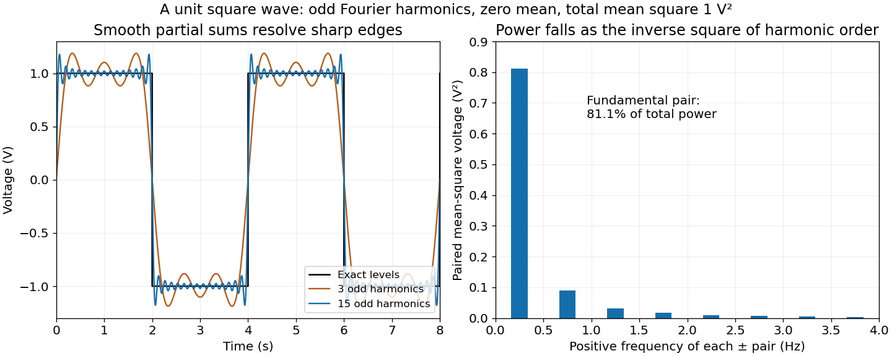

**[Figure 9](#7/g/image-odd-fourier-harmonics-reconstruct-a-unit-square-wave-and-concentrate-most-power-in-the-fundamental). Odd Fourier harmonics reconstruct a unit square wave and concentrate most power in the fundamental**. Original analytic calculations. The reconstruction and paired-harmonic powers use the derived exact coefficients, rather than the supplied noisy spectral illustration. The horizontal axis is time in seconds; voltage and mean-square voltage units are retained.

<h3 id="7/h">h</h3>

↑ **Parent:** [7](#7)

<h4 id="7/h/solution">Solution</h4>

↑ **Parent:** [H](#7/h)

Apply a [Fourier transform](../../fourier-transform.md) or [discrete Fourier transform](../../discrete-fourier-transform.md), retain the desired low-frequency coefficients and attenuate those in the high-frequency noise band with a [low-pass filter](../../electrical-engineering.md#low-pass-filter), then invert. For a real signal, apply matching gains at positive and negative [frequencies](../../wave.md#frequency) to preserve [Hermitian symmetry](../../fourier-transform.md#hermitian-symmetry).

[Parseval identity for Fourier series](../../fourier-analysis.md#parseval-identity-for-fourier-series) shows what an ideal coefficient cutoff does: the output [mean-square signal power](../../electrical-engineering.md#signal-power) is the sum of the retained squared coefficients, and cannot exceed that of the unfiltered input. Much of the high-frequency noise can be removed, but a finite cutoff also removes genuine [square wave](../../fourier-series.md#square-wave) harmonics. Its edges become less sharp, and a sharp spectral cutoff can exhibit the [Gibbs phenomenon](../../fourier-series.md#gibbs-phenomenon). There is no claim of exact recovery if the noise overlaps the retained band. Noise already folded into low frequencies by [aliasing](../../fourier-analysis.md#aliasing) cannot in general be removed merely by discarding the high-frequency bins afterward.

## 8

↑ **Parent:** [Paper 3](paper-3.md)

<h3 id="8/a">a</h3>

↑ **Parent:** [8](#8)

<h4 id="8/a/i">i</h4>

↑ **Parent:** [A](#8/a)

<h5 id="8/a/i/solution">Solution</h5>

↑ **Parent:** [I](#8/a/i)

The consistent matching is:

| Machine | Time series | Variance spectrum |
| --- | --- | --- |
| 1 | B | Z |
| 2 | C | W |
| 3 | D | X |
| 4 | A | Y |

Series C stops after about six months, identifying machine 2. Its short record gives spectrum W a coarser [Fourier frequency resolution](../../discrete-fourier-transform.md#fourier-frequency-resolution). Series A resolves the annual variation but misses the changing daily phase: the regular three-day interval samples the daily oscillation at the same phase, so its daily contribution aliases to a constant. Its spectrum is Y. Machine 3 produces the half-daily-frequency alias in X, leaving D as its time series. The fully sampled two-year record B and spectrum Z agree with the supplied first row.

These identifications use the record lengths, frequency locations and sampling intervals. They do not require assuming that the plotted spectral heights have an identical normalization.

<h4 id="8/a/ii">ii</h4>

↑ **Parent:** [A](#8/a)

<h5 id="8/a/ii/solution">Solution</h5>

↑ **Parent:** [Ii](#8/a/ii)

Sixteen hours is $2/3$ of a day, so the [sampling rate](../../wave-equation.md#sampling-rate) is

$$
\boxed{f_s=\frac1{16\,\mathrm h}=1.5\,\mathrm{day^{-1}}
\simeq1.7361\times10^{-5}\,\mathrm{Hz}.}
$$

<h4 id="8/a/iii">iii</h4>

↑ **Parent:** [A](#8/a)

<h5 id="8/a/iii/solution">Solution</h5>

↑ **Parent:** [Iii](#8/a/iii)

The conventional [Nyquist frequency](../../fourier-analysis.md#nyquist-frequency) is

$$
\boxed{f_N=f_s/2=0.75\,\mathrm{day^{-1}},\qquad T_N=1/f_N=32\,\mathrm h.}
$$

Frequencies above this cutoff are indistinguishable from lower-frequency [sampled sinusoid aliases](../../discrete-fourier-transform.md#sampled-sinusoid-alias). The [Nyquist–Shannon sampling theorem](../../fourier-analysis.md#nyquist-shannon-sampling-theorem) requires a band limit strictly below the cutoff for general phase information: at exactly the cutoff, some phases can give zero samples. Thus $32$ hours is the conventional limiting period, with unambiguous reconstruction requiring a longer period under those sampling assumptions.

<h4 id="8/a/iv">iv</h4>

↑ **Parent:** [A](#8/a)

<h5 id="8/a/iv/solution">Solution</h5>

↑ **Parent:** [Iv](#8/a/iv)

The true daily component has $f_D=1\,\mathrm{day^{-1}}$, above machine 3's [Nyquist frequency](../../fourier-analysis.md#nyquist-frequency). At sampling times $t_n=2n/3$ days,

$$
\cos(2\pi t_n)=\cos(4\pi n/3)=\cos(2\pi n/3).
$$

The last sequence is also produced by a continuous cosine with frequency $0.5\,\mathrm{day^{-1}}$ sampled at those same times. Hence the observed peak is the [sampled sinusoid alias](../../discrete-fourier-transform.md#sampled-sinusoid-alias)

$$
\boxed{f_{\rm alias}=|f_D-f_s|=0.5\,\mathrm{day^{-1}}.}
$$

It is not evidence for an additional two-day physical temperature cycle.

<h4 id="8/a/v">v</h4>

↑ **Parent:** [A](#8/a)

<h5 id="8/a/v/solution">Solution</h5>

↑ **Parent:** [V](#8/a/v)

The source text and its figure are inconsistent here. **The plotted low-frequency maximum in W is near $0.0055\,\mathrm{day^{-1}}$, rather than the printed $0.055\,\mathrm{day^{-1}}$.** The original PDF shows that this discrepancy is already present in the examination, rather than introduced by transcription.

Machine 2 records only about half a year. Its first nonzero [discrete Fourier transform](../../discrete-fourier-transform.md) bin is therefore at

$$
\Delta f\simeq\frac1{180\text{--}183\,\mathrm{days}}
\simeq0.0055\,\mathrm{day^{-1}}.
$$

The annual component near $1/365\,\mathrm{day^{-1}}$ is below that first bin. The finite [window function](../../fourier-transform.md#window-function) spreads it through [spectral leakage](../../fourier-transform.md#spectral-leakage), with a prominent first-bin contribution. This explains the plotted peak without invoking a new physical period.

A literal peak at $0.055\,\mathrm{day^{-1}}$ would instead have a period of about $18.2$ days. Neither the two stated model frequencies nor the given sampling schedule identifies such a separate component. The interpretation above treats the printed decimal as an apparent typo; it does not silently change the stated number.

<h4 id="8/a/vi">vi</h4>

↑ **Parent:** [A](#8/a)

<h5 id="8/a/vi/solution">Solution</h5>

↑ **Parent:** [Vi](#8/a/vi)

The adequately sampled record shows a yearly cycle and a daily cycle. Up to exchanging their labels,

$$
\boxed{\omega_Y=2\pi\,\mathrm{yr^{-1}},\qquad
\omega_D=2\pi\,\mathrm{day^{-1}}.}
$$

Using $365$ days per year for numerical estimates,

$$
\omega_Y\simeq1.99\times10^{-7}\,\mathrm{rad\,s^{-1}},\qquad
\omega_D\simeq7.27\times10^{-5}\,\mathrm{rad\,s^{-1}}.
$$

These are [angular frequencies](../../lagrangian-mechanics.md#angular-frequency). The corresponding ordinary [frequencies](../../wave.md#frequency) are $1\,\mathrm{yr^{-1}}$ and $1\,\mathrm{day^{-1}}$.

<h3 id="8/b">b</h3>

↑ **Parent:** [8](#8)

<h4 id="8/b/solution">Solution</h4>

↑ **Parent:** [B](#8/b)

Write $\delta_j=\sqrt{2K/\omega_j}$ for each component's [thermal penetration depth](../../heat.md#thermal-penetration-depth). Its contribution at depth is

$$
C_j e^{-x/\delta_j}\cos(\omega_jt-x/\delta_j).
$$

Thus its [amplitude](../../wave.md#wave-amplitude) is multiplied by $e^{-x/\delta_j}$ and its [wave phase](../../wave.md#phase-waves) lags the surface by $x/\delta_j$ radians. The corresponding unwrapped time lag is $x/(\delta_j\omega_j)$; a phase measured from a single periodic signal is observable only modulo $2\pi$.

Higher-frequency variations have smaller penetration depths. In particular,

$$
\boxed{\frac{\delta_Y}{\delta_D}=\sqrt{\frac{\omega_D}{\omega_Y}}\simeq\sqrt{365}\simeq19.1.}
$$

The daily oscillation is therefore strongly attenuated at depths where a substantial annual oscillation survives. This is a [thermal diffusion wave](../../heat.md#thermal-diffusion-wave), whose phase lag is not the arrival time of a sharp thermal front. The displayed solution is the established periodic response; an additional transient would depend on initial subsurface data not needed for this interpretation.

<h3 id="8/c">c</h3>

↑ **Parent:** [8](#8)

For the sketches, take $A$ to multiply the annual component and $B$ the daily component. Their amplitudes are left as parameters, as in the model.

<h4 id="8/c/i">i</h4>

↑ **Parent:** [C](#8/c)

<h5 id="8/c/i/solution">Solution</h5>

↑ **Parent:** [I](#8/c/i)

At the surface both attenuation factors are one and both lags vanish:

$$
\boxed{\Theta(0,t)=\Theta_0+A\cos(\omega_Yt)+B\cos(\omega_Dt).}
$$

The sketch is a rapid daily oscillation on a slowly varying annual background. The [amplitudes](../../wave.md#wave-amplitude) cannot be inferred uniquely from the sampling intervals alone.

<h4 id="8/c/ii">ii</h4>

↑ **Parent:** [C](#8/c)

<h5 id="8/c/ii/solution">Solution</h5>

↑ **Parent:** [Ii](#8/c/ii)

At $x=10\delta_D$, the daily component is multiplied by $e^{-10}\simeq4.54\times10^{-5}$ and has a lag of ten radians. The annual component instead has $x/\delta_Y=10/\sqrt{365}\simeq0.5234$. Hence

$$
\boxed{\begin{aligned}
\Theta-\Theta_0={}&A e^{-10/\sqrt{365}}\cos(\omega_Yt-10/\sqrt{365})\\
&+B e^{-10}\cos(\omega_Dt-10).
\end{aligned}}
$$

The sketch is nearly a smooth annual sinusoid, with annual [amplitude](../../wave.md#wave-amplitude) **about $0.5925A$** and annual [phase lag](../../wave.md#phase-lag) **about $0.5234$ radians**, corresponding to about $30.4$ days on the chosen year scale. The tiny daily component is retained in the formula rather than declared identically zero.

<h4 id="8/c/iii">iii</h4>

↑ **Parent:** [C](#8/c)

<h5 id="8/c/iii/solution">Solution</h5>

↑ **Parent:** [Iii](#8/c/iii)

At $x=10\delta_Y$, the annual attenuation is $e^{-10}$ and the daily attenuation is $e^{-10\sqrt{365}}$, approximately $10^{-83}$. Thus

$$
\boxed{\begin{aligned}
\Theta-\Theta_0={}&A e^{-10}\cos(\omega_Yt-10)\\
&+B e^{-10\sqrt{365}}\cos(\omega_Dt-10\sqrt{365}).
\end{aligned}}
$$

On the same vertical scale as the surface plot this is **almost the constant $\Theta_0$**. With a sufficiently enlarged scale, a residual annual oscillation of [amplitude](../../wave.md#wave-amplitude) $4.54\times10^{-5}A$ remains. Its phase lag is ten radians, interpreted modulo $2\pi$ when comparing periodic maxima.

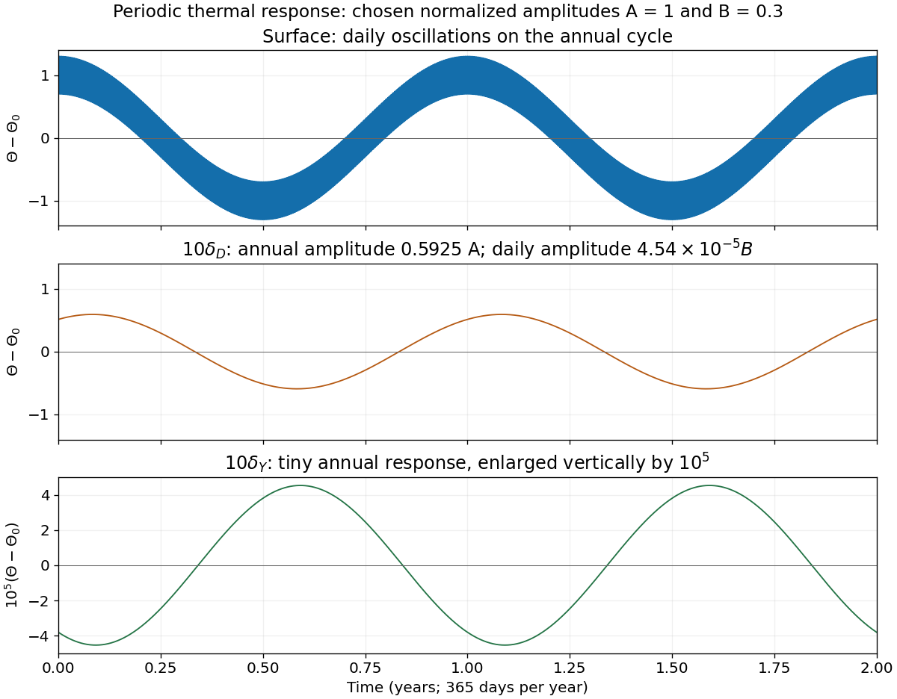

**[Figure 10](#8/c/iii/image-daily-and-annual-thermal-oscillations-at-the-surface-and-at-ten-daily-or-annual-penetration-depths). Daily and annual thermal oscillations at the surface and at ten daily or annual penetration depths**. Original calculation of the established periodic solution. The illustrative amplitudes are chosen as $A=1$ and $B=0.3$ in normalized temperature units; they are not fitted to the examination plots. The deepest response is enlarged by a factor of $10^5$ to make its tiny residual annual oscillation visible.

## 9

↑ **Parent:** [Paper 3](paper-3.md)

<h3 id="9/a">a</h3>

↑ **Parent:** [9](#9)

<h4 id="9/a/solution">Solution</h4>

↑ **Parent:** [A](#9/a)

At the one-bar [standard state](../../chemical-potential.md#standard-state), pure phases have unit [thermodynamic activities](../../chemical-potential.md#thermodynamic-activity). The [Gibbs energy of reaction](../../chemical-potential.md#gibbs-energy-of-reaction) balance is $\Delta_rH^\circ-T\Delta_rS^\circ=0$, giving

$$
\boxed{T=\frac{141120}{170.7}=826.714\,\mathrm K\simeq553.564\,{}^\circ\mathrm C.}
$$

This uses the stipulated temperature-independent reaction [enthalpy](../../enthalpy.md) and [entropy](../../entropy.md) differences, taken per mole of the written reaction.

<h3 id="9/b">b</h3>

↑ **Parent:** [9](#9)

<h4 id="9/b/solution">Solution</h4>

↑ **Parent:** [B](#9/b)

Apply the [pressure correction to a mineral reaction](../../chemical-potential.md#pressure-correction-to-a-mineral-reaction) to the solids and use the [chemical fugacity](../../chemical-potential.md#chemical-fugacity) of the water product. For pure solids and [water vapour](../../chemical-substance.md#water-vapor) treated as an [ideal gas](../../ideal-gas.md),

$$
0=\Delta_rH^\circ-T\Delta_rS^\circ+\Delta V_{\rm solids}(P-P_0)+RT\ln(P/P_0),
\qquad P_0=1\,\mathrm{bar}.
$$

The gas contribution is already included by the logarithm and must not be counted again as an independent volume correction. With pressures in bars,

$$
\boxed{T=\frac{141120-2.28(4500-1)}{170.7-8.3145\ln4500}
=1298.755\,\mathrm K\simeq1025.605\,{}^\circ\mathrm C.}
$$

<h3 id="9/c">c</h3>

↑ **Parent:** [9](#9)

<h4 id="9/c/solution">Solution</h4>

↑ **Parent:** [C](#9/c)

Adopt ideal independent [mixing on crystallographic sites](../../chemical-substance.md#mixing-on-crystallographic-sites), with Mg and Fe sharing three positions per formula unit and the other endmember sites fixed. This gives the [phlogopite](../../chemical-substance.md#phlogopite) and [pyrope](../../planetary-science.md#pyrope) activities

$$
a_{\rm phlogopite}=0.80^3,\qquad a_{\rm pyrope}=0.20^3.
$$

The [reaction quotient](../../chemical-potential.md#reaction-quotient) contains their ratio, since [pyrope](../../planetary-science.md#pyrope) is a product and [phlogopite](../../chemical-substance.md#phlogopite) a reactant. Consequently

$$
\boxed{T=\frac{130862.28}
{170.7-8.3145\ln[4500(0.20/0.80)^3]}
=966.923\,\mathrm K\simeq693.773\,{}^\circ\mathrm C.}
$$

The site-mixing assumption is part of this numerical answer: compositions alone do not determine nonideal [thermodynamic activities](../../chemical-potential.md#thermodynamic-activity). More detailed [activity coefficients](../../chemical-potential.md#activity-coefficient) or unequal site occupancies would need an additional model. The cube counts the three magnesium-bearing positions rather than three molecules of each mineral.

<h3 id="9/d">d</h3>

↑ **Parent:** [9](#9)

<h4 id="9/d/solution">Solution</h4>

↑ **Parent:** [D](#9/d)

For [fugacity coefficient](../../chemical-potential.md#fugacity-coefficient) $\phi=0.75$, use $f=\phi P=3375\,\mathrm{bar}$ for the water activity. The solid pressure correction still uses the actual pressure $4500\,\mathrm{bar}$. Thus

$$
\boxed{T=\frac{130862.28}
{170.7-8.3145\ln[3375(0.20/0.80)^3]}
=950.131\,\mathrm K\simeq676.981\,{}^\circ\mathrm C.}
$$

Lowering the water [chemical potential](../../chemical-potential.md) favours the product side, which lowers the equilibrium temperature relative to part (c) under the stated constant-property model.

## 10

↑ **Parent:** [Paper 3](paper-3.md)

<h3 id="10/i">i</h3>

↑ **Parent:** [10](#10)

<h4 id="10/i/solution">Solution</h4>

↑ **Parent:** [I](#10/i)

Use base-ten [logarithms](../../calculus.md#logarithm) and dimensionless [thermodynamic activities](../../chemical-potential.md#thermodynamic-activity) at the stated temperature and pressure. Define $x=\log_{10}a_{\mathrm{H_4SiO_4}}$ and $y=\log_{10}(a_{\mathrm{Na^+}}/a_{\mathrm{H^+}})$. The concentration notation is an ideal dilute-solution approximation with a consistent concentration reference.

With pure solids and unit water activity, the two [reaction quotients](../../chemical-potential.md#reaction-quotient) are $10^{2y+2x}$ and $10^{2y+6x}$. Equating them to the corresponding [equilibrium constants](../../chemical-potential.md#equilibrium-constant) gives

$$
\boxed{y=3.44-x,\qquad y=-7.59-3x.}
$$

The slopes on the [mineral activity diagram](../../thermodynamic-potential.md#mineral-activity-diagram) are $-1$ and $-3$. The lines meet at $(x_*,y_*)=(-5.515,8.955)$, within the negative silica-logarithm range.

<h3 id="10/ii">ii</h3>

↑ **Parent:** [10](#10)

<h4 id="10/ii/solution">Solution</h4>

↑ **Parent:** [Ii](#10/ii)

Subtract the nepheline–corundum reaction from the albite–corundum reaction and divide by two. In the albite-to-nepheline direction the resulting net reaction is

$$
\mathrm{NaAlSi_3O_8}+4\mathrm{H_2O}
\rightleftharpoons\mathrm{NaAlSiO_4}+2\mathrm{H_4SiO_4}.
$$

Additivity of the [standard Gibbs energy of reaction](../../chemical-potential.md#standard-gibbs-energy-of-reaction) makes the logarithms of the [equilibrium constants](../../chemical-potential.md#equilibrium-constant) combine with the same coefficients:

$$
\boxed{\log_{10}K=\frac{-15.18-6.88}{2}=-11.03.}
$$

This normalization is per one [albite](../../planetary-science.md#albite) formula unit. The doubled reaction has $\log_{10}K=-22.06$, and reversing the reaction changes its sign.

<h3 id="10/iii">iii</h3>

↑ **Parent:** [10](#10)

<h4 id="10/iii/solution">Solution</h4>

↑ **Parent:** [Iii](#10/iii)

The net [reaction quotient](../../chemical-potential.md#reaction-quotient) is $a_{\mathrm{H_4SiO_4}}^2$ when the solid and water activities equal one. Therefore its equilibrium line is

$$
\boxed{x=\tfrac12\log_{10}K=-5.515,}
$$

a vertical line through the intersection of the other two. There is no dependence on $y$, because the net reaction contains neither hydrogen ions nor sodium ions.

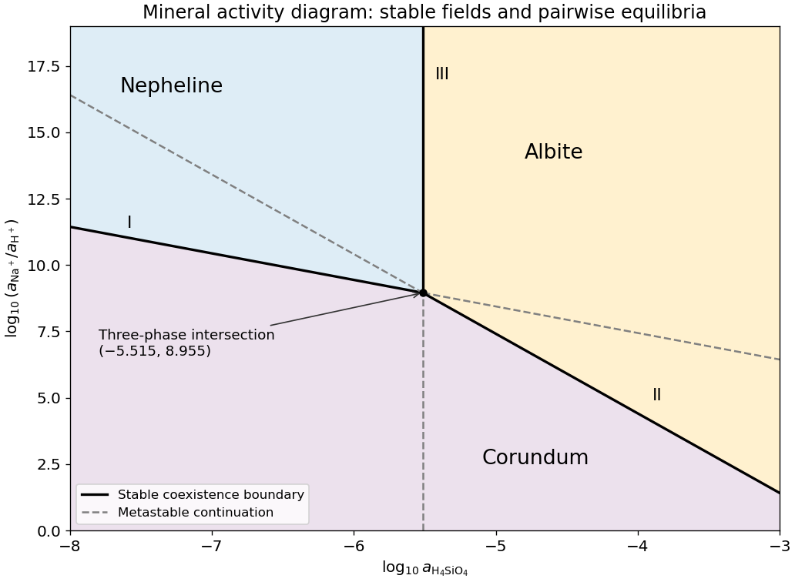

**[Figure 11](#10/iii/image-stable-and-metastable-mineral-boundaries-for-the-common-albite-nepheline-corundum-equilibrium-example). Stable and metastable mineral boundaries for the common albite-nepheline-corundum equilibrium example**. Original diagram computed from the supplied equilibrium constants. Solid lines show stable coexistence; dashed continuations are metastable. Logarithms are base ten.

<h3 id="10/iv">iv</h3>

↑ **Parent:** [10](#10)

<h4 id="10/iv/solution">Solution</h4>

↑ **Parent:** [Iv](#10/iv)

A [stability boundary in a mineral activity diagram](../../thermodynamic-potential.md#stability-boundary-in-a-mineral-activity-diagram) must also be stable against the third mineral. Use the [common-potential test for a three-mineral activity diagram](../../thermodynamic-potential.md#common-potential-test-for-a-three-mineral-activity-diagram). For the two corundum-producing directions,

$$
\frac{\Delta_rG_a}{2RT\ln10}=y-(3.44-x),\qquad
\frac{\Delta_rG_b}{2RT\ln10}=y-(-7.59-3x).
$$

Negative values favour [corundum](../../chemical-substance.md#corundum). For the albite-to-nepheline conversion, $\Delta_rG/(RT\ln10)=2x+11.03$, so low silica activity favours [nepheline](../../planetary-science.md#nepheline) and high silica activity favours [albite](../../planetary-science.md#albite). These comparisons give:

- **Nepheline–corundum: stable for $x<-5.515$**, metastable on the opposite extension.
- **Albite–corundum: stable for $x>-5.515$**, metastable on the opposite extension.
- **Nepheline–albite: stable for $y>8.955$** along $x=-5.515$, metastable below the intersection.

All three coexist at the intersection. Pairwise mass-action equations alone do not distinguish the stable segments from their [metastable](../../critical-phenomenon.md#metastability) extensions.

<h3 id="10/v">v</h3>

↑ **Parent:** [10](#10)

<h4 id="10/v/solution">Solution</h4>

↑ **Parent:** [V](#10/v)

The three stable fields are

$$
\boxed{\begin{aligned}
\text{nepheline: }&x<-5.515,\quad y>3.44-x,\\
\text{albite: }&x>-5.515,\quad y>-7.59-3x,\\
\text{corundum: }&y<\min(3.44-x,-7.59-3x).
\end{aligned}}
$$

The bounding equalities give the stable two-mineral coexistences. In particular, the stable [corundum](../../chemical-substance.md#corundum) region lies below the lower of the two oblique lines; treating every line extension as stable would mislabel parts of the [mineral activity diagram](../../thermodynamic-potential.md#mineral-activity-diagram).

## ↑ Ancestors (9)

1. [2024](../2024.md)
2. [Past exam of the year 2 of the earth sciences (geology) course of the University of Oxford](../../past-exam-of-the-year-2-of-the-earth-sciences-geology-course-of-the-university-of-oxford.md)
3. [Year 2 of the earth sciences (geology) course of the University of Oxford](../../university-of-oxford.md#year-2-of-the-earth-sciences-geology-course-of-the-university-of-oxford)
4. [Earth sciences (geology) course of the University of Oxford](../../university-of-oxford.md#earth-sciences-geology-course-of-the-university-of-oxford)
5. [Undergraduate course of the University of Oxford](../../university-of-oxford.md#undergraduate-course-of-the-university-of-oxford)
6. [Course of the University of Oxford](../../university-of-oxford.md#course-of-the-university-of-oxford)
7. [University of Oxford](../../university-of-oxford.md)
8. [List of universities](../../README.md#list-of-universities)
9. [Codex Wiki](../../README.md)
