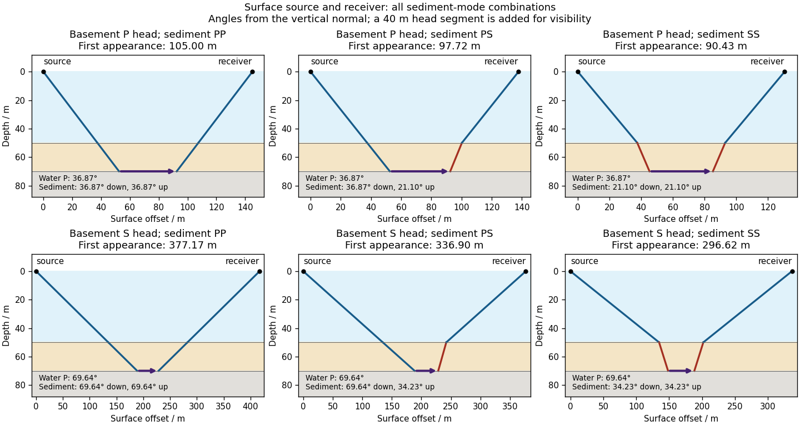

<h1 id="1/c/solution">Solution</h1>

↑ **Parent:** [C](../c.md)

Take horizontal interfaces, [water](../../../../../water.md) depth $h_w=50\ \mathrm m$, and [sediment](../../../../../sediment.md) thickness $h_s=20\ \mathrm m$. Both source and receiver are just below the sea surface. Every angle below is measured from the **vertical interface normal**. [Snell's law](../../../../../snell-s-law.md) preserves the horizontal [seismic ray parameter](../../../../../seismic-ray-parameter-in-horizontal-layering.md)

$$
p=\frac{\sin\theta_w}{1500}=\frac{\sin\theta_{sP}}{1500}=\frac{\sin\theta_{sS}}{900}.
$$

A basement [seismic head wave](../../../../../seismic-head-wave.md) of speed $V_h$ has horizontal propagation at the basement interface, so $p=1/V_h$. The two possibilities are:

| Basement head mode | $p$ / $\mathrm{s\,m^{-1}}$ | Water P angle | Sediment P angle | Sediment S angle |
| --- | --- | --- | --- | --- |
| P, $V_h=2500\ \mathrm{m\,s^{-1}}$ | $0.000400$ | $36.870^\circ$ | $36.870^\circ$ | $21.100^\circ$ |
| S, $V_h=1600\ \mathrm{m\,s^{-1}}$ | $0.000625$ | $69.636^\circ$ | $69.636^\circ$ | $34.229^\circ$ |

The [water](../../../../../water.md) supports only [P waves](../../../../../p-wave.md). At oblique incidence the seabed can convert a [P wave](../../../../../p-wave.md) into an [SV-wave](../../../../../sv-wave.md) in the [sediment](../../../../../sediment.md), and the return [SV-wave](../../../../../sv-wave.md) can convert back to a [P wave](../../../../../p-wave.md) in the [water](../../../../../water.md). Further [seismic mode conversion](../../../../../seismic-mode-conversion.md) can occur at the basement. Thus the down-going and up-going sediment legs can independently be P or S. The S entries refer to [SV-waves](../../../../../sv-wave.md); a fluid [P wave](../../../../../p-wave.md) source in this two-dimensional [isotropic](../../../../../isotropy.md) geometry does not excite the decoupled [SH-wave](../../../../../sh-wave.md) sector.

Let $L_h\geq0$ be the distance travelled along the basement interface. For sediment legs $a,b\in\{P,S\}$,

$$
x=2h_w\tan\theta_w+h_s(\tan\theta_{sa}+\tan\theta_{sb})+L_h.
$$

The **first-appearance distance** is the limiting value at $L_h=0$:

| Basement head mode | Sediment down/up modes | $x_{\min}$ / m |
| --- | --- | --- |
| P | P/P | $105.00$ |
| P | P/S or S/P | $97.72$ |
| P | S/S | $90.43$ |
| S | P/P | $377.17$ |
| S | P/S or S/P | $336.90$ |
| S | S/S | $296.62$ |

For example, the unconverted P branch gives $2(50+20)\tan36.870^\circ=105\ \mathrm m$. The earliest geometrically permitted basement P [seismic head wave](../../../../../seismic-head-wave.md) is the doubly converted path with sediment S legs, at approximately $90\ \mathrm m$. The corresponding basement S family first appears at approximately $297\ \mathrm m$. These limiting distances describe existence of ray branches; a finite detectable [wave amplitude](../../../../../wave-amplitude.md) also depends on conversion efficiency and acquisition noise.

**[Figure 1](#1/c/image-surface-to-surface-p-and-converted-s-head-wave-paths-through-the-water-and-sediment-layers). Surface-to-surface P and converted-S head-wave paths through the water and sediment layers**. Each panel adds an illustrative 40 m basement head segment; the tabulated first-appearance limit removes that segment. Angles are measured from the vertical normal. Reversing the mixed sediment path gives its reciprocal S/P case.

There is **no separate finite-distance P head wave at the water–sediment interface**: $V_{p,w}=V_{p,s}=1500\ \mathrm{m\,s^{-1}}$, so the nominal critical angle is $90^\circ$, and a ray from a source 50 m above the interface cannot reach it at finite horizontal distance. Nor can the slower sediment S speed, $900\ \mathrm{m\,s^{-1}}$, support a [seismic head wave](../../../../../seismic-head-wave.md) launched from [water](../../../../../water.md): it would require $\sin\theta_w=1500/900>1$. A [seismic reflection](../../../../../seismic-reflection.md) still exists at the seabed because the [densities](../../../../../density.md), hence the [acoustic impedances](../../../../../acoustic-impedance.md), differ.

**First appearance and first arrival differ.** For each permitted branch the [travel time](../../../../../travel-time.md) is

$$
t_h(x)=\frac{x}{V_h}+2h_w\sqrt{1500^{-2}-V_h^{-2}}+h_s\left(\sqrt{V_{sa}^{-2}-V_h^{-2}}+\sqrt{V_{sb}^{-2}-V_h^{-2}}\right),\qquad x\geq x_{\min}.
$$

The all-P basement P branch has $t_h=x/2500+0.0746667\ \mathrm s$. It overtakes the direct [water](../../../../../water.md) [P wave](../../../../../p-wave.md), $t_d=x/1500$, only at $x=280\ \mathrm m$. The converted P-head branches have larger [seismic intercept times](../../../../../seismic-intercept-time.md), so even where they exist at shorter offsets they are later arrivals. The S-head branches are likewise later than the all-P P-head branch wherever they exist in this model. Reflections and [layer reverberations](../../../../../layer-reverberation.md) can supply additional later phases.

## ↑ Ancestors (12)

1. [C](../c.md)
2. [1](../../1.md)
3. [Paper 3](../../../paper-3-split.md)
4. [2024](../../../split.md)
5. [Past exam of the year 2 of the earth sciences (geology) course of the University of Oxford](../../../../split.md)
6. [Year 2 of the earth sciences (geology) course of the University of Oxford](../../../../../year-2-of-the-earth-sciences-geology-course-of-the-university-of-oxford.md)
7. [Earth sciences (geology) course of the University of Oxford](../../../../../earth-sciences-geology-course-of-the-university-of-oxford.md)
8. [Undergraduate course of the University of Oxford](../../../../../undergraduate-course-of-the-university-of-oxford.md)
9. [Course of the University of Oxford](../../../../../course-of-the-university-of-oxford.md)
10. [University of Oxford](../../../../../university-of-oxford-split.md)
11. [List of universities](../../../../../list-of-universities.md)
12. [Codex Wiki](../../../../../split.md)
