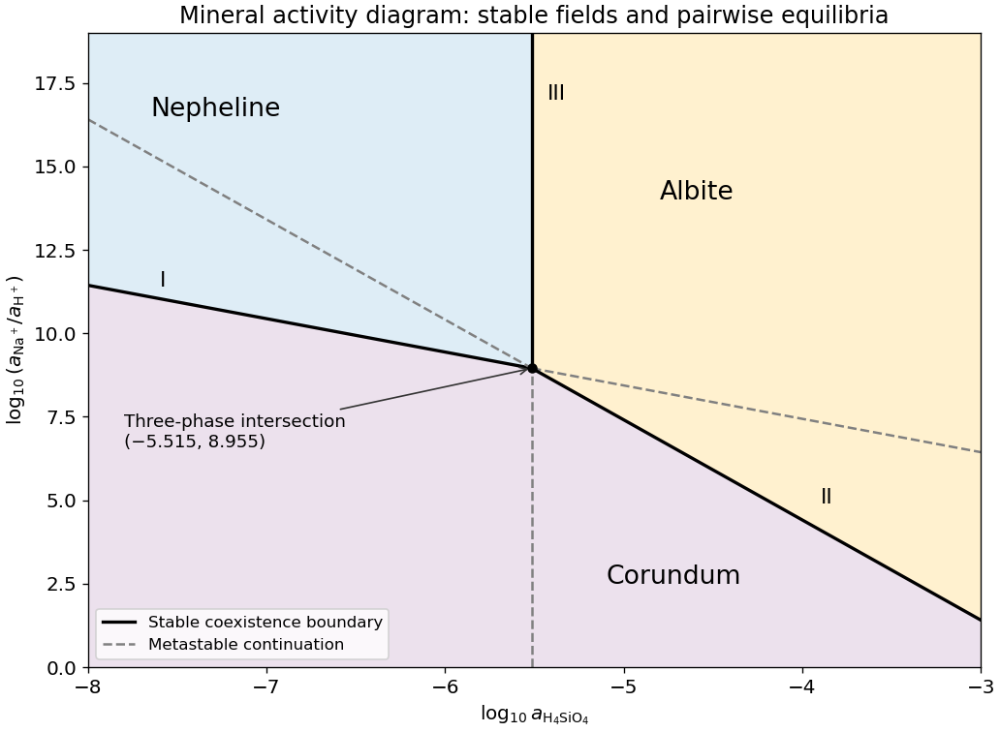

<h1 id="10/iii/solution">Solution</h1>

↑ **Parent:** [Iii](../iii.md)

The net [reaction quotient](../../../../../reaction-quotient.md) is $a_{\mathrm{H_4SiO_4}}^2$ when the solid and water activities equal one. Therefore its equilibrium line is

$$
\boxed{x=\tfrac12\log_{10}K=-5.515,}
$$

a vertical line through the intersection of the other two. There is no dependence on $y$, because the net reaction contains neither hydrogen ions nor sodium ions.

**[Figure 11](#10/iii/image-stable-and-metastable-mineral-boundaries-for-the-common-albite-nepheline-corundum-equilibrium-example). Stable and metastable mineral boundaries for the common albite-nepheline-corundum equilibrium example**. Original diagram computed from the supplied equilibrium constants. Solid lines show stable coexistence; dashed continuations are metastable. Logarithms are base ten.

## ↑ Ancestors (12)

1. [Iii](../iii.md)
2. [10](../../10.md)
3. [Paper 3](../../../paper-3-split.md)
4. [2024](../../../split.md)
5. [Past exam of the year 2 of the earth sciences (geology) course of the University of Oxford](../../../../split.md)
6. [Year 2 of the earth sciences (geology) course of the University of Oxford](../../../../../year-2-of-the-earth-sciences-geology-course-of-the-university-of-oxford.md)
7. [Earth sciences (geology) course of the University of Oxford](../../../../../earth-sciences-geology-course-of-the-university-of-oxford.md)
8. [Undergraduate course of the University of Oxford](../../../../../undergraduate-course-of-the-university-of-oxford.md)
9. [Course of the University of Oxford](../../../../../course-of-the-university-of-oxford.md)
10. [University of Oxford](../../../../../university-of-oxford-split.md)
11. [List of universities](../../../../../list-of-universities.md)
12. [Codex Wiki](../../../../../split.md)
