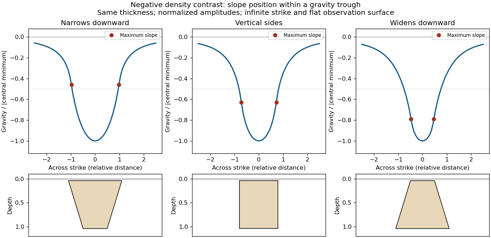

<h1 id="2/d/solution">Solution</h1>

↑ **Parent:** [D](../d.md)

For the two negative [gravity anomalies](../../../../../gravity-anomaly.md) in the actual Figure 1, examine **where the steepest flanks occur within the total fall into the trough**. The solid upper intrusion profile has maximum slope relatively low on its flanks, close to the flat trough; its body widens downwards. The lower basin profile has maximum slope relatively high on its flanks, near the shoulders; its body narrows downwards. The dashed gradient traces and arrows mark these transitions. The signed [derivative](../../../../../derivative.md) changes sign on opposite sides of a symmetric trough; a plot of gradient magnitude instead gives two positive peaks.

A shallow edge controls a relatively abrupt local change, whereas deeper [geophysical density contrast](../../../../../geophysical-density-contrast.md) spreads its effect over greater horizontal distance. Downward-narrowing geometry leaves relatively more of the anomaly associated with the shallow broad part, placing the strong flank change nearer the outer shoulders. Downward-widening geometry adds a broader deep contribution beneath the narrow outcrop, shifting the inflection towards the lower part of the trough. Thus the location of a flank's maximum slope relative to its shoulder and minimum is more useful here than the shared $-40\ \mathrm{mGal}$ peak alone.

A symmetric constant-density body with **vertical sides** gives a symmetric negative trough with paired rounded flanks; for a broad shallow body the main slope changes occur approximately halfway down those flanks. It is intermediate between the two end members, rather than a triangular anomaly or a rectangular discontinuity. Exact fractional inflection heights depend on width, depth, burial and rounding. The following independently calculated infinite-strike models illustrate the distinction without copying Figure 1.

**[Figure 2](#2/d/image-gravity-trough-shapes-for-bodies-narrowing-downward-having-vertical-sides-and-widening-downward). Gravity-trough shapes for bodies narrowing downward, having vertical sides, and widening downward**. The bodies have the same vertical thickness and negative density contrast; each profile is normalized by its own central anomaly. Markers identify maximum flank slopes. A small burial depth regularizes the near-surface edge response.

This qualitative inference assumes approximately comparable simple bodies, uniform [geophysical density contrast](../../../../../geophysical-density-contrast.md), and a properly removed regional field. [Gravity inversion](../../../../../gravity-inversion.md) is non-unique: lateral [density](../../../../../density.md) changes, multiple bodies, and a buried top can imitate changes of wall slope. Use the [seismic reflection](../../../../../seismic-reflection.md) constraints to test the interpretation.

## ↑ Ancestors (12)

1. [D](../d.md)
2. [2](../../2.md)
3. [Paper 3](../../../paper-3-split.md)
4. [2024](../../../split.md)
5. [Past exam of the year 2 of the earth sciences (geology) course of the University of Oxford](../../../../split.md)
6. [Year 2 of the earth sciences (geology) course of the University of Oxford](../../../../../year-2-of-the-earth-sciences-geology-course-of-the-university-of-oxford.md)
7. [Earth sciences (geology) course of the University of Oxford](../../../../../earth-sciences-geology-course-of-the-university-of-oxford.md)
8. [Undergraduate course of the University of Oxford](../../../../../undergraduate-course-of-the-university-of-oxford.md)
9. [Course of the University of Oxford](../../../../../course-of-the-university-of-oxford.md)
10. [University of Oxford](../../../../../university-of-oxford-split.md)
11. [List of universities](../../../../../list-of-universities.md)
12. [Codex Wiki](../../../../../split.md)
