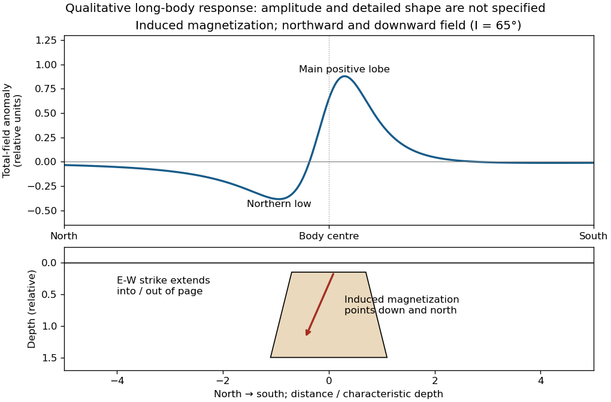

<h1 id="2/e/solution">Solution</h1>

↑ **Parent:** [E](../e.md)

Assume that the intrusion has a positive [magnetic susceptibility](../../../../../magnetic-susceptibility.md) contrast, that [induced magnetization](../../../../../induced-magnetization.md) dominates its [remanent magnetization](../../../../../remanent-magnetization.md), and that the local present-day [geomagnetic field](../../../../../geomagnetic-field.md) points roughly **northward and downward**, as in this northern mid-latitude setting. Write

$$
\Delta\mathbf M\simeq\Delta\chi\,\mathbf H_0,\qquad \Delta T=|\mathbf B_0+\mathbf b|-|\mathbf B_0|\simeq\widehat{\mathbf B}_0\cdot\mathbf b,
$$

where $\mathbf b$ is the anomalous [magnetic field](../../../../../magnetic-field-split.md) and the last expression assumes $|\mathbf b|\ll|\mathbf B_0|$. A [total-field magnetic anomaly](../../../../../total-field-magnetic-anomaly.md) measures a field projection, so it need not have the same sign everywhere above a high-susceptibility body.[The buried-dipole construction obtains total-field response by projecting the anomalous field along the inducing field and shows how the pattern changes with field orientation.](../../../../../magnetic-surveying-induced-magnetization-by-ubc-geophysical-inversion-facility.md)

The 100 km east–west extent makes an approximately **two-dimensional, east–west-striking body** a useful model away from its ends. On a profile drawn **north on the left, south on the right**, the expected normally induced response has a subsidiary **negative lobe on the northern side** and a stronger **positive lobe over the body, displaced towards the south**. The northward horizontal field component makes the anomaly asymmetric; its downward component produces the dominant positive response. The field falls back towards the regional value away from the intrusion. Broad bodies can have edge shoulders or a broad central high, so the sketch represents a qualitative shape rather than one uniquely specified curve.

**[Figure 3](#2/e/image-north-south-total-field-anomaly-of-a-normally-induced-long-east-west-magnetic-body). North–south total-field anomaly of a normally induced long east–west magnetic body**. An original infinite-strike line-dipole calculation illustrates the northern low and southward-displaced main high. The 65-degree downward inclination is illustrative; the geometry underneath is schematic and is not a quantitative model of the source intrusion.

An exactly vertical inducing field would remove this north–south skew for a symmetric induced body. Real [magnetic inclination](../../../../../magnetic-inclination.md) and [magnetic declination](../../../../../magnetic-declination.md) should be taken from a suitable [geomagnetic field](../../../../../geomagnetic-field.md) model for the survey date and location; no exact local value is supplied here. Strong oblique or reversed [remanent magnetization](../../../../../remanent-magnetization.md) can shift or reverse the lobes, and heterogeneous [magnetic susceptibility](../../../../../magnetic-susceptibility.md), body dip and three-dimensional end effects can alter the profile. Higher [magnetic susceptibility](../../../../../magnetic-susceptibility.md) alone does not determine a unique amplitude or polarity pattern without these qualifications.

## ↑ Ancestors (12)

1. [E](../e.md)
2. [2](../../2.md)
3. [Paper 3](../../../paper-3-split.md)
4. [2024](../../../split.md)
5. [Past exam of the year 2 of the earth sciences (geology) course of the University of Oxford](../../../../split.md)
6. [Year 2 of the earth sciences (geology) course of the University of Oxford](../../../../../year-2-of-the-earth-sciences-geology-course-of-the-university-of-oxford.md)
7. [Earth sciences (geology) course of the University of Oxford](../../../../../earth-sciences-geology-course-of-the-university-of-oxford.md)
8. [Undergraduate course of the University of Oxford](../../../../../undergraduate-course-of-the-university-of-oxford.md)
9. [Course of the University of Oxford](../../../../../course-of-the-university-of-oxford.md)
10. [University of Oxford](../../../../../university-of-oxford-split.md)
11. [List of universities](../../../../../list-of-universities.md)
12. [Codex Wiki](../../../../../split.md)
