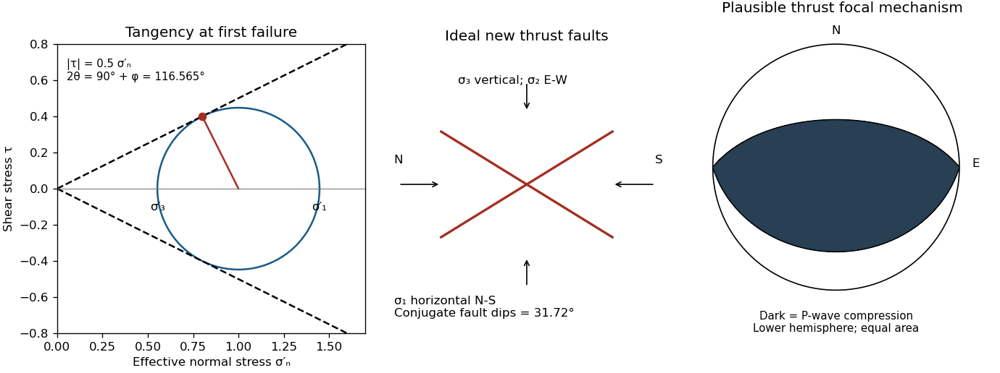

<h1 id="3/b/solution">Solution</h1>

↑ **Parent:** [B](../b.md)

A **reverse or [thrust fault](../../../../../thrust-fault.md) earthquake** is the expected end member: a [hanging wall](../../../../../hanging-wall.md) moves upwards relative to its [footwall](../../../../../footwall.md), accommodating north–south [tectonic shortening](../../../../../tectonic-shortening.md). A plausible [double-couple seismic source](../../../../../double-couple-seismic-source.md) [focal mechanism](../../../../../focal-mechanism.md) has an approximately east–west [fault strike](../../../../../fault-strike.md), a moderately north- or south-dipping [fault plane](../../../../../fault-plane.md), and up-dip [fault slip](../../../../../fault-slip.md). For example, right-hand-rule strike $090^\circ$, southward [fault dip](../../../../../fault-dip.md) about $32^\circ$, and [fault rake](../../../../../fault-rake.md) $+90^\circ$ specify a pure thrust mechanism.

In a lower-hemisphere equal-area plot, with shaded regions denoting compressional P first motions, this [focal mechanism](../../../../../focal-mechanism.md) has a shaded central region and two unshaded outer lobes. The P axis is approximately horizontal north–south and the T axis approximately vertical for a symmetric idealization; for a single $32^\circ$ plane their axes are slightly tilted. The P and T axes of a [double-couple seismic source](../../../../../double-couple-seismic-source.md) need not exactly equal the regional [principal stress](../../../../../principal-stress.md) axes. The nodal curves represent both the [fault plane](../../../../../fault-plane.md) and its auxiliary plane; additional evidence is needed to choose between them.[Lower-hemisphere compression shading and the ambiguity between the two nodal planes.](../../../../../focal-mechanisms-or-beachballs-by-united-states-geological-survey.md)

**[Figure 4](#3/b/image-mohr-coulomb-tangency-conjugate-thrust-dips-and-a-plausible-thrust-focal-mechanism). Mohr-Coulomb tangency, conjugate thrust dips, and a plausible thrust focal mechanism**. The stress scale is arbitrary. The Mohr circle touches a friction envelope of slope 0.5; the physical fault dip is 31.72 degrees. The original lower-hemisphere mechanism uses an east–west-striking reverse fault; dark shading denotes P-wave compression.

## ↑ Ancestors (12)

1. [B](../b.md)
2. [3](../../3.md)
3. [Paper 3](../../../paper-3-split.md)
4. [2024](../../../split.md)
5. [Past exam of the year 2 of the earth sciences (geology) course of the University of Oxford](../../../../split.md)
6. [Year 2 of the earth sciences (geology) course of the University of Oxford](../../../../../year-2-of-the-earth-sciences-geology-course-of-the-university-of-oxford.md)
7. [Earth sciences (geology) course of the University of Oxford](../../../../../earth-sciences-geology-course-of-the-university-of-oxford.md)
8. [Undergraduate course of the University of Oxford](../../../../../undergraduate-course-of-the-university-of-oxford.md)
9. [Course of the University of Oxford](../../../../../course-of-the-university-of-oxford.md)
10. [University of Oxford](../../../../../university-of-oxford-split.md)
11. [List of universities](../../../../../list-of-universities.md)
12. [Codex Wiki](../../../../../split.md)

## ← Incoming links (1)

- [Solution](../c/solution.md)
