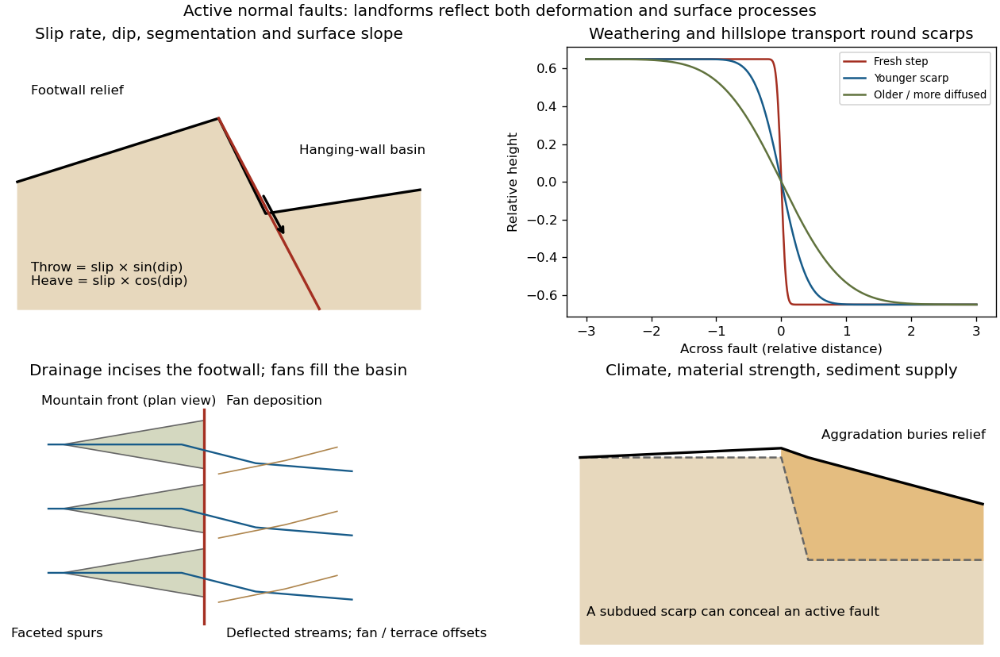

<h1 id="4/a/solution">Solution</h1>

↑ **Parent:** [A](../a.md)

The [geomorphology](../../../../../geomorphology.md) of active [normal faulting](../../../../../normal-faulting.md) records a competition between accumulated tectonic displacement and the ability of [erosion](../../../../../erosion.md), transport and deposition to modify it. A [hanging wall](../../../../../hanging-wall.md) moves down relative to a [footwall](../../../../../footwall.md), producing a [fault scarp](../../../../../fault-scarp.md), mountain-front relief, and accommodation space for a [sedimentary basin](../../../../../sedimentary-basin.md). Repeated earthquakes can build a large front even though each individual surface break is much smaller.[The primary mapping report's table of geomorphic features lists scarps, faceted spurs, oversteepened mountain fronts and rejuvenated valley floors as common normal-slip indicators.](../../../../../normal-fault-geomorphic-features-by-united-states-geological-survey.md)

**[Figure 5](#4/a/image-original-sketches-of-tectonic-erosional-and-depositional-controls-on-normal-fault-landforms). Original sketches of tectonic, erosional and depositional controls on normal-fault landforms**. The panels distinguish cumulative block displacement, progressive scarp rounding, drainage and faceted mountain fronts, and burial of a scarp by sediment. Geometries and relative scales are illustrative.

The principal controls and their observable effects are:

- **Displacement, rate and timing.** Larger single-event [fault slip](../../../../../fault-slip.md) creates a higher fresh scarp; repeated slip builds cumulative offsets of fans and [river terraces](../../../../../river-terrace.md). The interval since the latest rupture controls degradation. For pure [dip-slip faulting](../../../../../dip-slip-faulting.md) on a plane dipping $\delta$, vertical [fault throw](../../../../../fault-throw.md) is $D\sin\delta$ and horizontal [fault heave](../../../../../fault-heave.md) is $D\cos\delta$. Scarp height on an inclined eroded surface need not equal either the slip or the original vertical throw.
- **Geometry and structural history.** [Fault dip](../../../../../fault-dip.md), strike, curvature, segmentation, splays and along-strike variations in [fault slip](../../../../../fault-slip.md) control scarp orientation and continuity. Linked faults can create a stepped front; synthetic and antithetic faults can create a [graben](../../../../../graben.md). Cumulative deformation includes broad footwall uplift and hanging-wall tilting as well as a sharp break.
- **Lithology and cover.** Strong exposed [bedrock](../../../../../bedrock.md) can preserve steep scarps and fresh fault surfaces. Weak fractured [rock](../../../../../rock-geology.md), thick [regolith](../../../../../regolith.md) and loose [alluvium](../../../../../alluvium.md) weather and slump more rapidly, spread deformation, and produce debris at the scarp base. Differential [erosion](../../../../../erosion.md) can make a lithological front without recent tectonic movement, so a straight cliff alone is not sufficient evidence of activity.
- **Climate and surface transport.** Rainfall, runoff, frost action, vegetation and slope processes control scarp rounding and [colluvium](../../../../../colluvium.md) production. Steep new faces collapse towards stable slopes; later hillslope transport rounds the crest and fills the toe. A simple [scarp diffusion model](../../../../../scarp-diffusion-model.md) broadens a step over a length proportional to $\sqrt{\kappa t}$, but only if a suitable transport law and comparable material and climate apply.
- **Drainage and sediment supply.** Footwall uplift can incise channels and produce [river terraces](../../../../../river-terrace.md), knickpoints and triangular [faceted spurs](../../../../../faceted-spur.md). Hanging-wall subsidence can pond drainage, deflect streams and promote [alluvial fans](../../../../../alluvial-fan.md) and basin filling. Rapid [aggradation](../../../../../aggradation.md) can bury an active scarp, while stream incision can remove or exaggerate local relief.
- **Preservation and initial landscape.** Pre-existing slopes, relief, surface ages, glacial modification and human disturbance determine where offsets can be recognized. A fan abandoned long before the latest earthquake can accumulate more offset than a younger nearby surface. Compare like-age markers across a fault, and distinguish a mountain front's long history from a single event.

Useful observations therefore include scarp profiles, repeated offsets of dated surfaces, drainage organization, and continuity along strike. A high rugged front is not by itself evidence of a high present [fault slip rate](../../../../../fault-slip-rate.md); conversely, a muted or buried scarp need not mark an inactive [fault](../../../../../geological-fault.md).

## ↑ Ancestors (12)

1. [A](../a.md)
2. [4](../../4.md)
3. [Paper 3](../../../paper-3-split.md)
4. [2024](../../../split.md)
5. [Past exam of the year 2 of the earth sciences (geology) course of the University of Oxford](../../../../split.md)
6. [Year 2 of the earth sciences (geology) course of the University of Oxford](../../../../../year-2-of-the-earth-sciences-geology-course-of-the-university-of-oxford.md)
7. [Earth sciences (geology) course of the University of Oxford](../../../../../earth-sciences-geology-course-of-the-university-of-oxford.md)
8. [Undergraduate course of the University of Oxford](../../../../../undergraduate-course-of-the-university-of-oxford.md)
9. [Course of the University of Oxford](../../../../../course-of-the-university-of-oxford.md)
10. [University of Oxford](../../../../../university-of-oxford-split.md)
11. [List of universities](../../../../../list-of-universities.md)
12. [Codex Wiki](../../../../../split.md)
