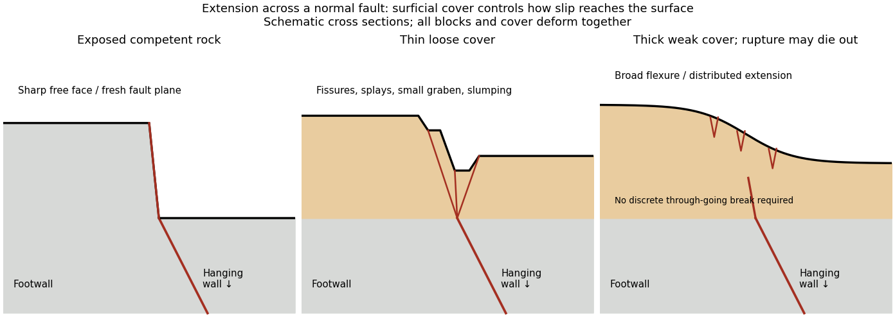

<h1 id="4/b/solution">Solution</h1>

↑ **Parent:** [B](../b.md)

A surface-reaching [normal fault](../../../../../normal-fault.md) earthquake commonly produces a **down-facing step towards the [hanging wall](../../../../../hanging-wall.md)**, accompanied by extension across the break. A fresh free face can expose [bedrock](../../../../../bedrock.md), polish or striations, roots or offset soil. The actual rupture is usually irregular: [fault slip](../../../../../fault-slip.md) changes along strike, separate strands overlap or step, and [tension fissures](../../../../../tension-fissure.md), small [grabens](../../../../../graben.md) and secondary cracks distribute part of the extension.

**[Figure 6](#4/b/image-original-cross-sections-showing-how-surficial-cover-changes-normal-fault-surface-rupture). Original cross sections showing how surficial cover changes normal-fault surface rupture**. Competent exposed rock localizes a sharp free face; thin loose cover permits splays and a small graben; thick weak cover can accommodate a buried fault tip by broad flexure and distributed extension.

**Exposed competent rock or very thin cover:** a relatively narrow, sharp break can closely follow the principal [fault plane](../../../../../fault-plane.md). A steep free face can be recognizable immediately, then weather and shed debris. The face need not be vertical or maintain the same height along strike.

**Loose granular or poorly consolidated cover:** the main shear can splay upwards through [alluvium](../../../../../alluvium.md) or [regolith](../../../../../regolith.md). Open fissures, step-like scarps, rotated blocks, synthetic and antithetic [normal faults](../../../../../normal-fault.md), and a small intervening [graben](../../../../../graben.md) can form across a wider zone. Collapse and raveling quickly build [colluvium](../../../../../colluvium.md) at the toe. A single rupture event can therefore create several parallel breaks; counting them does not count earthquakes.

**Thick weak or cohesive cover:** deeper [fault slip](../../../../../fault-slip.md) can be transferred into distributed [shear strain](../../../../../shear-strain.md), tilted beds, broad warping or [monoclines](../../../../../monocline.md), with tension cracks above a propagating tip. A discrete break may be attenuated or absent if the [fault](../../../../../geological-fault.md) remains blind. Cover thickness alone is not enough to predict the response: cohesion, grain size, layering, saturation, rupture displacement and fault depth also matter. Saturated loose [sediment](../../../../../sediment.md) can additionally develop [soil liquefaction](../../../../../soil-liquefaction.md), [sand blows](../../../../../sand-blow.md) or lateral spreading; these are secondary shaking effects and do not independently locate the tectonic rupture.

The observed vertical step, crack aperture and total width of disturbed ground should be measured separately. Reconstruct the total displacement across all strands and account for the original ground slope. [Landslides](../../../../../landslide.md) or gravitational spreading can imitate normal-fault scarps, so map connections to the main [fault](../../../../../geological-fault.md) and displaced markers rather than assuming every open crack is primary tectonic slip.

## ↑ Ancestors (12)

1. [B](../b.md)
2. [4](../../4.md)
3. [Paper 3](../../../paper-3-split.md)
4. [2024](../../../split.md)
5. [Past exam of the year 2 of the earth sciences (geology) course of the University of Oxford](../../../../split.md)
6. [Year 2 of the earth sciences (geology) course of the University of Oxford](../../../../../year-2-of-the-earth-sciences-geology-course-of-the-university-of-oxford.md)
7. [Earth sciences (geology) course of the University of Oxford](../../../../../earth-sciences-geology-course-of-the-university-of-oxford.md)
8. [Undergraduate course of the University of Oxford](../../../../../undergraduate-course-of-the-university-of-oxford.md)
9. [Course of the University of Oxford](../../../../../course-of-the-university-of-oxford.md)
10. [University of Oxford](../../../../../university-of-oxford-split.md)
11. [List of universities](../../../../../list-of-universities.md)
12. [Codex Wiki](../../../../../split.md)
