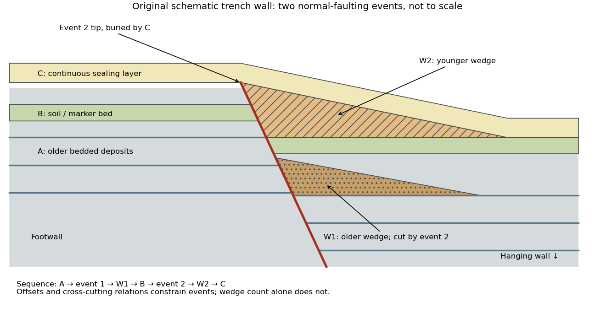

<h1 id="4/c/solution">Solution</h1>

↑ **Parent:** [C](../c.md)

Excavate across the mapped [fault scarp](../../../../../fault-scarp.md), approximately perpendicular to its strike, at a site where young [sediments](../../../../../sediment.md) record and preserve deformation. On cleaned trench walls log bedding, [soil horizons](../../../../../soil-horizon.md), shear zones, fissure fills, buried surfaces and [colluvial wedges](../../../../../colluvial-wedge.md). Correlate the same marker beds across the [fault](../../../../../geological-fault.md) before reconstructing individual displacements.

**[Figure 7](#4/c/image-original-two-event-paleoseismic-trench-interpretation-across-a-normal-fault). Original two-event paleoseismic trench interpretation across a normal fault**. Older deposits A record two events; the intervening soil or marker B records one; the youngest layer C seals the second rupture. W1 is cut by the later fault, whereas W2 forms after it. This is an invented schematic stratigraphy, not a copied field log.

Look for **event horizons**, not merely a stack of sediments:

- A [fault](../../../../../geological-fault.md) or fissure cuts older layers but terminates below an undeformed sealing deposit. The event occurred after deposition of the youngest demonstrably displaced material and before deposition of the oldest demonstrably sealing material.
- A fresh free face sheds coarse angular debris, often thickest against the scarp and thinning into the [hanging wall](../../../../../hanging-wall.md); later finer slopewash can overlie it. A buried [soil horizon](../../../../../soil-horizon.md) between successive [colluvial wedges](../../../../../colluvial-wedge.md) can indicate a period of stability separating events. Fissures filled from above can preserve collapsed soil blocks or distinctive younger sediment.
- Older markers may have larger offsets than younger markers. A lower wedge or soil cut and displaced by a younger shear, then overlain by a new wedge and an intact seal, gives a cross-cutting basis for at least two events. Changes in displacement should be reconstructed across all fault strands.
- Rapid tilting, growth of accommodation space, abrupt changes in deposit thickness, and locally ponded beds can corroborate the structural evidence. [Soil liquefaction](../../../../../soil-liquefaction.md) structures or shaking-induced [landslides](../../../../../landslide.md) may support a chronology, but do not alone prove surface rupture on the trenched fault.

In the drawing, A was faulted in event 1; W1 accumulated; B buried and stabilized that surface. Event 2 displaced A, W1 and B, after which W2 accumulated and C sealed the fault tip. Thus A records two events, B one and C none. This combination of offset and sealing relationships is stronger evidence than identifying two wedge-shaped units alone.

Bracket event ages with multiple samples just below and above the event horizons. Suitable short-lived organic material can be dated by [radiocarbon dating](../../../../../radiocarbon-dating.md); [optically stimulated luminescence dating](../../../../../optically-stimulated-luminescence-dating.md) can constrain deposition of appropriate mineral grains. Reworked old charcoal, younger roots, incomplete bleaching, erosional gaps and time elapsed between rupture and wedge deposition must enter the age interpretation. For calendar dates, $t_{\mathrm{youngest\ cut}}<t_{\mathrm{event}}<t_{\mathrm{oldest\ seal}}$ only when those deposits genuinely bracket the rupture; a radiocarbon age in years before present reverses the numerical ordering.[“Finding Paleoearthquakes” explains disrupted layers followed by unbroken cover; “Determining the Age of a Paleoearthquake” explains dating deposits above and below the event horizon.](../../../../../introduction-to-paleoseismology-by-united-states-geological-survey.md)

One earthquake can generate several debris pulses and wedges; repeated earthquakes may reuse one strand without leaving separable deposits. [Erosion](../../../../../erosion.md), [bioturbation](../../../../../bioturbation.md), nondeposition, lateral facies changes and upward-dying splays can hide events or mimic terminations. Confirm relationships on both trench walls and, when possible, in adjacent exposures. The result is a minimum supported event sequence with age intervals, not an assumption of perfectly periodic recurrence or one earthquake per wedge.

## ↑ Ancestors (12)

1. [C](../c.md)
2. [4](../../4.md)
3. [Paper 3](../../../paper-3-split.md)
4. [2024](../../../split.md)
5. [Past exam of the year 2 of the earth sciences (geology) course of the University of Oxford](../../../../split.md)
6. [Year 2 of the earth sciences (geology) course of the University of Oxford](../../../../../year-2-of-the-earth-sciences-geology-course-of-the-university-of-oxford.md)
7. [Earth sciences (geology) course of the University of Oxford](../../../../../earth-sciences-geology-course-of-the-university-of-oxford.md)
8. [Undergraduate course of the University of Oxford](../../../../../undergraduate-course-of-the-university-of-oxford.md)
9. [Course of the University of Oxford](../../../../../course-of-the-university-of-oxford.md)
10. [University of Oxford](../../../../../university-of-oxford-split.md)
11. [List of universities](../../../../../list-of-universities.md)
12. [Codex Wiki](../../../../../split.md)
