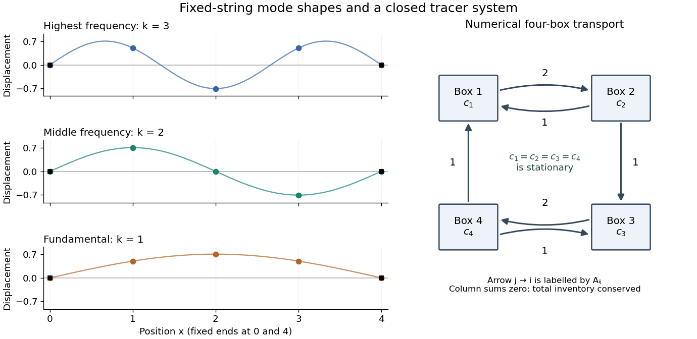

<h1 id="5/e/solution">Solution</h1>

↑ **Parent:** [E](../e.md)

Each supplied [eigenvector](../../../../../eigenvector.md) gives relative [displacements](../../../../../displacement.md) at $x=1,2,3$ in a [standing wave](../../../../../standing-wave.md). Insert zero at $x=0,4$ to describe the whole sampled string. A real [normal mode](../../../../../normal-mode.md) is $u_j(t)=C v_j\cos(\omega t+\phi)$: its shape stays fixed while its [amplitude](../../../../../wave-amplitude.md) oscillates.

- $(0,1/2,-1/\sqrt2,1/2,0)$ is the highest-[frequency](../../../../../frequency.md) resolved [normal mode](../../../../../normal-mode.md). Adjacent interior [displacements](../../../../../displacement.md) alternate in sign: the middle point moves opposite to both outer interior points. Its interpolated shape has three lobes, corresponding to the third string [normal mode](../../../../../normal-mode.md).
- $(0,1/\sqrt2,0,-1/\sqrt2,0)$ is the middle-[frequency](../../../../../frequency.md) [normal mode](../../../../../normal-mode.md). The midpoint is a [node of a standing wave](../../../../../node-physics.md), and the two sides move in opposite directions. It corresponds to the second string [normal mode](../../../../../normal-mode.md).
- $(0,1/2,1/\sqrt2,1/2,0)$ is the lowest-[frequency](../../../../../frequency.md) [normal mode](../../../../../normal-mode.md), corresponding to the [fundamental frequency](../../../../../fundamental-frequency.md). All interior points move in the same direction, with greatest [displacement](../../../../../displacement.md) at the centre; the only [nodes of a standing wave](../../../../../node-physics.md) are the endpoints in the smooth shape through these samples.

These [semidiscrete fixed-string normal modes](../../../../../semidiscrete-fixed-string-normal-mode.md) are samples of $\sin(k\pi x/4)$, with $k=3,2,1$ in the order listed. More precisely, their interior [vectors](../../../../../vector.md) are $v_j^{(k)}=2^{-1/2}\sin(k\pi j/4)$, which have unit [Euclidean norm](../../../../../euclidean-norm.md) and form an [orthonormal basis](../../../../../orthonormal-basis.md) of $\mathbb R^3$. Their [eigenvalues](../../../../../eigenvalue.md) and [angular frequencies](../../../../../angular-frequency.md) obey

$$
\lambda_k=-4\sin^2\!\left(\frac{k\pi}{8}\right),\qquad
\omega_k=2\sin\!\left(\frac{k\pi}{8}\right),\qquad k=1,2,3.
$$

Thus larger [absolute value](../../../../../absolute-value.md) of a negative [eigenvalue](../../../../../eigenvalue.md) means faster [oscillation](../../../../../oscillation.md), rather than faster decay. The numerical [angular frequencies](../../../../../angular-frequency.md) approximate the continuous fixed-string values $k\pi c/L$; the [finite difference](../../../../../finite-difference-split.md) spatial approximation changes them. Only three independent interior [normal modes](../../../../../normal-mode.md) exist on this grid, and any interior [displacement](../../../../../displacement.md) or initial velocity [vector](../../../../../vector.md) can be expanded in this [orthonormal basis](../../../../../orthonormal-basis.md).

**[Figure 8](#5/e/image-three-fixed-string-normal-modes-and-conservative-four-box-transport). Three fixed-string normal modes and conservative four-box transport**. The left panels show the supplied unit [eigenvectors](../../../../../eigenvector.md) with zero endpoints; smooth sine curves guide the eye through the samples. The right panel is an original directed graph of the numerical transport [matrix](../../../../../matrix.md) in Question 6: every arrow from j to i is labelled by Aij. It is not a reproduction of source Figure 6.

## ↑ Ancestors (12)

1. [E](../e.md)
2. [5](../../5.md)
3. [Paper 3](../../../paper-3-split.md)
4. [2024](../../../split.md)
5. [Past exam of the year 2 of the earth sciences (geology) course of the University of Oxford](../../../../split.md)
6. [Year 2 of the earth sciences (geology) course of the University of Oxford](../../../../../year-2-of-the-earth-sciences-geology-course-of-the-university-of-oxford.md)
7. [Earth sciences (geology) course of the University of Oxford](../../../../../earth-sciences-geology-course-of-the-university-of-oxford.md)
8. [Undergraduate course of the University of Oxford](../../../../../undergraduate-course-of-the-university-of-oxford.md)
9. [Course of the University of Oxford](../../../../../course-of-the-university-of-oxford.md)
10. [University of Oxford](../../../../../university-of-oxford-split.md)
11. [List of universities](../../../../../list-of-universities.md)
12. [Codex Wiki](../../../../../split.md)
