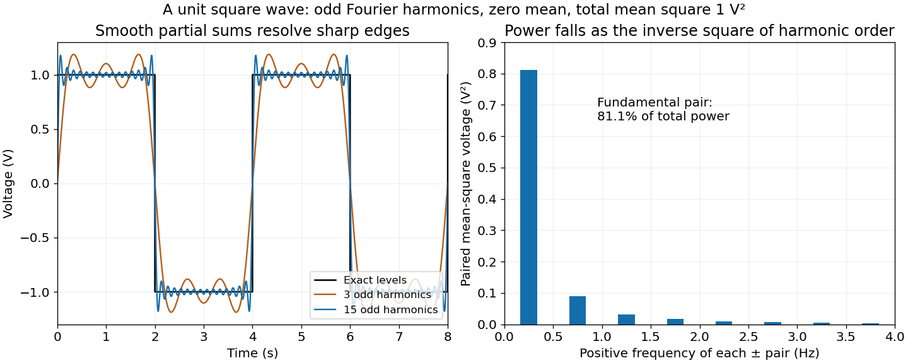

<h1 id="7/g/solution">Solution</h1>

↑ **Parent:** [G](../g.md)

Most of the [mean-square signal power](../../../../../signal-power.md) lies at low [frequencies](../../../../../frequency.md). Each nonzero coefficient has magnitude $2/(\pi|r|)\,\mathrm V$, so its power contribution decreases as $r^{-2}$. The pair at the fundamental frequencies $\pm0.25\,\mathrm{Hz}$ alone contains

$$
\boxed{\frac8{\pi^2}\simeq81.1\%}
$$

of the total. The first three positive odd harmonics, together with their negative-frequency partners, contain about $93.3\%$. The [harmonic power of a square wave](../../../../../harmonic-power-of-a-square-wave.md) still has a nonzero tail: higher harmonics are needed to reproduce sharp edges even though their combined power is small.

**[Figure 9](#7/g/image-odd-fourier-harmonics-reconstruct-a-unit-square-wave-and-concentrate-most-power-in-the-fundamental). Odd Fourier harmonics reconstruct a unit square wave and concentrate most power in the fundamental**. Original analytic calculations. The reconstruction and paired-harmonic powers use the derived exact coefficients, rather than the supplied noisy spectral illustration. The horizontal axis is time in seconds; voltage and mean-square voltage units are retained.

## ↑ Ancestors (12)

1. [G](../g.md)
2. [7](../../7.md)
3. [Paper 3](../../../paper-3-split.md)
4. [2024](../../../split.md)
5. [Past exam of the year 2 of the earth sciences (geology) course of the University of Oxford](../../../../split.md)
6. [Year 2 of the earth sciences (geology) course of the University of Oxford](../../../../../year-2-of-the-earth-sciences-geology-course-of-the-university-of-oxford.md)
7. [Earth sciences (geology) course of the University of Oxford](../../../../../earth-sciences-geology-course-of-the-university-of-oxford.md)
8. [Undergraduate course of the University of Oxford](../../../../../undergraduate-course-of-the-university-of-oxford.md)
9. [Course of the University of Oxford](../../../../../course-of-the-university-of-oxford.md)
10. [University of Oxford](../../../../../university-of-oxford-split.md)
11. [List of universities](../../../../../list-of-universities.md)
12. [Codex Wiki](../../../../../split.md)
