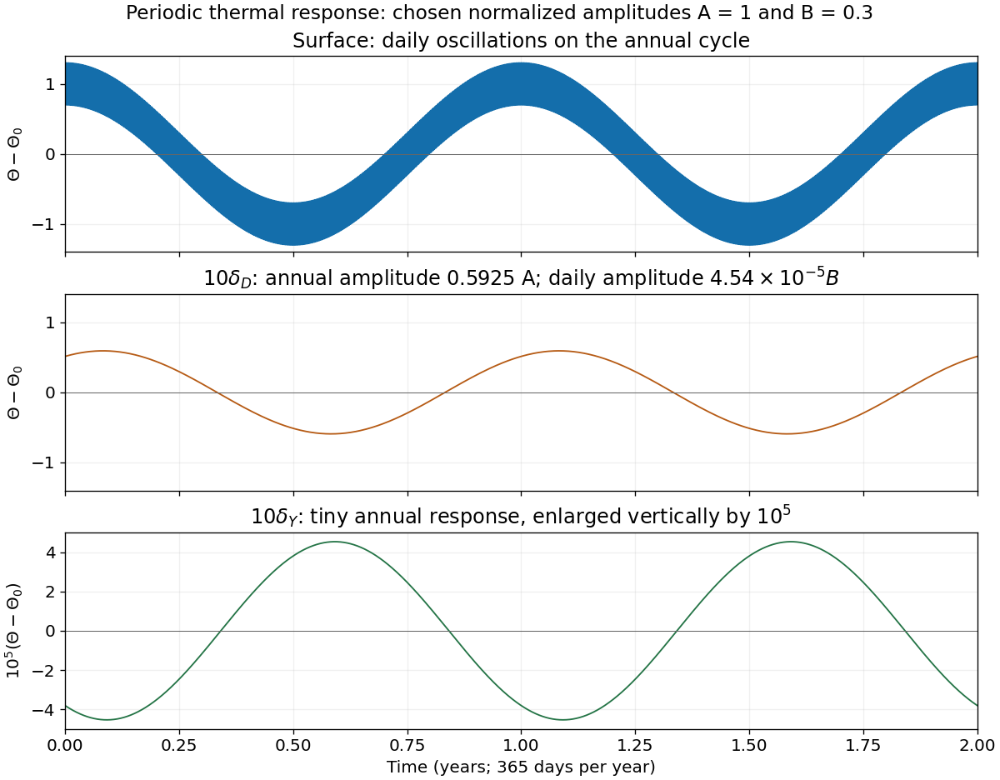

<h1 id="8/c/iii/solution">Solution</h1>

↑ **Parent:** [Iii](../iii.md)

At $x=10\delta_Y$, the annual attenuation is $e^{-10}$ and the daily attenuation is $e^{-10\sqrt{365}}$, approximately $10^{-83}$. Thus

$$
\boxed{\begin{aligned}
\Theta-\Theta_0={}&A e^{-10}\cos(\omega_Yt-10)\\
&+B e^{-10\sqrt{365}}\cos(\omega_Dt-10\sqrt{365}).
\end{aligned}}
$$

On the same vertical scale as the surface plot this is **almost the constant $\Theta_0$**. With a sufficiently enlarged scale, a residual annual oscillation of [amplitude](../../../../../../wave-amplitude.md) $4.54\times10^{-5}A$ remains. Its phase lag is ten radians, interpreted modulo $2\pi$ when comparing periodic maxima.

**[Figure 10](#8/c/iii/image-daily-and-annual-thermal-oscillations-at-the-surface-and-at-ten-daily-or-annual-penetration-depths). Daily and annual thermal oscillations at the surface and at ten daily or annual penetration depths**. Original calculation of the established periodic solution. The illustrative amplitudes are chosen as $A=1$ and $B=0.3$ in normalized temperature units; they are not fitted to the examination plots. The deepest response is enlarged by a factor of $10^5$ to make its tiny residual annual oscillation visible.

## ↑ Ancestors (13)

1. [Iii](../iii.md)
2. [C](../../c.md)
3. [8](../../../8.md)
4. [Paper 3](../../../../paper-3-split.md)
5. [2024](../../../../split.md)
6. [Past exam of the year 2 of the earth sciences (geology) course of the University of Oxford](../../../../../split.md)
7. [Year 2 of the earth sciences (geology) course of the University of Oxford](../../../../../../year-2-of-the-earth-sciences-geology-course-of-the-university-of-oxford.md)
8. [Earth sciences (geology) course of the University of Oxford](../../../../../../earth-sciences-geology-course-of-the-university-of-oxford.md)
9. [Undergraduate course of the University of Oxford](../../../../../../undergraduate-course-of-the-university-of-oxford.md)
10. [Course of the University of Oxford](../../../../../../course-of-the-university-of-oxford.md)
11. [University of Oxford](../../../../../../university-of-oxford-split.md)
12. [List of universities](../../../../../../list-of-universities.md)
13. [Codex Wiki](../../../../../../split.md)
