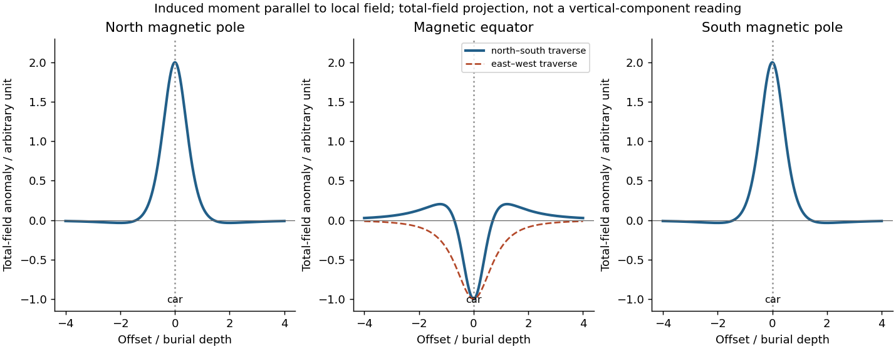
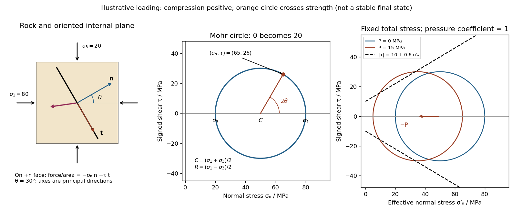
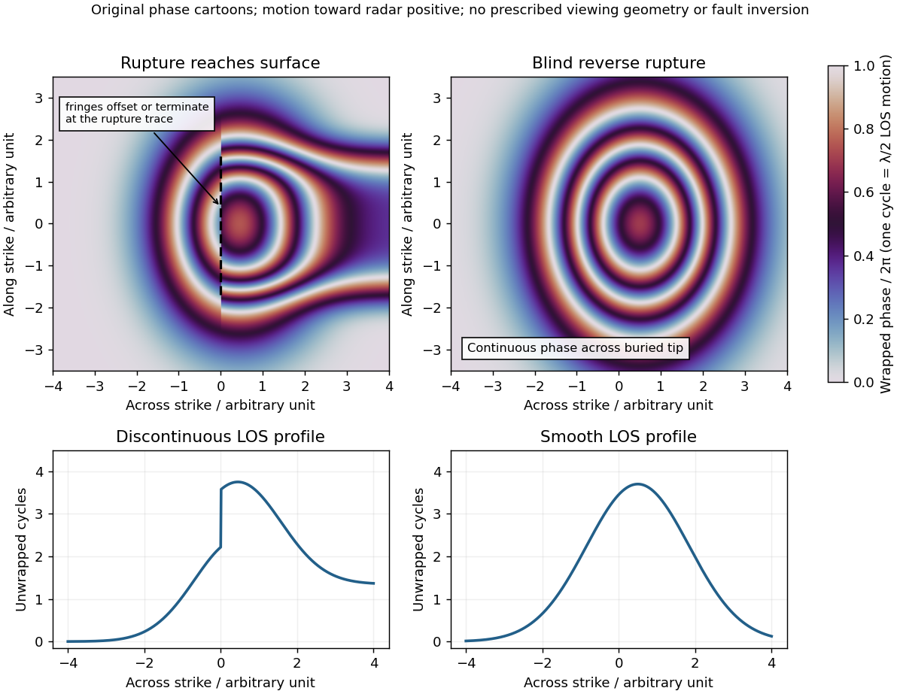
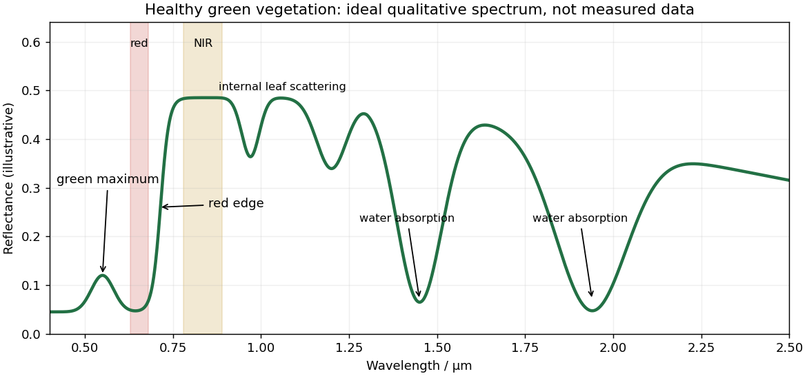
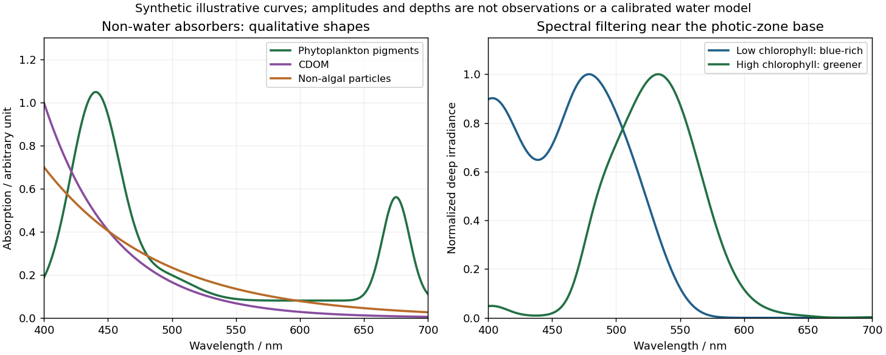
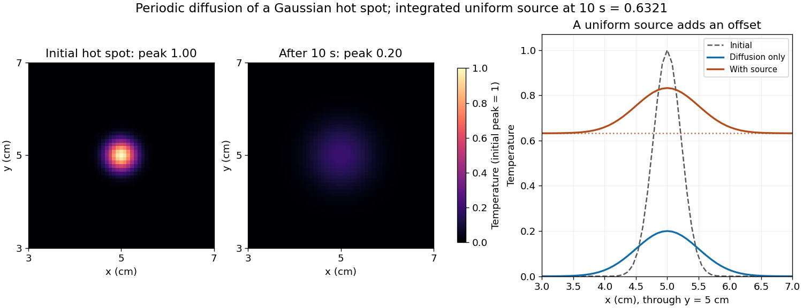
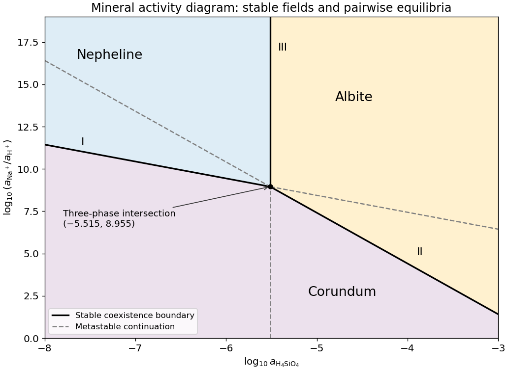

# Paper 3

↑ **Parent:** [2025](../2025.md)

Source release: [https://www.whatdotheyknow.com/request/earth_science_past_papers_and_ex/response/3419815/attach/4/Papers.zip?cookie_passthrough=1](https://www.whatdotheyknow.com/request/earth_science_past_papers_and_ex/response/3419815/attach/4/Papers.zip?cookie_passthrough=1)

**Table of contents**

- [1](#1)
  - [a](#1/a)
    - [Solution](#1/a/solution)
  - [b](#1/b)
    - [i](#1/b/i)
      - [Solution](#1/b/i/solution)
    - [ii](#1/b/ii)
      - [Solution](#1/b/ii/solution)
  - [c](#1/c)
    - [Solution](#1/c/solution)
- [2](#2)
  - [a](#2/a)
    - [Solution](#2/a/solution)
  - [b](#2/b)
    - [Solution](#2/b/solution)
  - [c](#2/c)
    - [Solution](#2/c/solution)
  - [d](#2/d)
    - [i](#2/d/i)
      - [Solution](#2/d/i/solution)
    - [ii](#2/d/ii)
      - [Solution](#2/d/ii/solution)
    - [iii](#2/d/iii)
      - [Solution](#2/d/iii/solution)
- [3](#3)
  - [a](#3/a)
    - [Solution](#3/a/solution)
  - [b](#3/b)
    - [i](#3/b/i)
      - [Solution](#3/b/i/solution)
    - [ii](#3/b/ii)
      - [Solution](#3/b/ii/solution)
    - [iii](#3/b/iii)
      - [Solution](#3/b/iii/solution)
- [4](#4)
  - [a](#4/a)
    - [Solution](#4/a/solution)
  - [b](#4/b)
    - [Solution](#4/b/solution)
  - [c](#4/c)
    - [Solution](#4/c/solution)
  - [d](#4/d)
    - [Solution](#4/d/solution)
- [5](#5)
  - [a](#5/a)
    - [i](#5/a/i)
      - [Solution](#5/a/i/solution)
    - [ii](#5/a/ii)
      - [Solution](#5/a/ii/solution)
  - [b](#5/b)
    - [Solution](#5/b/solution)
- [6](#6)
  - [a](#6/a)
    - [Solution](#6/a/solution)
  - [b](#6/b)
    - [Solution](#6/b/solution)
  - [c](#6/c)
    - [Solution](#6/c/solution)
  - [d](#6/d)
    - [Solution](#6/d/solution)
- [7](#7)
  - [a](#7/a)
    - [Solution](#7/a/solution)
  - [b](#7/b)
    - [Solution](#7/b/solution)
  - [c](#7/c)
    - [Solution](#7/c/solution)
  - [d](#7/d)
    - [Solution](#7/d/solution)
  - [e](#7/e)
    - [Solution](#7/e/solution)
  - [f](#7/f)
    - [Solution](#7/f/solution)
  - [g](#7/g)
    - [Solution](#7/g/solution)
  - [h](#7/h)
    - [Solution](#7/h/solution)
  - [i](#7/i)
    - [Solution](#7/i/solution)
- [8](#8)
  - [a](#8/a)
    - [Solution](#8/a/solution)
  - [b](#8/b)
    - [Solution](#8/b/solution)
  - [c](#8/c)
    - [Solution](#8/c/solution)
  - [d](#8/d)
    - [Solution](#8/d/solution)
  - [e](#8/e)
    - [Solution](#8/e/solution)
  - [f](#8/f)
    - [Solution](#8/f/solution)
  - [g](#8/g)
    - [Solution](#8/g/solution)
- [9](#9)
  - [a](#9/a)
    - [Solution](#9/a/solution)
  - [b](#9/b)
    - [Solution](#9/b/solution)
  - [c](#9/c)
    - [Solution](#9/c/solution)
  - [d](#9/d)
    - [Solution](#9/d/solution)
- [10](#10)
  - [a](#10/a)
    - [Solution](#10/a/solution)
  - [b](#10/b)
    - [Solution](#10/b/solution)
  - [c](#10/c)
    - [Solution](#10/c/solution)
  - [d](#10/d)
    - [Solution](#10/d/solution)
  - [e](#10/e)
    - [Solution](#10/e/solution)

## 1

↑ **Parent:** [Paper 3](paper-3.md)

<h3 id="1/a">a</h3>

↑ **Parent:** [1](#1)

<h4 id="1/a/solution">Solution</h4>

↑ **Parent:** [A](#1/a)

Let $S_g$ be the fraction of the [pore space](../../porous-media-flow.md#pore-space) occupied by [gas](../../thermodynamics.md#gas), and let $\phi$ be the [porosity](../../porous-media-flow.md#porosity). At fixed [porosity](../../porous-media-flow.md#porosity) and unchanged [rock](../../planetary-science.md#rock-geology) framework, the bulk [density](../../fluid-mechanics.md#density) is

$$
\rho=(1-\phi)\rho_s+\phi\bigl[(1-S_g)\rho_w+S_g\rho_g\bigr].
$$

Replacing [water](../../chemical-substance.md#water) with much less dense [gas](../../thermodynamics.md#gas) therefore decreases the bulk [density](../../fluid-mechanics.md#density) approximately linearly, as in Figure 1. The liquid and gas [densities](../../fluid-mechanics.md#density) here are those at reservoir conditions.

A [pore fluid](../../porous-media-flow.md#pore-fluid) has negligible static [shear modulus](../../elasticity-physics.md#shear-modulus), so the [rock](../../planetary-science.md#rock-geology) framework chiefly controls the effective [shear modulus](../../elasticity-physics.md#shear-modulus) $\mu$. If $\mu$ changes little, $V_s=\sqrt{\mu/\rho}$ increases gently as the [density](../../fluid-mechanics.md#density) falls. This does **not** imply that [S waves](../../wave-equation.md#s-wave) travel through the pore [gas](../../thermodynamics.md#gas) itself: their restoring force comes from the connected solid framework.

The [P wave](../../wave-equation.md#p-wave) speed depends on both [bulk modulus](../../elasticity-physics.md#bulk-modulus) and [shear modulus](../../elasticity-physics.md#shear-modulus):

$$
V_p=\sqrt{\frac{\kappa+4\mu/3}{\rho}}.
$$

[Gas](../../thermodynamics.md#gas) is much more compressible than [water](../../chemical-substance.md#water). Even a small connected gas fraction can strongly reduce the effective fluid [bulk modulus](../../elasticity-physics.md#bulk-modulus), approximately through the compliance average $\kappa_f^{-1}\simeq(1-S_g)/\kappa_w+S_g/\kappa_g$ for a pressure-equilibrated mixture. The saturated [rock](../../planetary-science.md#rock-geology)'s effective [bulk modulus](../../elasticity-physics.md#bulk-modulus) consequently falls rapidly at first, overwhelming the smaller [density](../../fluid-mechanics.md#density) reduction and causing the sharp initial fall in $V_p$. Once the fluid is already very compliant, further gas replacement changes the stiffness less; the continuing [density](../../fluid-mechanics.md#density) decrease can then make $V_p$ rise again. Figure 1 assumes a particular saturation response: patchy fluids, changing effective [pressure](../../pressure.md), and frequency-dependent fluid motion can alter it. The plotted $V_s$ is only nearly constant, so the plot should not be interpreted as an exact fixed-$\mu$ constitutive model.

<h3 id="1/b">b</h3>

↑ **Parent:** [1](#1)

For incidence from cap rock (1) into reservoir (2), use the conventional normal-incidence stress-amplitude [reflection coefficient](../../partial-differential-equation.md#reflection-coefficient)

$$
R_j=\frac{Z_{j2}-Z_{j1}}{Z_{j2}+Z_{j1}},\qquad Z_{pj}=\rho_jV_{pj},\quad Z_{sj}=\rho_jV_{sj}.
$$

Here [acoustic impedance](../../elasticity-physics.md#acoustic-impedance) is the [P wave](../../wave-equation.md#p-wave) impedance; $\rho V_s$ is the corresponding [shear-wave impedance](../../elasticity-physics.md#shear-wave-impedance). Positive $R$ preserves the chosen stress-wave [seismic reflection polarity](../../geophysics.md#seismic-reflection-polarity); negative $R$ reverses it. These are amplitude coefficients, not reflected [energy](../../energy.md) fractions. At normal incidence in the ideal isotropic model there is no P-to-S [mode conversion](../../wave.md#mode-conversion). The cap-rock impedances are

$$
Z_{p1}=2.25\times10^6,\qquad Z_{s1}=0.900\times10^6\quad\mathrm{kg\,m^{-2}\,s^{-1}}.
$$

The following are **approximate readings of the supplied Figure 1 PNG**, checked against the matching source PDF, rather than exact tabulated parameters. At zero gas, use $\rho\simeq1.75\ \mathrm{g\,cm^{-3}}$, $V_p\simeq1.75\ \mathrm{km\,s^{-1}}$, and $V_s\simeq0.60\ \mathrm{km\,s^{-1}}$; at full gas use $\rho\simeq1.25\ \mathrm{g\,cm^{-3}}$, $V_p\simeq1.15\ \mathrm{km\,s^{-1}}$, and $V_s\simeq0.65\ \mathrm{km\,s^{-1}}$. The left-hand $V_p$ endpoint is crowded against the axis and the [density](../../fluid-mechanics.md#density) curve; readings differing by roughly $0.05$ in the plotted units are reasonable. The resulting coefficients deserve about two significant figures, not the apparent precision of the intermediate arithmetic.

Both end members change [seismic reflection polarity](../../geophysics.md#seismic-reflection-polarity), but the [P wave](../../wave-equation.md#p-wave) change is much larger: approximately $+0.15$ to $-0.22$, compared with $+0.08$ to $-0.05$ for [S waves](../../wave-equation.md#s-wave). Thus a calibrated [P wave](../../wave-equation.md#p-wave) survey is better for distinguishing these two saturation end members and should give a stronger reflection from the fully gas-filled reservoir. A negative [P wave](../../wave-equation.md#p-wave) reflection relative to the water-filled prediction is a useful gas indicator in this stipulated model. In a real [seismic reflection survey](../../geophysics.md#seismic-reflection-survey), lithology, [porosity](../../porous-media-flow.md#porosity), effective [pressure](../../pressure.md), and [seismic wavelet](../../geophysics.md#seismic-wavelet) phase also affect the response, so a bright or reversed reflection alone does not prove the presence of [gas](../../thermodynamics.md#gas).

<h4 id="1/b/i">i</h4>

↑ **Parent:** [B](#1/b)

<h5 id="1/b/i/solution">Solution</h5>

↑ **Parent:** [I](#1/b/i)

For the fully water-filled reservoir, the approximate [densities](../../fluid-mechanics.md#density) and [wave speeds](../../wave-equation.md#wave-speed) give

$$
Z_{p2}\simeq3.06\times10^6,\quad Z_{s2}\simeq1.05\times10^6\quad\mathrm{kg\,m^{-2}\,s^{-1}},
$$

and hence

$$
\boxed{R_p\simeq\frac{3.0625-2.25}{3.0625+2.25}\simeq+0.15,\qquad R_s\simeq\frac{1.05-0.900}{1.05+0.900}\simeq+0.08.}
$$

Both are positive: the reservoir has larger [P wave](../../wave-equation.md#p-wave) and [shear-wave impedances](../../elasticity-physics.md#shear-wave-impedance) than the cap rock, and neither reflection reverses the chosen stress-wave [seismic reflection polarity](../../geophysics.md#seismic-reflection-polarity).

<h4 id="1/b/ii">ii</h4>

↑ **Parent:** [B](#1/b)

<h5 id="1/b/ii/solution">Solution</h5>

↑ **Parent:** [Ii](#1/b/ii)

For the fully gas-filled reservoir,

$$
Z_{p2}\simeq1.44\times10^6,\quad Z_{s2}\simeq0.81\times10^6\quad\mathrm{kg\,m^{-2}\,s^{-1}},
$$

so

$$
\boxed{R_p\simeq\frac{1.4375-2.25}{1.4375+2.25}\simeq-0.22,\qquad R_s\simeq\frac{0.8125-0.900}{0.8125+0.900}\simeq-0.05.}
$$

Both impedances are now smaller than those of the cap rock. Both reflections reverse [seismic reflection polarity](../../geophysics.md#seismic-reflection-polarity), with a substantially larger amplitude for the [P wave](../../wave-equation.md#p-wave) reflection. Reading the right-hand $V_p$ endpoint instead as $1.20\ \mathrm{km\,s^{-1}}$ would give $R_p\simeq-0.20$, preserving the interpretation.

<h3 id="1/c">c</h3>

↑ **Parent:** [1](#1)

<h4 id="1/c/solution">Solution</h4>

↑ **Parent:** [C](#1/c)

**The [P wave](../../wave-equation.md#p-wave) source is normally the more useful depth source for the end members and for the stated approximately 50% gas case**, because the predicted $|R_p|$ exceeds $|R_s|$, making the reservoir-top arrival easier to identify, assuming comparable source and recording quality. For a horizontal reflector and vertical two-way [travel time](../../dispersion-relation.md#travel-time) $t$ entirely through the homogeneous cap rock,

$$
h=\frac{V_{p1}t_p}{2}=750t_p\ \mathrm m,
$$

or $h=V_{s1}t_s/2=300t_s\ \mathrm m$ for an identified [S wave](../../wave-equation.md#s-wave) arrival, with times in seconds. The reservoir's own [wave speed](../../wave-equation.md#wave-speed) is not the overburden [wave speed](../../wave-equation.md#wave-speed) used in this conversion. Nonzero-offset data require [moveout correction](../../geophysics.md#moveout-correction) and an appropriate overburden [velocity model](../../geophysics.md#velocity-model); no numerical depth can be obtained without a measured time.

At approximately 50% gas, Figure 1 gives $\rho\simeq1.5\ \mathrm{g\,cm^{-3}}$, $V_p\simeq1.05\ \mathrm{km\,s^{-1}}$, and $V_s\simeq0.62$–$0.63\ \mathrm{km\,s^{-1}}$. Thus

$$
Z_{p2}\simeq1.58\times10^6,\quad R_p\simeq-0.18,\qquad Z_{s2}\simeq(0.93\text{–}0.945)\times10^6,\quad R_s\simeq+0.02.
$$

The [S wave](../../wave-equation.md#s-wave) reflector is then weak because its impedance is nearly matched to the cap rock. An exact [impedance match](../../elasticity-physics.md#impedance-match), $\rho_2V_{s2}=\rho_1V_{s1}$, gives $R_s=0$: a reservoir top can exist without producing an observable normal-incidence [S wave](../../wave-equation.md#s-wave) reflection. Rounding the 50% $V_s$ to $0.60$ would suggest exactly that cancellation, but the plotted line sits slightly higher. The continuous $Z_s$ curve crosses the cap-rock value at a somewhat greater saturation; the coarse figure does not justify a precise percentage.

There is also a smaller-saturation [P wave](../../wave-equation.md#p-wave) impedance match: $R_p$ changes sign between zero and modest gas saturation, so it must pass through zero. Thus neither source guarantees a detectable reflector at every saturation. Joint [P wave](../../wave-equation.md#p-wave) and [S wave](../../wave-equation.md#s-wave) observations help distinguish a weak impedance contrast from an absent reservoir; a slower [S wave](../../wave-equation.md#s-wave) speed alone is no reason to prefer it when its reflected amplitude is near zero.

## 2

↑ **Parent:** [Paper 3](paper-3.md)

<h3 id="2/a">a</h3>

↑ **Parent:** [2](#2)

<h4 id="2/a/solution">Solution</h4>

↑ **Parent:** [A](#2/a)

A [proton-precession magnetometer](../../geophysics.md#proton-precession-magnetometer) measures the scalar magnitude $F=|\mathbf B|$ of the local [magnetic field](../../magnetic-field.md). Its sensor contains a proton-rich liquid, such as a hydrocarbon or suitable water-based fluid. A strong current through a coil briefly polarizes the nuclear [magnetic moments](../../electromagnetism.md#magnetic-dipole-moment), producing a small net [magnetization](../../electromagnetism.md#magnetization). The polarizing field is directed sufficiently across the local [magnetic field](../../magnetic-field.md) to leave a transverse component when the current is switched off.

The [protons](../../physics.md#proton) then undergo [Larmor precession](../../angular-momentum-operator.md#larmor-precession) about the ambient [magnetic field](../../magnetic-field.md). Their rotating net [magnetization](../../electromagnetism.md#magnetization) induces a decaying alternating [voltage](../../random-walk.md#voltage) in a receiving coil. Measuring the [frequency](../../wave.md#frequency) determines the field:

$$
\omega=\gamma_pF,\qquad f=\frac{\gamma_p}{2\pi}F,\qquad \frac{\gamma_p}{2\pi}\simeq42.58\ \mathrm{MHz\,T^{-1}}.
$$

For example, $50\ \mathrm{\mu T}$ gives about $2.13\ \mathrm{kHz}$. The known proton [gyromagnetic ratio](../../electromagnetism.md#gyromagnetic-ratio) provides an absolute frequency-to-field scale; this instrument does not measure the field's direction. Strong spatial [gradients](../../multivariable-calculus.md#gradient) cause different parts of the liquid to precess at different rates and shorten the usable signal, which matters very close to a buried steel object.[Introduction, “What is a total field magnetometer?”, and “Magnetic Environment”; scalar intensity and sensitivity to gradients.](../../physics-bibliography.md#g-857-memory-mag-operation-manual-by-geometrics)

<h3 id="2/b">b</h3>

↑ **Parent:** [2](#2)

<h4 id="2/b/solution">Solution</h4>

↑ **Parent:** [B](#2/b)

Lay out a surveyed grid extending beyond the possible burial area into unaffected ground. Use closely spaced parallel traverses with measurements along each line; spacing should resolve a car-scale [magnetic anomaly](../../geophysics.md#magnetic-anomaly), with a finer grid over any candidate. For a shallow car, a pilot survey with roughly metre-scale spacing is a sensible starting point, refined according to anomaly width rather than treated as a universal prescription. Record position, time, sensor height, repeat readings and any nearby interference. Cross-lines and repeat stations check reproducibility. Maintain a constant sensor height on a nonmagnetic staff and remove magnetic items from the operator; map fences, gates, pipes, buildings and vehicles before interpreting an anomaly.

Operate a synchronized stationary [base-station magnetometer](../../geophysics.md#base-station-magnetometer) in quiet ground while the rover surveys, or make frequent base returns if a second instrument is unavailable. A [total-field magnetic anomaly](../../geophysics.md#total-field-magnetic-anomaly) is the corrected field magnitude minus a specified background:

$$
\Delta T(\mathbf x)=F_{\mathrm{corrected}}(\mathbf x)-F_{\mathrm{background}}(\mathbf x).
$$

For a field-sized target, a local background estimated away from the car is often sufficient. A larger regional survey may subtract the [International Geomagnetic Reference Field](../../electromagnetism.md#international-geomagnetic-reference-field) and an independently justified regional trend. Do not remove the car's broad anomaly by overfitting that trend.

Correct rover observations for time-varying [geomagnetic field](../../electromagnetism.md#geomagnetic-field) using the base record, for example $F_c(\mathbf x,t)=F_r(\mathbf x,t)-[F_b(t)-F_b(t_0)]$. Check instrument offsets and tie-line differences, reject disturbed or poor-quality readings, and allow for differing sensor heights. Preserve localized target signals when interpolating a contour map or comparing with a [magnetic dipole](../../electromagnetism.md#magnetic-dipole) model. There are no compulsory gravity-style free-air or [Bouguer gravity anomaly](../../geophysics.md#bouguer-gravity-anomaly) reductions for this magnetic search.

Postpone surveying during a [geomagnetic storm](../../electromagnetism.md#geomagnetic-storm) or rapid irregular magnetic variation, when base correction may be inadequate. Avoid periods of moving farm machinery or electrical interference, and recognize that strong permanent cultural interference or highly magnetic host [rock](../../planetary-science.md#rock-geology) may make this particular method unsuitable. Ordinary cloud cover or darkness does not prevent a [magnetic survey](../../geophysics.md#magnetic-survey).[“Magnetic Environment” and survey/base-station operation: magnetic cleanliness, spatial gradients, and time variation.](../../physics-bibliography.md#g-857-memory-mag-operation-manual-by-geometrics)

<h3 id="2/c">c</h3>

↑ **Parent:** [2](#2)

<h4 id="2/c/solution">Solution</h4>

↑ **Parent:** [C](#2/c)

Strong geological [magnetic anomalies](../../geophysics.md#magnetic-anomaly) generally occur in [rocks](../../planetary-science.md#rock-geology) containing abundant strongly magnetic iron oxides, especially [magnetite](../../chemical-substance.md#magnetite) and [titanomagnetite](../../chemical-substance.md#titanomagnetite). Many [mafic rocks](../../planetary-science.md#mafic-rock), including [basalt](../../planetary-science.md#basalt) and [gabbro](../../planetary-science.md#gabbro), and some [ultramafic rocks](../../planetary-science.md#ultramafic-rock) have large signatures; magnetite-rich iron formations can be exceptionally strong, while [serpentinization](../../planetary-science.md#serpentinization) can create additional [magnetite](../../chemical-substance.md#magnetite). Actual [magnetic susceptibility](../../statistical-physics.md#magnetic-susceptibility) and [remanent magnetization](../../electromagnetism.md#remanent-magnetization), rather than the rock name alone, determine the response. Sedimentary and felsic [rocks](../../planetary-science.md#rock-geology) are often weaker but have important exceptions.

[Magnetite](../../chemical-substance.md#magnetite), [titanomagnetite](../../chemical-substance.md#titanomagnetite) and [maghemite](../../chemical-substance.md#maghemite) exhibit strong [ferrimagnetism](../../electromagnetism.md#ferrimagnetism); some [pyrrhotite](../../chemical-substance.md#pyrrhotite) is also strongly magnetic. [Hematite](../../chemical-substance.md#hematite) is generally much weaker in induced [magnetic susceptibility](../../statistical-physics.md#magnetic-susceptibility), although it can carry stable [remanent magnetization](../../electromagnetism.md#remanent-magnetization). [Quartz](../../chemical-substance.md#quartz) and [calcite](../../chemical-substance.md#calcite) have very small, usually negative, susceptibilities, and many ordinary silicates have only weak [paramagnetism](../../electromagnetism.md#paramagnetism). A steel car exhibits strong [ferromagnetism](../../electromagnetism.md#ferromagnetism) and can therefore stand out against a weakly magnetic host, but its shape and pre-existing [remanent magnetization](../../electromagnetism.md#remanent-magnetization) complicate the signal.[Rock-susceptibility discussion and the section “Remanent or Permanent Magnetization”.](../../physics-bibliography.md#applications-manual-for-portable-magnetometers-by-geometrics)

<h3 id="2/d">d</h3>

↑ **Parent:** [2](#2)

The sketches assume the car can be approximated by a compact [magnetic dipole](../../electromagnetism.md#magnetic-dipole) whose **induced** [magnetic moment](../../electromagnetism.md#magnetic-dipole-moment) is parallel to the local [geomagnetic field](../../electromagnetism.md#geomagnetic-field). The host contributes negligible local contrast. Real steel also has [remanent magnetization](../../electromagnetism.md#remanent-magnetization) and shape-dependent magnetization, so the car's actual profile need not follow this idealization. A [proton-precession magnetometer](../../geophysics.md#proton-precession-magnetometer) observes

$$
\Delta T=|\mathbf B_0+\mathbf b|-|\mathbf B_0|\simeq\widehat{\mathbf B}_0\cdot\mathbf b
$$

when $|\mathbf b|\ll|\mathbf B_0|$. This scalar [total-field magnetic anomaly](../../geophysics.md#total-field-magnetic-anomaly) must not be confused with a fixed vertical field component. For induced $\mathbf m=m\widehat{\mathbf B}_0$, the [magnetic dipole](../../electromagnetism.md#magnetic-dipole) field gives

$$
\Delta T\simeq\frac{\mu_0m}{4\pi r^3}\left[3(\widehat{\mathbf B}_0\cdot\widehat{\mathbf r})^2-1\right].
$$

Reversing both the inducing field and induced moment leaves this [total-field magnetic anomaly](../../geophysics.md#total-field-magnetic-anomaly) unchanged, exactly for the magnitude definition as well as in the weak-anomaly approximation.[Buried-dipole examples at the magnetic equator and magnetic pole; total-field projection and traverse orientation.](../../physics-bibliography.md#magnetic-surveying-induced-magnetization-by-ubc-geophysical-inversion-facility)

<a id="2/d/image-induced-magnetic-dipole-profiles-at-the-magnetic-poles-and-equator"></a>


**[Figure 1](#2/d/image-induced-magnetic-dipole-profiles-at-the-magnetic-poles-and-equator). Induced magnetic dipole profiles at the magnetic poles and equator**. Original ideal profiles in arbitrary units for a dipole at unit burial depth. The polar curves coincide. At the equator, a north–south traverse has a central low and positive shoulders, whereas an east–west traverse has a central low without positive shoulders. Car shape and remanence are excluded.

<h4 id="2/d/i">i</h4>

↑ **Parent:** [D](#2/d)

<h5 id="2/d/i/solution">Solution</h5>

↑ **Parent:** [I](#2/d/i)

Near the **north magnetic pole**, take the inducing [magnetic field](../../magnetic-field.md) and induced [magnetic moment](../../electromagnetism.md#magnetic-dipole-moment) as vertically downward. Directly above the car, its anomalous field reinforces the main field: a positive central [total-field magnetic anomaly](../../geophysics.md#total-field-magnetic-anomaly) results. Along a horizontal traverse, the vertical-dipole approximation gives a symmetric central high flanked by weaker negative side lobes:

$$
\Delta T(x)\propto\frac{2h^2-x^2}{(x^2+h^2)^{5/2}},
$$

where $h$ is the depth from the sensor to the effective dipole centre. The anomaly width scales with $h$; no absolute amplitude can be calculated without the car's [magnetic moment](../../electromagnetism.md#magnetic-dipole-moment).

<h4 id="2/d/ii">ii</h4>

↑ **Parent:** [D](#2/d)

<h5 id="2/d/ii/solution">Solution</h5>

↑ **Parent:** [Ii](#2/d/ii)

At the **magnetic equator**, the inducing [magnetic field](../../magnetic-field.md) and induced [magnetic moment](../../electromagnetism.md#magnetic-dipole-moment) are horizontal. Let $x$ point along this field, approximately magnetic north, and $y$ across it. Directly over the car, the dipole field opposes the main field, producing a negative central [total-field magnetic anomaly](../../geophysics.md#total-field-magnetic-anomaly). A north–south traverse through the car gives

$$
\Delta T(x)\propto\frac{2x^2-h^2}{(x^2+h^2)^{5/2}},
$$

a symmetric central low with positive shoulders. An east–west traverse through the car instead has $\Delta T(y)\propto-(y^2+h^2)^{-3/2}$, a single negative trough. The equatorial anomaly therefore needs a stated traverse orientation; there is no universal single equatorial line profile.

<h4 id="2/d/iii">iii</h4>

↑ **Parent:** [D](#2/d)

<h5 id="2/d/iii/solution">Solution</h5>

↑ **Parent:** [Iii](#2/d/iii)

Near the **south magnetic pole**, the inducing [magnetic field](../../magnetic-field.md) and induced [magnetic moment](../../electromagnetism.md#magnetic-dipole-moment) are vertically upward. Directly over the car its dipole field is also upward, again reinforcing the main field. The [total-field magnetic anomaly](../../geophysics.md#total-field-magnetic-anomaly) is therefore the **same positive central high and weak negative side lobes as at the north magnetic pole** under the same induced-dipole assumptions. A fixed signed vertical field component would reverse, but the scalar field strength measured by the [proton-precession magnetometer](../../geophysics.md#proton-precession-magnetometer) does not. If the car's [remanent magnetization](../../electromagnetism.md#remanent-magnetization) dominates, neither this symmetry nor these predicted signs is assured.

## 3

↑ **Parent:** [Paper 3](paper-3.md)

<h3 id="3/a">a</h3>

↑ **Parent:** [3](#3)

<h4 id="3/a/solution">Solution</h4>

↑ **Parent:** [A](#3/a)

Use compression-positive [principal stresses](../../continuum-mechanics.md#principal-stress) $\sigma_1\geq\sigma_2\geq\sigma_3$. The two-dimensional [Mohr's circle](../../continuum-mechanics.md#mohr-s-circle) shown is the $\sigma_1$–$\sigma_3$ circle: its horizontal axis is compressive [normal stress](../../continuum-mechanics.md#normal-stress) $\sigma_n$, its vertical axis signed [shear stress](../../viscous-fluid-flow.md#shear-stress) $\tau$, its centre is $C=(\sigma_1+\sigma_3)/2$, and its radius is $R=(\sigma_1-\sigma_3)/2$. The intercepts $(\sigma_1,0)$ and $(\sigma_3,0)$ represent [principal stress planes](../../continuum-mechanics.md#principal-stress-plane), on which [shear stress](../../viscous-fluid-flow.md#shear-stress) vanishes. The top and bottom points have $|\tau|=R$, the maximum [shear stress](../../viscous-fluid-flow.md#shear-stress).

In the [rock](../../planetary-science.md#rock-geology) sketch, $\theta$ is the counterclockwise angle from the $\sigma_1$ direction to the plane's [unit normal vector](../../differential-geometry.md#unit-normal) $\mathbf n=(\cos\theta,\sin\theta)$. Choose the clockwise unit tangent $\mathbf t=(\sin\theta,-\cos\theta)$ and define $\tau=\mathbf t\cdot\boldsymbol\sigma^c\mathbf n$, with $\boldsymbol\sigma^c=\operatorname{diag}(\sigma_1,\sigma_3)$ compression positive. Thus a positive $\theta$ produces a positive $2\theta$ rotation on the plotted circle. The actual [traction](../../continuum-mechanics.md#traction) on the positive-normal face is $-\boldsymbol\sigma^c\mathbf n=-\sigma_n\mathbf n-\tau\mathbf t$. Reversing the tangent convention reverses the plotted shear sign, not the physical prediction.

<a id="3/a/image-stressed-rock-mohr-circle-and-the-effect-of-pore-pressure"></a>


**[Figure 2](#3/a/image-stressed-rock-mohr-circle-and-the-effect-of-pore-pressure). Stressed rock, Mohr circle, and the effect of pore pressure**. Original illustrative construction with principal compressions 80 and 20 MPa and a plane normal 30 degrees from the maximum compression. The circle point is approximately (65,26) MPa at twice that angle. A separate panel translates the circle left by 15 MPa pore pressure at fixed total stress, bringing it to a frictional failure envelope.

In three dimensions there are circles for each pair of [principal stresses](../../continuum-mechanics.md#principal-stress). The largest is the $\sigma_1$–$\sigma_3$ circle; a general three-dimensional plane requires all three [principal stresses](../../continuum-mechanics.md#principal-stress) and its normal, rather than a single angle on this circle.

<h3 id="3/b">b</h3>

↑ **Parent:** [3](#3)

<h4 id="3/b/i">i</h4>

↑ **Parent:** [B](#3/b)

<h5 id="3/b/i/solution">Solution</h5>

↑ **Parent:** [I](#3/b/i)

For a plane whose normal lies in the $\sigma_1$–$\sigma_3$ plane, rotate through $2\theta$ from $(\sigma_1,0)$ in the stated sign convention. The circle point gives

$$
\boxed{\sigma_n=C+R\cos2\theta=\sigma_1\cos^2\theta+\sigma_3\sin^2\theta,\qquad\tau=R\sin2\theta.}
$$

The normal-to-plane angle is essential: if the angle supplied is between the **plane itself** and $\sigma_1$, use its complement for $\theta$. The [principal stress planes](../../continuum-mechanics.md#principal-stress-plane) have zero [shear stress](../../viscous-fluid-flow.md#shear-stress), and planes at $45^\circ$ to those [principal stress planes](../../continuum-mechanics.md#principal-stress-plane) have maximum $|\tau|$.

For an arbitrary plane in a fully three-dimensional [stress](../../continuum-mechanics.md#stress) field, let $n_i$ be its direction cosines in the [principal stress](../../continuum-mechanics.md#principal-stress) basis. Then

$$
\sigma_n=\sum_{i=1}^{3}\sigma_i n_i^2,\qquad |\tau|=\sqrt{\sum_{i=1}^{3}\sigma_i^2n_i^2-\sigma_n^2}.
$$

These follow by resolving the [traction](../../continuum-mechanics.md#traction) into its normal and tangential components; the compression-positive tensor is the negative of the usual tension-positive [Cauchy stress tensor](../../continuum-mechanics.md#cauchy-stress-tensor). The family of [Mohr circles](../../continuum-mechanics.md#mohr-s-circle) visualizes the possible combinations, but the two-dimensional $2\theta$ rule alone does not specify an arbitrary three-dimensional orientation.[Lecture 10, stress tensor, traction resolution and Mohr construction; signs here are explicitly compression positive.](../../physics-bibliography.md#stress-and-strength-lecture-notes-by-mit-opencourseware)

<h4 id="3/b/ii">ii</h4>

↑ **Parent:** [B](#3/b)

<h5 id="3/b/ii/solution">Solution</h5>

↑ **Parent:** [Ii](#3/b/ii)

Draw a [failure envelope](../../continuum-mechanics.md#failure-envelope) in the $(\sigma_n',\tau)$ plane. A useful brittle shear-failure approximation is the [Mohr-Coulomb failure criterion](../../continuum-mechanics.md#mohr-coulomb-failure-criterion)

$$
|\tau|=c+\mu_f\sigma_n',\qquad\mu_f=\tan\varphi,
$$

where $c$ is [cohesion](../../continuum-mechanics.md#cohesion), $\varphi$ the [internal friction angle](../../continuum-mechanics.md#internal-friction-angle), and $\sigma_n'$ the effective compressive [normal stress](../../continuum-mechanics.md#normal-stress). A circle wholly inside the envelope is below this ideal failure threshold. Increasing the [differential stress](../../continuum-mechanics.md#differential-stress) expands it until it first touches the envelope: the tangent points identify the failing plane orientations. For a linear envelope, tangency implies

$$
R=C'\sin\varphi+c\cos\varphi,\qquad \sigma_1'=\sigma_3'\frac{1+\sin\varphi}{1-\sin\varphi}+\frac{2c\cos\varphi}{1-\sin\varphi}.
$$

With the angle convention above, the upper tangent point is at $2\theta=90^\circ+\varphi$. Its plane therefore makes $45^\circ-\varphi/2$ with the maximum-compression direction; there is a conjugate plane on the other side. For $\varphi=30^\circ$, this is $30^\circ$, rather than the $45^\circ$ plane of maximum [shear stress](../../viscous-fluid-flow.md#shear-stress). An existing weak [fault](../../geophysics.md#geological-fault) can reactivate first, with its own lower [cohesion](../../continuum-mechanics.md#cohesion) and friction, and need not have this optimum new-fracture orientation.

For tensile [brittle fracture](../../elasticity-physics.md#brittle-fracture), add a [tensile strength](../../engineering.md#tensile-strength) cutoff: failure occurs when $\sigma_3'\leq-T_0$, where $T_0>0$. The opening fracture is approximately perpendicular to the minimum-compression direction. Real [rock](../../planetary-science.md#rock-geology) envelopes curve, especially at small confinement; a straight shear envelope must not be extrapolated as an exact tensile law. High confinement can instead favor distributed or ductile deformation, so merely drawing a larger circle does not establish that brittle failure is the active mechanism.[Lecture 10, frictional strength and Mohr construction; the tensile cutoff is a separate condition.](../../physics-bibliography.md#stress-and-strength-lecture-notes-by-mit-opencourseware)

<h4 id="3/b/iii">iii</h4>

↑ **Parent:** [B](#3/b)

<h5 id="3/b/iii/solution">Solution</h5>

↑ **Parent:** [Iii](#3/b/iii)

[Pore fluid pressure](../../porous-media-flow.md#pore-fluid-pressure) $P$ reduces the compressive load carried across grain contacts or an accessible [fault](../../geophysics.md#geological-fault). In the usual elementary approximation,

$$
\boldsymbol\sigma'=\boldsymbol\sigma^c-P\mathbf I,\qquad \sigma_i'=\sigma_i-P,\quad\sigma_n'=\sigma_n-P,\quad\tau'=\tau.
$$

At fixed total [stress](../../continuum-mechanics.md#stress), increasing $P$ translates the entire [Mohr circle](../../continuum-mechanics.md#mohr-s-circle) left by $P$ without changing its radius or the [differential stress](../../continuum-mechanics.md#differential-stress). The circle therefore approaches the frictional [failure envelope](../../continuum-mechanics.md#failure-envelope) even though the applied shear has not increased. Equivalently, in total-stress coordinates the strength on an existing plane is $c+\mu_f(\sigma_n-P)$, reduced by $\mu_f P$. For a known orientation and constant frictional parameters, the ideal critical pressure is

$$
P_{\mathrm{crit}}=\sigma_n-\frac{|\tau|-c}{\mu_f},
$$

provided the plane is in contact and sliding failure is reached before tensile opening.

For the diagram's illustrative $\sigma_1=80$, $\sigma_3=20$, $c=10\ \mathrm{MPa}$ and $\mu_f=0.6$, the dry circle is below failure. The freely oriented tangency threshold is about $P=8.4\ \mathrm{MPa}$; the $15\ \mathrm{MPa}$ circle is already beyond that threshold and shows the loading tendency, not a stable post-failure state. If $P$ grows enough that $\sigma_3-P\leq-T_0$, fluid pressure can instead open a tensile fracture. A porous-continuum [effective stress](../../continuum-mechanics.md#effective-stress) law may use $\sigma_i'=\sigma_i-\alpha P$ with a coefficient $\alpha$ different from one. Also, changing fluid pressure can change total [stress](../../continuum-mechanics.md#stress) through constrained deformation; pure horizontal translation assumes those total stresses remain fixed.[Lecture 10, frictional strength modified by pore-fluid pressure.](../../physics-bibliography.md#stress-and-strength-lecture-notes-by-mit-opencourseware)

## 4

↑ **Parent:** [Paper 3](paper-3.md)

<h3 id="4/a">a</h3>

↑ **Parent:** [4](#4)

<h4 id="4/a/solution">Solution</h4>

↑ **Parent:** [A](#4/a)

[Fault slip](../../geophysics.md#fault-slip) must taper toward zero at the tips of an isolated finite [fault](../../geophysics.md#geological-fault), because its two sides are still joined beyond the tips. Accumulating more central displacement at a fixed short length steepens the displacement gradient and loads the surrounding [rock](../../planetary-science.md#rock-geology), especially near the tips. In a simple elastic scaling, a fault of length $L$ and characteristic displacement $D$ requires a characteristic driving shear [stress](../../continuum-mechanics.md#stress) of order

$$
\Delta\tau\sim\mu\frac{D}{L},
$$

where $\mu$ is the [shear modulus](../../elasticity-physics.md#shear-modulus) and the omitted coefficient depends on fault geometry. The host's finite strength prevents this gradient increasing indefinitely. Tip damage, new cracking and linkage with neighboring segments allow the fault system to lengthen and accommodate more displacement without unbounded tip loading. Self-similar growth at roughly comparable driving stress consequently gives the approximate [fault displacement-length scaling](../../geophysics.md#fault-displacement-length-scaling) $D\propto L$; displacement also commonly increases toward the interior of a fault segment.[2008 study, abstract: approximately linear scaling for shearing discontinuities under constant driving stress, with near-tip stress limited by rock strength.](../../physics-bibliography.md#fault-displacement-length-scaling-by-united-states-geological-survey)

The word “must” describes this mechanical limitation over sustained growth. It is not a rule that every [earthquake](../../geophysics.md#earthquake) or every increment of accumulated [fault slip](../../geophysics.md#fault-slip) lengthens the mapped trace: strong barriers, interactions and early establishment of fault length can permit substantial later displacement at nearly constant length.

<h3 id="4/b">b</h3>

↑ **Parent:** [4](#4)

<h4 id="4/b/solution">Solution</h4>

↑ **Parent:** [B](#4/b)

A [blind reverse fault](../../geophysics.md#blind-reverse-fault) can transfer displacement into [folding](../../planetary-science.md#folding) above its buried tip. Look for an asymmetric growing [anticline](../../planetary-science.md#anticline), often with a steep forelimb and gentler backlimb, aligned with the inferred [fault strike](../../geophysics.md#fault-strike). A [fault-propagation fold](../../planetary-science.md#fault-propagation-fold) is one possible geometry; the fold alone does not uniquely establish the fault's depth or shape. Exposed older [geological strata](../../planetary-science.md#geological-stratum) may be more steeply tilted than younger deposits, while [growth strata](../../planetary-science.md#growth-strata) thin and onlap toward an uplifting crest or fan in dip as deformation accumulates. Progressive [unconformities](../../planetary-science.md#unconformity) and warped young deposits help distinguish active folding from an inherited fold.

In the landscape, seek an elongate uplifted ridge, warped or tilted [river terraces](../../planetary-science.md#river-terrace) and [alluvial fans](../../planetary-science.md#alluvial-fan), localized [fold scarps](../../planetary-science.md#fold-scarp), incision across the rising structure, and drainage deflection or abandoned channels. Compare landforms of known relative ages: increasing deformation with age records repeated motion. Opposite fold limbs may show contrasting uplift and tilting, while active axial surfaces can concentrate deformation into narrow belts even without the main [fault](../../geophysics.md#geological-fault) reaching the surface. Combine geological mapping and dating with [seismic reflection](../../geophysics.md#seismic-reflection) or evidence from [geodesy](../../geophysics.md#geodesy) where available; an erosional ridge alone is not proof of a buried active reverse fault.[Sections “Active fold scarp” and “Syncline axis corresponding to the base of a fold forelimb”: surface folding and scarps can locate deformation associated with buried thrust tips.](../../physics-bibliography.md#blind-thrust-mapping-report-by-united-states-geological-survey)

<h3 id="4/c">c</h3>

↑ **Parent:** [4](#4)

<h4 id="4/c/solution">Solution</h4>

↑ **Parent:** [C](#4/c)

[Interferometric synthetic-aperture radar](../../radiometry.md#interferometric-synthetic-aperture-radar) compares the [phase](../../wave.md#phase-waves) of coherent radar returns acquired before and after the [earthquake](../../geophysics.md#earthquake) from closely repeated viewing geometry. After image registration and removal of orbital and topographic phase, the residual [interferometric phase](../../radiometry.md#interferometric-phase) constrains relative ground displacement along the radar [line of sight](../../astrophysics.md#line-of-sight). Defining $u_{\mathrm{LOS}}$ positive toward the satellite and choosing the interferogram's phase order accordingly,

$$
\Delta\phi_{\mathrm{def}}=\frac{4\pi}{\lambda}u_{\mathrm{LOS}}\pmod{2\pi}.
$$

One complete colour cycle therefore represents $\lambda/2$ of relative [line-of-sight displacement](../../radiometry.md#line-of-sight-displacement). Reversing the image order reverses the displayed phase sign. This observes a projection of both horizontal and vertical motion, not uplift alone.[NISAR mission explanation: remove orbit/topography contributions and interpret each complete fringe as half a radar wavelength of line-of-sight range change.](../../physics-bibliography.md#interferometry-by-nasa)

<a id="4/c/image-qualitative-interferograms-for-surface-breaking-and-blind-reverse-rupture"></a>


**[Figure 3](#4/c/image-qualitative-interferograms-for-surface-breaking-and-blind-reverse-rupture). Qualitative interferograms for surface-breaking and blind reverse rupture**. Original wrapped-phase cartoons and corresponding unwrapped line profiles. They illustrate a displacement discontinuity versus a continuous deformation lobe, rather than numerical elastic fault models. The chosen phase sign is positive toward the radar. Every complete colour cycle represents half a radar wavelength of line-of-sight displacement; real fringe shape depends on viewing and rupture geometry.

If the main reverse rupture reaches the surface, coherent areas on opposite sides can show a displacement step: fringes become offset, truncated or abruptly juxtaposed along a trace. A narrow belt can lose [interferometric coherence](../../radiometry.md#interferometric-coherence) where cracking, intense gradients or changed scatterers prevent reliable phase comparison. If the rupture remains blind, a simple elastic model instead predicts a continuous surface displacement field, often a broad asymmetric lobe with continuous curved or closed fringes and a smooth displacement gradient across the projected tip.

These are diagnostic tendencies, not a unique test. An ordinary wrapped-phase boundary is just a $2\pi$ colour reset and is not itself a rupture. A step of an integer number of cycles can be hidden in wrapped phase; loss of [interferometric coherence](../../radiometry.md#interferometric-coherence) can hide either kind of near-field deformation. Vegetation, atmosphere and viewing direction also affect the pattern, and a displacement perpendicular to the radar [line of sight](../../astrophysics.md#line-of-sight) is poorly sensed. Inspect coherence and unwrapped displacement, compare ascending and descending views where possible, and test a [fault](../../geophysics.md#geological-fault) model against field observations. A sharp [fold scarp](../../planetary-science.md#fold-scarp) above a blind rupture or a secondary shallow fault can also create localized gradients, so smooth fringes do not prove a buried tip and broken fringes alone do not prove a surface-breaking main rupture.

<h3 id="4/d">d</h3>

↑ **Parent:** [4](#4)

<h4 id="4/d/solution">Solution</h4>

↑ **Parent:** [D](#4/d)

For a surface-breaking reverse [earthquake](../../geophysics.md#earthquake), expect a [fault scarp](../../geophysics.md#fault-scarp) or disrupted belt with the [hanging wall](../../geophysics.md#hanging-wall) displaced upward and commonly over the [footwall](../../geophysics.md#footwall). Small [thrust faults](../../geophysics.md#thrust-fault), splays and [backthrusts](../../geophysics.md#backthrust) may repeat or override shallow deposits. Shortened soil, roads or other markers may buckle, while soft sediment can form pressure ridges and compression folds. Near the scarp, gravitational collapse and local bending can also produce tensile fissures and small [normal faults](../../geophysics.md#normal-fault); a reverse event need not create compression everywhere at the surface.

For a blind reverse rupture, expect coherent uplift and warping, newly tilted surfaces, or a [fold scarp](../../planetary-science.md#fold-scarp) without a throughgoing primary fault offset. Small flexural-slip surfaces along bedding, secondary [thrust faults](../../geophysics.md#thrust-fault) or [backthrusts](../../geophysics.md#backthrust), and opening cracks or small [normal faults](../../geophysics.md#normal-fault) over the bent outer arc of the [anticline](../../planetary-science.md#anticline) can accompany the folding. Deformation may be distributed or localized at fold hinges. Thus a blind main fault does not imply an entirely unbroken ground surface, and secondary cracking must be distinguished from the principal rupture by its geometry and displacement pattern. Shaking-triggered [landslides](../../planetary-science.md#landslide) or [soil liquefaction](../../planetary-science.md#soil-liquefaction) can accompany either case and should not automatically be mapped as primary tectonic rupture.[Active fold scarps can arise through localized coseismic uplift and tilting without the principal thrust reaching the ground surface.](../../physics-bibliography.md#blind-thrust-mapping-report-by-united-states-geological-survey)

## 5

↑ **Parent:** [Paper 3](paper-3.md)

<h3 id="5/a">a</h3>

↑ **Parent:** [5](#5)

<h4 id="5/a/i">i</h4>

↑ **Parent:** [A](#5/a)

<h5 id="5/a/i/solution">Solution</h5>

↑ **Parent:** [I](#5/a/i)

A [Sun-synchronous orbit](../../celestial-mechanics.md#sun-synchronous-orbit) maintains approximately constant orientation relative to the mean Sun, so corresponding passes over a location occur at nearly the same local solar time. It is usually a nearly polar, slightly retrograde [low Earth orbit](../../celestial-mechanics.md#low-earth-orbit). Earth rotates beneath the successive tracks, allowing broad coverage; the satellite is not stationary over a location and does not necessarily revisit that location every day.

It is attained by selecting altitude, [orbital eccentricity](../../celestial-mechanics.md#orbital-eccentricity) and [orbital inclination](../../celestial-mechanics.md#orbital-inclination) so that [nodal precession](../../planetary-science.md#nodal-precession) caused by Earth's equatorial bulge matches the mean apparent annual motion of the Sun, about $360^\circ$ per year eastward. To leading order,

$$
\dot\Omega=-\frac32J_2 n\left(\frac{R_E}{a(1-e^2)}\right)^2\cos i.
$$

Here $a$ is the [semi-major axis](../../celestial-mechanics.md#semi-major-axis), $e$ the [orbital eccentricity](../../celestial-mechanics.md#orbital-eccentricity), $i$ the [orbital inclination](../../celestial-mechanics.md#orbital-inclination), $n=\sqrt{GM_E/a^3}$ the [mean motion](../../celestial-mechanics.md#mean-motion), and $J_2$ Earth's dimensionless quadrupole coefficient. A retrograde inclination has $\cos i<0$, giving the required positive precession; typical imaging altitudes yield inclinations around $97^\circ$–$99^\circ$. The launch establishes the required orbital plane, and subsequent orbit maintenance limits drift.

This geometry suits repeated optical and [multispectral imaging](../../radiometry.md#multispectral-imaging) of land, vegetation and oceans, because comparable local time reduces illumination and shadow differences. [Landsat](../../radiometry.md#landsat) and [Sentinel-2](../../radiometry.md#sentinel-2) are examples. Radar missions such as [Sentinel-1](../../radiometry.md#sentinel-1) also use this orbit for regular global sampling even though their illumination is supplied by the radar. Constant local time helps comparison but does not remove seasonal changes in solar elevation.[“Polar Orbits” and “Sun-Synchronous Orbits”: near-polar global sampling and controlled precession maintaining local solar time.](../../physics-bibliography.md#catalog-of-earth-satellite-orbits-by-nasa-earth-observatory)

<h4 id="5/a/ii">ii</h4>

↑ **Parent:** [A](#5/a)

<h5 id="5/a/ii/solution">Solution</h5>

↑ **Parent:** [Ii](#5/a/ii)

A [geostationary orbit](../../celestial-mechanics.md#geostationary-orbit) is a circular, prograde, equatorial orbit with period equal to one [sidereal day](../../astrophysics.md#sidereal-day), approximately $23\ \mathrm h\ 56\ \mathrm{min}$. Its satellite therefore remains above one longitude on the equator. Merely having a one-day period gives a [geosynchronous orbit](../../celestial-mechanics.md#geosynchronous-orbit); an inclined or eccentric version still moves across the ground observer's sky.

Balancing [gravitational acceleration](../../newton-s-law-of-universal-gravitation.md#gravitational-acceleration) and [centripetal acceleration](../../classical-mechanics.md#centripetal-acceleration) gives

$$
r=\left(\frac{GM_ET^2}{4\pi^2}\right)^{1/3}\simeq42164\ \mathrm{km},\qquad h=r-R_E\simeq35786\ \mathrm{km}.
$$

One route is injection into an elliptical [geostationary transfer orbit](../../celestial-mechanics.md#geostationary-transfer-orbit), followed by a burn near apogee to circularize and remove the remaining inclination; direct or low-thrust transfers are also possible. Subsequent [station keeping](../../celestial-mechanics.md#station-keeping) controls longitude, inclination and eccentricity.

The fixed wide view permits frequent observations of weather, clouds and rapidly changing storms, as in [Meteosat](../../radiometry.md#meteosat) and [GOES](../../radiometry.md#goes). The tradeoffs are large range, generally coarser spatial sampling for comparable optics, oblique views at high latitudes and poor polar coverage. It is valuable for following change through the day rather than obtaining global coverage with one spacecraft.[“High Earth Orbit”: geosynchronous radius, the circular/equatorial conditions for geostationarity, and weather-monitoring applications.](../../physics-bibliography.md#catalog-of-earth-satellite-orbits-by-nasa-earth-observatory)

<h3 id="5/b">b</h3>

↑ **Parent:** [5](#5)

<h4 id="5/b/solution">Solution</h4>

↑ **Parent:** [B](#5/b)

Healthy green vegetation has strong visible [absorption](../../radiometry.md#absorption-electromagnetic-radiation) in the blue, around $0.43$–$0.47\ \mathrm{\mu m}$, and red, around $0.65$–$0.68\ \mathrm{\mu m}$, mainly from [chlorophylls](../../metabolism.md#chlorophyll) and other [photosynthetic pigments](../../chemical-substance.md#photosynthetic-pigment). Weaker absorption around green wavelengths produces a relative [reflectance](../../radiometry.md#reflectance) maximum near $0.55\ \mathrm{\mu m}$ and the familiar green appearance. The [red edge](../../radiometry.md#red-edge) is the steep reflectance rise around $0.68$–$0.75\ \mathrm{\mu m}$. In the [near-infrared](../../optics.md#near-infrared), weak pigment absorption and multiple scattering at internal leaf tissue–air interfaces produce high reflectance, commonly a broad plateau. This plateau is primarily a structural scattering effect, rather than chlorophyll reflecting the light.[“Normalized Difference Vegetation Index”: contrast between chlorophyll absorption of visible light and strong near-infrared scattering by leaf structure.](../../physics-bibliography.md#measuring-vegetation-by-nasa-earth-observatory)

<a id="5/b/image-qualitative-reflectance-spectrum-of-healthy-green-vegetation"></a>


**[Figure 4](#5/b/image-qualitative-reflectance-spectrum-of-healthy-green-vegetation). Qualitative reflectance spectrum of healthy green vegetation**. Original synthetic leaf spectrum with a green maximum, red absorption, red edge, near-infrared plateau and shortwave-infrared water absorption troughs. The curve is illustrative rather than measured; shaded bands exemplify red and near-infrared measurements for a vegetation index.

Leaf [water](../../chemical-substance.md#water) produces absorption troughs in the [shortwave infrared](../../optics.md#shortwave-infrared), especially near $1.4$ and $1.9\ \mathrm{\mu m}$, with weaker features near $0.97$ and $1.2\ \mathrm{\mu m}$. Atmospheric [water vapor](../../chemical-substance.md#water-vapor) also strongly absorbs near $1.4$ and $1.9\ \mathrm{\mu m}$, so satellite bands usually avoid the centres of those deep troughs. Drying, senescence, pigment loss and changes in canopy structure alter the spectrum; measured canopy reflectance also includes shadows and the soil background.

To highlight vegetation, assign the [near-infrared](../../optics.md#near-infrared) band to the red display channel, red to green and green to blue: vigorously vegetated areas appear bright red in this conventional [false-colour composite](../../radiometry.md#false-colour-composite). Alternatively calculate the [normalized difference vegetation index](../../radiometry.md#normalized-difference-vegetation-index) from atmospherically corrected, spatially registered red and near-infrared [reflectances](../../radiometry.md#reflectance):

$$
\mathrm{NDVI}=\frac{\rho_{\mathrm{NIR}}-\rho_{\mathrm{red}}}{\rho_{\mathrm{NIR}}+\rho_{\mathrm{red}}}.
$$

Large positive values indicate a strong vegetation-like red/NIR contrast. For example, $\rho_{\mathrm{NIR}}=0.50$ and $\rho_{\mathrm{red}}=0.05$ give about $0.82$. Mask clouds, their shadows and invalid low-signal pixels. Bare soil usually has a smaller contrast, while water often has negative values; fixed universal thresholds are inappropriate, and dense vegetation can saturate the index. A band ratio improves contrast but is not a direct count of plants or a unique measure of physiological health.[“Normalized Difference Vegetation Index”: normalized red/near-infrared contrast and interpretation of green vegetation.](../../physics-bibliography.md#measuring-vegetation-by-nasa-earth-observatory)

## 6

↑ **Parent:** [Paper 3](paper-3.md)

<h3 id="6/a">a</h3>

↑ **Parent:** [6](#6)

<h4 id="6/a/solution">Solution</h4>

↑ **Parent:** [A](#6/a)

The principal non-water visible-light absorbers can be grouped into [phytoplankton pigments](../../chemical-substance.md#phytoplankton-pigment), [coloured dissolved organic matter](../../radiometry.md#coloured-dissolved-organic-matter) (CDOM), and [non-algal particles](../../radiometry.md#non-algal-particle) (NAP), including organic detritus and absorbing mineral material. A useful additive decomposition of the [absorption coefficient](../../astrophysics.md#absorption-coefficient) is

$$
a(\lambda)=a_w(\lambda)+a_{\mathrm{ph}}(\lambda)+a_{\mathrm{CDOM}}(\lambda)+a_{\mathrm{NAP}}(\lambda).
$$

The supplied sketch separates the three non-water contributions; its amplitudes are arbitrary and are not concentrations or measured spectra.

<a id="6/a/image-qualitative-marine-absorption-spectra-and-deep-light-spectral-filtering"></a>


**[Figure 5](#6/a/image-qualitative-marine-absorption-spectra-and-deep-light-spectral-filtering). Qualitative marine absorption spectra and deep-light spectral filtering**. Original synthetic sketches: phytoplankton have blue and red pigment absorption bands, while CDOM and non-algal particles preferentially absorb short wavelengths. The right panel illustrates blue-rich deep light in low-chlorophyll clear water and a greener spectrum in more absorbing high-chlorophyll water. Spectra are normalized separately; curves and representative depths are illustrative, not observations or a calibrated radiative-transfer calculation.

[Phytoplankton pigments](../../chemical-substance.md#phytoplankton-pigment) give prominent absorption maxima around $440$ and $675\ \mathrm{nm}$, associated with [chlorophyll a](../../metabolism.md#chlorophyll-a), and a relative minimum in the green. [Accessory pigments](../../chemical-substance.md#accessory-pigment), including [carotenoids](../../chemical-substance.md#carotenoid) and [phycobilins](../../chemical-substance.md#phycobilin), broaden or add absorption bands, so an assemblage is not just a pure chlorophyll-a solution. Intracellular packaging and cell size also modify the shape and absorption per unit pigment.

[Coloured dissolved organic matter](../../radiometry.md#coloured-dissolved-organic-matter) consists of dissolved light-absorbing organic compounds, often including humic material from terrestrial runoff and marine degradation. Its absorption is strongest at the blue/ultraviolet end and declines approximately exponentially toward red, without the narrow chlorophyll red peak. A common local parameterization is $a_g(\lambda)=a_g(\lambda_0)e^{-S_g(\lambda-\lambda_0)}$ with positive spectral slope $S_g$; here $S_g$ is an optical slope, not gas saturation.

[Non-algal particles](../../radiometry.md#non-algal-particle) include nonliving organic detritus, pigment degradation products and absorbing suspended mineral particles. Their aggregate absorption often also decreases approximately exponentially from blue to red, with variable slope and mineral-dependent departures. Suspended sediments can strongly scatter as well as absorb; bright sediment-laden water is not evidence of a red absorption peak. Chlorophyll-containing living cells belong in $a_{\mathrm{ph}}$, so these categories should not be double counted.[Revision 4, Volume I, sections defining chlorophyll, CDOM and non-pigmented-particle absorption, and the importance of blue absorption to ocean-colour retrieval.](../../physics-bibliography.md#ocean-optics-protocols-for-satellite-ocean-color-sensor-validation-revision-4-volume-i-by-nasa)

<h3 id="6/b">b</h3>

↑ **Parent:** [6](#6)

<h4 id="6/b/solution">Solution</h4>

↑ **Parent:** [B](#6/b)

Many open-ocean [chlorophyll retrieval](../../radiometry.md#chlorophyll-retrieval) algorithms infer [chlorophyll a](../../metabolism.md#chlorophyll-a) from the blue-to-green [remote-sensing reflectance](../../radiometry.md#remote-sensing-reflectance) ratio. Increasing pigment generally depresses blue reflectance relative to green. In coastal waters, however, [coloured dissolved organic matter](../../radiometry.md#coloured-dissolved-organic-matter) and [non-algal particles](../../radiometry.md#non-algal-particle) can independently absorb blue light, as in the sketches, and therefore mimic an increase in pigment. Their concentrations need not covary with [phytoplankton biomass](../../ecology.md#phytoplankton-biomass): river runoff and sediment resuspension can change them separately.

Moreover, the satellite measures emerging [radiance](../../radiometry.md#radiance), not absorption directly. Schematically,

$$
R_{rs}(\lambda)\propto\frac{b_b(\lambda)}{a(\lambda)+b_b(\lambda)},
$$

where $b_b$ is the [backscattering coefficient](../../radiometry.md#backscattering-coefficient); this is an explanatory approximation, not a complete retrieval formula. Suspended particles change both absorption and backscattering, and different mixtures can produce similar band ratios. Shallow-bottom reflection, land-adjacency effects and more difficult [atmospheric correction](../../radiometry.md#atmospheric-correction) introduce further coastal errors. Consequently a simple blue/green ratio can overestimate [chlorophyll a](../../metabolism.md#chlorophyll-a) when excess CDOM removes blue light, although sediment scattering and other effects mean the bias is not universally positive. Multiband or hyperspectral methods that separately constrain pigment, dissolved absorption and particles, supported by local observations, are preferable in optically complex water.[Revision 4, Volume I: unaccounted blue absorption by CDOM creates regional chlorophyll-retrieval uncertainty; absorption and scattering are distinct optical properties.](../../physics-bibliography.md#ocean-optics-protocols-for-satellite-ocean-color-sensor-validation-revision-4-volume-i-by-nasa)

<h3 id="6/c">c</h3>

↑ **Parent:** [6](#6)

<h4 id="6/c/solution">Solution</h4>

↑ **Parent:** [C](#6/c)

[Chlorophyll a](../../metabolism.md#chlorophyll-a) occurs in nearly all oxygen-producing [phytoplankton](../../ecology.md#phytoplankton) groups and is central to their [photosynthesis](../../metabolism.md#photosynthesis). Its concentration can be measured reproducibly by pigment extraction or calibrated optical methods, and its absorption affects [ocean colour](../../radiometry.md#ocean-colour), making it observable over large areas. It is therefore a practical common index of photosynthetic standing stock across diverse communities, unlike a pigment limited to one group.

It is a **proxy**, not a fixed conversion to [phytoplankton biomass](../../ecology.md#phytoplankton-biomass) or [primary production](../../ecology.md#primary-production). The carbon-to-chlorophyll ratio varies with species, light acclimation, nutrient supply and physiological condition; low-light cells often contain more pigment per unit carbon. Dead pigment and methodological differences can also affect interpretation, and nonphotosynthetic plankton are not represented. A pigment increase need not mean the same proportional increase in living carbon biomass.[Chlorophyll alters sunlight absorption and reflection, enabling mapping of near-surface phytoplankton distributions; pigment is used as an index rather than a direct carbon measurement.](../../physics-bibliography.md#chlorophyll-maps-by-nasa-earth-observatory)

<h3 id="6/d">d</h3>

↑ **Parent:** [6](#6)

<h4 id="6/d/solution">Solution</h4>

↑ **Parent:** [D](#6/d)

The [photic zone](../../radiometry.md#photic-zone) is the illuminated layer supporting [photosynthesis](../../metabolism.md#photosynthesis); its [euphotic depth](../../radiometry.md#euphotic-depth) is conventionally associated with about 1% of surface [photosynthetically active radiation](../../metabolism.md#photosynthetically-active-radiation), integrated over approximately $400$–$700\ \mathrm{nm}$. This is a useful convention rather than a universal organism-specific compensation depth. Spectral filtering can be represented locally by

$$
E_d(z,\lambda)=E_d(0,\lambda)\exp\!\left[-\int_0^zK_d(\zeta,\lambda)\,d\zeta\right],
$$

where $K_d$ is the wavelength-dependent [diffuse attenuation coefficient](../../radiometry.md#diffuse-attenuation-coefficient). It includes effects of absorption and scattering and is not simply equal to the absorption coefficient $a$.

In clear, low-chlorophyll water, pure [water](../../chemical-substance.md#water) removes red light strongly, while weak blue pigment and CDOM absorption permits blue light, typically around $450$–$490\ \mathrm{nm}$, to penetrate furthest. The deepest usable light is consequently dim and blue-rich, and the [euphotic zone](../../radiometry.md#euphotic-zone) can extend relatively deep. At high pigment concentrations, [phytoplankton pigments](../../chemical-substance.md#phytoplankton-pigment) preferentially remove blue and red light; associated detritus or CDOM can remove still more blue. The remaining transmission window commonly shifts toward blue-green or green wavelengths, roughly $500$–$570\ \mathrm{nm}$, and the total light falls off faster, so the [euphotic depth](../../radiometry.md#euphotic-depth) is shallower. Exact window and depth depend on the full particle/dissolved mixture, not chlorophyll alone. The diagram normalizes the two deep spectra separately to show their different shapes, not equal absolute light at a common depth.

This confines photosynthetic growth to a thinner illuminated interval in high-chlorophyll water and allows a deeper potential habitat in clear low-chlorophyll water, subject also to nutrient supply, mixing and the organism's compensation requirement. Cells near the base benefit from low-light acclimation and pigment systems that capture the **remaining** wavelengths. In blue-rich deep ocean water, blue-absorbing pigments and some low-light-adapted picoplankton can be favored; where the surviving light is greener, groups with effective green-absorbing [accessory pigments](../../chemical-substance.md#accessory-pigment), such as certain [phycobilins](../../chemical-substance.md#phycobilin), gain an advantage. A pigment appears coloured by light it fails to absorb, so green-absorbing accessory pigments need not themselves look green. There is no universal deep species determined by chlorophyll concentration alone. A deep chlorophyll maximum can partly reflect increased pigment per cell rather than a proportional maximum in carbon [biomass](../../ecology.md#biomass).[Photic-zone discussion: the 1% convention, deep penetration in clear blue waters, and shallower illuminated habitat in productive turbid waters; pigment-based community selection here follows the surviving wavelengths and is conditional.](../../physics-bibliography.md#phytopia-s-light-and-color-by-nasa)

## 7

↑ **Parent:** [Paper 3](paper-3.md)

<h3 id="7/a">a</h3>

↑ **Parent:** [7](#7)

<h4 id="7/a/solution">Solution</h4>

↑ **Parent:** [A](#7/a)

Assume sufficient decay and [differentiability](../../analysis.md#differentiability) to justify [integration by parts](../../calculus.md#integration-by-parts) and exchange of [integrals](../../integral.md); [Schwartz functions](../../fourier-analysis.md#schwartz-function) are one convenient class. With the stated [Fourier transform](../../fourier-transform.md) convention, integrate first in $x$:

$$
\begin{aligned}
\mathcal F[u_x]
&=\int_{\mathbb R}e^{-ik_yy}\left([u e^{-ik_xx}]_{-\infty}^{\infty}+ik_x\int_{\mathbb R}u e^{-ik_xx}\,dx\right)dy\\
&=\boxed{ik_x\widehat u}.
\end{aligned}
$$

The boundary contribution vanishes under the decay assumption. The [Fourier transform of a derivative](../../fourier-analysis.md#fourier-transform-of-a-derivative) consequently turns constant-coefficient spatial [differential operators](../../analysis.md#differential-operator) into multipliers. Repeating it gives $\mathcal F[u_{xx}]=-k_x^2\widehat u$, so the [heat equation](../../diffusion-equation.md#heat-equation) becomes an independent temporal [ordinary differential equation](../../differential-equation.md#ordinary-differential-equation) at each [wavevector](../../elasticity-physics.md#wavevector).

<h3 id="7/b">b</h3>

↑ **Parent:** [7](#7)

<h4 id="7/b/solution">Solution</h4>

↑ **Parent:** [B](#7/b)

Apply the [Fourier transform of a derivative](../../fourier-analysis.md#fourier-transform-of-a-derivative) twice in each spatial coordinate, and commute the time derivative with the spatial [Fourier transform](../../fourier-transform.md). For the [Laplacian](../../multivariable-calculus.md#laplacian),

$$
\mathcal F[\Delta u]=-(k_x^2+k_y^2)\widehat u.
$$

Thus

$$
\boxed{\partial_t\widehat u=-\alpha(k_x^2+k_y^2)\widehat u.}
$$

The minus sign is essential: positive [thermal diffusivity](../../heat.md#thermal-diffusivity) damps short spatial scales rather than amplifying them. The [zero Fourier mode](../../fourier-analysis.md#zero-fourier-mode) is unchanged in the absence of a source.

<h3 id="7/c">c</h3>

↑ **Parent:** [7](#7)

<h4 id="7/c/solution">Solution</h4>

↑ **Parent:** [C](#7/c)

Let $\widehat u_0$ be the [Fourier transform](../../fourier-transform.md) of the initial [temperature](../../temperature.md). Solving the scalar [linear ordinary differential equation](../../linear-ordinary-differential-equation.md) gives

$$
\boxed{\widehat u(k_x,k_y,t)=\widehat u_0(k_x,k_y)e^{-\alpha(k_x^2+k_y^2)t}.}
$$

Recover $u$ using the [Fourier inversion theorem](../../fourier-analysis.md#fourier-inversion-theorem), with inverse factor $(2\pi)^{-2}$ for this two-dimensional convention. Equivalently, take the [convolution](../../fourier-analysis.md#convolution) of the initial data with the two-dimensional [heat kernel](../../diffusion-equation.md#heat-kernel). On a periodic square, the same exponential applies to each discrete [Fourier mode](../../fourier-analysis.md#fourier-mode), with $k_x=2\pi m/L_x$ and $k_y=2\pi n/L_y$.

<h3 id="7/d">d</h3>

↑ **Parent:** [7](#7)

<h4 id="7/d/solution">Solution</h4>

↑ **Parent:** [D](#7/d)

- Constant [thermal diffusivity](../../heat.md#thermal-diffusivity) makes the [Fourier spectral method](../../numerical-analysis.md#fourier-spectral-method) diagonal: each [Fourier mode](../../fourier-analysis.md#fourier-mode) can be evolved by its exact exponential multiplier.
- The smooth initial [Gaussian function](../../calculus.md#gaussian-function) has rapidly decaying [Fourier coefficients](../../fourier-series.md#fourier-coefficient), so a moderate grid resolves it well. The [Fast Fourier transform](../../discrete-fourier-transform.md#fast-fourier-transform) provides an efficient change between the spatial grid and those coefficients.
- A [discrete Fourier transform](../../discrete-fourier-transform.md) describes a periodically repeated array. Opposite edges are identified by [periodic boundary conditions](../../differential-equation.md#periodic-boundary-conditions); this is a periodically continued plate model, rather than a plate with prescribed cold or insulated edges.
- The initial hot spot is far from those edges. Over the stated short interval its width remains much smaller than the side length, so the periodic images have negligible influence near the centre. At sufficiently long times, periodic diffusion tends to the conserved spatial mean.

For consistency with the supplied wavenumbers, use an [FFT grid on a periodic interval](../../numerical-analysis.md#fft-grid-on-a-periodic-interval): $x_j=jL_x/n_x$, $0\le j<n_x$, and similarly for $y$. In [MATLAB](../../programming-language.md#matlab), replace the endpoint-inclusive coordinate definitions by `x = (0:nx-1)*Lx/nx;` and `y = (0:ny-1)*Ly/ny;`. The supplied `linspace` arrays instead have spacing $L_x/(n_x-1)$ while the [Fourier multipliers](../../fourier-transform.md#fourier-multiplier) assume $L_x/n_x$. Including both copies of the periodic endpoint creates a grid inconsistency, separate from high-frequency [aliasing](../../fourier-analysis.md#aliasing).

<h3 id="7/e">e</h3>

↑ **Parent:** [7](#7)

<h4 id="7/e/solution">Solution</h4>

↑ **Parent:** [E](#7/e)

The line references below use the original listing's line numbers.

- Lines 1–7 set the grid dimensions, domain lengths, [thermal diffusivity](../../heat.md#thermal-diffusivity) and time interval. The elapsed time is $n_t\Delta t=10\,\mathrm s$.
- Lines 9–10 supply coordinates, subject to the periodic-grid correction above. Lines 16–17 sample the initial [Gaussian function](../../calculus.md#gaussian-function).
- Lines 11–14 construct the [discrete Fourier transform](../../discrete-fourier-transform.md) frequency order and $K^2=K_X^2+K_Y^2$. Negative frequencies occupy the second half of each array. This is the discrete version of replacing each spatial derivative by multiplication by $ik$.
- Line 20 computes the two-dimensional [Fast Fourier transform](../../discrete-fourier-transform.md#fast-fourier-transform). Lines 22–24 multiply every mode by $\exp(-\alpha K^2\Delta t)$ at every step, implementing the modal solution derived above.
- Line 26 performs the inverse [discrete Fourier transform](../../discrete-fourier-transform.md). Taking the real part removes tiny imaginary [roundoff errors](../../numerical-analysis.md#round-off-error); conjugate symmetry of the exact transformed real data already guarantees a real result.
- Lines 28–42 display the initial and final arrays. A common colour scale is needed to compare their peak [temperatures](../../temperature.md); independent automatic colour scales can hide the decrease in amplitude.

For this linear homogeneous problem, the exponential update is exact for the retained modes, apart from [roundoff error](../../numerical-analysis.md#round-off-error). It is not a forward [Euler method](../../numerical-analysis.md#euler-method) step and does not require the explicit finite-difference diffusion stability restriction. Sampling, periodic modelling and spatial resolution still matter.

<h3 id="7/f">f</h3>

↑ **Parent:** [7](#7)

<h4 id="7/f/solution">Solution</h4>

↑ **Parent:** [F](#7/f)

Diffusion smooths and broadens the hot spot while conserving its integral. For an isolated two-dimensional initial profile $u_0=e^{-r^2/a}$, the [Gaussian hot spot under diffusion](../../diffusion-equation.md#gaussian-hot-spot-under-diffusion) is

$$
u(r,t)=\frac{a}{a+4\alpha t}\exp\left[-\frac{r^2}{a+4\alpha t}\right].
$$

Here $a=0.1\,\mathrm{cm^2}$ and $t=10\,\mathrm s$, giving **a width parameter of $0.5\,\mathrm{cm^2}$ and a peak of $0.20$** in the initial temperature units. The periodic-grid calculation agrees to displayed precision because the periodic copies are far away. Running the endpoint-inclusive listing as written instead gives a sampled initial peak near $0.9695$ and final peak near $0.1963$; the difference is consistent with the coordinate-grid issue, rather than a different diffusion law.

Increasing positive [thermal diffusivity](../../heat.md#thermal-diffusivity) at fixed time produces a wider, lower peak. Each nonconstant [Fourier mode](../../fourier-analysis.md#fourier-mode) decays faster, while the [spatial mean of a periodic heat equation](../../diffusion-equation.md#spatial-mean-of-a-periodic-heat-equation) remains fixed. The profiles approach a uniform mean at long times under these [periodic boundary conditions](../../differential-equation.md#periodic-boundary-conditions).

<a id="7/f/image-diffusion-of-a-gaussian-hot-spot-with-and-without-a-spatially-uniform-decaying-heat-source"></a>


**[Figure 6](#7/f/image-diffusion-of-a-gaussian-hot-spot-with-and-without-a-spatially-uniform-decaying-heat-source). Diffusion of a Gaussian hot spot, with and without a spatially uniform decaying heat source**. Original calculations on an endpoint-excluded periodic grid. The cross-sections use a common temperature scale; the source contribution is a uniform offset. The dashed initial profile and the two final profiles are calculated rather than copied from the supplied examination figure.

<h3 id="7/g">g</h3>

↑ **Parent:** [7](#7)

<h4 id="7/g/solution">Solution</h4>

↑ **Parent:** [G](#7/g)

[Aliasing](../../fourier-analysis.md#aliasing) occurs because a sampled grid cannot distinguish certain different continuous [Fourier modes](../../fourier-analysis.md#fourier-mode). With spacing $h$, modes $k$ and $k+2\pi m/h$ agree at every sample point. Frequencies above the [Nyquist frequency](../../fourier-analysis.md#nyquist-frequency) can therefore be misidentified as lower frequencies, changing the resolved spectrum and its subsequent diffusion rate.

For the corrected grid, $h=10/128\,\mathrm{cm}$ and the maximum resolved angular wavenumber is approximately $\pi/h\simeq40.2\,\mathrm{cm^{-1}}$. The initial [Gaussian function](../../calculus.md#gaussian-function) has spectral envelope proportional to $e^{-a|k|^2/4}$. At that one-coordinate cutoff the factor is about $e^{-40.4}$, so the omitted high-frequency tail is tiny. Its continuation mismatch at the distant edges is also tiny. **Significant aliasing is not expected for this resolved, smooth initial condition.**

The [linear](../../vector-space.md#linearity) constant-coefficient [heat equation](../../diffusion-equation.md#heat-equation) only damps existing modes; it does not generate higher frequencies through nonlinear products. An unresolved narrow peak, a sharp edge or a nonlinear source would require a separate resolution assessment. The duplicated-endpoint grid issue described above should not be diagnosed as high-frequency folding.

<h3 id="7/h">h</h3>

↑ **Parent:** [7](#7)

<h4 id="7/h/solution">Solution</h4>

↑ **Parent:** [H](#7/h)

A spatially uniform source changes only the [zero Fourier mode](../../fourier-analysis.md#zero-fourier-mode). Its exact integrated increment over a time step beginning at $t$ is

$$
\Delta q=\int_t^{t+\Delta t}0.1e^{-s/10}\,ds
=e^{-t/10}-e^{-(t+\Delta t)/10}.
$$

The unnormalised two-dimensional [discrete Fourier transform](../../discrete-fourier-transform.md) stores a constant field $q$ as $n_xn_yq$ in element `(1,1)`.[The forward defining sum has no normalization; the linked inverse definition includes the factor $1/(n_xn_y)$.](../../computer-science-bibliography.md#fft2-documentation-by-mathworks) Keep the existing homogeneous exponential multiplication and add this source increment to that element:
```
for i = 1:nt
    t = (i-1)*dt;
    u_hat = u_hat .* exp(-alpha*K2*dt);
    dq = exp(-t/10) - exp(-(t+dt)/10);
    u_hat(1,1) = u_hat(1,1) + nx*ny*dq;
end
```
This replacement uses the original variable names and [MATLAB](../../programming-language.md#matlab) indexing. The [uniform forcing of a periodic heat equation](../../diffusion-equation.md#uniform-forcing-of-a-periodic-heat-equation) is integrated exactly in time here. No source multiplier is applied to the other modes, and the zero-mode homogeneous multiplier equals one. Adding only `dq` to the unnormalised coefficient would underestimate the physical temperature increment by the factor $n_xn_y$.

<h3 id="7/i">i</h3>

↑ **Parent:** [7](#7)

<h4 id="7/i/solution">Solution</h4>

↑ **Parent:** [I](#7/i)

The uniform source adds a background without changing the spatial gradients relative to the unforced solution:

$$
\boxed{u_{\rm forced}(x,y,t)=u_{\rm unforced}(x,y,t)+1-e^{-t/10}.}
$$

At $10\,\mathrm s$ the offset is **$1-e^{-1}\simeq0.6321$**. On the corrected grid the central peak is therefore **about $0.8321$**, and regions far from the hot spot are near $0.6321$. The hot spot's broadening is unchanged; the source is spatially uniform. The [spatial mean of a periodic heat equation](../../diffusion-equation.md#spatial-mean-of-a-periodic-heat-equation) rises by the same amount, tending to a total increment of one temperature unit as $t\to\infty$.

## 8

↑ **Parent:** [Paper 3](paper-3.md)

<h3 id="8/a">a</h3>

↑ **Parent:** [8](#8)

<h4 id="8/a/solution">Solution</h4>

↑ **Parent:** [A](#8/a)

Since [tension](../../force.md#tension) is a [force](../../force.md) and $\lambda_0$ is a [linear mass density](../../fluid-mechanics.md#linear-mass-density),

$$
[c]^2=\frac{\mathrm{kg\,m\,s^{-2}}}{\mathrm{kg\,m^{-1}}}
=\mathrm{m^2\,s^{-2}}.
$$

Thus **$c$ has units $\mathrm{m\,s^{-1}}$**. It is the transverse [wave speed](../../wave-equation.md#wave-speed) of the ideal uniform string. The [wave equation on a string](../../wave-equation.md#wave-equation-on-a-string) assumes small transverse slopes, constant positive [tension](../../force.md#tension), positive uniform [linear mass density](../../fluid-mechanics.md#linear-mass-density), and negligible [damping](../../wave-equation.md#damping) and bending stiffness.

<h3 id="8/b">b</h3>

↑ **Parent:** [8](#8)

<h4 id="8/b/solution">Solution</h4>

↑ **Parent:** [B](#8/b)

The [wave equation](../../wave-equation.md) is second order in time. Even one [normal mode](../../wave-equation.md#normal-mode) obeys a second-order [ordinary differential equation](../../differential-equation.md#ordinary-differential-equation), so its initial displacement and initial velocity are independent data. Physically they specify stored elastic deformation and the initial motion.

The [heat equation](../../diffusion-equation.md#heat-equation) is first order in time; its initial [temperature](../../temperature.md) already fixes the instantaneous time derivative through the spatial [Laplacian](../../multivariable-calculus.md#laplacian). It needs one initial field. In either case spatial [boundary conditions](../../differential-equation.md#boundary-condition) remain necessary and are not substitutes for initial data. Classical fixed-end string data must satisfy the appropriate endpoint compatibility, including $f(0)=f(L)=0$ and, when endpoint velocities exist, $g(0)=g(L)=0$.

<h3 id="8/c">c</h3>

↑ **Parent:** [8](#8)

<h4 id="8/c/solution">Solution</h4>

↑ **Parent:** [C](#8/c)

Use [separation of variables](../../partial-differential-equation.md#separation-of-variables) with a nontrivial product $\eta=XT$. Substitution into the [wave equation on a string](../../wave-equation.md#wave-equation-on-a-string) gives $\tau_0X''T=\lambda_0XT''$. Wherever the factors are nonzero,

$$
\frac{X''(x)}{X(x)}=\frac{\lambda_0}{\tau_0}\frac{T''(t)}{T(t)}.
$$

The left side depends only on $x$ and the right only on $t$, so both are a constant. For nontrivial fixed-end solutions this constant is negative: multiplying $X''=\sigma X$ by $X$ and integrating, using the homogeneous [Dirichlet boundary conditions](../../differential-equation.md#dirichlet-boundary-condition), gives

$$
\sigma\int_0^LX^2\,dx=-\int_0^L(X')^2\,dx<0.
$$

Write it as $-k^2$. The separated equations are therefore

$$
\boxed{X''+k^2X=0,\qquad T''+c^2k^2T=0.}
$$

These equations extend across the zeros of $X$ and $T$; the division is a derivation device, not a restriction excluding their nodes.

<h3 id="8/d">d</h3>

↑ **Parent:** [8](#8)

<h4 id="8/d/solution">Solution</h4>

↑ **Parent:** [D](#8/d)

For $k>0$, the [harmonic oscillator equation](../../classical-mechanics.md#simple-harmonic-motion) gives $X=C\sin(kx)+D\cos(kx)$. The condition at zero requires $D=0$, and the condition at $L$ requires $C\sin(kL)=0$. A nonzero [normal mode](../../wave-equation.md#normal-mode) therefore has

$$
\boxed{k_n=\frac{n\pi}{L},\qquad X_n(x)=\sin\frac{n\pi x}{L},\qquad n=1,2,\ldots.}
$$

A multiplicative normalization has been absorbed into the temporal amplitude. The $k=0$ candidate is affine and the two zero endpoint values force it to vanish. A positive separation constant gives hyperbolic functions, whose two zero endpoint values likewise give only the trivial solution. Negative $n$ adds no new [eigenfunctions](../../linear-operator-theory.md#eigenfunction) because it only reverses their signs.

<h3 id="8/e">e</h3>

↑ **Parent:** [8](#8)

<h4 id="8/e/solution">Solution</h4>

↑ **Parent:** [E](#8/e)

For each spatial [normal mode](../../wave-equation.md#normal-mode), the temporal equation is $T_n''+\omega_n^2T_n=0$, with [angular frequency](../../lagrangian-mechanics.md#angular-frequency) $\omega_n=ck_n=cn\pi/L$. Hence

$$
\boxed{T_n(t)=A_n\cos(\omega_nt)+B_n\sin(\omega_nt).}
$$

The ordinary [frequency](../../wave.md#frequency) is $\omega_n/(2\pi)=cn/(2L)$; it should not be confused with the angular frequency used in the sine and cosine arguments.

<h3 id="8/f">f</h3>

↑ **Parent:** [8](#8)

<h4 id="8/f/solution">Solution</h4>

↑ **Parent:** [F](#8/f)

The [wave equation](../../wave-equation.md) and its homogeneous [Dirichlet boundary conditions](../../differential-equation.md#dirichlet-boundary-condition) are linear, so any finite [linear combination](../../vector-space.md#linear-combination) of the separated [normal modes](../../wave-equation.md#normal-mode) is another solution. More strongly, the [Fourier sine basis](../../fourier-series.md#fourier-sine-basis) is complete in [L2 space](../../measure-theory.md#l2-space-is-a-hilbert-space) on $(0,L)$. Expanding the initial fields in this basis yields

$$
\boxed{\eta(x,t)=\sum_{n=1}^{\infty}
\bigl[A_n\cos(\omega_nt)+B_n\sin(\omega_nt)\bigr]
\sin\frac{n\pi x}{L}.}
$$

[Completeness of the Fourier sine basis](../../fourier-series.md#completeness-of-the-fourier-sine-basis) is the reason the expansion covers general data; [linearity](../../vector-space.md#linearity) alone would not prove that every solution has this form. The convergence and differentiation are understood in a function space appropriate to the data. For finite [wave energy](../../wave-equation.md#wave-energy), one can take $f\in H_0^1(0,L)$ and $g\in L^2(0,L)$, obtaining an energy solution; stronger smoothness and endpoint compatibility give a classical solution.

<h3 id="8/g">g</h3>

↑ **Parent:** [8](#8)

<h4 id="8/g/solution">Solution</h4>

↑ **Parent:** [G](#8/g)

At $t=0$, the displacement expansion is $f(x)=\sum_nA_n\sin(n\pi x/L)$. [Fourier orthogonality](../../fourier-series.md#fourier-orthogonality) gives

$$
\boxed{A_n=\frac2L\int_0^Lf(x)\sin\frac{n\pi x}{L}\,dx.}
$$

Differentiating the modal solution at zero gives $g(x)=\sum_n\omega_nB_n\sin(n\pi x/L)$, so

$$
\boxed{B_n=\frac{2}{L\omega_n}\int_0^Lg(x)\sin\frac{n\pi x}{L}\,dx
=\frac{2}{cn\pi}\int_0^Lg(x)\sin\frac{n\pi x}{L}\,dx.}
$$

The factor $1/\omega_n$ is required because the derivative of $\sin(\omega_nt)$ at zero is $\omega_n$. The dimensions agree: $A_n$ and $B_n$ are displacements, while the sine coefficients of $g$ are velocities. These projections also establish uniqueness within the finite-energy solution class.

## 9

↑ **Parent:** [Paper 3](paper-3.md)

<h3 id="9/a">a</h3>

↑ **Parent:** [9](#9)

<h4 id="9/a/solution">Solution</h4>

↑ **Parent:** [A](#9/a)

At the one-bar [standard state](../../chemical-potential.md#standard-state), pure [mineral endmembers](../../planetary-science.md#mineral-endmember) and [water vapour](../../chemical-substance.md#water-vapor) treated as an [ideal gas](../../ideal-gas.md) all have unit [thermodynamic activity](../../chemical-potential.md#thermodynamic-activity). The [Gibbs energy of reaction](../../chemical-potential.md#gibbs-energy-of-reaction) is $\Delta_rG^\circ=\Delta_rH^\circ-T\Delta_rS^\circ$. Setting it to zero gives

$$
\boxed{T=\frac{141120}{170.7}=826.714\,\mathrm K\simeq553.564\,{}^\circ\mathrm C.}
$$

The quantities are taken per mole of the reaction as written. The simplified result uses the stipulated temperature-independent [enthalpy](../../enthalpy.md) and [entropy](../../entropy.md) differences.

<h3 id="9/b">b</h3>

↑ **Parent:** [9](#9)

<h4 id="9/b/solution">Solution</h4>

↑ **Parent:** [B](#9/b)

Use the [pressure correction to a mineral reaction](../../chemical-potential.md#pressure-correction-to-a-mineral-reaction) for the solids, with $P_0=1\,\mathrm{bar}$. The [water](../../chemical-substance.md#water) contribution must instead use its [chemical fugacity](../../chemical-potential.md#chemical-fugacity). For pure [solid](../../thermodynamics.md#solid) phases and [water vapour](../../chemical-substance.md#water-vapor) treated as an [ideal gas](../../ideal-gas.md), $f_{\mathrm{H_2O}}=P$, giving

$$
0=\Delta_rH^\circ-T\Delta_rS^\circ
+\Delta V_{\rm solids}(P-P_0)+RT\ln(P/P_0).
$$

The last term already accounts for the gas-pressure contribution; adding another gas-volume correction would double count it. The pressure ratio inside the logarithm is dimensionless.

With pressure expressed in bars, the solid correction is $-2.28(4500-1)=-10257.72\,\mathrm{J\,mol^{-1}}$. Thus

$$
\boxed{T=\frac{130862.28}{170.7-8.3145\ln4500}
=1298.755\,\mathrm K\simeq1025.605\,{}^\circ\mathrm C.}
$$

Using $4500$ rather than $4499$ for the solid pressure increment would silently shift the specified one-bar reference.

<h3 id="9/c">c</h3>

↑ **Parent:** [9](#9)

<h4 id="9/c/solution">Solution</h4>

↑ **Parent:** [C](#9/c)

The compositions alone do not specify a unique [thermodynamic activity](../../chemical-potential.md#thermodynamic-activity) model. Adopt the usual ideal, independent [mixing on crystallographic sites](../../chemical-substance.md#mixing-on-crystallographic-sites) approximation: three Mg–Fe positions per formula unit, with the other sites fixed at their stated endmember compositions. Then the [mineral endmember](../../planetary-science.md#mineral-endmember) activities are

$$
a_{\rm phlogopite}=0.85^3,\qquad a_{\rm pyrope}=0.23^3.
$$

The exponent counts the three mixing cations; treating each whole mineral formula as a single mixing site would be a different model. In particular, the magnesian [biotite](../../chemical-substance.md#biotite) and [garnet](../../planetary-science.md#garnet) components here are [phlogopite](../../chemical-substance.md#phlogopite) and [pyrope](../../planetary-science.md#pyrope).

For the written reaction, the [reaction quotient](../../chemical-potential.md#reaction-quotient) is

$$
Q=\frac{a_{\rm pyrope}}{a_{\rm phlogopite}}\frac{P}{P_0},
$$

with the other solid activities equal to one. The [Gibbs energy of reaction](../../chemical-potential.md#gibbs-energy-of-reaction) balance therefore gives

$$
\boxed{T=\frac{130862.28}
{170.7-8.3145\ln\!\left[4500(0.23/0.85)^3\right]}
=981.235\,\mathrm K\simeq708.085\,{}^\circ\mathrm C.}
$$

The smaller product-endmember activity lowers the reaction [chemical potential](../../chemical-potential.md) and lowers the equilibrium temperature in this model. Nonideal [activity coefficients](../../chemical-potential.md#activity-coefficient) or unequal occupancies of crystallographic sites would require further information rather than a revised universal numerical answer.[Online teaching draft, chapter 3, Example 3.4: pyrope activity as a product of site fractions, $a_{\rm pyrope}=X_{\rm Mg}^3X_{\rm Al}^2$. Here the aluminium sites are fixed at their endmember occupancy.](../../chemistry-bibliography.md#geochemistry-by-william-m-white)

<h3 id="9/d">d</h3>

↑ **Parent:** [9](#9)

<h4 id="9/d/solution">Solution</h4>

↑ **Parent:** [D](#9/d)

The [fugacity coefficient](../../chemical-potential.md#fugacity-coefficient) gives $f_{\mathrm{H_2O}}=\phi P=0.82\times4500=3690\,\mathrm{bar}$. Keep the solid pressure correction at the actual $4500\,\mathrm{bar}$; only the [water activity](../../chemical-potential.md#water-activity) uses the fugacity. Thus

$$
\boxed{T=\frac{130862.28}
{170.7-8.3145\ln\!\left[3690(0.23/0.85)^3\right]}
=969.243\,\mathrm K\simeq696.093\,{}^\circ\mathrm C.}
$$

The decrease from part (c) follows because $\phi<1$ lowers the chemical potential of the water product. All logarithms in these thermodynamic formulae are natural [logarithms](../../calculus.md#logarithm).

## 10

↑ **Parent:** [Paper 3](paper-3.md)

<h3 id="10/a">a</h3>

↑ **Parent:** [10](#10)

<h4 id="10/a/solution">Solution</h4>

↑ **Parent:** [A](#10/a)

Take base-ten [logarithms](../../calculus.md#logarithm) and use dimensionless [thermodynamic activities](../../chemical-potential.md#thermodynamic-activity). The supplied concentration notation is interpreted in the ideal dilute-solution approximation, with a consistent reference concentration. Put

$$
x=\log_{10}a_{\mathrm{H_4SiO_4}},\qquad
y=\log_{10}(a_{\mathrm{Na^+}}/a_{\mathrm{H^+}}).
$$

With pure solids and unit water activity, the [reaction quotients](../../chemical-potential.md#reaction-quotient) are $Q_I=10^{2y+2x}$ and $Q_{II}=10^{2y+6x}$. At [chemical equilibrium](../../chemical-potential.md#chemical-equilibrium), $Q=K$, so the two lines on the [mineral activity diagram](../../thermodynamic-potential.md#mineral-activity-diagram) are

$$
\boxed{I:\ y=3.44-x,\qquad II:\ y=-7.59-3x.}
$$

They have slopes $-1$ and $-3$. Restricting the plotted silica activity to $x<0$ is compatible with their intersection,

$$
x_*=-5.515,\qquad y_*=8.955.
$$

Their full straight extensions are equilibrium relations for the respective phase pairs; not every extension is a stable boundary when the third mineral is available.

<h3 id="10/b">b</h3>

↑ **Parent:** [10](#10)

<h4 id="10/b/solution">Solution</h4>

↑ **Parent:** [B](#10/b)

Subtract reaction (I) from reaction (II), cancelling the common aqueous ions and [corundum](../../chemical-substance.md#corundum), and divide by two. Choose the albite-to-nepheline direction:

$$
\mathrm{NaAlSi_3O_8}+4\mathrm{H_2O}
\rightleftharpoons\mathrm{NaAlSiO_4}+2\mathrm{H_4SiO_4}.
$$

This is [albite](../../planetary-science.md#albite) plus water converting to [nepheline](../../planetary-science.md#nepheline) and dissolved silica. [Standard Gibbs energies of reaction](../../chemical-potential.md#standard-gibbs-energy-of-reaction) add with their [stoichiometric coefficients](../../chemical-reaction.md#stoichiometric-coefficient), so logarithms of [equilibrium constants](../../chemical-potential.md#equilibrium-constant) do too. For this single-formula normalization,

$$
\boxed{\log_{10}K_{III}=\frac{-15.18-6.88}{2}=-11.03.}
$$

The doubled reaction has $\log_{10}K=-22.06$, while reversing either reaction changes the sign. Specifying the direction and normalization removes that apparent ambiguity.

<h3 id="10/c">c</h3>

↑ **Parent:** [10](#10)

<h4 id="10/c/solution">Solution</h4>

↑ **Parent:** [C](#10/c)

For pure [albite](../../planetary-science.md#albite), pure [nepheline](../../planetary-science.md#nepheline) and unit water activity, $Q_{III}=a_{\mathrm{H_4SiO_4}}^2$. Consequently

$$
\boxed{x=\tfrac12\log_{10}K_{III}=-5.515,}
$$

a vertical line through the intersection of (I) and (II). It does not depend on $y$ because the net reaction has no hydrogen or sodium ions.

<a id="10/c/image-stable-and-metastable-boundaries-for-albite-nepheline-and-corundum"></a>


**[Figure 7](#10/c/image-stable-and-metastable-boundaries-for-albite-nepheline-and-corundum). Stable and metastable boundaries for albite, nepheline and corundum**. Original diagram derived from the two supplied equilibrium constants. Solid black segments delimit the stable mineral fields; dashed grey continuations are metastable pairwise equilibria. Logarithms are base ten and the plotted silica activities are below one.

<h3 id="10/d">d</h3>

↑ **Parent:** [10](#10)

<h4 id="10/d/solution">Solution</h4>

↑ **Parent:** [D](#10/d)

The [stability boundary in a mineral activity diagram](../../thermodynamic-potential.md#stability-boundary-in-a-mineral-activity-diagram) requires the two coexisting minerals to be stable against the third. For the forward dissolution directions of (I) and (II),

$$
\frac{\Delta_rG_I}{2RT\ln10}=y-(3.44-x),\qquad
\frac{\Delta_rG_{II}}{2RT\ln10}=y-(-7.59-3x).
$$

A negative value favours [corundum](../../chemical-substance.md#corundum) over the corresponding [silicate mineral](../../planetary-science.md#silicate-mineral). For (III),

$$
\frac{\Delta_rG_{III}}{RT\ln10}=2x+11.03,
$$

so low silica activity favours [nepheline](../../planetary-science.md#nepheline) over [albite](../../planetary-science.md#albite), and high silica activity favours [albite](../../planetary-science.md#albite). Combining these comparisons gives the stable portions:

- **(I): $x<-5.515$**, the nepheline–corundum boundary to the left of the intersection.
- **(II): $x>-5.515$**, the albite–corundum boundary to its right.
- **(III): $x=-5.515$, $y>8.955$**, the nepheline–albite boundary above the intersection.

The opposite extension of each line is [metastable](../../critical-phenomenon.md#metastability) because the third mineral has lower thermodynamic potential there. All three minerals can coexist at the intersection in this fixed-temperature, fixed-pressure activity model.

<h3 id="10/e">e</h3>

↑ **Parent:** [10](#10)

<h4 id="10/e/solution">Solution</h4>

↑ **Parent:** [E](#10/e)

The three stable fields are:

$$
\boxed{\begin{aligned}
\text{nepheline: }&x<-5.515,\quad y>3.44-x,\\
\text{albite: }&x>-5.515,\quad y>-7.59-3x,\\
\text{corundum: }&y<\min(3.44-x,-7.59-3x).
\end{aligned}}
$$

Equalities give the stable coexistence boundaries described above. In particular, a point between the two descending line extensions is not automatically a fourth field: only the lower line borders the stable [corundum](../../chemical-substance.md#corundum) region on each side of the intersection. The free-energy comparisons, rather than the appearance of the complete straight-line sketch, select the stable [mineral](../../planetary-science.md#mineral).

## ↑ Ancestors (9)

1. [2025](../2025.md)
2. [Past exam of the year 2 of the earth sciences (geology) course of the University of Oxford](../../past-exam-of-the-year-2-of-the-earth-sciences-geology-course-of-the-university-of-oxford.md)
3. [Year 2 of the earth sciences (geology) course of the University of Oxford](../../university-of-oxford.md#year-2-of-the-earth-sciences-geology-course-of-the-university-of-oxford)
4. [Earth sciences (geology) course of the University of Oxford](../../university-of-oxford.md#earth-sciences-geology-course-of-the-university-of-oxford)
5. [Undergraduate course of the University of Oxford](../../university-of-oxford.md#undergraduate-course-of-the-university-of-oxford)
6. [Course of the University of Oxford](../../university-of-oxford.md#course-of-the-university-of-oxford)
7. [University of Oxford](../../university-of-oxford.md)
8. [List of universities](../../README.md#list-of-universities)
9. [Codex Wiki](../../README.md)
