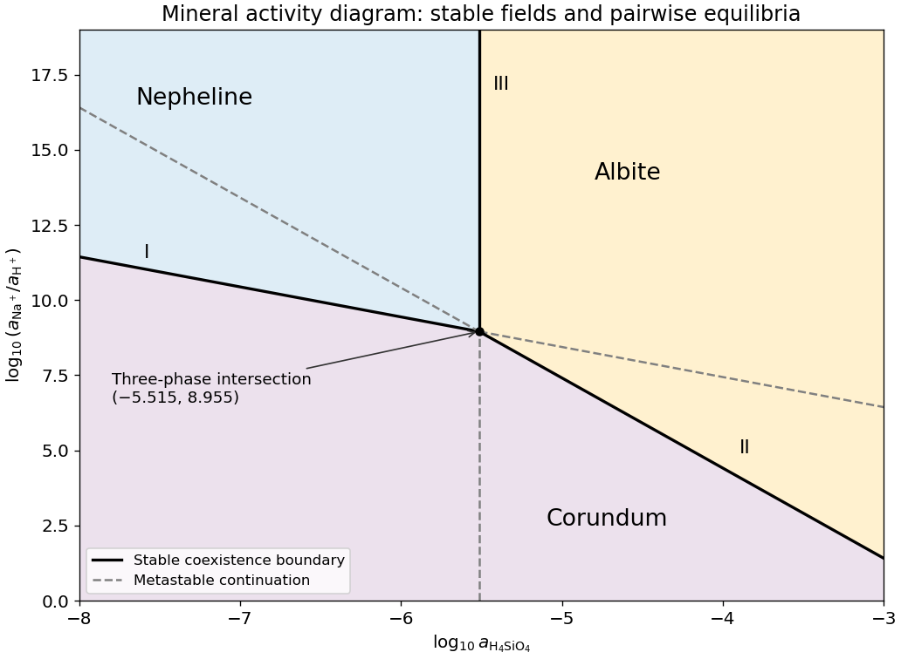

<h1 id="10/c/solution">Solution</h1>

↑ **Parent:** [C](../c.md)

For pure [albite](../../../../../albite.md), pure [nepheline](../../../../../nepheline.md) and unit water activity, $Q_{III}=a_{\mathrm{H_4SiO_4}}^2$. Consequently

$$
\boxed{x=\tfrac12\log_{10}K_{III}=-5.515,}
$$

a vertical line through the intersection of (I) and (II). It does not depend on $y$ because the net reaction has no hydrogen or sodium ions.

**[Figure 7](#10/c/image-stable-and-metastable-boundaries-for-albite-nepheline-and-corundum). Stable and metastable boundaries for albite, nepheline and corundum**. Original diagram derived from the two supplied equilibrium constants. Solid black segments delimit the stable mineral fields; dashed grey continuations are metastable pairwise equilibria. Logarithms are base ten and the plotted silica activities are below one.

## ↑ Ancestors (12)

1. [C](../c.md)
2. [10](../../10.md)
3. [Paper 3](../../../paper-3-split.md)
4. [2025](../../../split.md)
5. [Past exam of the year 2 of the earth sciences (geology) course of the University of Oxford](../../../../split.md)
6. [Year 2 of the earth sciences (geology) course of the University of Oxford](../../../../../year-2-of-the-earth-sciences-geology-course-of-the-university-of-oxford.md)
7. [Earth sciences (geology) course of the University of Oxford](../../../../../earth-sciences-geology-course-of-the-university-of-oxford.md)
8. [Undergraduate course of the University of Oxford](../../../../../undergraduate-course-of-the-university-of-oxford.md)
9. [Course of the University of Oxford](../../../../../course-of-the-university-of-oxford.md)
10. [University of Oxford](../../../../../university-of-oxford-split.md)
11. [List of universities](../../../../../list-of-universities.md)
12. [Codex Wiki](../../../../../split.md)
