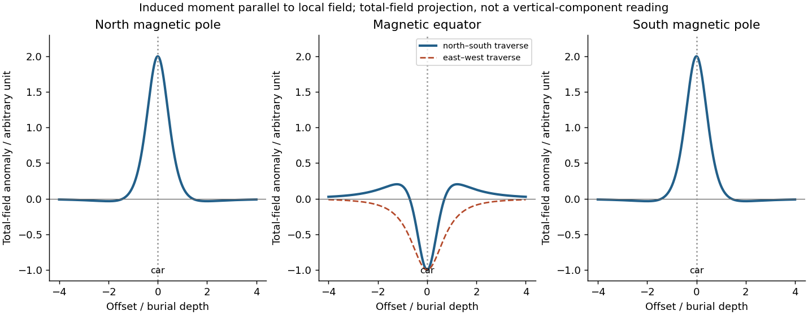

<h1 id="2/d">d</h1>

↑ **Parent:** [2](../2.md)

The sketches assume the car can be approximated by a compact [magnetic dipole](../../../../magnetic-dipole.md) whose **induced** [magnetic moment](../../../../magnetic-dipole-moment.md) is parallel to the local [geomagnetic field](../../../../geomagnetic-field.md). The host contributes negligible local contrast. Real steel also has [remanent magnetization](../../../../remanent-magnetization.md) and shape-dependent magnetization, so the car's actual profile need not follow this idealization. A [proton-precession magnetometer](../../../../proton-precession-magnetometer.md) observes

$$
\Delta T=|\mathbf B_0+\mathbf b|-|\mathbf B_0|\simeq\widehat{\mathbf B}_0\cdot\mathbf b
$$

when $|\mathbf b|\ll|\mathbf B_0|$. This scalar [total-field magnetic anomaly](../../../../total-field-magnetic-anomaly.md) must not be confused with a fixed vertical field component. For induced $\mathbf m=m\widehat{\mathbf B}_0$, the [magnetic dipole](../../../../magnetic-dipole.md) field gives

$$
\Delta T\simeq\frac{\mu_0m}{4\pi r^3}\left[3(\widehat{\mathbf B}_0\cdot\widehat{\mathbf r})^2-1\right].
$$

Reversing both the inducing field and induced moment leaves this [total-field magnetic anomaly](../../../../total-field-magnetic-anomaly.md) unchanged, exactly for the magnitude definition as well as in the weak-anomaly approximation.[Buried-dipole examples at the magnetic equator and magnetic pole; total-field projection and traverse orientation.](../../../../magnetic-surveying-induced-magnetization-by-ubc-geophysical-inversion-facility.md)

**[Figure 1](#2/d/image-induced-magnetic-dipole-profiles-at-the-magnetic-poles-and-equator). Induced magnetic dipole profiles at the magnetic poles and equator**. Original ideal profiles in arbitrary units for a dipole at unit burial depth. The polar curves coincide. At the equator, a north–south traverse has a central low and positive shoulders, whereas an east–west traverse has a central low without positive shoulders. Car shape and remanence are excluded.

**Table of contents**

- [i](d/i.md)
  - [Solution](d/i/solution.md)
- [ii](d/ii.md)
  - [Solution](d/ii/solution.md)
- [iii](d/iii.md)
  - [Solution](d/iii/solution.md)

## ↑ Ancestors (11)

1. [2](../2.md)
2. [Paper 3](../../paper-3-split.md)
3. [2025](../../split.md)
4. [Past exam of the year 2 of the earth sciences (geology) course of the University of Oxford](../../../split.md)
5. [Year 2 of the earth sciences (geology) course of the University of Oxford](../../../../year-2-of-the-earth-sciences-geology-course-of-the-university-of-oxford.md)
6. [Earth sciences (geology) course of the University of Oxford](../../../../earth-sciences-geology-course-of-the-university-of-oxford.md)
7. [Undergraduate course of the University of Oxford](../../../../undergraduate-course-of-the-university-of-oxford.md)
8. [Course of the University of Oxford](../../../../course-of-the-university-of-oxford.md)
9. [University of Oxford](../../../../university-of-oxford-split.md)
10. [List of universities](../../../../list-of-universities.md)
11. [Codex Wiki](../../../../split.md)
