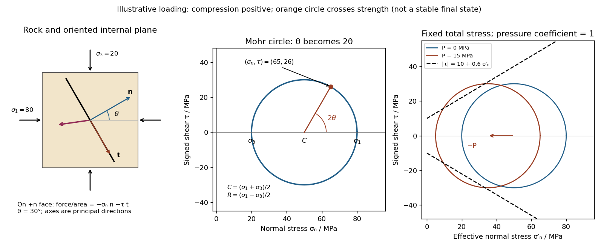

<h1 id="3/a/solution">Solution</h1>

↑ **Parent:** [A](../a.md)

Use compression-positive [principal stresses](../../../../../principal-stress.md) $\sigma_1\geq\sigma_2\geq\sigma_3$. The two-dimensional [Mohr's circle](../../../../../mohr-s-circle.md) shown is the $\sigma_1$–$\sigma_3$ circle: its horizontal axis is compressive [normal stress](../../../../../normal-stress.md) $\sigma_n$, its vertical axis signed [shear stress](../../../../../shear-stress.md) $\tau$, its centre is $C=(\sigma_1+\sigma_3)/2$, and its radius is $R=(\sigma_1-\sigma_3)/2$. The intercepts $(\sigma_1,0)$ and $(\sigma_3,0)$ represent [principal stress planes](../../../../../principal-stress-plane.md), on which [shear stress](../../../../../shear-stress.md) vanishes. The top and bottom points have $|\tau|=R$, the maximum [shear stress](../../../../../shear-stress.md).

In the [rock](../../../../../rock-geology.md) sketch, $\theta$ is the counterclockwise angle from the $\sigma_1$ direction to the plane's [unit normal vector](../../../../../unit-normal.md) $\mathbf n=(\cos\theta,\sin\theta)$. Choose the clockwise unit tangent $\mathbf t=(\sin\theta,-\cos\theta)$ and define $\tau=\mathbf t\cdot\boldsymbol\sigma^c\mathbf n$, with $\boldsymbol\sigma^c=\operatorname{diag}(\sigma_1,\sigma_3)$ compression positive. Thus a positive $\theta$ produces a positive $2\theta$ rotation on the plotted circle. The actual [traction](../../../../../traction.md) on the positive-normal face is $-\boldsymbol\sigma^c\mathbf n=-\sigma_n\mathbf n-\tau\mathbf t$. Reversing the tangent convention reverses the plotted shear sign, not the physical prediction.

**[Figure 2](#3/a/image-stressed-rock-mohr-circle-and-the-effect-of-pore-pressure). Stressed rock, Mohr circle, and the effect of pore pressure**. Original illustrative construction with principal compressions 80 and 20 MPa and a plane normal 30 degrees from the maximum compression. The circle point is approximately (65,26) MPa at twice that angle. A separate panel translates the circle left by 15 MPa pore pressure at fixed total stress, bringing it to a frictional failure envelope.

In three dimensions there are circles for each pair of [principal stresses](../../../../../principal-stress.md). The largest is the $\sigma_1$–$\sigma_3$ circle; a general three-dimensional plane requires all three [principal stresses](../../../../../principal-stress.md) and its normal, rather than a single angle on this circle.

## ↑ Ancestors (12)

1. [A](../a.md)
2. [3](../../3.md)
3. [Paper 3](../../../paper-3-split.md)
4. [2025](../../../split.md)
5. [Past exam of the year 2 of the earth sciences (geology) course of the University of Oxford](../../../../split.md)
6. [Year 2 of the earth sciences (geology) course of the University of Oxford](../../../../../year-2-of-the-earth-sciences-geology-course-of-the-university-of-oxford.md)
7. [Earth sciences (geology) course of the University of Oxford](../../../../../earth-sciences-geology-course-of-the-university-of-oxford.md)
8. [Undergraduate course of the University of Oxford](../../../../../undergraduate-course-of-the-university-of-oxford.md)
9. [Course of the University of Oxford](../../../../../course-of-the-university-of-oxford.md)
10. [University of Oxford](../../../../../university-of-oxford-split.md)
11. [List of universities](../../../../../list-of-universities.md)
12. [Codex Wiki](../../../../../split.md)
