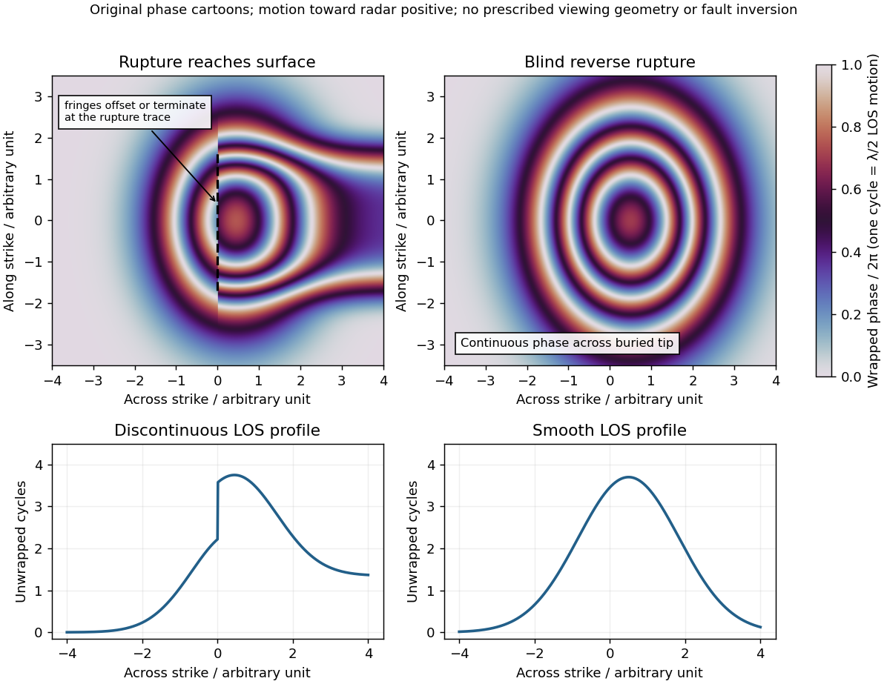

<h1 id="4/c/solution">Solution</h1>

↑ **Parent:** [C](../c.md)

[Interferometric synthetic-aperture radar](../../../../../interferometric-synthetic-aperture-radar.md) compares the [phase](../../../../../phase-waves.md) of coherent radar returns acquired before and after the [earthquake](../../../../../earthquake.md) from closely repeated viewing geometry. After image registration and removal of orbital and topographic phase, the residual [interferometric phase](../../../../../interferometric-phase.md) constrains relative ground displacement along the radar [line of sight](../../../../../line-of-sight.md). Defining $u_{\mathrm{LOS}}$ positive toward the satellite and choosing the interferogram's phase order accordingly,

$$
\Delta\phi_{\mathrm{def}}=\frac{4\pi}{\lambda}u_{\mathrm{LOS}}\pmod{2\pi}.
$$

One complete colour cycle therefore represents $\lambda/2$ of relative [line-of-sight displacement](../../../../../line-of-sight-displacement.md). Reversing the image order reverses the displayed phase sign. This observes a projection of both horizontal and vertical motion, not uplift alone.[NISAR mission explanation: remove orbit/topography contributions and interpret each complete fringe as half a radar wavelength of line-of-sight range change.](../../../../../interferometry-by-nasa.md)

**[Figure 3](#4/c/image-qualitative-interferograms-for-surface-breaking-and-blind-reverse-rupture). Qualitative interferograms for surface-breaking and blind reverse rupture**. Original wrapped-phase cartoons and corresponding unwrapped line profiles. They illustrate a displacement discontinuity versus a continuous deformation lobe, rather than numerical elastic fault models. The chosen phase sign is positive toward the radar. Every complete colour cycle represents half a radar wavelength of line-of-sight displacement; real fringe shape depends on viewing and rupture geometry.

If the main reverse rupture reaches the surface, coherent areas on opposite sides can show a displacement step: fringes become offset, truncated or abruptly juxtaposed along a trace. A narrow belt can lose [interferometric coherence](../../../../../interferometric-coherence.md) where cracking, intense gradients or changed scatterers prevent reliable phase comparison. If the rupture remains blind, a simple elastic model instead predicts a continuous surface displacement field, often a broad asymmetric lobe with continuous curved or closed fringes and a smooth displacement gradient across the projected tip.

These are diagnostic tendencies, not a unique test. An ordinary wrapped-phase boundary is just a $2\pi$ colour reset and is not itself a rupture. A step of an integer number of cycles can be hidden in wrapped phase; loss of [interferometric coherence](../../../../../interferometric-coherence.md) can hide either kind of near-field deformation. Vegetation, atmosphere and viewing direction also affect the pattern, and a displacement perpendicular to the radar [line of sight](../../../../../line-of-sight.md) is poorly sensed. Inspect coherence and unwrapped displacement, compare ascending and descending views where possible, and test a [fault](../../../../../geological-fault.md) model against field observations. A sharp [fold scarp](../../../../../fold-scarp.md) above a blind rupture or a secondary shallow fault can also create localized gradients, so smooth fringes do not prove a buried tip and broken fringes alone do not prove a surface-breaking main rupture.

## ↑ Ancestors (12)

1. [C](../c.md)
2. [4](../../4.md)
3. [Paper 3](../../../paper-3-split.md)
4. [2025](../../../split.md)
5. [Past exam of the year 2 of the earth sciences (geology) course of the University of Oxford](../../../../split.md)
6. [Year 2 of the earth sciences (geology) course of the University of Oxford](../../../../../year-2-of-the-earth-sciences-geology-course-of-the-university-of-oxford.md)
7. [Earth sciences (geology) course of the University of Oxford](../../../../../earth-sciences-geology-course-of-the-university-of-oxford.md)
8. [Undergraduate course of the University of Oxford](../../../../../undergraduate-course-of-the-university-of-oxford.md)
9. [Course of the University of Oxford](../../../../../course-of-the-university-of-oxford.md)
10. [University of Oxford](../../../../../university-of-oxford-split.md)
11. [List of universities](../../../../../list-of-universities.md)
12. [Codex Wiki](../../../../../split.md)
