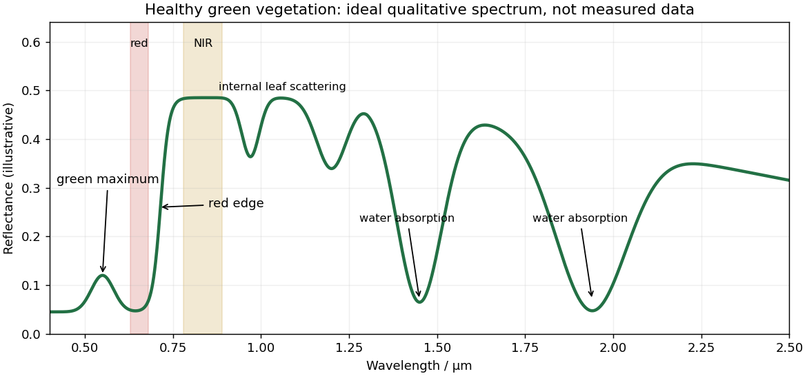

<h1 id="5/b/solution">Solution</h1>

↑ **Parent:** [B](../b.md)

Healthy green vegetation has strong visible [absorption](../../../../../absorption-electromagnetic-radiation.md) in the blue, around $0.43$–$0.47\ \mathrm{\mu m}$, and red, around $0.65$–$0.68\ \mathrm{\mu m}$, mainly from [chlorophylls](../../../../../chlorophyll.md) and other [photosynthetic pigments](../../../../../photosynthetic-pigment.md). Weaker absorption around green wavelengths produces a relative [reflectance](../../../../../reflectance.md) maximum near $0.55\ \mathrm{\mu m}$ and the familiar green appearance. The [red edge](../../../../../red-edge.md) is the steep reflectance rise around $0.68$–$0.75\ \mathrm{\mu m}$. In the [near-infrared](../../../../../near-infrared.md), weak pigment absorption and multiple scattering at internal leaf tissue–air interfaces produce high reflectance, commonly a broad plateau. This plateau is primarily a structural scattering effect, rather than chlorophyll reflecting the light.[“Normalized Difference Vegetation Index”: contrast between chlorophyll absorption of visible light and strong near-infrared scattering by leaf structure.](../../../../../measuring-vegetation-by-nasa-earth-observatory.md)

**[Figure 4](#5/b/image-qualitative-reflectance-spectrum-of-healthy-green-vegetation). Qualitative reflectance spectrum of healthy green vegetation**. Original synthetic leaf spectrum with a green maximum, red absorption, red edge, near-infrared plateau and shortwave-infrared water absorption troughs. The curve is illustrative rather than measured; shaded bands exemplify red and near-infrared measurements for a vegetation index.

Leaf [water](../../../../../water.md) produces absorption troughs in the [shortwave infrared](../../../../../shortwave-infrared.md), especially near $1.4$ and $1.9\ \mathrm{\mu m}$, with weaker features near $0.97$ and $1.2\ \mathrm{\mu m}$. Atmospheric [water vapor](../../../../../water-vapor.md) also strongly absorbs near $1.4$ and $1.9\ \mathrm{\mu m}$, so satellite bands usually avoid the centres of those deep troughs. Drying, senescence, pigment loss and changes in canopy structure alter the spectrum; measured canopy reflectance also includes shadows and the soil background.

To highlight vegetation, assign the [near-infrared](../../../../../near-infrared.md) band to the red display channel, red to green and green to blue: vigorously vegetated areas appear bright red in this conventional [false-colour composite](../../../../../false-colour-composite.md). Alternatively calculate the [normalized difference vegetation index](../../../../../normalized-difference-vegetation-index.md) from atmospherically corrected, spatially registered red and near-infrared [reflectances](../../../../../reflectance.md):

$$
\mathrm{NDVI}=\frac{\rho_{\mathrm{NIR}}-\rho_{\mathrm{red}}}{\rho_{\mathrm{NIR}}+\rho_{\mathrm{red}}}.
$$

Large positive values indicate a strong vegetation-like red/NIR contrast. For example, $\rho_{\mathrm{NIR}}=0.50$ and $\rho_{\mathrm{red}}=0.05$ give about $0.82$. Mask clouds, their shadows and invalid low-signal pixels. Bare soil usually has a smaller contrast, while water often has negative values; fixed universal thresholds are inappropriate, and dense vegetation can saturate the index. A band ratio improves contrast but is not a direct count of plants or a unique measure of physiological health.[“Normalized Difference Vegetation Index”: normalized red/near-infrared contrast and interpretation of green vegetation.](../../../../../measuring-vegetation-by-nasa-earth-observatory.md)

## ↑ Ancestors (12)

1. [B](../b.md)
2. [5](../../5.md)
3. [Paper 3](../../../paper-3-split.md)
4. [2025](../../../split.md)
5. [Past exam of the year 2 of the earth sciences (geology) course of the University of Oxford](../../../../split.md)
6. [Year 2 of the earth sciences (geology) course of the University of Oxford](../../../../../year-2-of-the-earth-sciences-geology-course-of-the-university-of-oxford.md)
7. [Earth sciences (geology) course of the University of Oxford](../../../../../earth-sciences-geology-course-of-the-university-of-oxford.md)
8. [Undergraduate course of the University of Oxford](../../../../../undergraduate-course-of-the-university-of-oxford.md)
9. [Course of the University of Oxford](../../../../../course-of-the-university-of-oxford.md)
10. [University of Oxford](../../../../../university-of-oxford-split.md)
11. [List of universities](../../../../../list-of-universities.md)
12. [Codex Wiki](../../../../../split.md)
