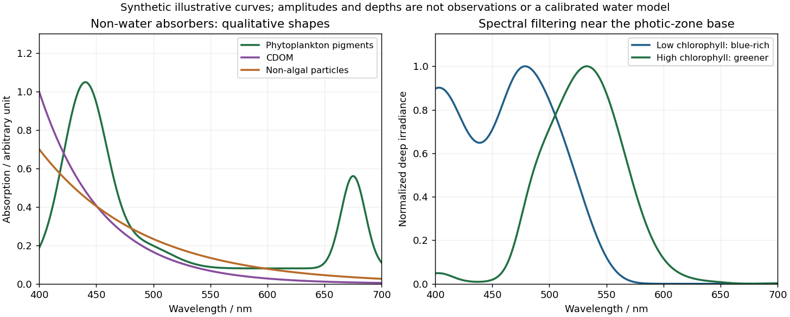

<h1 id="6/a/solution">Solution</h1>

↑ **Parent:** [A](../a.md)

The principal non-water visible-light absorbers can be grouped into [phytoplankton pigments](../../../../../phytoplankton-pigment.md), [coloured dissolved organic matter](../../../../../coloured-dissolved-organic-matter.md) (CDOM), and [non-algal particles](../../../../../non-algal-particle.md) (NAP), including organic detritus and absorbing mineral material. A useful additive decomposition of the [absorption coefficient](../../../../../absorption-coefficient.md) is

$$
a(\lambda)=a_w(\lambda)+a_{\mathrm{ph}}(\lambda)+a_{\mathrm{CDOM}}(\lambda)+a_{\mathrm{NAP}}(\lambda).
$$

The supplied sketch separates the three non-water contributions; its amplitudes are arbitrary and are not concentrations or measured spectra.

**[Figure 5](#6/a/image-qualitative-marine-absorption-spectra-and-deep-light-spectral-filtering). Qualitative marine absorption spectra and deep-light spectral filtering**. Original synthetic sketches: phytoplankton have blue and red pigment absorption bands, while CDOM and non-algal particles preferentially absorb short wavelengths. The right panel illustrates blue-rich deep light in low-chlorophyll clear water and a greener spectrum in more absorbing high-chlorophyll water. Spectra are normalized separately; curves and representative depths are illustrative, not observations or a calibrated radiative-transfer calculation.

[Phytoplankton pigments](../../../../../phytoplankton-pigment.md) give prominent absorption maxima around $440$ and $675\ \mathrm{nm}$, associated with [chlorophyll a](../../../../../chlorophyll-a.md), and a relative minimum in the green. [Accessory pigments](../../../../../accessory-pigment.md), including [carotenoids](../../../../../carotenoid.md) and [phycobilins](../../../../../phycobilin.md), broaden or add absorption bands, so an assemblage is not just a pure chlorophyll-a solution. Intracellular packaging and cell size also modify the shape and absorption per unit pigment.

[Coloured dissolved organic matter](../../../../../coloured-dissolved-organic-matter.md) consists of dissolved light-absorbing organic compounds, often including humic material from terrestrial runoff and marine degradation. Its absorption is strongest at the blue/ultraviolet end and declines approximately exponentially toward red, without the narrow chlorophyll red peak. A common local parameterization is $a_g(\lambda)=a_g(\lambda_0)e^{-S_g(\lambda-\lambda_0)}$ with positive spectral slope $S_g$; here $S_g$ is an optical slope, not gas saturation.

[Non-algal particles](../../../../../non-algal-particle.md) include nonliving organic detritus, pigment degradation products and absorbing suspended mineral particles. Their aggregate absorption often also decreases approximately exponentially from blue to red, with variable slope and mineral-dependent departures. Suspended sediments can strongly scatter as well as absorb; bright sediment-laden water is not evidence of a red absorption peak. Chlorophyll-containing living cells belong in $a_{\mathrm{ph}}$, so these categories should not be double counted.[Revision 4, Volume I, sections defining chlorophyll, CDOM and non-pigmented-particle absorption, and the importance of blue absorption to ocean-colour retrieval.](../../../../../ocean-optics-protocols-for-satellite-ocean-color-sensor-validation-revision-4-volume-i-by-nasa.md)

## ↑ Ancestors (12)

1. [A](../a.md)
2. [6](../../6.md)
3. [Paper 3](../../../paper-3-split.md)
4. [2025](../../../split.md)
5. [Past exam of the year 2 of the earth sciences (geology) course of the University of Oxford](../../../../split.md)
6. [Year 2 of the earth sciences (geology) course of the University of Oxford](../../../../../year-2-of-the-earth-sciences-geology-course-of-the-university-of-oxford.md)
7. [Earth sciences (geology) course of the University of Oxford](../../../../../earth-sciences-geology-course-of-the-university-of-oxford.md)
8. [Undergraduate course of the University of Oxford](../../../../../undergraduate-course-of-the-university-of-oxford.md)
9. [Course of the University of Oxford](../../../../../course-of-the-university-of-oxford.md)
10. [University of Oxford](../../../../../university-of-oxford-split.md)
11. [List of universities](../../../../../list-of-universities.md)
12. [Codex Wiki](../../../../../split.md)
