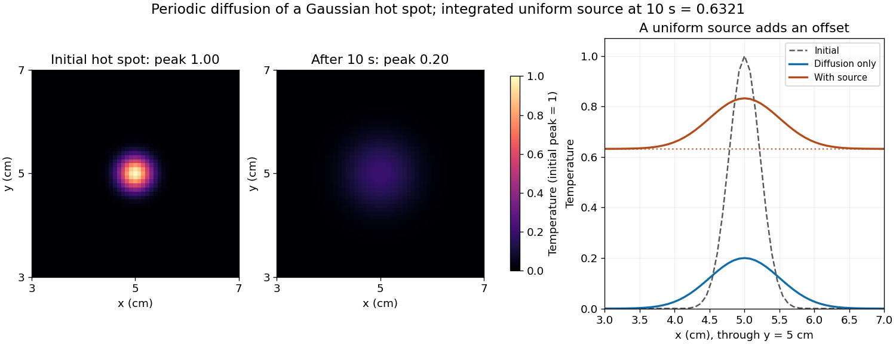

<h1 id="7/f/solution">Solution</h1>

↑ **Parent:** [F](../f.md)

Diffusion smooths and broadens the hot spot while conserving its integral. For an isolated two-dimensional initial profile $u_0=e^{-r^2/a}$, the [Gaussian hot spot under diffusion](../../../../../gaussian-hot-spot-under-diffusion.md) is

$$
u(r,t)=\frac{a}{a+4\alpha t}\exp\left[-\frac{r^2}{a+4\alpha t}\right].
$$

Here $a=0.1\,\mathrm{cm^2}$ and $t=10\,\mathrm s$, giving **a width parameter of $0.5\,\mathrm{cm^2}$ and a peak of $0.20$** in the initial temperature units. The periodic-grid calculation agrees to displayed precision because the periodic copies are far away. Running the endpoint-inclusive listing as written instead gives a sampled initial peak near $0.9695$ and final peak near $0.1963$; the difference is consistent with the coordinate-grid issue, rather than a different diffusion law.

Increasing positive [thermal diffusivity](../../../../../thermal-diffusivity.md) at fixed time produces a wider, lower peak. Each nonconstant [Fourier mode](../../../../../fourier-mode.md) decays faster, while the [spatial mean of a periodic heat equation](../../../../../spatial-mean-of-a-periodic-heat-equation.md) remains fixed. The profiles approach a uniform mean at long times under these [periodic boundary conditions](../../../../../periodic-boundary-conditions.md).

**[Figure 6](#7/f/image-diffusion-of-a-gaussian-hot-spot-with-and-without-a-spatially-uniform-decaying-heat-source). Diffusion of a Gaussian hot spot, with and without a spatially uniform decaying heat source**. Original calculations on an endpoint-excluded periodic grid. The cross-sections use a common temperature scale; the source contribution is a uniform offset. The dashed initial profile and the two final profiles are calculated rather than copied from the supplied examination figure.

## ↑ Ancestors (12)

1. [F](../f.md)
2. [7](../../7.md)
3. [Paper 3](../../../paper-3-split.md)
4. [2025](../../../split.md)
5. [Past exam of the year 2 of the earth sciences (geology) course of the University of Oxford](../../../../split.md)
6. [Year 2 of the earth sciences (geology) course of the University of Oxford](../../../../../year-2-of-the-earth-sciences-geology-course-of-the-university-of-oxford.md)
7. [Earth sciences (geology) course of the University of Oxford](../../../../../earth-sciences-geology-course-of-the-university-of-oxford.md)
8. [Undergraduate course of the University of Oxford](../../../../../undergraduate-course-of-the-university-of-oxford.md)
9. [Course of the University of Oxford](../../../../../course-of-the-university-of-oxford.md)
10. [University of Oxford](../../../../../university-of-oxford-split.md)
11. [List of universities](../../../../../list-of-universities.md)
12. [Codex Wiki](../../../../../split.md)
