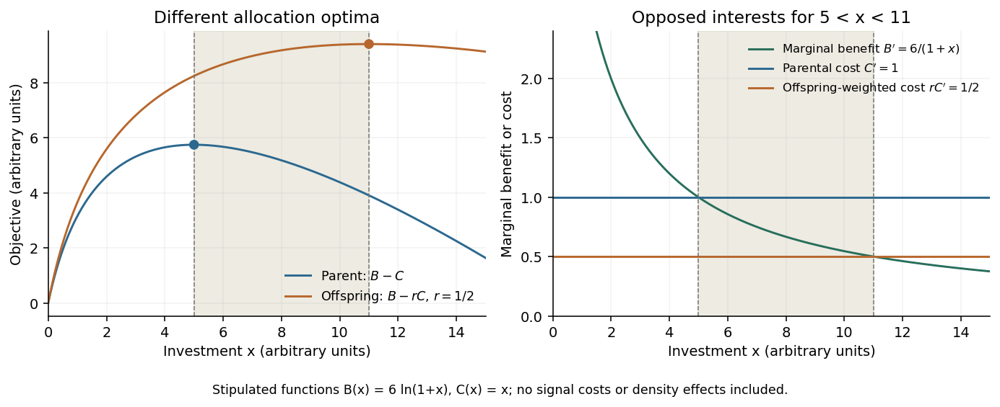

# Paper zl3

↑ **Parent:** [2025](../2025.md)

[Original paper, released PDF pages 42–44](https://www.whatdotheyknow.com/request/natural_science_tripos_part_ii_p_3/response/3307450/attach/3/FOI%202026%2053%20Vongtanakiat%20materials.pdf?cookie_passthrough=1#page=42)

**Table of contents**

- [1](#1)
  - [Solution](#1/solution)
- [2](#2)
  - [Solution](#2/solution)
- [3](#3)
  - [Solution](#3/solution)
- [4](#4)
  - [Solution](#4/solution)
- [5](#5)
  - [Solution](#5/solution)
- [6](#6)
  - [Solution](#6/solution)

## 1

↑ **Parent:** [Paper zl3](paper-zl3.md)

<h3 id="1/solution">Solution</h3>

↑ **Parent:** [1](#1)

**The strength of conflicting interests, opportunities for exploitation and receiver defences matter more than the species boundary itself.** Many striking examples occur between [species](../../biology.md#species), where shared descent usually supplies little [inclusive fitness](../../biology.md#inclusive-fitness) restraint. However, competition for mates and resources also creates substantial conflict within a [species](../../biology.md#species), including between relatives. The available examples do not establish a universal numerical ranking of the two settings.

A useful distinction is between [deceptive signalling](../../biology.md#deceptive-signalling) and the broader category of [behavioural manipulation](../../biology.md#behavioural-manipulation). A deceptive display exploits a receiver response in a context in which that response no longer provides the normally associated benefit. Manipulation also includes changing another organism's physiology or behaviour without conveying misleading information. Neither definition requires conscious lying or knowledge of another individual's beliefs. Ordinary persuasion is not a helpful biological criterion: the relevant comparison is between the [reproductive success](../../biology.md#reproductive-success) consequences for sender and receiver, relative to appropriate alternatives.

**Between species, exploitation can borrow a response that is maintained for another reason.** A [predator](../../ecology.md#predator) can mimic an attractive prey cue; a [parasite](../../ecology.md#parasite) can exploit a host's provisioning or avoidance mechanism; and a plant can attract a pollinator without providing the expected reward. Such interactions can favour [sensory exploitation](../../biology.md#sensory-exploitation) and [aggressive mimicry](../../biology.md#aggressive-mimicry). Receiver resistance is selected when the losses outweigh its costs, but resistance need not eliminate deception. Rejecting a genuine mate or ignoring a real predator can be more costly than occasionally accepting a false signal.

In [fork-tailed drongos](../../organism.md#fork-tailed-drongo), observations and playback experiments showed that false alarm calls can make other foragers abandon food, which the drongo steals. Receivers habituated to repeated alarms, while switching among alarm types, including mimicked calls, helped sustain responses. This demonstrates both an exploiter benefit and a receiver counterresponse. It does not require an inference that drongos attribute beliefs to their victims.[2014, field observations and playback tests of alarm variation and habituation](../../biology-bibliography.md#deception-by-flexible-alarm-mimicry-in-an-african-bird-by-tom-p-flower-and-others)

A different mechanism occurs in the orchid [Ophrys sphegodes](../../organism.md#ophrys-sphegodes). Chemical analyses and behavioural tests implicated a floral blend matching components of female [Andrena nigroaenea](../../organism.md#andrena-nigroaenea) sex pheromone in attracting males that transfer pollen during attempted mating. Here deception exploits a reproductive response maintained in the pollinator's own [species](../../biology.md#species), rather than a communication system jointly serving orchid and bee. The orchid example demonstrates a specific mechanism, not the frequency of deception across all pollination systems.[1999, floral chemistry and field behavioural tests](../../biology-bibliography.md#orchid-pollination-by-sexual-swindle-by-florian-p-schiestl-and-others)

[Behavioural manipulation](../../biology.md#behavioural-manipulation) can go beyond signals. In experimental comparisons, [Toxoplasma gondii](../../organism.md#toxoplasma-gondii)-infected rats showed altered responses to cat-associated odours, sometimes approaching locations avoided by uninfected rats. This is consistent with a transmission-enhancing effect because felids are the parasite's definitive hosts. However, an odour preference assay does not itself demonstrate increased predation by cats, greater parasite transmission, or that every infection-associated behavioural change is an adaptation. Illness, host defence and collateral pathology remain alternative explanations requiring separate tests.[2000, experimental odour responses and interpretation](../../biology-bibliography.md#fatal-attraction-in-rats-infected-with-toxoplasma-gondii-by-m-berdoy-and-others)

**Within species, common ancestry does not imply identical interests.** A mating partner may benefit from extra copulations that impose costs on the other partner; competitors may benefit by concealing food or exaggerating fighting ability; offspring may demand more care than maximizes parental lifetime [reproductive success](../../biology.md#reproductive-success). [Kin selection](../../biology.md#kin-selection) weakens some conflicts because harming a relative can also reduce an actor's [inclusive fitness](../../biology.md#inclusive-fitness), but it does not generally remove them. For an unrelated rival, even that indirect cost may be absent.

Male [topi](../../organism.md#topi) provide a direct counterexample to the claim that deceptive communication is mainly possible across species. Field observations and playback work associated false alarm snorts with retaining receptive females within male territories and obtaining mating opportunities. Alarm responsiveness remains useful to females when a predator really is present, allowing a sexual conflict to exploit an otherwise protective response. The relevant opposition is male versus female mating interests, despite their membership of the same [species](../../biology.md#species).[2010, alarm context, female responses and mating consequences](../../biology-bibliography.md#male-topi-antelopes-alarm-snort-deceptively-to-retain-females-for-mating-by-jakob-bro-jorgensen-and-wiline-m-pangle)

There are also reasons why repeated interactions can restrain exploitation in either setting. A receiver can learn, recognize individuals, stop responding, abandon a partner, or impose a cost on it. In many [mutualisms](../../ecology.md#mutualism), both parties gain from preserving the association, even though each would benefit from obtaining more while supplying less. Conversely, within-species relatedness need not be high, and a short-lived encounter may give little opportunity for retaliation. Thus “between species” is an imperfect proxy for the underlying distribution of benefits, costs, encounter rates and alternatives.

To establish comparative prevalence, one would need a denominator: deceptive acts per interaction, the fraction of signal types exploited, the proportion of individuals using manipulation, or the number of independent evolutionary origins. Those measures can rank systems differently. Sampling would also need to control for observation effort, interaction frequency, detection probability and [phylogenetic nonindependence](../../biology.md#phylogenetic-nonindependence). A concealed false signal can be harder to identify than an obvious parasite-induced change; spectacular cases attract disproportionate study.

The defensible prediction is conditional. Exploitation should be favoured where it increases the actor's [reproductive success](../../biology.md#reproductive-success), the receiver's defences are ineffective or costly, and countervailing relatedness or future-interaction costs are small. Interspecific antagonism often meets these conditions, but so do some intraspecific sexual and competitive interactions. A comparative answer should therefore explain those conditions and acknowledge that the examples alone cannot settle a universal prevalence claim.

## 2

↑ **Parent:** [Paper zl3](paper-zl3.md)

<h3 id="2/solution">Solution</h3>

↑ **Parent:** [2](#2)

**Both conflicts arise because family members value the same resource differently, but they concern different decisions.** [Sibling rivalry](../../biology.md#sibling-rivalry) concerns allocation among offspring, whereas [parent-offspring conflict](../../biology.md#parent-offspring-conflict) concerns a parent's allocation relative to what an offspring would favour. Their consequences interact: offspring compete with one another inside a parental provisioning system that their own demands can also alter.

The basic mechanism is unequal [genetic relatedness](../../population-genetics.md#genetic-relatedness) to the beneficiaries of an action. An offspring values its own additional survival or reproduction more strongly than an equal gain to a sibling. A parent, under a simple symmetric pedigree, is equally related to each of its offspring and can favour an allocation that maximizes their combined contribution. Neither statement implies that an offspring should demand everything: diverting resources from relatives can reduce its [inclusive fitness](../../biology.md#inclusive-fitness). These differing interests underlie the original theory of [parent-offspring conflict](../../biology.md#parent-offspring-conflict).[1974, theory of investment, sibling costs and the duration of care](../../biology-bibliography.md#parent-offspring-conflict-by-robert-l-trivers)

Consider an explicit illustrative model. Let investment $x$ produce a direct offspring benefit $B(x)$ and an opportunity cost $C(x)$ measured in lost equivalent fitness contributions of other offspring. Assume a single parent, equal value of current and future offspring, no inbreeding, and relatedness $r$ between the focal offspring and those losing resources. After dropping a common parental relatedness factor, the parent's objective is $B-C$, whereas the offspring's is $B-rC$. Interior optima therefore satisfy

$$
B'(x_{\rm parent})=C'(x_{\rm parent}),\qquad B'(x_{\rm offspring})=rC'(x_{\rm offspring}).
$$

With diminishing marginal benefits and $0<r<1$, the offspring typically favours more investment. In particular, the range $rC'<B'<C'$ contains increments favoured by the offspring but opposed by the parent. For full siblings under the stated pedigree, $r=1/2$; for maternal half-siblings, $r=1/4$. These values are not universal constants for all family structures, and parent survival, reproductive value and density dependence can alter the effective costs.

**[Figure 1](#2/image-an-original-illustrative-allocation-model-separates-parental-and-offspring-optima). An original illustrative allocation model separates parental and offspring optima**. Chosen functions $B(x)=6\ln(1+x)$ and $C(x)=x$ give a parental optimum at $x=5$ and a full-sibling-weighted offspring optimum at $x=11$. The shaded interval contains increments whose marginal benefit is below the parental opportunity cost but above the offspring-weighted cost. These are stipulated functions and arbitrary units, not empirical measurements.

**Sibling rivalry selects on relative access; parent-offspring conflict can also change the total supply.** If one nestling obtains a larger fraction of a fixed food delivery, its sibling loses directly. Selection can favour size advantages, advantageous positions, earlier hatching or more effective solicitation. Severe asymmetries can permit [siblicide](../../biology.md#siblicide) or [brood reduction](../../biology.md#brood-reduction). By contrast, a stronger demand directed at a parent can increase food delivery to the brood, potentially benefiting siblings too. The same begging behaviour can therefore redistribute a fixed supply and alter parental effort, with different consequences in each case.

A parent's preferred distribution need not be equal. A marginal food item may produce more surviving descendants when given to a smaller hungry chick, or to a larger chick that alone can survive a severe shortage. Parental allocation can consequently mitigate sibling asymmetry in one environment and reinforce it in another. Asynchronous hatching and brood-size adjustment are plausible parental means of structuring that contest; whether a particular asymmetry is an adaptation, a constraint or an offspring-driven outcome needs evidence. A parent's tolerance of brood reduction is not proof that every aggressive act serves parental interests.

Over evolutionary time, [sibling rivalry](../../biology.md#sibling-rivalry) can affect competitive morphology, growth schedules, solicitation, nest position and the survival distribution within broods. [Parent-offspring conflict](../../biology.md#parent-offspring-conflict) can affect the amount and duration of care, offspring demand, parental responsiveness, weaning schedules and the trade-off between current and future reproduction. Neither conflict predicts unlimited escalation. Energetic expenditure, injury, predation risk and losses to relatives can make competitive effort costly even when it obtains a larger resource share.

**Information can produce compromise as well as waste.** An offspring usually has private information about its hunger, while the parent integrates brood condition with its own prospects. In a costly-signalling model, offspring in greater need gain more from additional resources, so differing incentives can support informative solicitation at equilibrium. Such a result is conditional on the cost and benefit functions; it does not mean all begging is perfectly honest or that energetic expenditure alone establishes honesty.[1991, primary signalling model and its assumptions](../../biology-bibliography.md#signalling-of-need-by-offspring-to-their-parents-by-h-c-j-godfray)

Signals can also be aimed at siblings. Experiments on [barn owls](../../organism.md#barn-owl) found that nestlings reduced vocalization when a rival was hungrier, increased it after that rival was fed, and altered calling with experimental brood size. These calls occurred when parents were absent. They support [sibling negotiation](../../biology.md#sibling-negotiation): assessing relative willingness to contest a future prey item can avert some unnecessary escalation. The experiment therefore cautions against treating every nestling call as a demand directed at the parent.[2000, hunger and brood-size manipulations](../../biology-bibliography.md#barn-owl-tyto-alba-siblings-vocally-negotiate-resources-by-alexandre-roulin-and-others)

A further consequence is [coevolution](../../biology.md#coevolution) among parental and offspring response rules. A demand phenotype expressed in young becomes part of the selective environment of provisioning adults, while parental allocation changes the returns to offspring competition. The same individual can experience both roles at different life stages, and genetic correlations between demand and care can constrain independent optimization. Thus observed care can be a compromise maintained by interacting strategies rather than the optimum of either party in isolation.

The comparison is consequently about overlapping arenas of selection. [Sibling rivalry](../../biology.md#sibling-rivalry) chiefly determines who obtains care, while [parent-offspring conflict](../../biology.md#parent-offspring-conflict) also determines how much care is supplied and when it ends. Both can generate competitive adaptations and costs, but both can also generate assessment, contingent responses and restraint. A strong empirical test must separate changes in total provisioning from redistribution, measure lifetime consequences rather than only immediate feeding success, and manipulate relatedness or information without simultaneously changing need.

## 3

↑ **Parent:** [Paper zl3](paper-zl3.md)

<h3 id="3/solution">Solution</h3>

↑ **Parent:** [3](#3)

**Consistent individual differences can bias who leads, works, reproduces or takes risks, but a social role is usually produced jointly by an individual's traits and its social environment.** A stable pattern of participation is not necessarily a fixed genetic caste, and observed specialization is not automatically evidence of superior skill.

First distinguish the measurements. [Animal personality](../../biology.md#animal-personality) denotes repeatable among-individual differences in behaviour; a [behavioural syndrome](../../biology.md#behavioural-syndrome) is a correlation across behavioural contexts. A [social role](../../biology.md#social-role) describes an individual's contribution or position in a particular group, such as initiating travel or carrying brood. A member can repeatedly occupy a role because of morphology, age, nutritional state, information, experience or treatment by others. Some of these causes change predictably during life, so consistency over a short observation window need not imply lifelong specialization.

One proximate route is variation in [behavioural response thresholds](../../biology.md#behavioural-response-threshold). A worker with a lower threshold for responding to brood demand begins care sooner; a hungry fish leaves shelter sooner; an informed animal initiates movement toward food. Once a member acts, it can reduce the stimulus facing others. That negative feedback helps partition labour even when initial differences are small. Conversely, practice or social reinforcement can lower the actor's future threshold or increase others' reliance on it, amplifying small initial differences into persistent roles. These are testable mechanisms, not reasons to assume that a group allocates tasks deliberately.

[Animal leadership](../../biology.md#animal-leadership) illustrates the importance of relational effects. In experimental pairs of [three-spined sticklebacks](../../organism.md#three-spined-stickleback), researchers first measured willingness to leave cover, then paired fish and modelled their movements. Relatively bold fish more often initiated joint trips, but both partners adjusted to the other's movements. Leadership therefore arose from differences in responsiveness as well as spontaneous initiation. It was neither simply the most active fish's solitary phenotype nor evidence that followers had surrendered all influence.[2009, individual assays, paired trials and movement-state model](../../biology-bibliography.md#social-feedback-and-the-emergence-of-leaders-and-followers-by-jennifer-l-harcourt-and-others)

A second route is [division of labour](../../biology.md#division-of-labour) based on developmental or physiological differences. Body size can alter the mechanical returns to defence or transport; age can alter experience, residual lifespan and the cost of risky work. Members can thereby specialize on tasks for which their relative performance is better, even if another individual performs more tasks better in absolute terms. However, morphology may also constrain a role rather than represent an adaptation specifically for the present task, and an age pattern alone does not identify its endocrine or social cause.

Honeybee experiments provide evidence for that distinction. Rearing workers in groups of different sizes and transplanting older bees into otherwise forager-deficient colonies altered endocrine and behavioural development. Young workers could begin foraging unusually early under changed colony conditions. These manipulations show that worker-worker interactions affect [age polyethism](../../biology.md#age-polyethism); age is not an independent clock that irreversibly assigns each bee its task.[1992, group-rearing and older-worker transplant experiments](../../biology-bibliography.md#honeybee-colony-integration-worker-worker-interactions-mediate-hormonally-regulated-plasticity-in-division-of-labor-by-z-y-huang-and-gene-e-robinson)

**Roles can be maintained through feedback without being individually optimal in every context.** Repeated experience can improve information about a particular location, while repeated exclusion from reproduction can make helping the best available option. A [dominance hierarchy](../../biology.md#dominance-hierarchy) can distribute access to food or breeding, but rank may reflect competitive constraints rather than efficient allocation. A subordinate's increased work may therefore result from limited alternatives or coercion, not from a freely chosen cooperative specialization. These possibilities predict different changes after removing dominant members or opening breeding opportunities.

At the group level, complementary tendencies can reduce duplicated effort, switching costs and interference. A mixture of initiators and responsive followers can exploit information that a uniformly cautious group would not use; different thresholds can spread effort across tasks. Yet too many risk-taking initiators may fragment a group, while excessive following may create dependence on poorly informed leaders. The effects therefore depend on composition, task demand and environmental variation. A positive association between behavioural diversity and performance is not enough to establish that selection maintains that diversity: group size, resource supply and group age may influence both.

Nor does specializing necessarily make a worker an expert. In [Temnothorax albipennis](../../organism.md#temnothorax-albipennis), measurements across several tasks found that individual specialization did not predict higher task efficiency, and much work was not performed by the most efficient workers. This rejects a simple specialization-equals-skill explanation in that study. It leaves other possible benefits, including task coverage and reduced switching or coordination costs, to be tested independently.[2008, individual task performance and allocation of labour](../../biology-bibliography.md#specialization-does-not-predict-individual-efficiency-in-an-ant-by-anna-dornhaus)

Persistent differences can themselves be socially maintained. An individual repeatedly treated as a leader obtains more opportunities to lead; a member repeatedly excluded from one task acquires less experience in it. [Social niche specialization](../../biology.md#social-niche-specialization) can thus stabilize a distribution of roles through feedback between behaviour and partner responses. At the same time, [phenotypic plasticity](../../genetics.md#phenotypic-plasticity) permits replacement after a worker or leader disappears. A group can display stable role proportions while its individual members change roles, so stability of organization should not be confused with rigidity of membership.

A causal study should follow identified individuals across repeated contexts, estimate [behavioural repeatability](../../biology.md#behavioural-repeatability) after accounting for age and state, and measure partners' responses. Cross-fostering, standardized hunger manipulations, group-composition changes and member removals can distinguish pre-existing propensities from social induction. Performance should be measured separately from time allocated to a task, and group productivity separately from each member's [reproductive success](../../biology.md#reproductive-success). These distinctions also expose cases in which a role benefits others while imposing costs on its occupant.

Consistent differences therefore supply biases from which social organization can emerge, but the resulting roles are conditional, relational and often reversible. The strongest explanation links an individual trait to a response rule, shows how interactions turn that rule into a role, and tests the consequences for both the individual and the group.

## 4

↑ **Parent:** [Paper zl3](paper-zl3.md)

<h3 id="4/solution">Solution</h3>

↑ **Parent:** [4](#4)

**Relatedness is not required when responding to others yields a sufficient direct benefit, and coordination need not begin as costly altruism.** [Coordinated behaviour](../../biology.md#coordinated-behaviour) means that individuals adjust the timing, position or type of their actions relative to others. [Cooperation](../../ecology.md#cooperation) concerns benefits provided through an interaction, while evolutionary [altruism](../../ecology.md#altruism) specifically imposes a direct fitness cost on the actor. Confusing these categories makes unrelated coordination appear harder to explain than it is.

Consider animals travelling together. Matching a neighbour's direction can reduce an individual's predation risk or help it reach food. Both the responder and the neighbour may benefit immediately; no deferred repayment or kin recognition is necessary. Likewise, complementary hunters can each increase their own chance of capture by responding to another's actions. The relevant condition is that the expected direct return to the response exceeds its costs, relative to available alternatives. That condition depends on ecology, not merely on whether companions share genes.

A clear interspecific example is joint hunting by [groupers](../../organism.md#grouper) and [giant moray eels](../../organism.md#giant-moray-eel), which cannot be close genetic relatives. Field observations documented nonrandom associations, grouper recruitment signals and benefits to both partners. Their different hunting modes expose prey that could evade either hunter alone. Each captured prey item is swallowed by its captor, limiting disputes over division of a carcass. The study supports a direct-benefit mechanism; it does not require alternating favours or prove that every recruitment signal evolved specifically in that association.[2006, associations, recruitment and complementary hunting modes](../../biology-bibliography.md#interspecific-communicative-and-coordinated-hunting-between-groupers-and-giant-moray-eels-in-the-red-sea-by-redouan-bshary-and-others)

**Simple response rules can make individually advantageous actions fit together.** Attraction, alignment, avoidance and following informed individuals can generate collective movement without central control. A [quorum response](../../biology.md#quorum-response) makes commitment more likely after enough others act, potentially preventing one mistaken individual from drawing the whole group into danger. Such proximate rules still need an evolutionary explanation: heritable differences in responsiveness must affect expected survival or reproduction in the environments where the rule is expressed.

Experiments with [three-spined sticklebacks](../../organism.md#three-spined-stickleback) used moving replica fish to manipulate apparent social information. Larger groups under perceived risk were less readily led by a single replica than solitary fish, and nonlinear response models explained these decisions better than simple proportional copying. Simulations linked these rules to improved decisions under specified assumptions. The experiment establishes a plausible coordination mechanism; actual lifetime fitness gains and the historical selection of its parameters remain separate questions.[2008, replica-fish experiments and decision models](../../biology-bibliography.md#quorum-decision-making-facilitates-information-transfer-in-fish-shoals-by-ashley-j-w-ward-and-others)

The strategic problem also depends on the [payoff matrix](../../game-theory.md#payoff-matrix). In a [coordination game](../../game-theory.md#coordination-game), joining a hunt can be a best response when others join, while acting alone is better when nobody else participates. Shared cues, recruitment signals and learned conventions can move a group toward the mutually beneficial equilibrium. Here the difficulty is reaching or maintaining compatible choices. In a [prisoner's dilemma](../../game-theory.md#prisoner-s-dilemma), by contrast, withholding a contribution pays better against either partner action in a one-shot encounter. An account of coordinated hunting must establish which incentives actually apply rather than assume every group activity is a public-goods dilemma.

When cooperation does carry an immediate cost, [direct reciprocity](../../ecology.md#direct-reciprocity) can make future consequences matter. In a deliberately simple repeated donation game, giving costs $c$ and benefits a partner by $b>c$. If encounters continue with probability $w$, perpetual mutual cooperation yields $(b-c)/(1-w)$. Defecting once against a cooperator yields $b$ if it then triggers permanent noncooperation. Cooperation is preferable against that deviation when

$$
\frac{b-c}{1-w}\ge b\qquad\Longleftrightarrow\qquad w\ge\frac cb.
$$

This is a conditional comparison under recognition, reliable observation and the specified retaliation rule. It is not a universal threshold for animal cooperation, nor does it show that a rare cooperative strategy can always invade an uncooperative population. Primary repeated-game modelling and computer tournaments established how such contingent interactions can sustain cooperation under suitable conditions.[1981, theoretical model and strategy tournament](../../biology-bibliography.md#the-evolution-of-cooperation-by-robert-axelrod-and-william-d-hamilton)

Other mechanisms need not involve repayment by the same individual. [Partner choice](../../ecology.md#partner-choice) can reward useful collaborators through access to future interactions; leaving an unproductive association can impose an opportunity cost on a defector. [Reputation](../../ecology.md#reputation) can alter future access to different partners. [Partner fidelity feedback](../../ecology.md#partner-fidelity-feedback) occurs when helping a partner increases the actor's future benefits because that partner survives or becomes more productive. These mechanisms require appropriate encounter structure, information and opportunities to choose; naming them is not evidence that a particular species uses them.

[Evolutionary policing](../../biology.md#evolutionary-policing) or [partner sanctions](../../biology.md#partner-sanctions) can change the returns to exploitation. As a mechanistic example involving unrelated partners, soybean experiments prevented a normally fixing rhizobial strain from fixing nitrogen by changing its atmospheric supply. Reduced bacterial reproductive success and oxygen-supply measurements supported a host-sanction interpretation. This shows how conditional resource allocation can favour service provision without kinship, although it is not by itself an example of synchronized animal movement or proof of the historical origin of the interaction.[2003, experimental prevention of nitrogen fixation and symbiont performance](../../biology-bibliography.md#host-sanctions-and-the-legume-rhizobium-mutualism-by-e-toby-kiers-and-others)

Coordination can consequently evolve through several routes: immediate mutual benefit, stable contingent exchange, partner assortment, or changed incentives imposed by others. Learning can implement or transmit successful rules, while genetic evolution shapes learning capacities and costs. These explanations are compatible with multilevel descriptions of selection, but a claim that groups benefit is insufficient unless the process maintaining the relevant individual strategies is specified. Effective groups of unrelated individuals emerge when responding and contributing are viable strategies in their actual ecological and social setting.

## 5

↑ **Parent:** [Paper zl3](paper-zl3.md)

<h3 id="5/solution">Solution</h3>

↑ **Parent:** [5](#5)

**Dependence evolves when a partner becomes a sufficiently reliable part of the environment that specialization on its services outcompetes maintaining an autonomous alternative. Reciprocal evolutionary change requires additional evidence.** [Ecological interdependence](../../ecology.md#ecological-interdependence), [obligate symbiosis](../../ecology.md#obligate-symbiosis) and [coevolution](../../biology.md#coevolution) describe different properties: present-day benefit, inability to persist without assistance, and reciprocal heritable responses to selection, respectively.

An association can begin with incidental benefits. One species releases metabolic products, modifies habitat or consumes a toxin; another uses the altered environment. Initially neither partner need have evolved a service for the other. Repeated association can favour increased access to that benefit, spatial attachment or mechanisms that exchange complementary resources. [Metabolic cross-feeding](../../ecology.md#metabolic-cross-feeding) may arise from waste uptake before either producer becomes dependent on a particular recipient. This route requires no foresight and does not imply that the interaction started as costly altruism.

Once a service is sufficiently reliable, retaining an expensive redundant function may yield little advantage. [Adaptive gene loss](../../molecular-genetics.md#adaptive-gene-loss) can then make the recipient dependent. Neutral deterioration under relaxed selection is another possible route, particularly when small populations and transmission bottlenecks weaken [purifying selection](../../biology.md#purifying-selection). These explanations have different predictions about costs and selection and should not be conflated: a missing gene is not evidence, by itself, that losing it was adaptive. Moreover, dependence is conditional on the environment. A lineage unable to grow alone in one natural setting may grow without its usual partner when the missing resource or protection is experimentally supplied.

Experiments with [Prochlorococcus](../../organism.md#prochlorococcus) illustrate this distinction. The cyanobacterium is vulnerable to extracellular [hydrogen peroxide](../../chemical-substance.md#hydrogen-peroxide), and co-culture with peroxide-removing [Alteromonas](../../organism.md#alteromonas) protected cells and enabled growth at low densities. Removing the surrounding microbial community also altered peroxide accumulation in seawater assays. These results establish an ecological dependence on a diffusible protective service in the tested conditions. They do not demonstrate that one specific helper species must be present, that helpers require [Prochlorococcus](../../organism.md#prochlorococcus) in return, or that gene loss and reciprocal adaptation were observed evolving during the experiment.[2011, peroxide measurements, co-culture and growth experiments](../../biology-bibliography.md#dependence-of-the-cyanobacterium-prochlorococcus-on-hydrogen-peroxide-scavenging-microbes-for-growth-at-the-ocean-s-surface-by-j-jeffrey-morris-and-others)

**Reciprocal specialization can make dependence bilateral.** If each partner increasingly relies on a different product or function supplied by the other, selection can favour complementary investment and reduced redundancy. Inherited association strengthens that feedback: successful host reproduction also transmits symbionts, so investment in host function can improve symbiont transmission. [Vertical transmission](../../mathematical-biology.md#vertical-transmission) and physical compartmentalization can therefore align some fitness consequences. They do not make interests identical, because symbionts can still compete within hosts and hosts can favour reduced costs of support.

Aphids and [Buchnera aphidicola](../../organism.md#buchnera-aphidicola) provide a strong example of a highly integrated association. The sequenced [Buchnera aphidicola](../../organism.md#buchnera-aphidicola) genome has extensive losses but retains pathways associated with essential amino-acid provision, consistent with nutritional complementation of the aphid's diet. The bacterium depends on the host-associated setting, while the host uses its biosynthetic contributions. This pattern supports derived specialization and loss of autonomy; the genome alone does not establish every metabolite exchanged or directly reconstruct the order of historical evolutionary changes.[2000, reduced genome and retained biosynthetic functions](../../biology-bibliography.md#genome-sequence-of-the-endocellular-bacterial-symbiont-of-aphids-buchnera-sp-aps-by-shuji-shigenobu-and-others)

Dependence can also arise through repeated behavioural or ecological specialization rather than physical integration. A pollinator can specialize on a floral resource, or a predator on a particular prey. The affected partner may then evolve recognition, defence or counter-exploitation. Such interactions may remain facultative, asymmetric or antagonistic. Conversely, obligate association can arise through one lineage's losses while the other changes little. Thus the intensity of current dependence does not measure the amount of reciprocal evolution.

**[Coevolution](../../biology.md#coevolution) requires each lineage to alter selection on the other, with a heritable response in both.** A functional match between two traits is insufficient: both could have adapted to the same abiotic environment, one could have tracked the other, or different partners could produce the same match. An association might also result from ecological sorting of already compatible types. Immediate behavioural adjustment or altered gene expression is [phenotypic plasticity](../../genetics.md#phenotypic-plasticity) unless an inherited change in the response itself is demonstrated.

Experimental host-parasite evolution gives a clearer test. In replicated populations of [bacteria](../../organism.md#bacteria) and [bacteriophages](../../biology.md#bacteriophage), temporal comparisons of bacterial resistance and phage infectivity demonstrated reciprocal escalation, with divergence among replicate populations. Here changes in the antagonist's traits change the selective environment confronting the other lineage. This is evidence for an antagonistic arms race rather than merely a close ecological association. It also shows why [coevolution](../../biology.md#coevolution) is not restricted to beneficial partnerships.[2002, experimental resistance-infectivity dynamics and between-population differentiation](../../biology-bibliography.md#antagonistic-coevolution-between-a-bacterium-and-a-bacteriophage-by-angus-buckling-and-paul-b-rainey)

For a mutualism, reciprocal-transplant experiments can cross evolved hosts with ancestral and evolved symbionts, measuring both parties' performance in a common environment. Parallel evolution without the partner and controls for adaptation to the culture medium help isolate partner-mediated selection. In natural systems, time-shift assays, reciprocal genotype combinations and evidence that relevant traits affect partner fitness strengthen an inference; simple correlations and matching phylogenies remain vulnerable to shared environmental or transmission histories. Diffuse [coevolution](../../biology.md#coevolution) involving several interchangeable partners is possible and need not produce a one-to-one species pair.

The result may be complementary specialization and increasingly integrated reproduction, but stability is not guaranteed. Cheaters, changing environments, loss of partners and altered transmission can destabilize even an obligate association. The transition from incidental benefit to dependence is therefore explained by the relative costs of autonomy and association; the transition to [coevolution](../../biology.md#coevolution) is established only when reciprocal selection and heritable responses are demonstrated.

## 6

↑ **Parent:** [Paper zl3](paper-zl3.md)

<h3 id="6/solution">Solution</h3>

↑ **Parent:** [6](#6)

**Conflicts are reduced by changing who benefits from cooperation, constraining opportunities for selfish success, or imposing costs on exploiters. The same logic operates between organisms and inside them, but the units that reproduce and transmit differ.** Resolution need not mean eliminating all conflict or giving every participant its preferred outcome: it can be a stable compromise, suppression by a powerful party, or a continuing arms race.

An [evolutionary conflict](../../biology.md#evolutionary-conflict) exists when different inherited strategies or replicating lineages favour different outcomes. Between organisms, individuals may disagree over resources, mating or contributions to a shared activity. Within an organism, cell lineages can gain from proliferating at their neighbours' expense, and genes can gain a transmission advantage that harms the rest of the genome. A common environment or membership of one body does not guarantee identical interests.

**Between organisms, alignment can make restraint individually worthwhile.** [Genetic relatedness](../../population-genetics.md#genetic-relatedness) can reward benefits to relatives through [inclusive fitness](../../biology.md#inclusive-fitness); repeated interaction can link current help to later returns; and [partner choice](../../ecology.md#partner-choice) can make productive cooperation a condition of continued association. Reliable exchange can also make a partner's survival directly valuable. None of these mechanisms requires conscious agreement. They work only where their gains outweigh the available selfish alternative, including the costs of assessment and enforcement.

Conditional allocation supplies another route. In soybean experiments, preventing rhizobial nitrogen fixation reduced bacterial reproductive success, while physiological measurements implicated reduced oxygen supply to non-fixing nodules. This supports host control that makes poor service costly to the symbiont. The treatment forced noncooperation in an otherwise cooperative strain: it tests the consequences of service failure, rather than demonstrating the evolutionary origin of a particular cheating mutation.[2003, nitrogen-free atmosphere treatment and nodule responses](../../biology-bibliography.md#host-sanctions-and-the-legume-rhizobium-mutualism-by-e-toby-kiers-and-others)

Social insects show how relatedness and enforcement interact without making a colony conflict free. Workers can produce haploid sons, creating disagreement over male production. With a sufficiently multiply mated queen, a worker may be more related to queen-produced males than to the average other worker's sons. Experiments in [honeybees](../../organism.md#honeybee) found strong discrimination against worker-laid male eggs, supporting [worker policing](../../biology.md#worker-policing). The result establishes differential treatment of eggs; relatedness and colony productivity are possible selective benefits and must be evaluated rather than assumed equivalent.[1989, genetic incentives and experimental egg discrimination](../../biology-bibliography.md#worker-policing-in-the-honeybee-by-francis-l-w-ratnieks-and-p-kirk-visscher)

**Within multicellular organisms, common descent changes the baseline.** Development from a single-cell bottleneck normally makes most cells close genetic relatives and links their lineage's long-term transmission to successful reproduction of the organism. [Germline-soma differentiation](../../organism.md#germline-soma-differentiation) further restricts the routes by which a proliferating somatic lineage can reach future generations. These features help explain extensive cellular cooperation, but they are incomplete protection: [somatic mutation](../../genetics.md#somatic-mutation) can create a clone that grows faster within the body even while lowering host survival or reproduction.

Cell-cycle regulation, DNA-damage responses, [apoptosis](../../biological-cell.md#apoptosis), tissue architecture and immune responses can restrict such expansion. Some mechanisms remove damaged cells; others reduce opportunities for spread or prevent extra divisions from translating into transmission. Their developmental and maintenance functions mean that they should not all be described as adaptations exclusively for cancer suppression. [Cancer](../../biology.md#cancer) demonstrates that the constraints can fail, especially when selection on the organism is weak at ages after most reproduction.

[Apoptosis](../../biological-cell.md#apoptosis) and [cell competition](../../biological-cell.md#cell-competition) are also not automatically measures of collective welfare. In experimental [Drosophila](../../organism.md#drosophila) tissues, higher [Myc](../../molecular-genetics.md#myc) expression made clones eliminate lower-Myc neighbours and expand at their expense. This showed that a process involving elimination of neighbouring cells can be exploited by a locally successful lineage. It cautions against labelling whichever cells win a contest “best for the organism.”[2004, mosaic tissues, neighbour elimination and clonal expansion](../../biology-bibliography.md#dmyc-transforms-cells-into-super-competitors-by-eduardo-moreno-and-konrad-basler)

Genetic conflict can persist even when cells descend from one zygote, because loci may have different transmission rules. A sex-linked [meiotic driver](../../genetics.md#meiotic-driver) can increase its own representation by impairing gametes carrying the alternative chromosome. Autosomal alleles can instead favour restoration of a more balanced transmission system. In [Drosophila simulans](../../organism.md#drosophila-simulans), genetic and molecular work identified the autosomal suppressor _not much yang_, which suppresses an X-linked sex-ratio distorter; cytological work connected distortion to failure of Y-bearing sperm maturation. This is a concrete case of a genomic countermeasure, rather than an assumption that Mendelian inheritance is intrinsically immune to selfish elements.[2007, suppressor characterization and sperm-development evidence](../../biology-bibliography.md#a-sex-ratio-meiotic-drive-system-in-drosophila-simulans-i-an-autosomal-suppressor-by-yun-tao-and-others)

The comparison reveals two common principles. First, common transmission can align interests, as in relatives, vertically transmitted symbionts and clonally developing cells. Second, discrimination can make selfish strategies less profitable, as in partner sanctions, worker egg removal and suppression of a driver. Compartmentalization can help target the responsible partner or lineage, but its effect depends on scale: a compartment founded by one symbiont may reduce within-compartment mixing while still allowing competition among host compartments.

There are also important differences. Separate organisms can often leave, switch partners or use outside resources, so the costs of exit shape bargaining and partner choice. An ordinary somatic cell has few such reproductive alternatives and is usually integrated into a developmentally specified body. Genes inside that cell cannot choose partners in the behavioural sense, but recombination, linkage and differential transmission change the selection acting on suppressors. At either scale, suppression can select for evasion, producing continuing counteradaptation rather than permanent harmony.

A successful explanation therefore specifies the competing units, their routes of transmission, the benefit of the proposed control mechanism, and the level at which success is measured. More offspring, more surviving symbionts, a larger clone and greater representation of one chromosome are different outcomes. Conflicts are resolved to the extent that mechanisms make the lower-level selfish alternative less successful relative to its competitors; neither organismal organization nor social cooperation is evidence that the underlying conflict has vanished.

## ↑ Ancestors (10)

1. [2025](../2025.md)
2. [Past exam of the zoology course of the University of Cambridge](../../past-exam-of-the-zoology-course-of-the-university-of-cambridge.md)
3. [Zoology course of the University of Cambridge](../../university-of-cambridge.md#zoology-course-of-the-university-of-cambridge)
4. [Year 3 of the natural sciences course of the University of Cambridge](../../university-of-cambridge.md#year-3-of-the-natural-sciences-course-of-the-university-of-cambridge)
5. [Year of the natural sciences course of the University of Cambridge](../../university-of-cambridge.md#year-of-the-natural-sciences-course-of-the-university-of-cambridge)
6. [Natural sciences course of the University of Cambridge](../../university-of-cambridge.md#natural-sciences-course-of-the-university-of-cambridge)
7. [Course of the University of Cambridge](../../university-of-cambridge.md#course-of-the-university-of-cambridge)
8. [University of Cambridge](../../university-of-cambridge.md)
9. [List of universities](../../README.md#list-of-universities)
10. [Codex Wiki](../../README.md)
