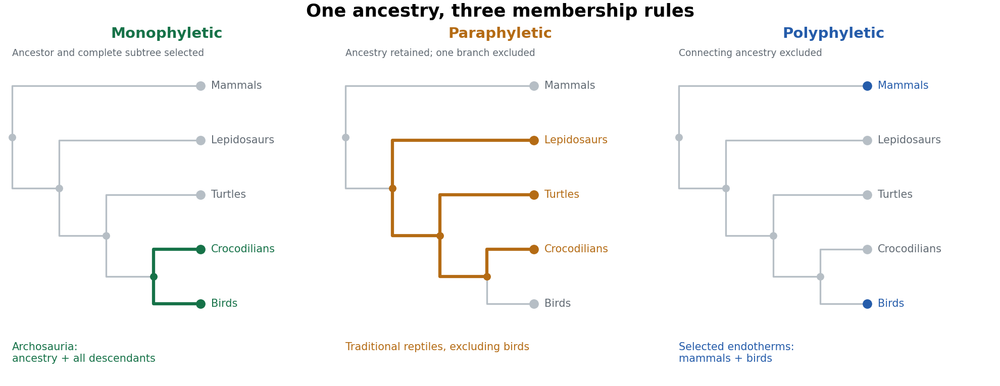
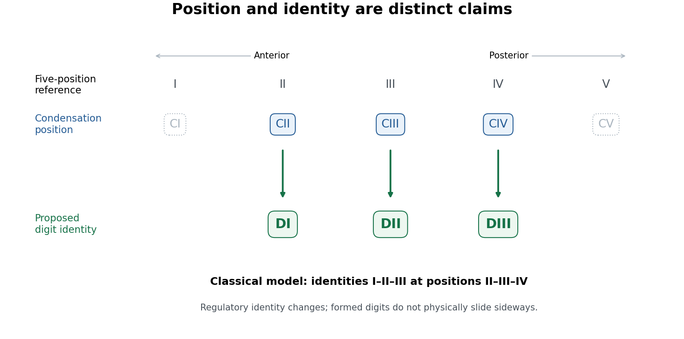

# Paper zm1

↑ **Parent:** [2025](../2025.md)

[Original paper, released PDF pages 45–46](https://www.whatdotheyknow.com/request/natural_science_tripos_part_ii_p_3/response/3307450/attach/3/FOI%202026%2053%20Vongtanakiat%20materials.pdf?cookie_passthrough=1#page=45)

**Table of contents**

- [1](#1)
  - [Solution](#1/solution)
- [2](#2)
  - [Solution](#2/solution)
- [3](#3)
  - [Solution](#3/solution)
- [4](#4)
  - [Solution](#4/solution)
- [5](#5)
  - [Solution](#5/solution)
- [6](#6)
  - [Solution](#6/solution)

## 1

↑ **Parent:** [Paper zm1](paper-zm1.md)

<h3 id="1/solution">Solution</h3>

↑ **Parent:** [1](#1)

**[taphonomic bias](../../paleontology.md#taphonomic-bias) is systematic distortion of biological information between a living community and the [fossil record](../../paleontology.md#fossil-record).** Death, [carcass decay](../../paleontology.md#carcass-decay), scavenging, transport, burial, chemical alteration, exposure and collection all filter what is observed. A deposit therefore samples organisms, body parts and environments unequally. This is more than incompleteness: preferential preservation of a particular tissue or habitat can produce a misleading pattern of abundance, [anatomy](../../anatomy.md) or evolutionary timing.

An [autochthonous fossil assemblage](../../paleontology.md#autochthonous-fossil-assemblage) contains remains preserved where the organisms lived; an [allochthonous fossil assemblage](../../paleontology.md#allochthonous-fossil-assemblage) contains material transported from elsewhere. These describe provenance, rather than two levels of fidelity. In an [allochthonous fossil assemblage](../../paleontology.md#allochthonous-fossil-assemblage), currents can separate elements by size, shape and [density](../../fluid-mechanics.md#density), concentrate resistant [teeth](../../anatomy.md#tooth) or scales, remove delicate bodies and mix organisms from different habitats. Erosion and redeposition can also introduce older [fossils](../../paleontology.md#fossil) into younger sediment. Such [reworking](../../paleontology.md#fossil-reworking) differs from simple transport of recently dead animals. [time averaging](../../paleontology.md#time-averaging) mixes deaths from different times even without long-distance transport. A concentration of robust remains consequently need not represent either a locally abundant living population or a single ecological event.

An [autochthonous fossil assemblage](../../paleontology.md#autochthonous-fossil-assemblage) avoids some transport distortion, but still selects organisms and characters. A bottom-dwelling community rapidly buried in place can be unusually well represented while swimmers above it, unmineralized tissues and organisms living outside that depositional setting are missing. Conversely, an intact carcass can travel before burial, whereas locally decayed remains can become disarticulated without transport. Articulation, abrasion, preferred orientation, sedimentary context and age agreement must therefore be evaluated together. **Local preservation does not imply an unbiased biological census.**

The contrast between [cyclostomes](../../organism.md#cyclostome) and early members of the [gnathostome](../../organism.md#gnathostome) lineage is particularly revealing. Living [cyclostomes](../../organism.md#cyclostome), [hagfish](../../organism.md#hagfish) and [lampreys](../../organism.md#lamprey), have no extensive mineralized external skeleton comparable to the armour of many early jawless relatives of [gnathostomes](../../organism.md#gnathostome). Their bodies are dominated by tissues whose preservation usually requires exceptional conditions. The abundance of isolated mineralized scales, plates or [teeth](../../anatomy.md#tooth) can thus make a hard-bodied lineage conspicuous where a soft-bodied contemporary is virtually invisible. Importantly, the armoured jawless assemblage traditionally called [ostracoderms](../../organism.md#ostracoderm) is not simply the ancestral [cyclostome](../../organism.md#cyclostome) record: many of its members belong on the [gnathostome](../../organism.md#gnathostome) stem. Absence of jaws does not by itself establish [cyclostome](../../organism.md#cyclostome) affinity.

There is also a character-level filter. [Robert S. Sansom](../../paleontology.md#robert-s-sansom) and colleagues followed experimental [carcass decay](../../paleontology.md#carcass-decay) of living [chordates](../../organism.md#chordate), and then examined [hagfish](../../organism.md#hagfish) and [lampreys](../../organism.md#lamprey) in detail. Anatomical characters did not disappear at random: loss of diagnostic features could make a derived animal appear more primitive. This produces [stemward slippage](../../paleontology.md#stemward-slippage) if investigators mistake an unpreserved feature for a feature absent in life. The result is relevant both to isolated soft-bodied [fossils](../../paleontology.md#fossil) and to the apparently long primitive intervals preceding well-preserved groups.[Experimental character-loss sequences and simulated consequences for fossil interpretation](../../ecology-and-evolution-bibliography.md#non-random-decay-of-chordate-characters-causes-bias-in-fossil-interpretation-by-robert-s-sansom-and-others)[Comparative decay of cyclostome tissues and diagnostic characters](../../ecology-and-evolution-bibliography.md#decay-of-vertebrate-characters-in-hagfish-and-lamprey-cyclostomata-and-the-implications-for-the-vertebrate-fossil-record-by-robert-s-sansom-and-others)

A useful experimental design records fresh [anatomy](../../anatomy.md) first, samples replicated carcasses through time under stated [temperature](../../temperature.md) and chemical conditions, and scores the same characters in each specimen. Comparisons between animals and between preservational conditions test whether the loss order is reproducible. Such experiments identify plausible biases; they do not recreate every burial chemistry or prove that every uncertain [fossil](../../paleontology.md#fossil) has undergone the same sequence. In a phylogenetic character matrix, genuinely unobservable [anatomy](../../anatomy.md) should normally be coded as unknown rather than automatically absent. Comparison across differently preserved specimens can sometimes recover information that one specimen lacks.

Exceptional discoveries show what the ordinary record omits. The Late [Devonian](../../paleontology.md#devonian) [lamprey](../../organism.md#lamprey) [Priscomyzon](../../organism.md#priscomyzon) from South Africa preserves a recognizable oral apparatus and branchial region without a massive mineralized skeleton. It shows that early [lamprey](../../organism.md#lamprey) [anatomy](../../anatomy.md) can be recovered when the appropriate soft-tissue window is available; the gap before such a discovery is not evidence that the lineage had just originated.[Description and Late Devonian occurrence of Priscomyzon](../../ecology-and-evolution-bibliography.md#a-lamprey-from-the-devonian-period-of-south-africa-by-robert-w-gess-and-others) The [Cretaceous](../../planetary-science.md#cretaceous) [hagfish](../../organism.md#hagfish) [Tethymyxine](../../organism.md#tethymyxine) preserves evidence including slime-producing structures, allowing characters unavailable in most older deposits to be brought into an analysis using [phylogenetics](../../evolution.md#phylogenetics). It supplies a minimum occurrence and anatomical information, not the date when [hagfish](../../organism.md#hagfish) originated.[Fossil anatomy, slime-gland evidence and combined phylogenetic analysis](../../ecology-and-evolution-bibliography.md#hagfish-from-the-cretaceous-tethys-sea-and-a-reconciliation-of-the-morphological-molecular-conflict-in-early-vertebrate-phylogeny-by-tetsuto-miyashita-and-others) Conversely, Early [Silurian](../../paleontology.md#silurian) [Qianodus](../../organism.md#qianodus) is known through mineralized [tooth](../../anatomy.md#tooth) whorls: such durable small remains can establish an early occurrence of a toothed [gnathostome](../../organism.md#gnathostome) even where complete bodies are missing.[Qianodus tooth whorls and their Early Silurian context](../../ecology-and-evolution-bibliography.md#the-oldest-gnathostome-teeth-by-plamen-s-andreev-and-others)

**The defensible comparison concerns preservation probabilities as well as biological histories.** First [fossil](../../paleontology.md#fossil) occurrences are minimum ages, and unequal counts need not measure unequal diversity. Independent anatomical characters, comparable depositional settings, searches for small hard parts and exceptional soft-tissue deposits together give a better test of early [vertebrate](../../organism.md#vertebrate) history than a literal reading of the most conspicuous remains.

## 2

↑ **Parent:** [Paper zm1](paper-zm1.md)

<h3 id="2/solution">Solution</h3>

↑ **Parent:** [2](#2)

**The transition places [vertebrate](../../organism.md#vertebrate) origins within a prolonged assembly of animal body plans, ecological interactions and preservational opportunities.** It does not identify one boundary at which a complete modern [vertebrate](../../organism.md#vertebrate) suddenly appeared. Three questions must be separated: when the relevant lineages diverged, when diagnostic features evolved, and when those features became recoverable as [fossils](../../paleontology.md#fossil).

The [Ediacaran](../../paleontology.md#ediacaran) precedes the [Cambrian](../../paleontology.md#cambrian), whose beginning is approximately 539 million years ago. [Ediacaran](../../paleontology.md#ediacaran) communities already contained macroscopic organisms and evidence of animal movement and feeding. [Kimberella](../../organism.md#kimberella), for example, has been interpreted from its body organization as a mollusc-like [bilaterian](../../organism.md#bilaterian); its relevance is that substantial animal differentiation predates the boundary, rather than that it is a [vertebrate](../../organism.md#vertebrate) ancestor.[Body reconstruction and bilaterian interpretation](../../ecology-and-evolution-bibliography.md#the-late-precambrian-fossil-kimberella-is-a-mollusc-like-bilaterian-organism-by-mikhail-a-fedonkin-and-benjamin-m-waggoner) [trace fossils](../../paleontology.md#trace-fossil) record activities that may otherwise leave no body remains. Increasingly elaborate movement and sediment disturbance reveal ecological capacities, but an isolated burrow does not identify a [notochord](../../developmental-biology.md#notochord), a head or a particular branch of the animal [phylogenetic tree](../../evolution.md#phylogenetic-tree).

Across the transition, animal skeletons, [predation](../../ecology.md#predation), burrowing and water-column communities became more prominent. Their appearance changes both biology and observation. Resistant skeletons improve preservation, while [bioturbation](../../ecology.md#bioturbation) can destroy the sedimentary surfaces that had preserved some earlier soft-bodied communities. Different preservational windows reveal different subsets of life. An apparent replacement in the [fossil record](../../paleontology.md#fossil-record) can therefore combine real ecological turnover with [taphonomic bias](../../paleontology.md#taphonomic-bias). One should compare [anatomy](../../anatomy.md) and environments across several deposits rather than treating all [Ediacaran](../../paleontology.md#ediacaran) absences as biological absences.

The [Cambrian](../../paleontology.md#cambrian) exceptional deposits provide positive evidence. [Haikouichthys](../../organism.md#haikouichthys) and [Myllokunmingia](../../organism.md#myllokunmingia) from [Chengjiang](../../paleontology.md#chengjiang) reveal small fish-like animals with combinations of axial, muscular and branchial structures interpreted as early [vertebrate](../../organism.md#vertebrate) organization.[Descriptions and reconstruction of the two Chengjiang taxa](../../ecology-and-evolution-bibliography.md#lower-cambrian-vertebrates-from-south-china-by-d-g-shu-and-others) [Metaspriggina](../../organism.md#metaspriggina) from the [Burgess Shale](../../paleontology.md#burgess-shale) adds evidence from a distinct assemblage, including prominent [eyes](../../anatomy.md#eye), segmented musculature, organized into [myomeres](../../anatomy.md#myomere), and serial branchial supports.[Anatomical description and reconstruction of Metaspriggina](../../ecology-and-evolution-bibliography.md#a-primitive-fish-from-the-cambrian-of-north-america-by-simon-conway-morris-and-jean-bernard-caron) These are more informative than an undifferentiated claim that “fish existed”: they allow particular characters to be mapped onto alternative [phylogenetic trees](../../evolution.md#phylogenetic-tree).

A plausible sequence involves a swimming [chordate](../../organism.md#chordate) organization with a [notochord](../../developmental-biology.md#notochord) and segmental musculature, followed by elaboration of anterior sensory and feeding systems along the [vertebrate](../../organism.md#vertebrate) lineage. Nevertheless, [fossil](../../paleontology.md#fossil) compressions can obscure boundaries or superimpose unrelated structures. Confidence should come from repeated specimens, bilateral agreement, positional relationships and combinations of characters, rather than resemblance of one dark patch to an organ. A structure absent from a compressed specimen may be unpreserved. Nor does a plausible early [vertebrate](../../organism.md#vertebrate) have to be a member of the living [vertebrate](../../organism.md#vertebrate) [crown group](../../evolution.md#crown-group), still less a direct ancestor of a living [species](../../biology.md#species). A [stem group](../../evolution.md#stem-group) can contain extinct side branches showing different combinations of ancestral and derived states.

Living organisms constrain the reconstruction without forming a ladder. Molecular analyses place [tunicates](../../organism.md#tunicate), rather than [cephalochordates](../../organism.md#cephalochordate), as the closest living relatives of [vertebrates](../../organism.md#vertebrate).[Phylogenomic comparison of chordate relationships](../../ecology-and-evolution-bibliography.md#tunicates-and-not-cephalochordates-are-the-closest-living-relatives-of-vertebrates-by-frederic-delsuc-and-others) A modern lancelet is consequently a comparative relative with its own history, not an unchanged stage through which [vertebrates](../../organism.md#vertebrate) passed. The same warning applies to living [hagfish](../../organism.md#hagfish) and [lampreys](../../organism.md#lamprey). Their [anatomy](../../anatomy.md) can reveal inherited features and secondary specializations; simplicity alone cannot polarize a character.

The [New Head hypothesis](../../developmental-biology.md#new-head-hypothesis) connects cranial sensory and feeding innovations with [neural crest](../../developmental-biology.md#neural-crest) and [ectodermal placodes](../../developmental-biology.md#ectodermal-placode). This is a developmental explanation for assembling a more elaborate head. Experiments on living [chordates](../../organism.md#chordate) can test where cells originate, which structures they form and which regulatory interactions are needed. The [fossil](../../paleontology.md#fossil) presence of [eyes](../../anatomy.md#eye) or branchial supports cannot directly demonstrate the embryonic migration of [neural crest](../../developmental-biology.md#neural-crest). Conversely, a conserved regulatory [gene](../../genetics.md#gene) alone does not establish that a complete modern head existed in an [Ediacaran](../../paleontology.md#ediacaran) ancestor. Developmental, molecular and anatomical evidence address complementary parts of the argument.[Proposed developmental basis and functional significance of head innovation](../../ecology-and-evolution-bibliography.md#neural-crest-and-the-origin-of-vertebrates-a-new-head-by-carl-gans-and-r-glenn-northcutt)

Ecological context helps explain why these capacities might diversify. More active swimming, prey detection and food processing can create opportunities and selective pressures for improved sensory and locomotor coordination. [molecular oxygen](../../chemical-substance.md#molecular-oxygen) availability constrains the metabolic activities that can be sustained. [Erik A. Sperling](../../paleontology.md#erik-a-sperling) and colleagues compared modern low-oxygen animal communities and related the scarcity of carnivory at low oxygen levels to hypotheses about [Cambrian](../../paleontology.md#cambrian) ecological expansion.[Modern oxygen-gradient observations and the proposed ecological connection](../../ecology-and-evolution-bibliography.md#oxygen-ecology-and-the-cambrian-radiation-of-animals-by-erik-a-sperling-and-others) This motivates a mechanism; environmental correlation alone neither dates the [vertebrate](../../organism.md#vertebrate) ancestor nor establishes oxygenation as a sufficient single cause.

**The useful conclusion is a constrained historical sequence, with explicit gaps.** [Ediacaran](../../paleontology.md#ediacaran) evidence establishes antecedent animal complexity; [Cambrian](../../paleontology.md#cambrian) exceptional preservation documents recognizable early [vertebrate](../../organism.md#vertebrate) combinations; comparative [phylogenetics](../../evolution.md#phylogenetics) and [evolutionary developmental biology](../../developmental-biology.md#evolutionary-developmental-biology) test their placement and assembly. [molecular clocks](../../evolution.md#molecular-clock) can estimate earlier divergences, but their dependence on rates and [fossil calibration](../../evolution.md#fossil-calibration) prevents them from turning every absence into a precise origin date.

## 3

↑ **Parent:** [Paper zm1](paper-zm1.md)

<h3 id="3/solution">Solution</h3>

↑ **Parent:** [3](#3)

**[Sarcopterygii](../../organism.md#sarcopterygii) is the [clade](../../evolution.md#clade) comprising the most recent common ancestor of living [coelacanths](../../organism.md#coelacanth), [lungfish](../../organism.md#lungfish) and [tetrapods](../../organism.md#tetrapod), together with all its descendants.** In this crown-based usage, [humans](../../organism.md#human) are [sarcopterygians](../../organism.md#sarcopterygii): acquisition of [limbs](../../anatomy.md#vertebrate-limb) and loss of a fish-like outline do not remove descendants from a [clade](../../evolution.md#clade). Extinct taxa assigned along the stem require an explicitly broader total-group usage. A diagnosis lists characters useful for recognizing a group; a [synapomorphy](../../evolution.md#synapomorphy) is a shared derived character whose position has been inferred on a [phylogenetic tree](../../evolution.md#phylogenetic-tree). Those are related but not interchangeable statements.

Two particularly instructive traditional diagnostic features are the fleshy, internally supported [paired appendages](../../anatomy.md#paired-appendage) and true [enamel](../../anatomy.md#enamel) associated with the dentition. The first survives conspicuously in our arms and legs. The second survives in our [tooth](../../anatomy.md#tooth) crowns, although modern evidence requires qualification of its traditional status as an exclusively [sarcopterygian](../../organism.md#sarcopterygii) innovation.

**The paired-appendage transformation.** A lobed [fin](../../anatomy.md#fin) contains musculature and a substantial [endoskeleton](../../anatomy.md#endoskeleton) extending into the appendage. In the relevant ancestral pattern, a single proximal skeletal element connects to the girdle: the [humerus](../../anatomy.md#humerus) in the pectoral appendage, and the [femur](../../anatomy.md#femur) in the pelvic appendage. Subsequent elements elaborate the jointed internal axis. The important comparison is historical organization and articulations, not merely that both a [fin](../../anatomy.md#fin) and an arm contain [bone](../../anatomy.md#bone). [fins](../../anatomy.md#fin) in other lineages also possess internal supporting elements, so the presence of any [fin](../../anatomy.md#fin) skeleton is too broad a diagnosis.

Within the lineage leading to [tetrapods](../../organism.md#tetrapod), the pectoral series can be recognized as [humerus](../../anatomy.md#humerus), [radius bone](../../anatomy.md#radius-bone) and [ulna](../../anatomy.md#ulna), followed by increasingly elaborate distal elements. [Tiktaalik](../../organism.md#tiktaalik) retains [fin rays](../../anatomy.md#fin-ray) but has a distal jointed skeleton capable of limb-like positioning against a substrate. Its combination of characters shows that parts of a wrist-like support system preceded a fully digit-bearing hand. Comparing several articulated specimens and the geometry of joint surfaces constrains the reconstruction better than matching isolated [bones](../../anatomy.md#bone) by outline.[Pectoral anatomy, joint configurations and proposed substrate-supported postures](../../ecology-and-evolution-bibliography.md#the-pectoral-fin-of-tiktaalik-roseae-and-the-origin-of-the-tetrapod-limb-by-neil-h-shubin-and-others)

Further changes included [anatomical digits](../../anatomy.md#anatomical-digit), loss of external [fin rays](../../anatomy.md#fin-ray) in the [limb](../../anatomy.md#vertebrate-limb), changes to the girdles and altered force transmission through the trunk. They did not all arise simultaneously. Early digit-bearing [tetrapods](../../organism.md#tetrapod) were not uniformly five-fingered terrestrial walkers; aquatic settings and [polydactyly](../../anatomy.md#polydactyly) make it misleading to present the modern [human](../../organism.md#human) hand as the immediate purpose or original endpoint of the transition. [Acanthostega](../../organism.md#acanthostega), with eight [anatomical digits](../../anatomy.md#anatomical-digit) in its [forelimb](../../organism.md#forelimb), supplies a concrete counterexample to an ancestrally universal five-digit condition.[Digit counts and implications for the ancestral tetrapod limb](../../ecology-and-evolution-bibliography.md#polydactyly-in-the-earliest-known-tetrapod-limbs-by-michael-i-coates-and-jennifer-a-clack)

Our own upper [limb](../../anatomy.md#vertebrate-limb) retains the proximal single-bone and paired-bone organization, but the [shoulder](../../organism.md#shoulder), [elbow](../../organism.md#elbow), [wrist](../../anatomy.md#wrist) and [fingers](../../anatomy.md#finger) are extensively specialized. Rotation of the [radius bone](../../anatomy.md#radius-bone) relative to the [ulna](../../anatomy.md#ulna) contributes to turning the forearm; an opposable [thumb](../../anatomy.md#thumb) and independently controlled [fingers](../../anatomy.md#finger) support grasping. In the lower [limb](../../anatomy.md#vertebrate-limb), the [femur](../../anatomy.md#femur), [tibia](../../anatomy.md#tibia) and [fibula](../../anatomy.md#fibula) show the corresponding serial organization, while the [pelvis](../../anatomy.md#pelvis), [hip](../../anatomy.md#hip), [knee](../../anatomy.md#knee) and [foot](../../anatomy.md#foot) transmit loads in habitual [bipedalism](../../anatomy.md#bipedalism). These are derived modifications within [tetrapods](../../organism.md#tetrapod), rather than defining traits of all [Sarcopterygii](../../organism.md#sarcopterygii). Comparing our arm with a fish pectoral [fin](../../anatomy.md#fin) concerns [biological homology](../../evolution.md#biological-homology) between organisms; comparing arm and leg also involves [serial homology](../../developmental-biology.md#serial-homology) within the body.

**The dental transformation and its qualification.** [human](../../organism.md#human) [tooth](../../anatomy.md#tooth) crowns have an outer layer of [enamel](../../anatomy.md#enamel) over [dentine](../../anatomy.md#dentine). [enamel](../../anatomy.md#enamel) is highly mineralized and is produced by epithelial [ameloblasts](../../anatomy.md#ameloblast), whereas [dentine](../../anatomy.md#dentine) is a different tissue formed by [odontoblasts](../../anatomy.md#odontoblast). Identifying a [fossil](../../paleontology.md#fossil) surface as [enamel](../../anatomy.md#enamel) therefore requires tissue architecture and developmental or molecular comparison, not simply a shiny hard covering. In our [teeth](../../anatomy.md#tooth) the coating has specialized organization into [enamel rods](../../anatomy.md#enamel-rod) and contributes to wear resistance during biting and chewing. [tooth](../../anatomy.md#tooth) classes and crown shapes diversify the ancestral feeding apparatus; they are not themselves basal [sarcopterygian](../../organism.md#sarcopterygii) [synapomorphies](../../evolution.md#synapomorphy). After eruption, loss of the enamel-producing cellular layer severely limits biological replacement of worn crown [enamel](../../anatomy.md#enamel).

The traditional contrast between [sarcopterygian](../../organism.md#sarcopterygii) true [tooth](../../anatomy.md#tooth) [enamel](../../anatomy.md#enamel) and other hard coverings needs an explicit historical correction. [Qingming Qu](../../paleontology.md#qingming-qu) and colleagues combined [fossil](../../paleontology.md#fossil) [histology](../../anatomy.md#histology) with evidence for enamel-matrix [genes](../../genetics.md#gene) in the skin of [gar](../../organism.md#gar). In [Psarolepis](../../organism.md#psarolepis), external [odontodes](../../anatomy.md#odontode) carried [enamel](../../anatomy.md#enamel) while the [teeth](../../anatomy.md#tooth) lacked an [enamel](../../anatomy.md#enamel) coating. Their evidence supported an origin in dermal coverings followed by expansion into the mouth, and an ancestry deeper than [Sarcopterygii](../../organism.md#sarcopterygii) alone.[Fossil tissue distribution and gar enamel-matrix gene expression](../../ecology-and-evolution-bibliography.md#new-genomic-and-fossil-data-illuminate-the-origin-of-enamel-by-qingming-qu-and-others) Thus [enamel](../../anatomy.md#enamel) and its oral deployment must be coded separately; [tooth](../../anatomy.md#tooth) [enamel](../../anatomy.md#enamel) remains a useful traditional diagnostic comparison, but **the tissue itself is not a uniquely [sarcopterygian](../../organism.md#sarcopterygii) [synapomorphy](../../evolution.md#synapomorphy)**. Shared tissue can undergo [heterotopy](../../developmental-biology.md#heterotopy), loss and later modification.

The two histories illustrate different forms of transformation visible in our bodies: an internally supported paired [fin](../../anatomy.md#fin) became a jointed, digit-bearing, specialized [limb](../../anatomy.md#vertebrate-limb), and an inherited mineralized epithelial covering acquired a complex role in our dentition. A rigorous diagnosis states the anatomical level being compared and distinguishes inherited organization from later functional specialization. Neither the modern function nor the external [human](../../organism.md#human) appearance determines membership of [Sarcopterygii](../../organism.md#sarcopterygii).

## 4

↑ **Parent:** [Paper zm1](paper-zm1.md)

<h3 id="4/solution">Solution</h3>

↑ **Parent:** [4](#4)

**A [monophyletic group](../../evolution.md#monophyly) includes an ancestor and all its descendants; a [paraphyletic group](../../evolution.md#paraphyly) includes an ancestor but excludes some descendants; a [polyphyletic group](../../evolution.md#polyphyly) combines separate lineages while excluding their relevant common ancestry.** The distinction concerns how membership relates to a [phylogenetic tree](../../evolution.md#phylogenetic-tree), rather than how many visible similarities the members possess.

Consider a simplified tree of living [amniotes](../../organism.md#amniote): [mammals](../../organism.md#mammal) form one branch, while the other contains [lepidosaurs](../../organism.md#lepidosaur), [turtles](../../organism.md#turtle) and [archosaurs](../../organism.md#archosauria); living [archosaurs](../../organism.md#archosauria) comprise [crocodilians](../../organism.md#crocodilian) and [birds](../../organism.md#bird). Within the latter branch, [birds](../../organism.md#bird) are surviving [dinosaurs](../../organism.md#dinosaur). The tree below omits extinct branches and most living diversity, and its branch lengths represent neither age nor quantity of evolutionary change. It illustrates three choices of group on the same ancestry.

**[Figure 1](#4/image-three-ways-to-select-vertebrate-groups-on-one-schematic-phylogenetic-tree). Three ways to select vertebrate groups on one schematic phylogenetic tree**. Original schematic. Green selects the archosaur ancestor and all sampled descendants. Orange retains the sauropsid ancestry and nonavian branches while excluding birds. Blue selects independently endothermic terminal lineages while their connecting ancestry remains outside the functional group. Extinct branches are omitted.

A [monophyletic group](../../evolution.md#monophyly) is a [clade](../../evolution.md#clade). [Archosauria](../../organism.md#archosauria) includes the last common ancestor of [birds](../../organism.md#bird) and [crocodilians](../../organism.md#crocodilian) and every descendant, including extinct [dinosaurs](../../organism.md#dinosaur) and other extinct branches. In the simplified figure, selecting their shared node and both descendant tips gives the corresponding complete subtree. [Sarcopterygii](../../organism.md#sarcopterygii), with [tetrapods](../../organism.md#tetrapod) included, is another example. A [clade](../../evolution.md#clade) need not be recognized by a feature that remains visibly unchanged in every descendant: subsequent modification and loss are permitted. It also need not have a particular taxonomic rank.

A familiar [paraphyletic group](../../evolution.md#paraphyly) is the traditional assemblage “reptiles” when it includes [turtles](../../organism.md#turtle), lizards, snakes and [crocodilians](../../organism.md#crocodilian) but explicitly excludes [birds](../../organism.md#bird). The latter descend from within the ancestry otherwise assigned to that assemblage. The selected ancestry is therefore cut short at one of its own branches. Similarly, conventional “fish” that include finned [sarcopterygians](../../organism.md#sarcopterygii) but exclude [tetrapods](../../organism.md#tetrapod) form an evolutionary grade rather than a complete [clade](../../evolution.md#clade). These examples require the stated usage: [Reptilia](../../organism.md#reptilia) or [Sauropsida](../../organism.md#sauropsida) can instead be defined as a [clade](../../evolution.md#clade) that includes [birds](../../organism.md#bird). The everyday word does not irrevocably determine the phylogenetic status of every technical definition bearing that name.

For [polyphyly](../../evolution.md#polyphyly), consider assembling [mammals](../../organism.md#mammal) and [birds](../../organism.md#bird) solely as the familiar independently evolved examples of sustained high metabolic heat production, while omitting their intervening ancestors and other descendants. This physiological grouping can be useful for comparing [endothermy](../../metabolism.md#endothermy), but it does not identify one exclusive historical lineage. Their last common ancestor also has descendants such as [lepidosaurs](../../organism.md#lepidosaur) and [crocodilians](../../organism.md#crocodilian). On the usual inference of independent elaboration of the relevant physiology, the selected resemblance involves [convergent evolution](../../evolution.md#convergent-evolution). Calling the assemblage “warm-blooded [vertebrates](../../organism.md#vertebrate)” must not turn a selected physiological trait into evidence that [birds](../../organism.md#bird) are closer to [mammals](../../organism.md#mammal) than to [crocodilians](../../organism.md#crocodilian). Moreover, [endothermy](../../metabolism.md#endothermy) and constant body [temperature](../../temperature.md) are not identical properties, and living taxon sampling does not locate every thermophysiological transition in extinct lineages.

There is a subtle distinction between the last two cases. A diagram of selected terminal tips alone can show that a group is not a [clade](../../evolution.md#clade), but does not always uniquely distinguish [paraphyly](../../evolution.md#paraphyly) from [polyphyly](../../evolution.md#polyphyly). One must state which ancestors are included and the historical interpretation of the defining character. In the orange example, the ancestral reptile lineage is retained and one descendant branch excluded. In the blue example, similar functional outcomes are assembled from separate branches without including the connecting ancestry. The highlighted internal paths in the figure make that difference explicit.

[clades](../../evolution.md#clade) are particularly suitable for discussing [vertebrate](../../organism.md#vertebrate) [evolution](../../evolution.md) because their nested membership directly expresses [common descent](../../evolution.md#common-descent). They permit consistent statements such as “[birds](../../organism.md#bird) are [dinosaurs](../../organism.md#dinosaur)” and “[humans](../../organism.md#human) are [sarcopterygians](../../organism.md#sarcopterygii)”, while allowing substantial changes in form and function. Shared derived characters, or [synapomorphies](../../evolution.md#synapomorphy), provide evidence for branches; shared ancestral states do not uniquely diagnose the smaller groups inheriting them, and independently acquired similarities require separate explanation. This framework makes character transformations testable against a branching history instead of arranging animals in a ladder of increasing complexity.

In practice the [phylogenetic tree](../../evolution.md#phylogenetic-tree) remains a hypothesis. More characters, better [fossils](../../paleontology.md#fossil) or different evolutionary models can change inferred relationships. Naming a [clade](../../evolution.md#clade) with an explicit ancestry-based definition helps keep the statement intelligible when that happens, but does not make the inference immune to error. Anatomical and molecular characters need [biological homology](../../evolution.md#biological-homology) assessment, appropriate taxon sampling and uncertainty estimates. For example, genome-scale data and stem-turtle [anatomy](../../anatomy.md) independently address whether [turtles](../../organism.md#turtle) lie near [archosaurs](../../organism.md#archosauria), rather than treating one [skull](../../anatomy.md#skull) condition as sufficient to define the tree.[Taxon sampling and phylogenomic support for turtle placement](../../ecology-and-evolution-bibliography.md#more-than-1000-ultraconserved-elements-provide-evidence-that-turtles-are-the-sister-group-of-archosaurs-by-nicholas-g-crawford-and-others)

**Use [monophyletic groups](../../evolution.md#monophyly) to express ancestry, and identify ecological or anatomical grades explicitly when they serve another purpose.** [paraphyletic groups](../../evolution.md#paraphyly) can summarize retained ancestral organization, and [polyphyletic groups](../../evolution.md#polyphyly) can support functional comparisons, but neither should silently substitute for a complete lineage.

## 5

↑ **Parent:** [Paper zm1](paper-zm1.md)

<h3 id="5/solution">Solution</h3>

↑ **Parent:** [5](#5)

**The avian [digit identity frameshift hypothesis](../../developmental-biology.md#digit-identity-frameshift-hypothesis) proposes that positional condensations conventionally numbered II, III and IV develop morphological identities I, II and III.** It separates the place where an [anatomical digit](../../anatomy.md#anatomical-digit) develops from the inherited developmental identity expressed there. It is a hypothesis about [evolutionary developmental biology](../../developmental-biology.md#evolutionary-developmental-biology), not a [frameshift mutation](../../molecular-genetics.md#frameshift-mutation) in a [DNA](../../polymer.md#deoxyribonucleic-acid) [reading frame](../../molecular-genetics.md#reading-frame).

The problem arose from comparing two kinds of evidence. The hands of the theropod relatives of [birds](../../organism.md#bird) were traditionally reconstructed as retaining the first three [anatomical digits](../../anatomy.md#anatomical-digit). Their [bone](../../anatomy.md#bone) relationships and, in appropriate [fossils](../../paleontology.md#fossil), the phalangeal pattern of two, three and four [phalanges](../../anatomy.md#phalanx) supported identities I, II and III. Embryological studies of the [bird](../../organism.md#bird) wing instead assigned the principal surviving condensations to positions II, III and IV within a pentadactyl reference pattern, partly from their relation to the primary skeletal axis. If positional number necessarily fixed morphological identity, the interpretations appeared inconsistent.

[biological homology](../../evolution.md#biological-homology) is a historical claim, however, and a developmental coordinate need not be eternally coupled to the same character identity. [Günter P. Wagner](../../developmental-biology.md#gunter-p-wagner) and [Jacques A. Gauthier](../../paleontology.md#jacques-a-gauthier) proposed an evolutionary change in that coupling: an [anatomical digit](../../anatomy.md#anatomical-digit) formed at position II could execute an identity-I developmental program, and the two posterior [anatomical digits](../../anatomy.md#anatomical-digit) could undergo the corresponding changes.[The developmental frameshift proposal reconciling positional and morphological assignments](../../ecology-and-evolution-bibliography.md#1-2-3-2-3-4-a-solution-to-the-problem-of-the-homology-of-the-digits-in-the-avian-hand-by-gunter-p-wagner-and-jacques-a-gauthier) With $C_k$ denoting a positional condensation and $D_j$ its resulting identity, the classical proposal is:

$$
\boxed{C_{\mathrm{II}}\mapsto D_{\mathrm{I}},\qquad C_{\mathrm{III}}\mapsto D_{\mathrm{II}},\qquad C_{\mathrm{IV}}\mapsto D_{\mathrm{III}}.}
$$

This notation describes a change in specification. It does not mean that a fully formed [thumb](../../anatomy.md#thumb) physically migrated into another [anatomical digit](../../anatomy.md#anatomical-digit)'s position during development.

**[Figure 2](#5/image-positional-condensations-and-morphological-identities-in-the-classical-avian-digit-frameshift-hypothesis). Positional condensations and morphological identities in the classical avian digit frameshift hypothesis**. Original conceptual diagram. The upper row is a five-position reference; the lower rows distinguish the retained positional assignments from the identities proposed for them. Dotted symbols indicate positions outside the three principal retained digits, without asserting that no transient cells or condensations ever occur there. This diagram states the classical model, not a universal molecular identity code.

The proposal yields tests. Anatomical identity should be assessed from several features of [metacarpals](../../anatomy.md#metacarpal), joints and [phalanges](../../anatomy.md#phalanx), not by calling the anteriormost remaining [anatomical digit](../../anatomy.md#anatomical-digit) “I” by definition. Condensation position should be established independently from staged [embryos](../../developmental-biology.md#embryo) and [fate mapping](../../developmental-biology.md#fate-mapping), rather than inferred solely from the adult hand. Molecular comparisons can then ask whether positional [anatomical digit](../../anatomy.md#anatomical-digit) II in the wing shares a distinctive regulatory state with [anatomical digit](../../anatomy.md#anatomical-digit) I in a reference [limb](../../anatomy.md#vertebrate-limb). [evolution](../../evolution.md) of [gene regulation](../../molecular-genetics.md#regulation-of-gene-expression), including the duration and distribution of [Sonic hedgehog](../../morphogen.md#sonic-hedgehog) signalling and downstream interactions, offers a means of uncoupling position and later differentiation. Expression of one [Hox gene](../../genetics.md#hox-gene) is informative but is not a universally valid barcode of a complete [digit identity](../../anatomy.md#digit-identity).

[Koji Tamura](../../developmental-biology.md#koji-tamura) and colleagues used cell labelling and transplantation to compare wing and [hindlimb](../../anatomy.md#hindlimb) development. The cells contributing to the posterior wing [anatomical digit](../../anatomy.md#anatomical-digit) did not have the same relationship to the posterior signalling region, the [zone of polarizing activity](../../developmental-biology.md#zone-of-polarizing-activity), as the corresponding [hindlimb](../../anatomy.md#hindlimb) [anatomical digit](../../anatomy.md#anatomical-digit) IV; their early separation was compatible with a digit-III developmental domain. This supplied experimental evidence against equating the posterior wing [anatomical digit](../../anatomy.md#anatomical-digit) straightforwardly with [hindlimb](../../anatomy.md#hindlimb) [anatomical digit](../../anatomy.md#anatomical-digit) IV.[Cell-labelling and transplantation comparisons of wing and hindlimb digit progenitors](../../ecology-and-evolution-bibliography.md#embryological-evidence-identifies-wing-digits-in-birds-as-digits-1-2-and-3-by-koji-tamura-and-others)

Such experiments need [embryos](../../developmental-biology.md#embryo) matched by developmental stage, verified label positions, assessment of label persistence and spread, and controls for effects of grafting on survival and growth. A cell's ultimate contribution establishes its fate under the tested conditions; it does not alone establish the evolutionary identity of every structure it forms. Comparing [forelimb](../../organism.md#forelimb) with [hindlimb](../../anatomy.md#hindlimb) also requires recognizing that the two are already developmentally different organs. The stronger inference combines [lineage tracing](../../biological-cell.md#lineage-tracing) with [anatomy](../../anatomy.md) and regulatory evidence.

Transcriptomic data sharpened, rather than simply ended, the debate. [Zhe Wang](../../developmental-biology.md#zhe-wang) and colleagues found a conserved anterior-digit signature consistent with identity I in the anteriormost wing [anatomical digit](../../anatomy.md#anatomical-digit), while the posterior wing [anatomical digits](../../anatomy.md#anatomical-digit) showed derived expression identities rather than a simple conserved series.[Comparative digit transcriptomes and the distinctive anterior-wing-digit signature](../../ecology-and-evolution-bibliography.md#transcriptomic-analysis-of-avian-digits-reveals-conserved-and-derived-digit-identities-in-birds-by-zhe-wang-and-others) A later multi-species comparison by [Thomas A. Stewart](../../paleontology.md#thomas-a-stewart) and colleagues challenged the assumption that all corresponding [anatomical digits](../../anatomy.md#anatomical-digit) possess a conserved tetrapod-wide molecular identity. Their results supported a more limited shift rather than treating every posterior [anatomical digit](../../anatomy.md#anatomical-digit) as an unchanged identity displaced by one position.[Cross-species expression comparisons and limits of a universal digit-identity model](../../ecology-and-evolution-bibliography.md#evidence-against-tetrapod-wide-digit-identities-and-for-a-limited-frame-shift-in-bird-wings-by-thomas-a-stewart-and-others) Tissue composition, sampling stage, [orthology](../../molecular-genetics.md#orthology) assignment and the choice of reference [species](../../biology.md#species) are therefore essential controls in molecular tests.

The evolutionary significance is substantial but bounded. [birds](../../organism.md#bird) are nested within [theropod dinosaurs](../../organism.md#theropod-dinosaur) on evidence extending beyond [anatomical digit](../../anatomy.md#anatomical-digit) number, including many skeletal transformations and feathered relatives. The preserved integument of [Yutyrannus](../../organism.md#yutyrannus), for example, documents filamentous [feathers](../../anatomy.md#feather) in a nonavian tyrannosauroid, broadening the [fossil](../../paleontology.md#fossil) distribution of [feathers](../../anatomy.md#feather) beyond [birds](../../organism.md#bird).[Associated skeletons and filamentous feather preservation in Yutyrannus](../../ecology-and-evolution-bibliography.md#a-gigantic-feathered-dinosaur-from-the-lower-cretaceous-of-china-by-xing-xu-and-others) A coherent developmental mechanism removes one apparent contradiction between embryology and that historical interpretation. It also illustrates why disagreement between positional and morphological evidence should trigger a mechanistic test rather than automatic rejection of either dataset. However, showing that a regulatory shift is developmentally possible is not proof that precisely the full classical shift occurred in the ancestral [bird](../../organism.md#bird) lineage.

**The durable result is that [anatomical digit](../../anatomy.md#anatomical-digit) position and [digit identity](../../anatomy.md#digit-identity) can evolve partly independently.** Evidence for an identity-I anterior wing [anatomical digit](../../anatomy.md#anatomical-digit) is stronger than a claim that all three [anatomical digits](../../anatomy.md#anatomical-digit) retain invariant molecular identities I, II and III. The [digit identity frameshift hypothesis](../../developmental-biology.md#digit-identity-frameshift-hypothesis) remains a useful, testable bridge between [fossil](../../paleontology.md#fossil) [anatomy](../../anatomy.md) and development, with the exact extent and sequence of identity transformation requiring explicit comparison rather than assumed equivalence.

## 6

↑ **Parent:** [Paper zm1](paper-zm1.md)

<h3 id="6/solution">Solution</h3>

↑ **Parent:** [6](#6)

**The [turtle problem](../../evolution.md#turtle-problem) is the difficulty of placing [turtles](../../organism.md#turtle) on the reptile [phylogenetic tree](../../evolution.md#phylogenetic-tree), historically intensified by conflict between their unusual [skulls](../../anatomy.md#skull) and other anatomical or molecular evidence.** Their closed or extensively roofed temporal region once appeared to identify a primitively [anapsid](../../anatomy.md#anapsid) lineage outside [Diapsida](../../organism.md#diapsida). Evidence instead places living [turtles](../../organism.md#turtle) within the [diapsid](../../organism.md#diapsida) radiation, commonly as the sister lineage to [archosaurs](../../organism.md#archosauria). The inference requires distinguishing retention of an ancestral state from secondary modification.

The traditional scheme counts openings behind the [orbit (anatomy)](../../anatomy.md#orbit-anatomy) on each side of the [skull](../../anatomy.md#skull). An [anapsid](../../anatomy.md#anapsid) condition lacks the characteristic temporal openings; a [synapsid](../../organism.md#synapsid) condition has one, classically lower; a [diapsid](../../organism.md#diapsida) condition has upper and lower openings separated by bony structures. These descriptions originally provided convenient anatomical categories. The [eye](../../anatomy.md#eye) socket is not a temporal opening, and a notch open to a [skull](../../anatomy.md#skull) margin, or [temporal emargination](../../anatomy.md#temporal-emargination), must not automatically be equated with a completely bounded [temporal fenestra](../../anatomy.md#temporal-fenestra). [bone](../../anatomy.md#bone) identities and contacts matter as much as the count.

On a literal state-based scheme, a roofed [turtle](../../organism.md#turtle) [skull](../../anatomy.md#skull) resembles the inferred primitive [amniote](../../organism.md#amniote) condition. That resemblance helped motivate positions outside the main [diapsid](../../organism.md#diapsida) groups and comparisons with extinct anapsid-grade reptiles. Other anatomical analyses allied [turtles](../../organism.md#turtle) with different reptile branches. Their shell and strongly modified [skull](../../anatomy.md#skull) make character comparison difficult: several apparently correlated characters may belong to one functional transformation, and absence of an opening can conceal a more complex history. A shared absence is especially weak evidence when the opening can be closed independently.

Molecular evidence provides an independent character system. [Nicholas G. Crawford](../../evolution.md#nicholas-g-crawford) and colleagues sampled more than a thousand [ultraconserved elements](../../molecular-genetics.md#ultraconserved-element) with associated variable sequence, using representatives of major living reptile lineages, including the [tuatara](../../organism.md#tuatara). Their analyses supported [turtles](../../organism.md#turtle) as the sister group of [archosaurs](../../organism.md#archosauria), rather than the sister group of all other living reptiles or a lineage within [lepidosaurs](../../organism.md#lepidosaur).[Nuclear-locus sampling, inclusion of tuatara and inferred turtle–archosaur relationship](../../ecology-and-evolution-bibliography.md#more-than-1000-ultraconserved-elements-provide-evidence-that-turtles-are-the-sister-group-of-archosaurs-by-nicholas-g-crawford-and-others) In this hypothesis, [crocodilians](../../organism.md#crocodilian) and [birds](../../organism.md#bird) are closer to one another than either is to [turtles](../../organism.md#turtle). The schematic in solution 4 shows that distinction: “sister to [archosaurs](../../organism.md#archosauria)” does not mean “a living [archosaur](../../organism.md#archosauria)”.

A large number of aligned bases is not a substitute for checking the analysis. Appropriate outgroups, broad taxon sampling, correct [orthology](../../molecular-genetics.md#orthology) and models that address rate or composition differences are needed. Analyses across loci and model choices test sensitivity; [gene](../../genetics.md#gene) histories may also differ from the [species tree](../../evolution.md#species-tree). Molecular data from living [species](../../biology.md#species) cannot directly locate every extinct turtle-like animal. They provide a living backbone against which the anatomical placement of [fossils](../../paleontology.md#fossil) can be tested.

Stem-turtle discoveries provide a particularly discriminating anatomical test. [Pappochelys](../../organism.md#pappochelys), a Middle [Triassic](../../planetary-science.md#triassic) animal described by [Rainer R. Schoch](../../paleontology.md#rainer-r-schoch) and [Hans-Dieter Sues](../../paleontology.md#hans-dieter-sues), combines broadened ribs and robust ventral elements relevant to shell origins with temporal [anatomy](../../anatomy.md) retaining a small upper opening and a ventrally open lower region. This supports a [diapsid](../../organism.md#diapsida) ancestry even though the animal lacks a complete modern shell.[Skull openings, ribs, gastralia and phylogenetic interpretation of Pappochelys](../../ecology-and-evolution-bibliography.md#a-middle-triassic-stem-turtle-and-the-evolution-of-the-turtle-body-plan-by-rainer-r-schoch-and-hans-dieter-sues) Its significance is the associated character combination, not merely a hole selected because it agrees with a molecular tree. It shows that the shell and temporal roof need not have evolved as one indivisible package.

A study using [computed tomography](../../inverse-problem.md#computed-tomography) of [Eunotosaurus](../../organism.md#eunotosaurus) supplied another proposed part of the transition, interpreting hidden or ontogenetically altered temporal [anatomy](../../anatomy.md) as evidence of [diapsid](../../organism.md#diapsida) ancestry.[Computed-tomographic anatomy, ontogenetic interpretation and placement of Eunotosaurus](../../ecology-and-evolution-bibliography.md#evolutionary-origin-of-the-turtle-skull-by-g-s-bever-and-others) The proposed placement of such early forms and the [biological homology](../../evolution.md#biological-homology) of particular openings remain matters for character analysis. One should not claim that every specimen retains an unambiguous pair of textbook [diapsid](../../organism.md#diapsida) holes, or that a single [fossil](../../paleontology.md#fossil) resolves all deeper reptile relationships. Comparing growth stages, multiple specimens and independent postcranial characters is necessary to separate developmental closure from damage, preservation and mistaken [bone](../../anatomy.md#bone) identification.

The general limitation is [homoplasy](../../evolution.md#homoplasy). Openings can expand, merge with a margin, lose separating bars or become secondarily roofed; apparently similar counts can consequently have different histories. A derived closed roof cannot be classified reliably as primitively [anapsid](../../anatomy.md#anapsid) without a tree and additional characters. Conversely, changing the temporal condition does not remove a descendant from [Diapsida](../../organism.md#diapsida). The same principle applies to [synapsids](../../organism.md#synapsid): [mammals](../../organism.md#mammal) remain members of that lineage despite extensive transformation of their [skull](../../anatomy.md#skull) architecture. An anatomical grade is not automatically a [clade](../../evolution.md#clade).

Even perfect recognition of a [diapsid](../../organism.md#diapsida) origin would not, by itself, decide whether [turtles](../../organism.md#turtle) are nearest to [lepidosaurs](../../organism.md#lepidosaur) or [archosaurs](../../organism.md#archosauria), since both are [diapsid](../../organism.md#diapsida) lineages. Resolving that question requires informative derived characters within the radiation, rather than recounting the ancestral pair of openings. Temporal architecture remains valuable when scored through explicit [bone](../../anatomy.md#bone) relationships and combined with other evidence; it fails when used as a stand-alone ancestry detector.

**[turtles](../../organism.md#turtle) demonstrate that temporal fenestration is an evolving character complex, not an immutable classification key.** An ancestry-based classification can recognize [turtles](../../organism.md#turtle) as modified [diapsids](../../organism.md#diapsida) while explaining their [skull](../../anatomy.md#skull) roof as a derived transformation. The strongest resolution brings molecular comparisons, [fossil](../../paleontology.md#fossil) [anatomy](../../anatomy.md) and developmental change into agreement without assuming that any one evidence source is infallible.

## ↑ Ancestors (10)

1. [2025](../2025.md)
2. [Past exam of the zoology course of the University of Cambridge](../../past-exam-of-the-zoology-course-of-the-university-of-cambridge.md)
3. [Zoology course of the University of Cambridge](../../university-of-cambridge.md#zoology-course-of-the-university-of-cambridge)
4. [Year 3 of the natural sciences course of the University of Cambridge](../../university-of-cambridge.md#year-3-of-the-natural-sciences-course-of-the-university-of-cambridge)
5. [Year of the natural sciences course of the University of Cambridge](../../university-of-cambridge.md#year-of-the-natural-sciences-course-of-the-university-of-cambridge)
6. [Natural sciences course of the University of Cambridge](../../university-of-cambridge.md#natural-sciences-course-of-the-university-of-cambridge)
7. [Course of the University of Cambridge](../../university-of-cambridge.md#course-of-the-university-of-cambridge)
8. [University of Cambridge](../../university-of-cambridge.md)
9. [List of universities](../../README.md#list-of-universities)
10. [Codex Wiki](../../README.md)
