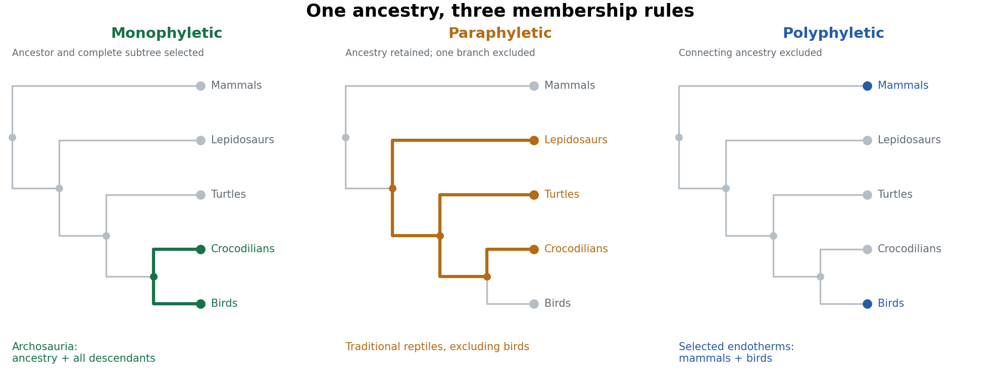

<h1 id="4/solution">Solution</h1>

↑ **Parent:** [4](../4.md)

**A [monophyletic group](../../../../monophyly.md) includes an ancestor and all its descendants; a [paraphyletic group](../../../../paraphyly.md) includes an ancestor but excludes some descendants; a [polyphyletic group](../../../../polyphyly.md) combines separate lineages while excluding their relevant common ancestry.** The distinction concerns how membership relates to a [phylogenetic tree](../../../../phylogenetic-tree.md), rather than how many visible similarities the members possess.

Consider a simplified tree of living [amniotes](../../../../amniote.md): [mammals](../../../../mammal.md) form one branch, while the other contains [lepidosaurs](../../../../lepidosaur.md), [turtles](../../../../turtle.md) and [archosaurs](../../../../archosauria.md); living [archosaurs](../../../../archosauria.md) comprise [crocodilians](../../../../crocodilian.md) and [birds](../../../../bird.md). Within the latter branch, [birds](../../../../bird.md) are surviving [dinosaurs](../../../../dinosaur.md). The tree below omits extinct branches and most living diversity, and its branch lengths represent neither age nor quantity of evolutionary change. It illustrates three choices of group on the same ancestry.

**[Figure 1](#4/image-three-ways-to-select-vertebrate-groups-on-one-schematic-phylogenetic-tree). Three ways to select vertebrate groups on one schematic phylogenetic tree**. Original schematic. Green selects the archosaur ancestor and all sampled descendants. Orange retains the sauropsid ancestry and nonavian branches while excluding birds. Blue selects independently endothermic terminal lineages while their connecting ancestry remains outside the functional group. Extinct branches are omitted.

A [monophyletic group](../../../../monophyly.md) is a [clade](../../../../clade.md). [Archosauria](../../../../archosauria.md) includes the last common ancestor of [birds](../../../../bird.md) and [crocodilians](../../../../crocodilian.md) and every descendant, including extinct [dinosaurs](../../../../dinosaur.md) and other extinct branches. In the simplified figure, selecting their shared node and both descendant tips gives the corresponding complete subtree. [Sarcopterygii](../../../../sarcopterygii.md), with [tetrapods](../../../../tetrapod.md) included, is another example. A [clade](../../../../clade.md) need not be recognized by a feature that remains visibly unchanged in every descendant: subsequent modification and loss are permitted. It also need not have a particular taxonomic rank.

A familiar [paraphyletic group](../../../../paraphyly.md) is the traditional assemblage “reptiles” when it includes [turtles](../../../../turtle.md), lizards, snakes and [crocodilians](../../../../crocodilian.md) but explicitly excludes [birds](../../../../bird.md). The latter descend from within the ancestry otherwise assigned to that assemblage. The selected ancestry is therefore cut short at one of its own branches. Similarly, conventional “fish” that include finned [sarcopterygians](../../../../sarcopterygii.md) but exclude [tetrapods](../../../../tetrapod.md) form an evolutionary grade rather than a complete [clade](../../../../clade.md). These examples require the stated usage: [Reptilia](../../../../reptilia.md) or [Sauropsida](../../../../sauropsida.md) can instead be defined as a [clade](../../../../clade.md) that includes [birds](../../../../bird.md). The everyday word does not irrevocably determine the phylogenetic status of every technical definition bearing that name.

For [polyphyly](../../../../polyphyly.md), consider assembling [mammals](../../../../mammal.md) and [birds](../../../../bird.md) solely as the familiar independently evolved examples of sustained high metabolic heat production, while omitting their intervening ancestors and other descendants. This physiological grouping can be useful for comparing [endothermy](../../../../endothermy.md), but it does not identify one exclusive historical lineage. Their last common ancestor also has descendants such as [lepidosaurs](../../../../lepidosaur.md) and [crocodilians](../../../../crocodilian.md). On the usual inference of independent elaboration of the relevant physiology, the selected resemblance involves [convergent evolution](../../../../convergent-evolution.md). Calling the assemblage “warm-blooded [vertebrates](../../../../vertebrate.md)” must not turn a selected physiological trait into evidence that [birds](../../../../bird.md) are closer to [mammals](../../../../mammal.md) than to [crocodilians](../../../../crocodilian.md). Moreover, [endothermy](../../../../endothermy.md) and constant body [temperature](../../../../temperature-split.md) are not identical properties, and living taxon sampling does not locate every thermophysiological transition in extinct lineages.

There is a subtle distinction between the last two cases. A diagram of selected terminal tips alone can show that a group is not a [clade](../../../../clade.md), but does not always uniquely distinguish [paraphyly](../../../../paraphyly.md) from [polyphyly](../../../../polyphyly.md). One must state which ancestors are included and the historical interpretation of the defining character. In the orange example, the ancestral reptile lineage is retained and one descendant branch excluded. In the blue example, similar functional outcomes are assembled from separate branches without including the connecting ancestry. The highlighted internal paths in the figure make that difference explicit.

[clades](../../../../clade.md) are particularly suitable for discussing [vertebrate](../../../../vertebrate.md) [evolution](../../../../evolution.md) because their nested membership directly expresses [common descent](../../../../common-descent.md). They permit consistent statements such as “[birds](../../../../bird.md) are [dinosaurs](../../../../dinosaur.md)” and “[humans](../../../../human.md) are [sarcopterygians](../../../../sarcopterygii.md)”, while allowing substantial changes in form and function. Shared derived characters, or [synapomorphies](../../../../synapomorphy.md), provide evidence for branches; shared ancestral states do not uniquely diagnose the smaller groups inheriting them, and independently acquired similarities require separate explanation. This framework makes character transformations testable against a branching history instead of arranging animals in a ladder of increasing complexity.

In practice the [phylogenetic tree](../../../../phylogenetic-tree.md) remains a hypothesis. More characters, better [fossils](../../../../fossil.md) or different evolutionary models can change inferred relationships. Naming a [clade](../../../../clade.md) with an explicit ancestry-based definition helps keep the statement intelligible when that happens, but does not make the inference immune to error. Anatomical and molecular characters need [biological homology](../../../../biological-homology.md) assessment, appropriate taxon sampling and uncertainty estimates. For example, genome-scale data and stem-turtle [anatomy](../../../../anatomy.md) independently address whether [turtles](../../../../turtle.md) lie near [archosaurs](../../../../archosauria.md), rather than treating one [skull](../../../../skull.md) condition as sufficient to define the tree.[Taxon sampling and phylogenomic support for turtle placement](../../../../more-than-1000-ultraconserved-elements-provide-evidence-that-turtles-are-the-sister-group-of-archosaurs-by-nicholas-g-crawford-and-others.md)

**Use [monophyletic groups](../../../../monophyly.md) to express ancestry, and identify ecological or anatomical grades explicitly when they serve another purpose.** [paraphyletic groups](../../../../paraphyly.md) can summarize retained ancestral organization, and [polyphyletic groups](../../../../polyphyly.md) can support functional comparisons, but neither should silently substitute for a complete lineage.

## ↑ Ancestors (12)

1. [4](../4.md)
2. [Paper zm1](../../paper-zm1-split.md)
3. [2025](../../split.md)
4. [Past exam of the zoology course of the University of Cambridge](../../../split.md)
5. [Zoology course of the University of Cambridge](../../../../zoology-course-of-the-university-of-cambridge.md)
6. [Year 3 of the natural sciences course of the University of Cambridge](../../../../year-3-of-the-natural-sciences-course-of-the-university-of-cambridge.md)
7. [Year of the natural sciences course of the University of Cambridge](../../../../year-of-the-natural-sciences-course-of-the-university-of-cambridge.md)
8. [Natural sciences course of the University of Cambridge](../../../../natural-sciences-course-of-the-university-of-cambridge.md)
9. [Course of the University of Cambridge](../../../../course-of-the-university-of-cambridge.md)
10. [University of Cambridge](../../../../university-of-cambridge-split.md)
11. [List of universities](../../../../list-of-universities.md)
12. [Codex Wiki](../../../../split.md)
