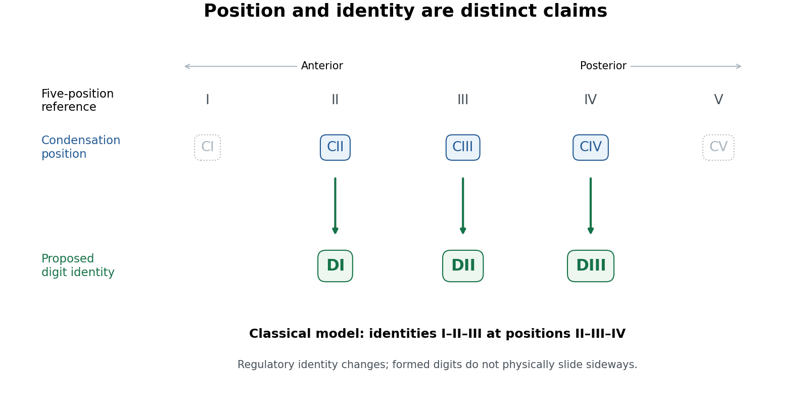

<h1 id="5/solution">Solution</h1>

↑ **Parent:** [5](../5.md)

**The avian [digit identity frameshift hypothesis](../../../../digit-identity-frameshift-hypothesis.md) proposes that positional condensations conventionally numbered II, III and IV develop morphological identities I, II and III.** It separates the place where an [anatomical digit](../../../../anatomical-digit.md) develops from the inherited developmental identity expressed there. It is a hypothesis about [evolutionary developmental biology](../../../../evolutionary-developmental-biology.md), not a [frameshift mutation](../../../../frameshift-mutation.md) in a [DNA](../../../../deoxyribonucleic-acid.md) [reading frame](../../../../reading-frame.md).

The problem arose from comparing two kinds of evidence. The hands of the theropod relatives of [birds](../../../../bird.md) were traditionally reconstructed as retaining the first three [anatomical digits](../../../../anatomical-digit.md). Their [bone](../../../../bone.md) relationships and, in appropriate [fossils](../../../../fossil.md), the phalangeal pattern of two, three and four [phalanges](../../../../phalanx.md) supported identities I, II and III. Embryological studies of the [bird](../../../../bird.md) wing instead assigned the principal surviving condensations to positions II, III and IV within a pentadactyl reference pattern, partly from their relation to the primary skeletal axis. If positional number necessarily fixed morphological identity, the interpretations appeared inconsistent.

[biological homology](../../../../biological-homology.md) is a historical claim, however, and a developmental coordinate need not be eternally coupled to the same character identity. [Günter P. Wagner](../../../../gunter-p-wagner.md) and [Jacques A. Gauthier](../../../../jacques-a-gauthier.md) proposed an evolutionary change in that coupling: an [anatomical digit](../../../../anatomical-digit.md) formed at position II could execute an identity-I developmental program, and the two posterior [anatomical digits](../../../../anatomical-digit.md) could undergo the corresponding changes.[The developmental frameshift proposal reconciling positional and morphological assignments](../../../../1-2-3-2-3-4-a-solution-to-the-problem-of-the-homology-of-the-digits-in-the-avian-hand-by-gunter-p-wagner-and-jacques-a-gauthier.md) With $C_k$ denoting a positional condensation and $D_j$ its resulting identity, the classical proposal is:

$$
\boxed{C_{\mathrm{II}}\mapsto D_{\mathrm{I}},\qquad C_{\mathrm{III}}\mapsto D_{\mathrm{II}},\qquad C_{\mathrm{IV}}\mapsto D_{\mathrm{III}}.}
$$

This notation describes a change in specification. It does not mean that a fully formed [thumb](../../../../thumb.md) physically migrated into another [anatomical digit](../../../../anatomical-digit.md)'s position during development.

**[Figure 2](#5/image-positional-condensations-and-morphological-identities-in-the-classical-avian-digit-frameshift-hypothesis). Positional condensations and morphological identities in the classical avian digit frameshift hypothesis**. Original conceptual diagram. The upper row is a five-position reference; the lower rows distinguish the retained positional assignments from the identities proposed for them. Dotted symbols indicate positions outside the three principal retained digits, without asserting that no transient cells or condensations ever occur there. This diagram states the classical model, not a universal molecular identity code.

The proposal yields tests. Anatomical identity should be assessed from several features of [metacarpals](../../../../metacarpal.md), joints and [phalanges](../../../../phalanx.md), not by calling the anteriormost remaining [anatomical digit](../../../../anatomical-digit.md) “I” by definition. Condensation position should be established independently from staged [embryos](../../../../embryo.md) and [fate mapping](../../../../fate-mapping.md), rather than inferred solely from the adult hand. Molecular comparisons can then ask whether positional [anatomical digit](../../../../anatomical-digit.md) II in the wing shares a distinctive regulatory state with [anatomical digit](../../../../anatomical-digit.md) I in a reference [limb](../../../../vertebrate-limb.md). [evolution](../../../../evolution.md) of [gene regulation](../../../../regulation-of-gene-expression.md), including the duration and distribution of [Sonic hedgehog](../../../../sonic-hedgehog.md) signalling and downstream interactions, offers a means of uncoupling position and later differentiation. Expression of one [Hox gene](../../../../hox-gene.md) is informative but is not a universally valid barcode of a complete [digit identity](../../../../digit-identity.md).

[Koji Tamura](../../../../koji-tamura.md) and colleagues used cell labelling and transplantation to compare wing and [hindlimb](../../../../hindlimb.md) development. The cells contributing to the posterior wing [anatomical digit](../../../../anatomical-digit.md) did not have the same relationship to the posterior signalling region, the [zone of polarizing activity](../../../../zone-of-polarizing-activity.md), as the corresponding [hindlimb](../../../../hindlimb.md) [anatomical digit](../../../../anatomical-digit.md) IV; their early separation was compatible with a digit-III developmental domain. This supplied experimental evidence against equating the posterior wing [anatomical digit](../../../../anatomical-digit.md) straightforwardly with [hindlimb](../../../../hindlimb.md) [anatomical digit](../../../../anatomical-digit.md) IV.[Cell-labelling and transplantation comparisons of wing and hindlimb digit progenitors](../../../../embryological-evidence-identifies-wing-digits-in-birds-as-digits-1-2-and-3-by-koji-tamura-and-others.md)

Such experiments need [embryos](../../../../embryo.md) matched by developmental stage, verified label positions, assessment of label persistence and spread, and controls for effects of grafting on survival and growth. A cell's ultimate contribution establishes its fate under the tested conditions; it does not alone establish the evolutionary identity of every structure it forms. Comparing [forelimb](../../../../forelimb.md) with [hindlimb](../../../../hindlimb.md) also requires recognizing that the two are already developmentally different organs. The stronger inference combines [lineage tracing](../../../../lineage-tracing.md) with [anatomy](../../../../anatomy.md) and regulatory evidence.

Transcriptomic data sharpened, rather than simply ended, the debate. [Zhe Wang](../../../../zhe-wang.md) and colleagues found a conserved anterior-digit signature consistent with identity I in the anteriormost wing [anatomical digit](../../../../anatomical-digit.md), while the posterior wing [anatomical digits](../../../../anatomical-digit.md) showed derived expression identities rather than a simple conserved series.[Comparative digit transcriptomes and the distinctive anterior-wing-digit signature](../../../../transcriptomic-analysis-of-avian-digits-reveals-conserved-and-derived-digit-identities-in-birds-by-zhe-wang-and-others.md) A later multi-species comparison by [Thomas A. Stewart](../../../../thomas-a-stewart.md) and colleagues challenged the assumption that all corresponding [anatomical digits](../../../../anatomical-digit.md) possess a conserved tetrapod-wide molecular identity. Their results supported a more limited shift rather than treating every posterior [anatomical digit](../../../../anatomical-digit.md) as an unchanged identity displaced by one position.[Cross-species expression comparisons and limits of a universal digit-identity model](../../../../evidence-against-tetrapod-wide-digit-identities-and-for-a-limited-frame-shift-in-bird-wings-by-thomas-a-stewart-and-others.md) Tissue composition, sampling stage, [orthology](../../../../orthology.md) assignment and the choice of reference [species](../../../../species.md) are therefore essential controls in molecular tests.

The evolutionary significance is substantial but bounded. [birds](../../../../bird.md) are nested within [theropod dinosaurs](../../../../theropod-dinosaur.md) on evidence extending beyond [anatomical digit](../../../../anatomical-digit.md) number, including many skeletal transformations and feathered relatives. The preserved integument of [Yutyrannus](../../../../yutyrannus.md), for example, documents filamentous [feathers](../../../../feather.md) in a nonavian tyrannosauroid, broadening the [fossil](../../../../fossil.md) distribution of [feathers](../../../../feather.md) beyond [birds](../../../../bird.md).[Associated skeletons and filamentous feather preservation in Yutyrannus](../../../../a-gigantic-feathered-dinosaur-from-the-lower-cretaceous-of-china-by-xing-xu-and-others.md) A coherent developmental mechanism removes one apparent contradiction between embryology and that historical interpretation. It also illustrates why disagreement between positional and morphological evidence should trigger a mechanistic test rather than automatic rejection of either dataset. However, showing that a regulatory shift is developmentally possible is not proof that precisely the full classical shift occurred in the ancestral [bird](../../../../bird.md) lineage.

**The durable result is that [anatomical digit](../../../../anatomical-digit.md) position and [digit identity](../../../../digit-identity.md) can evolve partly independently.** Evidence for an identity-I anterior wing [anatomical digit](../../../../anatomical-digit.md) is stronger than a claim that all three [anatomical digits](../../../../anatomical-digit.md) retain invariant molecular identities I, II and III. The [digit identity frameshift hypothesis](../../../../digit-identity-frameshift-hypothesis.md) remains a useful, testable bridge between [fossil](../../../../fossil.md) [anatomy](../../../../anatomy.md) and development, with the exact extent and sequence of identity transformation requiring explicit comparison rather than assumed equivalence.

## ↑ Ancestors (12)

1. [5](../5.md)
2. [Paper zm1](../../paper-zm1-split.md)
3. [2025](../../split.md)
4. [Past exam of the zoology course of the University of Cambridge](../../../split.md)
5. [Zoology course of the University of Cambridge](../../../../zoology-course-of-the-university-of-cambridge.md)
6. [Year 3 of the natural sciences course of the University of Cambridge](../../../../year-3-of-the-natural-sciences-course-of-the-university-of-cambridge.md)
7. [Year of the natural sciences course of the University of Cambridge](../../../../year-of-the-natural-sciences-course-of-the-university-of-cambridge.md)
8. [Natural sciences course of the University of Cambridge](../../../../natural-sciences-course-of-the-university-of-cambridge.md)
9. [Course of the University of Cambridge](../../../../course-of-the-university-of-cambridge.md)
10. [University of Cambridge](../../../../university-of-cambridge-split.md)
11. [List of universities](../../../../list-of-universities.md)
12. [Codex Wiki](../../../../split.md)
