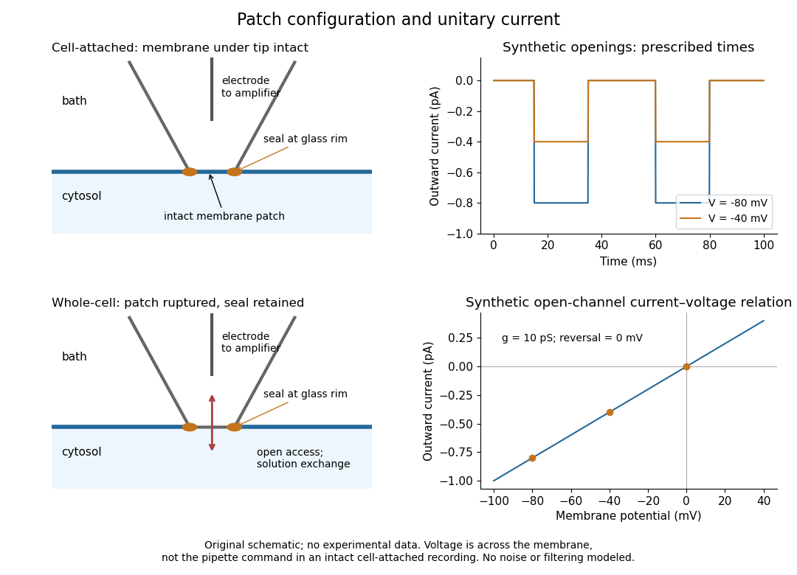

# Patch clamp

↑ **Parent:** [Neuroscience](neuroscience-split.md)  
ⓦ [Wiki](https://en.wikipedia.org/wiki/Patch_clamp)

[Patch clamp](patch-clamp.md) connects an [electrode](electrode.md) to a small area of [cell membrane](cell-membrane-split.md) through a solution-filled [patch pipette](patch-pipette.md). A [gigaohm seal](gigaohm-seal.md) around the rim makes tiny [electric currents](electric-current.md) through [ion channels](ion-channel.md) distinguishable from [seal leak current](seal-leak-current.md). The beautiful change of scale is from a population's average response to individual opening and closing events in [single-channel recording](single-channel-recording.md).

Separate two questions. The configuration determines which [cell membrane](cell-membrane-split.md) is accessible: an intact patch in [cell-attached recording](cell-attached-recording.md), an excised [inside-out patch](inside-out-patch.md) or [outside-out patch](outside-out-patch.md), or intracellular access in [whole-cell recording](whole-cell-recording.md). The recording mode determines what is commanded and what is observed: [voltage clamp](voltage-clamp.md) commands an [electric potential difference](electric-potential-difference.md) and measures [electric current](electric-current.md); [current clamp](current-clamp.md) commands [electric current](electric-current.md) and measures [membrane potential](membrane-potential-split.md). [Whole-cell recording](whole-cell-recording.md) supports both modes. A patch can contain several [ion channels](ion-channel.md); a small recording area does not establish that only one is present.

**[Figure 13](#image-patch-clamp-configurations-and-synthetic-single-channel-recording). Patch clamp configurations and synthetic single-channel recording**. Original schematic of [cell-attached recording](cell-attached-recording.md) and [whole-cell recording](whole-cell-recording.md), with synthetic [electric current](electric-current.md) traces and a [single-channel current-voltage relation](single-channel-current-voltage-relation.md). The prescribed opening times are identical at $-80$ and $-40\,\mathrm{mV}$ solely to compare amplitudes. These are not experimental data or a model of opening [probability](probability.md). [Membrane potential](membrane-potential-split.md) means the actual voltage across the patch, not automatically the pipette command.

The 1976 article [Single-channel currents recorded from membrane of denervated frog muscle fibres](https://cenl.ucsd.edu/psych506A/papers/neher-sakmann%2Bsingle-channel-currents-membrane-denervated-frog-muscle%2BNature%2B1976.pdf) describes an extracellular fire-polished pipette with a $3$–$5\,\mu\mathrm m$ opening and $2$–$5\,\mathrm{M\Omega}$ [electrical resistance](electrical-resistance.md). It contained saline and a channel-activating compound. Two separate intracellular [electrodes](electrode.md) supplied local [voltage clamp](voltage-clamp.md) of the muscle fibre; the patch amplifier measured local [electric current](electric-current.md). Cooling to $6$–$8\,{}^\circ\mathrm C$ and [hyperpolarization](hyperpolarization.md) helped resolve elementary events. Figure 2 shows step-like pulses with a $200\,\mathrm{Hz}$ filter at $-120\,\mathrm{mV}$ and $8\,{}^\circ\mathrm C$. Discrete amplitudes and overlapping events supported individual [ion channel](ion-channel.md) openings rather than a smoothly varying population response. This was neither [whole-cell recording](whole-cell-recording.md) through the patch pipette nor [current clamp](current-clamp.md). The specialized conditions improved visibility but limit generalization to warmer preparations; filtering can conceal brief openings.[p. 800, Figures 1–2 and accompanying experimental conditions](single-channel-currents-recorded-from-membrane-of-denervated-frog-muscle-fibres-by-erwin-neher-and-others.md)

For a new [single-channel recording](single-channel-recording.md) experiment, useful controls include a matched recording without the activating compound, controlled [membrane potential](membrane-potential-split.md), repeated seal tests, and an explicitly stated filter [frequency response](frequency-response.md). These are proposed controls, not claims that every one was performed in that 1976 figure. Changing [membrane potential](membrane-potential-split.md) tests the [single-channel current-voltage relation](single-channel-current-voltage-relation.md); changing the recording filter tests whether a short pulse's apparent amplitude is an instrument artifact. A flat baseline establishes neither an absence of [ion channels](ion-channel.md) nor an absence of very brief events.

**Table of contents**

- [Patch pipette](patch-pipette.md)
- [Gigaohm seal](gigaohm-seal.md)
  - [Seal leak current](seal-leak-current.md)
- [Cell-attached recording](cell-attached-recording.md)
- [Single-channel recording](single-channel-recording.md)
  - [Single-channel current-voltage relation](single-channel-current-voltage-relation.md)
- [Inside-out patch](inside-out-patch.md)
- [Outside-out patch](outside-out-patch.md)
- [Whole-cell recording](whole-cell-recording.md)
  - [Patch-clamp series resistance](patch-clamp-series-resistance.md)
  - [Membrane capacitance](membrane-capacitance.md)
  - [Space clamp](space-clamp.md)
  - [Cytosol dialysis](cytosol-dialysis.md)
  - [Perforated patch recording](perforated-patch-recording.md)
- [Current clamp](current-clamp.md)
  - [Passive membrane response in current clamp](passive-membrane-response-in-current-clamp.md)

## ↑ Ancestors (3)

1. [Neuroscience](neuroscience-split.md)
2. [Biology](biology-split.md)
3. [Codex Wiki](split.md)

## ← Incoming links (4)

- [Solution](past-exam-of-the-biochemistry-and-molecular-biology-course-of-the-university-of-cambridge/2025/paper-1/section-d/10/solution.md)
- [Solution](past-exam-of-the-biochemistry-course-of-the-university-of-cambridge/2025/paper-1/section-i/2/solution.md)
- [Patch clamp](patch-clamp.md)
- [Patch pipette](patch-pipette.md)
