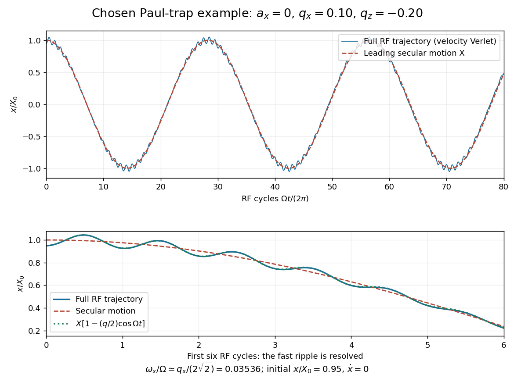

# Paul trap secular-motion example

↑ **Parent:** [Paul trap micromotion](paul-trap-micromotion.md)

Choose these dimensionless parameters for an original example, with no collisions or damping. They are teaching inputs, not measurements from either lecture. With $s=\Omega t$ and slow initial amplitude $X_0$, the radial equation and its leading approximation are

$$
\frac{d^2x}{ds^2}=\frac{q_x}{2}\cos s\,x,\qquad
X=X_0\cos\left(\frac{q_xs}{2\sqrt2}\right),\qquad
x_{\rm app}=X\left(1-\frac{q_x}{2}\cos s\right).
$$

Set $x(0)=0.95X_0$ and $dx/ds(0)=0$ to match the approximate initial conditions. The leading secular [angular frequency](angular-frequency.md) is $\omega_x/\Omega=0.0353553$. The [velocity Verlet method](velocity-verlet-method.md) integrates the full RF equation over 80 drive periods; a separate fourth-order [Runge-Kutta method](runge-kutta-method-split.md) checks the computed trajectory. Halving the timestep tests numerical error independently of the averaging error.

**[Figure 8](#image-full-rf-motion-and-the-leading-secular-approximation). Full RF motion and the leading secular approximation**. Original chosen small-parameter calculation in units of $X_0$. The lower panel resolves six drive cycles and includes the first micromotion correction. Agreement over this finite interval does not establish a stability diagram or an exact secular frequency.

Using 400, 800, 1600 and 3200 steps per RF period gives successive maximum position differences of approximately $1.40\times10^{-4}$, $3.50\times10^{-5}$ and $8.74\times10^{-6}$ in units of $X_0$, consistent with second-order convergence. The finest trajectory differs from the independent [classical fourth-order Runge-Kutta method](classical-fourth-order-runge-kutta-method.md) result by at most $2.92\times10^{-6}X_0$, whereas $x_{\rm app}$ differs by as much as $0.0378X_0$. Over a sufficiently long time, the omitted correction to the secular [angular frequency](angular-frequency.md) produces a growing phase discrepancy even if the numerical trajectory has converged. For the chosen point only, integration of a fundamental solution [matrix](matrix.md) over one RF period checks that both the radial and axial [Floquet multipliers](floquet-multiplier.md) lie on the unit circle, away from its endpoints. This tests simultaneous ideal confinement without extrapolating to larger $|q_i|$.

## ↑ Ancestors (7)

1. [Paul trap micromotion](paul-trap-micromotion.md)
2. [Paul trap](paul-trap.md)
3. [Ion trap](ion-trap.md)
4. [Atomic measurement methods](atomic-measurement-methods.md)
5. [Atomic physics](atomic-physics-split.md)
6. [Physics](physics-split.md)
7. [Codex Wiki](split.md)
