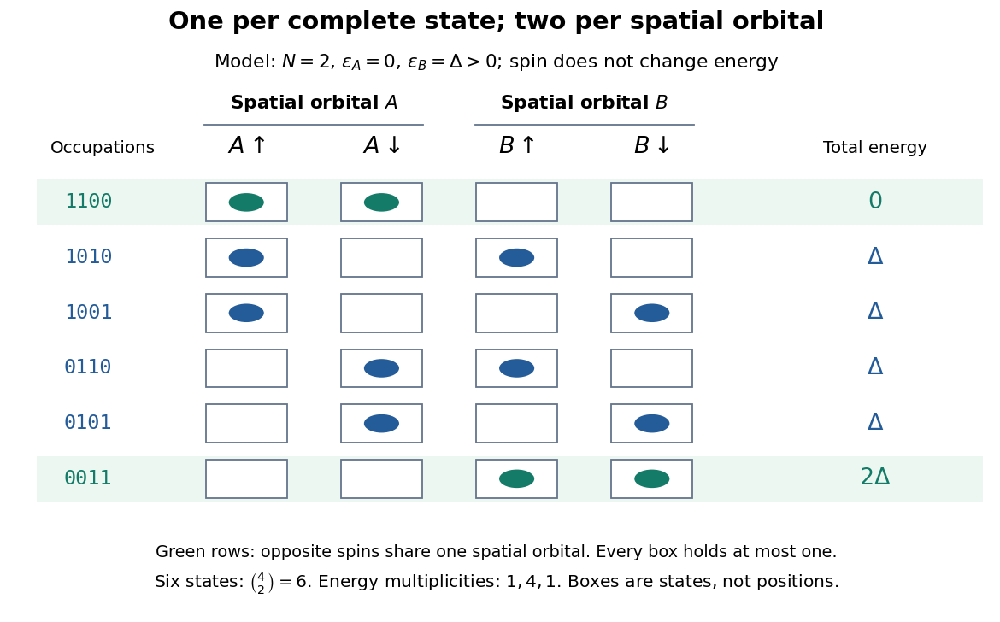

# Pauli exclusion principle

↑ **Parent:** [Fermion](fermion.md)  
ⓦ [Wiki](https://en.wikipedia.org/wiki/Pauli_exclusion_principle)

The [Pauli exclusion principle](pauli-exclusion-principle.md) says that each complete [one-particle state](one-particle-state.md) can have [fermionic occupation number](fermionic-occupation-number.md) zero or one. “Complete” includes [spin](spin.md) and any other internal labels, as well as the spatial [wavefunction](wave-function.md). Thus two [Electrons](electron.md) can share a [spatial orbital](spatial-orbital.md) with opposite [spin](spin.md) projections: these are two different [spin orbitals](spin-orbital.md). Equal energy alone does not mean equal [quantum state](quantum-state.md), because [degenerate energy levels](degenerate-energy-levels.md) contain several independent [one-particle states](one-particle-state.md).

This distinction explains how an [electron shell](electron-shell.md) can accommodate several [Electrons](electron.md) while exclusion still allows only one per complete [one-particle state](one-particle-state.md). It also makes a finite model of [fermionic state counting](fermionic-state-counting.md) surprisingly simple: two [spatial orbitals](spatial-orbital.md) with two [spin](spin.md) choices each give four complete [one-particle states](one-particle-state.md), and exactly six two-[Electron](electron.md) basis states. The following diagram enumerates them; its boxes represent [occupation numbers](occupation-number.md), not locations in space.

**[Figure 23](#image-six-two-electron-occupation-states-in-two-spatial-orbitals-with-two-spin-projections-each). Six two-electron occupation states in two spatial orbitals with two spin projections each**.

Pauli's [Exclusion principle and quantum mechanics by Wolfgang Pauli](exclusion-principle-and-quantum-mechanics-by-wolfgang-pauli.md) is his retrospective account, delivered on 13 December 1946 for the 1945 Nobel Prize. On printed pp. 29–30, he describes proposing an extra two-valued [Electron](electron.md) property in autumn 1924 and formulating exclusion in 1925. The crucial clue linked counts of resolved [energy eigenstates](energy-eigenstate.md) in alkali spectra under a [magnetic field](magnetic-field.md) with the populations of closed [electron shells](electron-shell.md). Resolving every label turned a complicated shell capacity into one [Electron](electron.md) per complete [one-particle state](one-particle-state.md). This historical route preceded the modern [spin](spin.md) interpretation and the antisymmetric [wavefunction](wave-function.md) formulation; it was not originally a deduction from a [Slater determinant](slater-determinant.md).

**Table of contents**

- [Spatial orbital](spatial-orbital.md)
  - [Spin orbital](spin-orbital.md)
- [Two-particle antisymmetrization](two-particle-antisymmetrization.md)
  - [Slater determinant](slater-determinant.md)
- [Exclusion versus particle position](exclusion-versus-particle-position.md)
- [Zero-temperature filling of finite fermion levels](zero-temperature-filling-of-finite-fermion-levels.md)
  - [Fermionic state counting](fermionic-state-counting.md)
- [Fermionic atom antibunching](fermionic-atom-antibunching.md)
  - [Pair detection correlation](pair-detection-correlation.md)
  - [Magnetic trapping of neutral atoms](magnetic-trapping-of-neutral-atoms.md)
  - [Time-of-flight atom detection](time-of-flight-atom-detection.md)
    - [Microchannel plate detector](microchannel-plate-detector.md)

## ↑ Ancestors (9)

1. [Fermion](fermion.md)
2. [Indistinguishable particles](indistinguishable-particles.md)
3. [Particle exchange operator](particle-exchange-operator.md)
4. [Multiparticle quantum state](multiparticle-quantum-state.md)
5. [Tensor product of quantum systems](tensor-product-of-quantum-systems.md)
6. [Quantum mechanics](quantum-mechanics-split.md)
7. [Branches of physics](branches-of-physics.md)
8. [Physics](physics-split.md)
9. [Codex Wiki](split.md)

## ← Incoming links (32)

- [Centrifugal distortion](centrifugal-distortion.md)
- [Degeneracy pressure](degeneracy-pressure.md)
- [Degenerate electron gas](degenerate-electron-gas.md)
- [Dirac sea](dirac-sea.md)
- [Electron hole](electron-hole.md)
- [Electrostatic model of ionic binding](electrostatic-model-of-ionic-binding.md)
- [Fermi-Dirac statistics](fermi-dirac-statistics.md)
- [Fermionic creation operator](fermionic-creation-operator.md)
- [Molecular orbital theory](molecular-orbital-theory.md)
- [Solution](past-exam-of-the-mathematics-course-of-the-university-of-cambridge/2002/iii/paper-63/2/solution.md)
- [Solution](past-exam-of-the-mathematics-course-of-the-university-of-cambridge/2003/iii/paper-45/1/solution.md)
- [Solution](past-exam-of-the-mathematics-course-of-the-university-of-cambridge/2004/iii/paper-44/3/b/solution.md)
- [Solution](past-exam-of-the-mathematics-course-of-the-university-of-cambridge/2005/ii/paper-3/34d/solution.md)
- [Solution](past-exam-of-the-mathematics-course-of-the-university-of-cambridge/2005/iii/paper-50/2/solution.md)
- [Solution](past-exam-of-the-mathematics-course-of-the-university-of-cambridge/2006/ii/paper-3/10d/b/solution.md)
- [Solution](past-exam-of-the-mathematics-course-of-the-university-of-cambridge/2007/iii/paper-50/4/solution.md)
- [Solution](past-exam-of-the-mathematics-course-of-the-university-of-cambridge/2007/iii/paper-52/4/solution.md)
- [Solution](past-exam-of-the-mathematics-course-of-the-university-of-cambridge/2011/ii/paper-3/10e/i/solution.md)
- [Solution](past-exam-of-the-mathematics-course-of-the-university-of-cambridge/2012/iii/paper-48/2/solution.md)
- [Solution](past-exam-of-the-mathematics-course-of-the-university-of-cambridge/2014/iii/paper-40/4/solution.md)
- [Solution](past-exam-of-the-mathematics-course-of-the-university-of-cambridge/2014/iii/paper-41/3/solution.md)
- [Solution](past-exam-of-the-mathematics-course-of-the-university-of-cambridge/2014/iii/paper-55/4/solution.md)
- [Solution](past-exam-of-the-mathematics-course-of-the-university-of-cambridge/2017/ii/paper-1/33c/solution.md)
- [Solution](past-exam-of-the-mathematics-course-of-the-university-of-cambridge/2017/ii/paper-2/34d/b/i/solution.md)
- [Solution](past-exam-of-the-mathematics-course-of-the-university-of-cambridge/2019/ii/paper-3/35d/solution.md)
- [Solution](past-exam-of-the-mathematics-course-of-the-university-of-cambridge/2019/iii/paper-317/3/i/solution.md)
- [Solution](past-exam-of-the-mathematics-course-of-the-university-of-cambridge/2021/ii/paper-2/9b/a/ii/solution.md)
- [Solution](past-exam-of-the-mathematics-course-of-the-university-of-cambridge/2022/ii/paper-3/35a/a/solution.md)
- [Solution](past-exam-of-the-mathematics-course-of-the-university-of-cambridge/2022/ii/paper-3/35a/b/iii/solution.md)
- [Solution](past-exam-of-the-mathematics-course-of-the-university-of-cambridge/2023/ii/paper-4/34d/b/solution.md)
- [Pauli exclusion principle](pauli-exclusion-principle.md)
- [Three-quark colour singlet](three-quark-colour-singlet.md)
