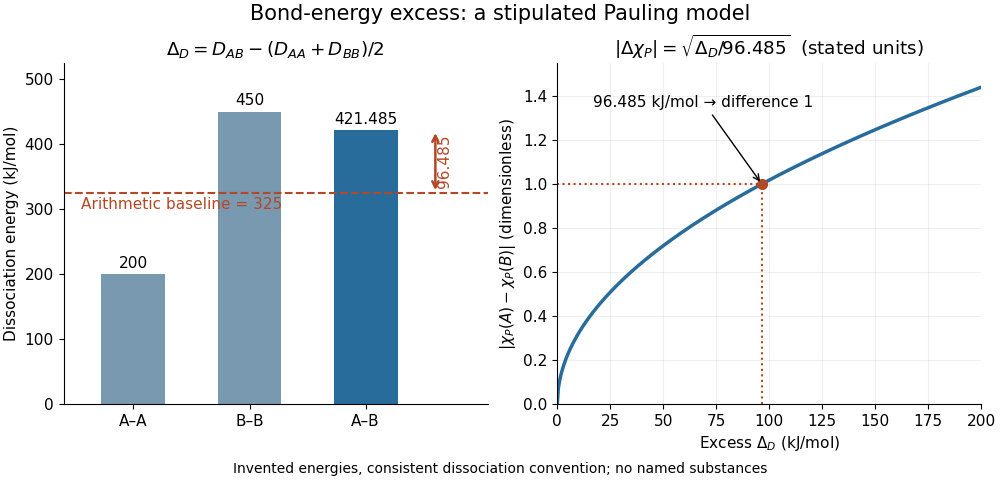

# Pauling bond-energy excess

↑ **Parent:** [Pauling electronegativity](pauling-electronegativity.md)

A [Pauling bond-energy excess](pauling-bond-energy-excess.md) subtracts a chosen like-atom baseline from the unlike-atom [bond-dissociation energy](bond-dissociation-energy.md). For an unequal-input arithmetic example, stipulate $D_{AA}=200$, $D_{BB}=450$ and $D_{AB}=421.485\,\mathrm{kJ\,mol^{-1}}$, all with one dissociation convention. The [arithmetic mean](arithmetic-mean.md) baseline and excess are

$$
D_{\rm base}=\frac{200+450}{2}=325\,\mathrm{kJ\,mol^{-1}},\qquad
\Delta_D=421.485-325=96.485\,\mathrm{kJ\,mol^{-1}}.
$$

The arithmetic-baseline [Pauling scale](pauling-electronegativity.md) model therefore gives $|\chi_{\rm P}(A)-\chi_{\rm P}(B)|=\sqrt{96.485/96.485}=1$. The [bond-dissociation energy](bond-dissociation-energy.md) $421.485$ is not itself the excess: subtracting the baseline is essential. All three numbers are stipulated, not experimental values for named [chemical elements](chemical-element.md).

**[Figure 2](#image-pauling-bond-energy-excess-construction). Constructing a Pauling bond-energy excess from stipulated bond-dissociation energies and converting it to a dimensionless electronegativity difference**.

Changing the baseline changes the model. For the same stipulated inputs, a [geometric mean](geometric-mean.md) baseline would be $\sqrt{200\times450}=300\,\mathrm{kJ\,mol^{-1}}$, yielding an excess of $121.485\,\mathrm{kJ\,mol^{-1}}$ and a difference of approximately $1.122$. It is a different construction, even though both start from the same [bond-dissociation energies](bond-dissociation-energy.md). State which baseline is used before comparing [electronegativity](electronegativity-split.md) differences.

The arithmetic-baseline [Pauling scale](pauling-electronegativity.md) also has a useful inverse: a difference of $0.5$ corresponds to an excess of $24.12125\,\mathrm{kJ\,mol^{-1}}$, and a difference of $2$ corresponds to $385.94\,\mathrm{kJ\,mol^{-1}}$. Doubling the [electronegativity](electronegativity-split.md) difference quadruples the modeled excess. Interchanging the endpoint labels changes neither quantity; the [square root](square-root.md) alone cannot choose the direction of [bond polarization](bond-polarization.md).

In [The Nature of the Chemical Bond. IV. The Energy of Single Bonds and the Relative Electronegativity of Atoms](the-nature-of-the-chemical-bond-iv-the-energy-of-single-bonds-and-the-relative-electronegativity-of-atoms-by-linus-pauling.md) (printed pp. 3576–3578, Table II and equation (1)), [Linus Pauling](linus-pauling.md) organized excess [energies](energy-split.md) for [chemical bonds](chemical-bond-split.md) into an approximately additive map of their [square roots](square-root.md). He also identified a limitation: his H–F map separation of $2$ predicted an excess of $4.00\,\mathrm{eV}$, exceeding his table's value by $1.23\,\mathrm{eV}$. Those are historical values and a historical model discrepancy, not modern recommended inputs.[printed pp. 3576–3578, Table II, equation (1), and paragraph beginning “These coördinates”](the-nature-of-the-chemical-bond-iv-the-energy-of-single-bonds-and-the-relative-electronegativity-of-atoms-by-linus-pauling.md)

## ↑ Ancestors (5)

1. [Pauling electronegativity](pauling-electronegativity.md)
2. [Electronegativity](electronegativity-split.md)
3. [Chemical bond](chemical-bond-split.md)
4. [Chemistry](chemistry-split.md)
5. [Codex Wiki](split.md)

## ← Incoming links (2)

- [Experimental inputs to electronegativity scales](experimental-inputs-to-electronegativity-scales.md)
- [Pauling bond-energy excess](pauling-bond-energy-excess.md)
