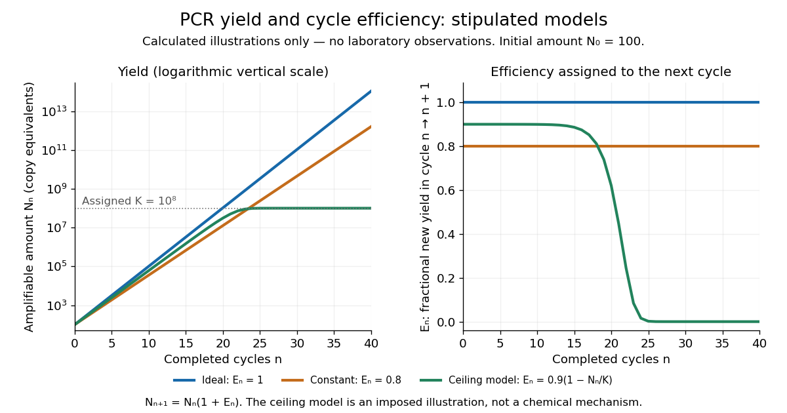

# PCR efficiency

↑ **Parent:** [Polymerase chain reaction](polymerase-chain-reaction.md)

For a stipulated population of amplifiable copies, let $N_n$ be the amount after cycle $n$ and define [PCR efficiency](pcr-efficiency.md) by the fractional new yield

$$
N_{n+1}=N_n(1+E_n),\qquad 0\leq E_n\leq1.
$$

Here $E_n=1$ means one additional copy per existing copy, hence ideal doubling. If every cycle has the same [PCR efficiency](pcr-efficiency.md) $E$, the [exponential growth](exponential-growth.md) model gives $N_n=N_0(1+E)^n$. Starting with $N_0=100$ copies, twenty ideal cycles give $104\,857\,600$ copies; the stipulated value $E=0.8$ gives about $12\,748\,236$. An efficiency of 80 percent therefore means multiplication by 1.8 each cycle, not retention of 80 percent of the final ideal yield.

**[Figure 10](#image-stipulated-pcr-efficiency-models-ideal-doubling-slower-exponential-growth-and-a-pcr-plateau). Stipulated PCR efficiency models: ideal doubling, slower exponential growth and a PCR plateau**. Original calculated curves, not laboratory observations or measured [fluorescence](fluorescence-split.md). All begin at $N_0=100$. Blue has $E_n=1$; orange has $E_n=0.8$; green stipulates $E_n=0.9(1-N_n/K)$ with $K=10^8$. The left panel uses a [logarithmic scale](logarithmic-scale.md) for copy amount; the right shows the assigned cycle efficiencies. Only the green model includes a finite ceiling. The illustrative ceiling and its equation are assumptions, not fitted chemical kinetics or a universal explanation of a plateau.

In the ideal strand-counting example, all duplex-equivalent material doubles, but exact-length [amplicons](amplicon.md) lag initially. Starting from one longer duplex and retaining its two original strands, cycle $n\geq1$ contains $2(2^n-n-1)$ exact-length strands out of $2^{n+1}$ total strands. Thus their fraction is $1-(n+1)/2^n$: zero after cycle 1, one quarter after cycle 2 and one half after cycle 3. This counts strands rather than assuming every strand immediately finds an exact-length partner. The generic yield model above ignores this early distinction.

**Table of contents**

- [PCR plateau](pcr-plateau.md)

## ↑ Ancestors (5)

1. [Polymerase chain reaction](polymerase-chain-reaction.md)
2. [Molecular genetics](molecular-genetics-split.md)
3. [Genetics](genetics-split.md)
4. [Biology](biology-split.md)
5. [Codex Wiki](split.md)

## ← Incoming links (6)

- [Solution](past-exam-of-the-biochemistry-and-molecular-biology-course-of-the-university-of-cambridge/2024/paper-1/section-a/2/solution.md)
- [PCR efficiency](pcr-efficiency.md)
- [PCR plateau](pcr-plateau.md)
- [PCR thermal cycle](pcr-thermal-cycle.md)
- [Real-time polymerase chain reaction](real-time-polymerase-chain-reaction.md)
- [RT-qPCR](rt-qpcr.md)
