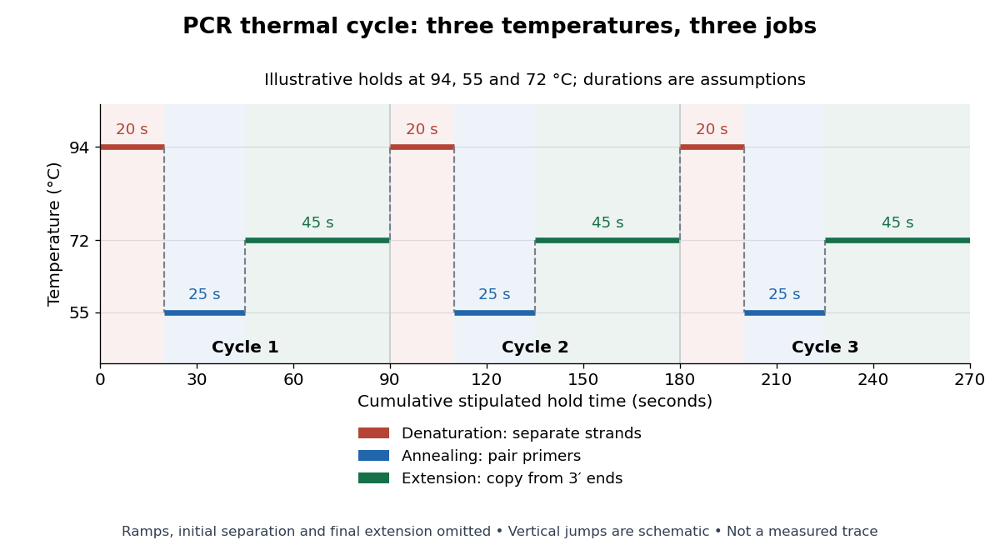

# PCR thermal cycle

↑ **Parent:** [Polymerase chain reaction](polymerase-chain-reaction.md)

A [PCR thermal cycle](pcr-thermal-cycle.md) separates three jobs. During [PCR denaturation](pcr-denaturation.md), heating separates the paired [DNA](deoxyribonucleic-acid.md) strands without intentionally cutting their [phosphodiester bonds](phosphodiester-bond.md). During [PCR annealing](pcr-annealing.md), cooling permits [base pairing](base-pairing.md) between [PCR primers](pcr-primer.md) and templates. During [PCR extension](pcr-extension.md), the chosen interval supports [DNA polymerase](dna-polymerase.md) synthesis from the paired $3'$ ends. Each new [nucleotide](nucleotide.md) is supplied as a [deoxynucleoside triphosphate](deoxynucleoside-triphosphate.md); its incorporation lengthens the strand. The [DNA polymerase](dna-polymerase.md) is a [catalyst](catalyst.md), while these [nucleotides](nucleotide.md) are consumed substrates.[Principles of PCR, accompanying description: denaturation, annealing, primer-dependent extension and dNTP incorporation](principles-of-pcr-by-thermo-fisher-scientific.md)

[Taq polymerase](taq-polymerase.md) withstands repeated high-[temperature](temperature-split.md) strand separation better than a heat-sensitive [DNA polymerase](dna-polymerase.md). Its extension activity still depends on [temperature](temperature-split.md), [buffer solution](buffer-solution.md) and [magnesium](magnesium.md) ions. Heat resistance does not mean constant activity at every stage: the separation [temperature](temperature-split.md) serves the [DNA](deoxyribonucleic-acid.md), whereas the extension [temperature](temperature-split.md) serves the copying [enzyme](enzyme-split.md). As one institutional example, Addgene's Basic PCR Program specifies $94^{\circ}\mathrm{C}$ separation, $55^{\circ}\mathrm{C}$ primer binding and $72^{\circ}\mathrm{C}$ extension. These are example settings, not universal properties of all [PCR primers](pcr-primer.md) or [DNA polymerases](dna-polymerase.md).[Basic PCR Program, steps 1–6; Materials List: Taq buffer with magnesium chloride](polymerase-chain-reaction-pcr-by-addgene.md)

**[Figure 8](#image-the-three-jobs-in-a-pcr-thermal-cycle-separate-pair-extend). The three jobs in a PCR thermal cycle: separate, pair, extend**. Original schematic of three stipulated cycles with $94$, $55$ and $72^{\circ}\mathrm{C}$ holds lasting $20$, $25$ and $45\,\mathrm{s}$ respectively. Horizontal widths represent these assumed hold durations. Vertical transitions omit heating and cooling time; this is neither a measured sample-temperature trace nor a validated experimental program. Initial separation, final extension and storage holds are omitted.

For timing arithmetic alone, those stipulated holds give $20+25+45=90\,\mathrm{s}$ per [PCR thermal cycle](pcr-thermal-cycle.md), and three cycles give $270\,\mathrm{s}$. Adding an assumed $90\,\mathrm{s}$ initial separation and $180\,\mathrm{s}$ final extension gives $540\,\mathrm{s}=9\,\mathrm{min}$ of holds. A real [thermal cycler](thermal-cycler.md) also takes time to move between [temperatures](temperature-split.md). The schedule tells us when conditions favour [PCR denaturation](pcr-denaturation.md), [PCR annealing](pcr-annealing.md) or [PCR extension](pcr-extension.md); it does not measure the fraction of [DNA](deoxyribonucleic-acid.md) copied.

An actual institutional protocol makes the distinction concrete. New England Biolabs specifies mixing templates and [PCR primers](pcr-primer.md) with its OneTaq master mix in a thin-walled tube; a quick spin collects liquid at the bottom. Its $25\,\mathrm{\mu L}$ preparation uses $12.5\,\mathrm{\mu L}$ of the twice-concentrated mix and $0.5\,\mathrm{\mu L}$ of each $10\,\mathrm{\mu M}$ [PCR primer](pcr-primer.md) stock, with [water](water.md) completing the volume. Tubes enter a [thermal cycler](thermal-cycler.md) preheated to $94^{\circ}\mathrm{C}$; mineral oil is specified if there is no heated lid. The program gives thirty cycles of $94^{\circ}\mathrm{C}$ separation, $45$–$68^{\circ}\mathrm{C}$ binding and $68^{\circ}\mathrm{C}$ extension, with extension time scaled to product length. The binding setting must be selected for the [PCR primers](pcr-primer.md); the range is not a continuously swept setting.[Protocol, Reaction setup steps 1–2, 25 microlitre table and Thermocycling conditions; General Guidelines, Annealing and Extension](protocol-for-onetaq-2x-master-mix-with-standard-buffer-by-new-england-biolabs.md)

The dilution can be checked independently: each [PCR primer](pcr-primer.md) has final [concentration](concentration.md) $10\times0.5/25=0.2\,\mathrm{\mu M}$, while the mix is diluted twofold. For an endpoint readout, Addgene specifies examining a product aliquot by [gel electrophoresis](gel-electrophoresis.md).[Procedure, Primer Design and PCR step 13: run 2 microlitres on a gel](polymerase-chain-reaction-pcr-by-addgene.md) Pair that size comparison with the existing [PCR controls](pcr-controls.md): a known template and a no-template tube test different explanations of success or failure. Those comparisons are an analytical addition, not controls documented in the OneTaq schedule. An expected-sized band supports production of a length-compatible [amplicon](amplicon.md); it does not establish its [nucleotide sequence](nucleic-acid-sequence.md), ideal [PCR efficiency](pcr-efficiency.md) or successful separation during every cycle. Neither protocol supplies a measured temperature or yield curve for the schematic above.

**Table of contents**

- [PCR denaturation](pcr-denaturation.md)
- [PCR annealing](pcr-annealing.md)
- [PCR extension](pcr-extension.md)

## ↑ Ancestors (5)

1. [Polymerase chain reaction](polymerase-chain-reaction.md)
2. [Molecular genetics](molecular-genetics-split.md)
3. [Genetics](genetics-split.md)
4. [Biology](biology-split.md)
5. [Codex Wiki](split.md)

## ← Incoming links (2)

- [PCR thermal cycle](pcr-thermal-cycle.md)
- [Polymerase chain reaction](polymerase-chain-reaction.md)
