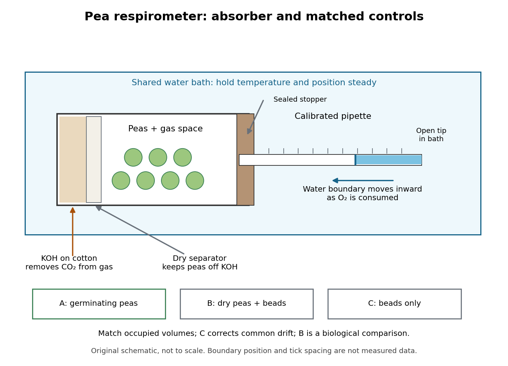

# Pea seed respirometry

↑ **Parent:** [Respirometer](respirometer.md)

The University of Oklahoma K20 Center's handout describes three sealed vial-and-pipette [respirometers](respirometer.md) in each [temperature](temperature-split.md) bath: soaked, germinating [peas](pea.md); nongerminating [peas](pea.md) plus inert plastic beads; and beads alone. Displaced [water](water.md) establishes equal occupied [volumes](volume.md). Absorbent cotton holds [potassium hydroxide](potassium-hydroxide.md), which removes [carbon dioxide](carbon-dioxide.md); nonabsorbent cotton separates it from the [peas](pea.md). The source equilibrates the vials before submersion and again before the initial reading. Colored [water](water.md) makes the boundary visible in each calibrated pipette. Readers then record positions every five minutes for twenty minutes.[Cell Respiration, K20 Center handout adapted from AP Biology Lab Manual, pp. 3–4, procedure 1–16: preparation, equilibration and readings](cell-respiration-by-the-k20-center.md)

**[Figure 35](#image-pea-seed-respirometry-absorber-gas-readout-and-matched-controls). Pea seed respirometry: absorber, gas readout and matched controls**. Original schematic of the university handout's vial-and-pipette apparatus. [Carbon dioxide](carbon-dioxide.md) is removed from the gas; [molecular oxygen](molecular-oxygen.md) consumption draws the [water](water.md) boundary toward the vial. The three sample groups share a bath and matched occupied [volumes](volume.md). Geometry, particle counts and boundary position are illustrative; no measured readings are plotted.

Bath [temperature](temperature-split.md), vial position and seal integrity matter. The beads-only [respirometer](respirometer.md) detects common [temperature](temperature-split.md) or atmospheric [pressure](pressure-split.md) drift; its change is subtracted from each pea reading. Nongerminating [peas](pea.md) provide a biological comparison, not an assumption of zero [cellular respiration](cellular-respiration.md). A larger corrected uptake slope for germinating [peas](pea.md) would support greater [molecular oxygen](molecular-oxygen.md) consumption by that sample under the tested conditions.[Cell Respiration, pp. 1, 3–4 and 6: living dormant seeds, position/leaks, corrected differences and slope](cell-respiration-by-the-k20-center.md)

Equal displaced [volumes](volume.md) help match the gas spaces; they do not establish equal living [mass](mass.md) or equal developmental state. Comparing uptake per [seed](seed.md) and uptake per dry [mass](mass.md) asks different questions. Leaks, incomplete [carbon dioxide](carbon-dioxide.md) absorption, gas dissolution and changing water-vapour contributions can distort the [respirometer](respirometer.md) inference. A blank correction cannot repair a sample-specific leak. These are consequences of the [respirometer gas balance](respirometer-gas-balance.md), rather than measurements reported in the handout.

## ↑ Ancestors (5)

1. [Respirometer](respirometer.md)
2. [Cellular respiration](cellular-respiration.md)
3. [Metabolism](metabolism.md)
4. [Biology](biology-split.md)
5. [Codex Wiki](split.md)

## ← Incoming links (3)

- [Cellular respiration](cellular-respiration.md)
- [Pea seed respirometry](pea-seed-respirometry.md)
- [Respirometer](respirometer.md)
