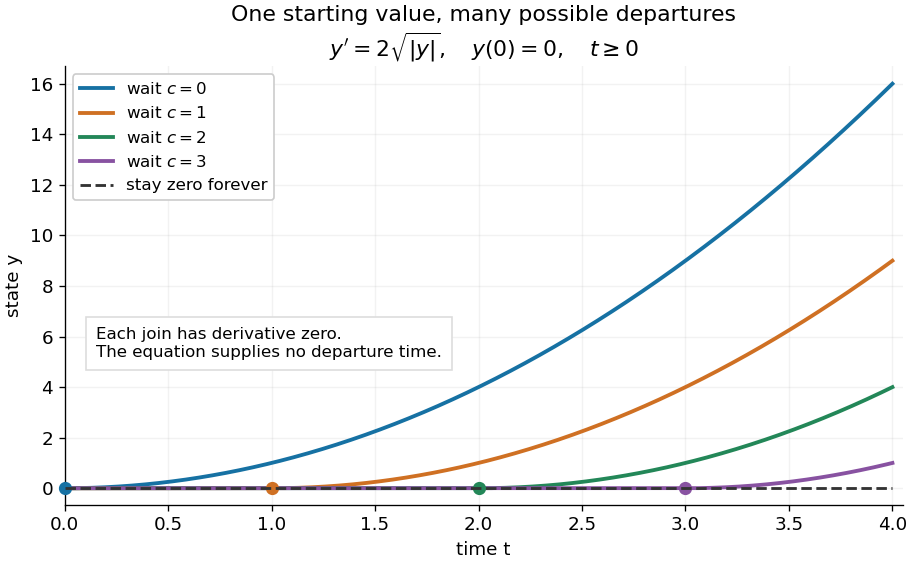

# Peano existence theorem

↑ **Parent:** [Ordinary differential equation](ordinary-differential-equation.md)  
ⓦ [Wiki](https://en.wikipedia.org/wiki/Peano_existence_theorem)

Let $U\subset\mathbb R\times\mathbb R^d$ be an [open set](open-set.md), $d<\infty$, and $f:U\to\mathbb R^d$ a [continuous function](continuous-function.md). Through every $(t_0,y_0)\in U$ there is a local [solution of a differential equation](solution-of-a-differential-equation.md): a [continuously differentiable function](continuously-differentiable-function.md) $y:I\to\mathbb R^d$ on an open [interval](interval-mathematics.md) containing $t_0$, satisfying the displayed [initial value problem](initial-value-problem.md) pointwise. No [Lipschitz condition](lipschitz-continuity.md) is assumed.[Gerald Teschl, Ordinary Differential Equations and Dynamical Systems, §2.7, Theorem 2.19, printed p. 56: forward existence and the analogous backward result](ordinary-differential-equations-and-dynamical-systems-by-gerald-teschl.md)

[Continuity](continuous-function.md) of a proposed rate law therefore guarantees at least one trajectory for a short time. For a physical model, this is a first consistency check: can the stated rule and [initial condition](initial-condition.md) actually be followed? Prediction also needs uniqueness. The [delayed solutions of a square-root differential equation](delayed-solutions-of-a-square-root-differential-equation.md) below show how the same rule and [initial condition](initial-condition.md) can leave a departure time undetermined. The [Picard-Lindelöf theorem](picard-lindelof-theorem.md) supplies a sufficient additional hypothesis for uniqueness; failure of that hypothesis alone does not prove nonuniqueness.

For the [initial value problem](initial-value-problem.md) $y'=2\sqrt{|y|}$, $y(0)=0$, a forward [solution of a differential equation](solution-of-a-differential-equation.md) can stay zero until any $c\geq0$, then follow $y=(t-c)^2$. The [delayed solutions of a square-root differential equation](delayed-solutions-of-a-square-root-differential-equation.md) verify this freedom exactly.

**[Figure 8](#image-one-initial-condition-admits-an-arbitrary-forward-waiting-time). One initial condition admits an arbitrary forward waiting time**. Colored curves leave zero at the marked waits $c=0,1,2,3$; the dashed curve stays zero forever. Every curve satisfies the same original differential equation for $t\geq0$.

Local existence gives neither a global [solution of a differential equation](solution-of-a-differential-equation.md) nor a bound on all future values. The [continuous function](continuous-function.md) $f(t,y)=y^2$ already permits [finite-time blowup](finite-time-blowup.md); the [finite-dimensional continuation criterion](finite-dimensional-continuation-criterion.md) explains the additional issue of extending a trajectory within its domain.

Proof outline: choose a [compact set](compact-space.md) $K=[t_0-a,t_0+a]\times\overline B_r(y_0)\subset U$. By the [extreme value theorem](extreme-value-theorem.md), $M=\max_K\|f\|<\infty$. Take $0<h\leq a$ with $Mh\leq r$. Forward [Euler method](euler-method.md) polygons remain in the [closed ball](closed-ball.md) and satisfy $\|y_n(t)-y_n(s)\|\leq M|t-s|$. The [Arzelà-Ascoli theorem](arzela-ascoli-theorem.md) yields a [convergent subsequence](convergent-subsequence.md) with [uniform convergence](uniform-convergence.md). [Uniform continuity](uniform-continuity.md) of $f$ on $K$ makes their [integral equation](integral-equation.md) defect tend uniformly to zero, so the limit satisfies

$$
y(t)=y_0+\int_{t_0}^t f(s,y(s))\,ds.
$$

The [fundamental theorem of calculus](fundamental-theorem-of-calculus.md) gives a [continuously differentiable function](continuously-differentiable-function.md). Repeat backward and join at $t_0$, where both [derivatives](derivative.md) equal $f(t_0,y_0)$.[Teschl, §2.7, printed pp. 54–56, equations (2.69), (2.71)–(2.76): polygon bounds, compactness, and vanishing integral defect](ordinary-differential-equations-and-dynamical-systems-by-gerald-teschl.md)

The [compact set](compact-space.md) here uses a [finite-dimensional vector space](finite-dimensional-vector-space.md); bounded closed balls in an arbitrary [Banach space](banach-space-split.md) need not be compact. When $M=0$, the constant [solution of a differential equation](solution-of-a-differential-equation.md) $y=y_0$ works on the entire time [interval](interval-mathematics.md) in $K$. In general the proof selects a subsequence, without asserting that all polygons converge to one unique trajectory.

**Table of contents**

- [Delayed solutions of a square-root differential equation](delayed-solutions-of-a-square-root-differential-equation.md)
  - [Sticking solutions of a bounded square-root differential equation](sticking-solutions-of-a-bounded-square-root-differential-equation.md)

## ↑ Ancestors (6)

1. [Ordinary differential equation](ordinary-differential-equation.md)
2. [Differential equation](differential-equation-split.md)
3. [Analysis](analysis-split.md)
4. [Area of mathematics](area-of-mathematics.md)
5. [Mathematics](mathematics-split.md)
6. [Codex Wiki](split.md)

## ← Incoming links (5)

- [Delayed solutions of a square-root differential equation](delayed-solutions-of-a-square-root-differential-equation.md)
- [Initial value problem](initial-value-problem.md)
- [Solution](past-exam-of-the-mathematics-course-of-the-university-of-cambridge/2012/iii/paper-7/2/f/solution.md)
- [Solution](past-exam-of-the-mathematics-course-of-the-university-of-cambridge/2020/ii/paper-4/22i/c/ii/solution.md)
- [Picard-Lindelöf theorem](picard-lindelof-theorem.md)
