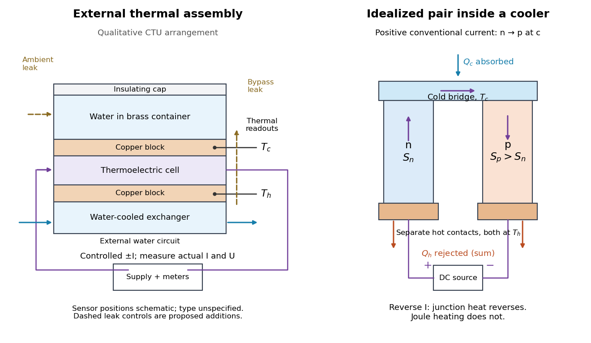

# Peltier current-reversal experiment

↑ **Parent:** [Peltier effect](peltier-effect.md)

An actual institutional protocol is CTU's _Measurement of characteristics of a Peltier cell_. Its cooling run uses a water container, an insulating cap and a current-limited supply; both face [temperatures](temperature-split.md) are recorded every minute while [electric current](electric-current.md) is monitored. The apparatus includes a water-cooled exchanger, [copper](copper.md) blocks and brass containers. The heating run resets the water near room [temperature](temperature-split.md) before reversing polarity. The handout specifies no [thermometer](thermometer.md) type and reports no dataset. Its modular junction geometry is shown separately from the external thermal assembly.[pp. 3–4, Figs. 1.4–1.5; pp. 5–7, §§1.5.2–1.5.3 and Appendix](measurement-of-characteristics-of-a-peltier-cell-by-milan-cervenka-and-ladislav-sieger.md)

**[Figure 7](#image-peltier-effect-apparatus-and-a-junction-s-conventional-current-direction). Peltier effect apparatus and a junction's conventional current direction**. Original explanatory schematic, not an apparatus photograph. The external water assembly follows the CTU protocol qualitatively; readout locations are schematic because sensor construction is unspecified. The inset is an idealized material pair, not a reconstruction of that cell's internal fabrication. Dashed arrows mark proposed parasitic [heat transfer](heat-transfer.md) controls.

The following is a proposed quantitative extension. Keep the physical face labels fixed throughout reversal: c denotes the observed object's side and h the exchanger side, even if their actual [temperatures](temperature-split.md) change order. Use an independently read [thermometer](thermometer.md) at each thermal contact and log the actual signed [electric current](electric-current.md) and terminal [electric potential difference](electric-potential-difference.md). Maintain reproducible contact pressure and contact layers. A sensor in water measures water [temperature](temperature-split.md), which need not equal the face [temperature](temperature-split.md) during a transient; verify mixing and contact equilibration before using it as a face reading. Do not interchange sensor leads when reversing the supply.

The strongest separation compares runs at the same $T_c,T_h$, water mass, contact conditions and environment, rather than subtracting arbitrary final [temperatures](temperature-split.md). One option is short initial-rate runs after resetting the whole assembly to a reproducible state. Define $H(I)$ as the net [power](power.md) entering the monitored object, inferred from its calibrated effective [heat capacity](heat-capacity.md) $C$ and initial [temperature](temperature-split.md) [slope](slope.md). In a simple symmetric model, let $H_0$ include background [heat transfer](heat-transfer.md) at that state and $bI^2$ the dissipated [power](power.md) reaching the object. Then

$$
H(I)=C\frac{dT_c}{dt}=H_0-aI+bI^2,\qquad a>0,
$$

where $a=\alpha T_c$ in the [thermoelectric cooling](thermoelectric-cooling.md) model below. The half-difference and baseline-subtracted half-sum are

$$
H_{\rm odd}(I)=\frac{H(+I)-H(-I)}{2}=-aI,\qquad
H_{\rm even}(I)=\frac{H(+I)+H(-I)}{2}-H(0)=bI^2.
$$

The minus sign in the odd part means positive [electric current](electric-current.md) cools the object. The even part has to subtract the zero-current baseline: otherwise [heat conduction](thermal-conduction.md) and ambient exchange remain mixed with [Joule heating](joule-heating.md). Independently measured [heat capacity](heat-capacity.md) is essential for converting a thermal [slope](slope.md) into [watts](watt.md); include the blocks, container and water that actually equilibrate on the measurement timescale.

Useful controls are zero-current drift at several matched [temperature](temperature-split.md) differences, equal-magnitude positive and negative [electric currents](electric-current.md), and repetition of a sequence such as $0,+I,-I,0,-I,+I,0$ with thermal resets. A calibrated small heater on the object can test the [heat capacity](heat-capacity.md) and lost-[heat](heat-split.md) correction independently. Check [Joule heating](joule-heating.md) in supply leads and contacts, bypass [heat conduction](thermal-conduction.md) through supports and wiring, and ambient [convection](convection-split.md) and [thermal radiation](thermal-radiation.md). Insulation reduces a leak; it does not establish that it is zero. Measure terminal [power](power.md) at the module boundary so lead losses are not mistaken for module heating.

An odd thermal response supports a reversible current-coupled contribution, but does not by itself locate all of it at one junction: the [Thomson effect](thomson-effect.md) in nonuniform leads can also be odd. Sensor offsets, unequal current magnitudes, drifting thermal contacts and different junction [temperatures](temperature-split.md) during the two runs can contaminate both parts. In particular, heating proportional to $I^2R(T)$ is even only when the compared [electrical resistance](electrical-resistance.md) is the same. CTU's qualitative reversal illustrates switching heating and cooling; the matched-state controls above would be needed for a coefficient measurement.

## ↑ Ancestors (6)

1. [Peltier effect](peltier-effect.md)
2. [Thermoelectric effect](thermoelectric-effect-split.md)
3. [Electromagnetism](electromagnetism-split.md)
4. [Branches of physics](branches-of-physics.md)
5. [Physics](physics-split.md)
6. [Codex Wiki](split.md)
