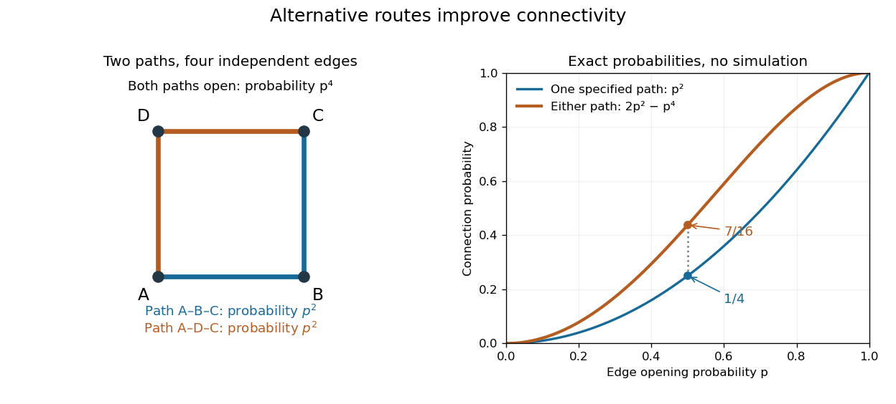

# Percolation theory

↑ **Parent:** [Probability theory](probability-theory-split.md)  
ⓦ [Wiki](https://en.wikipedia.org/wiki/Percolation_theory)

Percolation theory asks how many local connections must be available before a large connected structure appears. Start with a [graph](graph-split.md), randomly retain some [edges](edge-of-a-graph.md) or [vertices](vertex-graph-theory.md), and study the resulting [percolation clusters](percolation-cluster.md). In independent [bond percolation](bond-percolation-split.md), every [edge](edge-of-a-graph.md) is open with [probability](probability.md) $p$, independently of the others. In independent [site percolation](site-percolation-split.md), the random decisions concern [vertices](vertex-graph-theory.md) instead. A [percolation cluster](percolation-cluster.md) is a [connected component of a graph](component-graph-theory.md) formed by the available connections; an [open path](open-path-in-bond-percolation.md) joins two [vertices](vertex-graph-theory.md) exactly when they belong to the same [percolation cluster](percolation-cluster.md).

The attraction is that a local rule can produce a global change. One open [edge](edge-of-a-graph.md) says little about travel across a large [graph](graph-split.md). Many alternative [graph paths](path-in-a-graph.md) can nevertheless make distant connections likely. The model separates the geometry of possible connections from the [probability distribution](probability-distribution-split.md) of which connections are usable. This was the central perspective of Broadbent and Hammersley's 1957 paper, which discussed porous solids and disease transmission as interpretations of the same mathematical structure: [Percolation processes I: Crystals and mazes, introduction](https://courses.physics.ucsd.edu/2019/Spring/physics235/Broadbent_Hammersley.pdf). Independent [bond percolation](bond-percolation-split.md) supplies a simplified model of those systems; the physical interpretation still requires justification of its [independence](independent-random-variables.md) assumptions.

For a completely calculable example, consider the four [edges](edge-of-a-graph.md) around a square and ask whether opposite corners $A$ and $C$ are connected. There are two [graph paths](path-in-a-graph.md), each using two [edges](edge-of-a-graph.md). Each [open path](open-path-in-bond-percolation.md) has [probability](probability.md) $p^2$. Their [events](event.md) are [independent events](independent-events.md) because the paths share no [edges](edge-of-a-graph.md), even though they share endpoints. The [inclusion-exclusion principle](inclusion-exclusion-principle.md) therefore gives

$$
\boxed{\mathbb P_p(A\leftrightarrow C)=2p^2-p^4.}
$$

At $p=1/2$, the connection [probability](probability.md) is $7/16$, larger than the $1/4$ for either chosen [graph path](path-in-a-graph.md). Counting all sixteen equally likely [edge](edge-of-a-graph.md) configurations gives the same answer: two configurations with exactly two open [edges](edge-of-a-graph.md), four with three, and one with four connect $A$ to $C$. Connectivity benefits from alternative routes; adding their [probabilities](probability.md) without subtracting their overlap would count the all-open configuration twice.

**[Figure 1](#image-two-alternative-paths-increase-the-probability-of-connecting-opposite-corners). Two alternative paths increase the probability of connecting opposite corners**.

This finite calculation is already useful for studying redundant connections. The deeper question is what happens as the [graph](graph-split.md) becomes arbitrarily large: does connectivity remain confined to finite [percolation clusters](percolation-cluster.md), or can an [infinite percolation cluster](infinite-percolation-cluster.md) appear? The [percolation probability](percolation-probability.md) and [percolation critical probability](percolation-critical-probability.md) make that question precise. A finite picture can illustrate the geometry, but cannot establish the existence of an [infinite percolation cluster](infinite-percolation-cluster.md).

**Table of contents**

- [Directed percolation](directed-percolation.md)
  - [Oriented site percolation](oriented-site-percolation.md)
  - [Oriented bond percolation](oriented-bond-percolation.md)
  - [Parallel-bond ray with different site and bond thresholds](parallel-bond-ray-with-different-site-and-bond-thresholds.md)
  - [Incoming-edge coupling of site and bond percolation](incoming-edge-coupling-of-site-and-bond-percolation.md)
  - [Survival and susceptibility thresholds for directed percolation](survival-and-susceptibility-thresholds-for-directed-percolation.md)
- [Conformal invariance of planar percolation](conformal-invariance-of-planar-percolation.md)
- [Lace expansion](lace-expansion.md)
- [Bond percolation](bond-percolation.md)
  - [Rectangle crossing in bond percolation](bond-percolation.md#rectangle-crossing-in-bond-percolation)
    - [Finite-torus crossing amplification](bond-percolation.md#finite-torus-crossing-amplification)
  - [Open path in bond percolation](bond-percolation.md#open-path-in-bond-percolation)
  - [Uniform random orientation out-cluster comparison](bond-percolation.md#uniform-random-orientation-out-cluster-comparison)
  - [Percolation triangle condition](bond-percolation.md#percolation-triangle-condition)
  - [Percolation two-point connection probability](bond-percolation.md#percolation-two-point-connection-probability)
    - [Reflection lower bound for two-point percolation](bond-percolation.md#reflection-lower-bound-for-two-point-percolation)
  - [Connection decay rate in a percolation strip](bond-percolation.md#connection-decay-rate-in-a-percolation-strip)
    - [Strip approximation to the planar connection decay rate](bond-percolation.md#strip-approximation-to-the-planar-connection-decay-rate)
    - [Closed-cut bound for percolation in a strip](bond-percolation.md#closed-cut-bound-for-percolation-in-a-strip)
  - [Translation ergodicity of Bernoulli percolation](bond-percolation.md#translation-ergodicity-of-bernoulli-percolation)
  - [Percolation cluster](bond-percolation.md#percolation-cluster)
    - [Maximum cluster radius under exponential one-arm decay](bond-percolation.md#maximum-cluster-radius-under-exponential-one-arm-decay)
    - [Infinite percolation cluster](bond-percolation.md#infinite-percolation-cluster)
    - [Uniqueness of the infinite percolation cluster](bond-percolation.md#uniqueness-of-the-infinite-percolation-cluster)
      - [Percolation uniqueness on an amenable quasi-transitive graph](bond-percolation.md#percolation-uniqueness-on-an-amenable-quasi-transitive-graph)
      - [Boundary counting proof of percolation uniqueness](bond-percolation.md#boundary-counting-proof-of-percolation-uniqueness)
        - [Encounter box in percolation](bond-percolation.md#encounter-box-in-percolation)
      - [Trifurcation vertex in percolation](bond-percolation.md#trifurcation-vertex-in-percolation)
        - [Trifurcation boundary-counting lemma](bond-percolation.md#trifurcation-boundary-counting-lemma)
          - [Forest proof of trifurcation boundary counting](bond-percolation.md#forest-proof-of-trifurcation-boundary-counting)
  - [Percolation susceptibility](bond-percolation.md#percolation-susceptibility)
    - [Tree-graph moment bound for a percolation cluster](bond-percolation.md#tree-graph-moment-bound-for-a-percolation-cluster)
    - [Exponential one-arm decay from finite susceptibility](bond-percolation.md#exponential-one-arm-decay-from-finite-susceptibility)
  - [Russo-Seymour-Welsh theorem](bond-percolation.md#russo-seymour-welsh-theorem)
    - [Uniform RSW crossing estimate](bond-percolation.md#uniform-rsw-crossing-estimate)
    - [RSW reflection extension lemma](bond-percolation.md#rsw-reflection-extension-lemma)
      - [Reflected attachment estimate for percolation](bond-percolation.md#reflected-attachment-estimate-for-percolation)
    - [One-arm probability](bond-percolation.md#one-arm-probability)
      - [Weighted BK boundary-splitting estimate](bond-percolation.md#weighted-bk-boundary-splitting-estimate)
      - [Polynomial critical one-arm upper bound](bond-percolation.md#polynomial-critical-one-arm-upper-bound)
      - [Independent annular barriers for percolation](bond-percolation.md#independent-annular-barriers-for-percolation)
      - [BK boundary-splitting estimate](bond-percolation.md#bk-boundary-splitting-estimate)
      - [Percolation one-arm decay rate](bond-percolation.md#percolation-one-arm-decay-rate)
        - [Almost-subadditive percolation decay rate](bond-percolation.md#almost-subadditive-percolation-decay-rate)
      - [One-arm extension estimate](bond-percolation.md#one-arm-extension-estimate)
        - [RSW gluing lemma for two one-arm events](bond-percolation.md#rsw-gluing-lemma-for-two-one-arm-events)
  - [Van den Berg-Kesten inequality](bond-percolation.md#van-den-berg-kesten-inequality)
    - [Coordinate-splitting proof of the BK inequality](bond-percolation.md#coordinate-splitting-proof-of-the-bk-inequality)
    - [Square-lattice one-arm lower bound from disjoint occurrence](bond-percolation.md#square-lattice-one-arm-lower-bound-from-disjoint-occurrence)
    - [Disjoint occurrence of increasing events](bond-percolation.md#disjoint-occurrence-of-increasing-events)
- [Percolation probability](percolation-probability.md)
  - [Boundary-side amplification for planar percolation](boundary-side-amplification-for-planar-percolation.md)
  - [Near-critical percolation power upper bound](near-critical-percolation-power-upper-bound.md)
  - [Right continuity of percolation probability](right-continuity-of-percolation-probability.md)
    - [Supercritical continuity of percolation probability](supercritical-continuity-of-percolation-probability.md)
  - [Percolation critical probability](percolation-critical-probability.md)
    - [Sharpness of the percolation transition](sharpness-of-the-percolation-transition.md)
    - [Connective-constant lower bound for percolation](connective-constant-lower-bound-for-percolation.md)
    - [Harris-Kesten theorem](harris-kesten-theorem.md)
      - [Harris theorem for square-lattice bond percolation](harris-theorem-for-square-lattice-bond-percolation.md)
      - [Alternating arms argument at the self-dual percolation parameter](alternating-arms-argument-at-the-self-dual-percolation-parameter.md)
        - [Three-fold symmetric primal-dual noncoexistence](three-fold-symmetric-primal-dual-noncoexistence.md)
        - [Alternating exterior-arm separation lemma](alternating-exterior-arm-separation-lemma.md)
- [Monotone coupling of Bernoulli percolation](monotone-coupling-of-bernoulli-percolation.md)
  - [Finite-box comparison for percolation parameters](finite-box-comparison-for-percolation-parameters.md)
  - [Coupled onset parameter for origin percolation](coupled-onset-parameter-for-origin-percolation.md)
  - [Sprinkling coupling for Bernoulli percolation](sprinkling-coupling-for-bernoulli-percolation.md)
- [Site percolation](site-percolation.md)
  - [Critical probability for site percolation on the triangular lattice](site-percolation.md#critical-probability-for-site-percolation-on-the-triangular-lattice)
  - [Domain Markov property of a percolation exploration](site-percolation.md#domain-markov-property-of-a-percolation-exploration)
  - [Dependent percolation](site-percolation.md#dependent-percolation)
    - [One-independent bond percolation](site-percolation.md#one-independent-bond-percolation)
      - [Separated-block percolation renormalization](site-percolation.md#separated-block-percolation-renormalization)
      - [Peierls circuit bound for one-independent percolation](site-percolation.md#peierls-circuit-bound-for-one-independent-percolation)
    - [Monochromatic line-graph percolation counterexample](site-percolation.md#monochromatic-line-graph-percolation-counterexample)
    - [Random-cluster model](site-percolation.md#random-cluster-model)
      - [Bernoulli bounds for the random-cluster model](site-percolation.md#bernoulli-bounds-for-the-random-cluster-model)
      - [Cluster weight in the random-cluster model](site-percolation.md#cluster-weight-in-the-random-cluster-model)
      - [Random-cluster critical probability](site-percolation.md#random-cluster-critical-probability)
        - [Monotonicity of random-cluster critical probability in cluster weight](site-percolation.md#monotonicity-of-random-cluster-critical-probability-in-cluster-weight)
      - [Random-cluster weight monotonicity](site-percolation.md#random-cluster-weight-monotonicity)
      - [Self-dual parameter of the random-cluster model](site-percolation.md#self-dual-parameter-of-the-random-cluster-model)
        - [Symmetric cluster weight at the self-dual parameter](site-percolation.md#symmetric-cluster-weight-at-the-self-dual-parameter)
      - [Random-cluster single-edge conditional probability](site-percolation.md#random-cluster-single-edge-conditional-probability)
      - [Random-cluster boundary condition](site-percolation.md#random-cluster-boundary-condition)
        - [Boundary monotonicity of the random-cluster measure](site-percolation.md#boundary-monotonicity-of-the-random-cluster-measure)
        - [Wired random-cluster boundary condition](site-percolation.md#wired-random-cluster-boundary-condition)
          - [Infinite-volume wired random-cluster measure](site-percolation.md#infinite-volume-wired-random-cluster-measure)
            - [Random-cluster inverse correlation length](site-percolation.md#random-cluster-inverse-correlation-length)
              - [Reflection comparison of random-cluster connections](site-percolation.md#reflection-comparison-of-random-cluster-connections)
        - [Free random-cluster boundary condition](site-percolation.md#free-random-cluster-boundary-condition)
      - [Positive association of the random-cluster model](site-percolation.md#positive-association-of-the-random-cluster-model)
      - [Uniform connected-subgraph limit of the random-cluster model](site-percolation.md#uniform-connected-subgraph-limit-of-the-random-cluster-model)
      - [Uniform spanning-tree limit of the random-cluster model](site-percolation.md#uniform-spanning-tree-limit-of-the-random-cluster-model)
      - [Edwards-Sokal coupling](site-percolation.md#edwards-sokal-coupling)
        - [Spin-connectivity identity for the Potts model](site-percolation.md#spin-connectivity-identity-for-the-potts-model)
      - [Heat-bath Markov chain](site-percolation.md#heat-bath-markov-chain)
    - [Level-set percolation](site-percolation.md#level-set-percolation)
      - [Critical threshold for level-set percolation](site-percolation.md#critical-threshold-for-level-set-percolation)
    - [Finite-range dependent random field](site-percolation.md#finite-range-dependent-random-field)
- [Peierls argument](peierls-argument.md)
  - [Connective-constant Peierls bound](connective-constant-peierls-bound.md)
- [Finite-energy property (percolation)](finite-energy-property-percolation.md)
  - [Finite-energy property of Bernoulli percolation](finite-energy-property-of-bernoulli-percolation.md)
    - [Finite modification of Bernoulli percolation](finite-modification-of-bernoulli-percolation.md)
- [Exponential decay of subcritical percolation](exponential-decay-of-subcritical-percolation.md)
  - [Finite-set criterion for percolation sharpness](finite-set-criterion-for-percolation-sharpness.md)
  - [Exponential tail of subcritical cluster size](exponential-tail-of-subcritical-cluster-size.md)
- [One-arm event](one-arm-event.md)
- [OSSS inequality](osss-inequality.md)
  - [OSSS exploration of a one-arm event](osss-exploration-of-a-one-arm-event.md)

## ↑ Ancestors (5)

1. [Probability theory](probability-theory-split.md)
2. [Probability and statistics](probability-and-statistics-split.md)
3. [Area of mathematics](area-of-mathematics.md)
4. [Mathematics](mathematics-split.md)
5. [Codex Wiki](split.md)

## ← Incoming links (1)

- [Bond percolation](bond-percolation-split.md)
