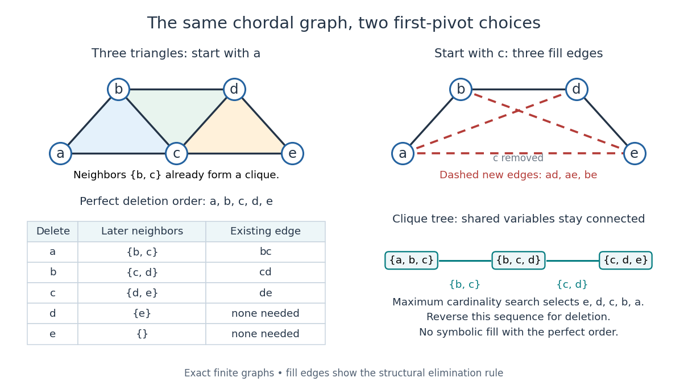

# Perfect elimination ordering

↑ **Parent:** [Chordal graph](chordal-graph.md)

A [perfect elimination ordering](perfect-elimination-ordering.md) of a finite [simple graph](simple-graph.md) $G=(V,E)$ is a [permutation](permutation.md) $(v_1,\ldots,v_n)$ of its [vertices](vertex-graph-theory.md) such that each set of later [graph neighbours](neighbour-of-a-vertex.md)

$$
N_i^+=\{v_j:j>i,\ \{v_i,v_j\}\in E\}
$$

is a [clique](clique-graph-theory.md). Thus $v_i$ is a [simplicial vertex](simplicial-vertex-graph-theory.md) in the remaining [induced subgraph](induced-subgraph.md) $G[\{v_i,\ldots,v_n\}]$. Empty and one-[vertex](vertex-graph-theory.md) sets satisfy the [clique](clique-graph-theory.md) condition automatically. The order here is the order of deletion: $v_1$ goes first.

The characterization is powerful: a finite [simple graph](simple-graph.md) is a [chordal graph](chordal-graph.md) if and only if it has a [perfect elimination ordering](perfect-elimination-ordering.md). For one proof outline, the earliest [vertex](vertex-graph-theory.md) of an [induced cycle](induced-cycle.md) of length at least four would have two later [graph neighbours](neighbour-of-a-vertex.md) on that [graph cycle](cycle-in-a-graph.md) that are not adjacent, contradicting the [clique](clique-graph-theory.md) condition. Conversely, every nonempty [chordal graph](chordal-graph.md) has a [simplicial vertex](simplicial-vertex-graph-theory.md), and every [induced subgraph](induced-subgraph.md) of a [chordal graph](chordal-graph.md) is a [chordal graph](chordal-graph.md); repeatedly deleting such a [vertex](vertex-graph-theory.md) supplies the ordering.[§2.2; Theorem 2.2](an-introduction-to-chordal-graphs-and-clique-trees-by-jean-r-s-blair-and-others.md)

In the square-plus-diagonal [chordal graph](chordal-graph.md) above, $(b,d,a,c)$ is a [perfect elimination ordering](perfect-elimination-ordering.md), with later [graph neighbourhoods](graph-neighbourhood.md) $\{a,c\}$, $\{a,c\}$, $\{c\}$, and $\varnothing$. Starting instead with $a$ fails: its [graph neighbours](neighbour-of-a-vertex.md) $b,c,d$ do not form a [clique](clique-graph-theory.md), because $bd$ is absent. Thus even a [chordal graph](chordal-graph.md) can have a poor elimination ordering.

For a larger example, join three triangles along shared [edges](edge-of-a-graph.md), using

$$
V=\{a,b,c,d,e\},\qquad E=\{ab,ac,bc,bd,cd,ce,de\}.
$$

The exact [graph neighbourhoods](graph-neighbourhood.md) are $N(a)=\{b,c\}$, $N(b)=\{a,c,d\}$, $N(c)=\{a,b,d,e\}$, $N(d)=\{b,c,e\}$, and $N(e)=\{c,d\}$. The ordering $(a,b,c,d,e)$ has later [graph neighbourhoods](graph-neighbourhood.md) $\{b,c\}$, $\{c,d\}$, $\{d,e\}$, $\{e\}$, and $\varnothing$, all [cliques](clique-graph-theory.md); this certifies that the [graph](graph-split.md) is a [chordal graph](chordal-graph.md) without enumerating its [graph cycles](cycle-in-a-graph.md). Its [maximal cliques](maximal-clique.md) $\{a,b,c\}$, $\{b,c,d\}$, $\{c,d,e\}$ form a [junction tree](junction-tree.md) in that order, with intersections $\{b,c\}$ and $\{c,d\}$.

**[Figure 2](#image-a-perfect-elimination-ordering-removes-three-overlapping-triangles-without-fill-in-choosing-the-central-vertex-first-adds-three-edges). A perfect elimination ordering removes three overlapping triangles without fill-in; choosing the central vertex first adds three edges**.

To find an ordering, [maximum cardinality search](maximum-cardinality-search.md) starts with all scores zero, repeatedly selects an unselected [vertex](vertex-graph-theory.md) of largest score, and increases each unselected [graph neighbour](neighbour-of-a-vertex.md)'s score by one. Reverse the selection order to obtain a candidate [perfect elimination ordering](perfect-elimination-ordering.md). For the three-triangle [graph](graph-split.md), one valid selection sequence is $(e,d,c,b,a)$, with scores at selection $0,1,2,2,2$; reversing it gives the displayed deletion order. On a [chordal graph](chordal-graph.md) every tie choice works. On an arbitrary [graph](graph-split.md), test the resulting later [graph neighbourhoods](graph-neighbourhood.md) for the [clique](clique-graph-theory.md) condition to recognize [chordal graphs](chordal-graph.md). Suitable [adjacency lists](adjacency-list.md), score buckets and a linear-time verification method give $O(|V|+|E|)$ recognition.[§4.1–4.2; Algorithm 4.2](chordal-graphs-and-semidefinite-optimization-by-lieven-vandenberghe-and-others.md)

The deletion rule also explains [sparse Gaussian elimination](sparse-gaussian-elimination.md). For a symmetric [positive-definite matrix](positive-definite-matrix.md) whose [matrix graph](matrix-graph.md) is $G$, eliminating pivot $v$ applies the [Schur complement](schur-complement.md) update

$$
a_{uw}\longleftarrow a_{uw}-\frac{a_{uv}a_{vw}}{a_{vv}}.
$$

Only pairs of remaining [graph neighbours](neighbour-of-a-vertex.md) of $v$ can acquire new off-diagonal entries. A [perfect elimination ordering](perfect-elimination-ordering.md) already has all those [edges](edge-of-a-graph.md), so [Cholesky decomposition](cholesky-decomposition.md) creates no symbolic [fill-in](fill-in.md). Positive definiteness ensures nonzero pivots in exact arithmetic. Special numerical cancellation can suppress predicted entries, and floating-point rounding affects their values.[§9.1; equation 9.2; Theorem 9.1](chordal-graphs-and-semidefinite-optimization-by-lieven-vandenberghe-and-others.md) In the three-triangle [graph](graph-split.md), deleting $c$ first instead connects every pair in $\{a,b,d,e\}$ and adds exactly $ad,ae,be$. The [graph](graph-split.md) was already a [chordal graph](chordal-graph.md); the extra [fill-in](fill-in.md) comes from the ordering.

One further reward is optimal [graph coloring](graph-coloring.md). Process a [perfect elimination ordering](perfect-elimination-ordering.md) backwards and give each [vertex](vertex-graph-theory.md) the smallest positive color absent from its already colored [graph neighbours](neighbour-of-a-vertex.md). Those [graph neighbours](neighbour-of-a-vertex.md) form a [clique](clique-graph-theory.md), so this [greedy algorithm](greedy-algorithm.md) uses at most the [clique number](clique-number.md) $\omega(G)$ colors; any [clique](clique-graph-theory.md) of that size requires at least that many. In the three-triangle [graph](graph-split.md), coloring $(e,d,c,b,a)$ gives colors $(1,2,3,1,2)$, so both the [chromatic number](chromatic-number.md) and the [clique number](clique-number.md) are three. Every [maximal clique](maximal-clique.md) also occurs among $\{v_i\}\cup N_i^+$: take its earliest [vertex](vertex-graph-theory.md) and use maximality. The same ordering therefore supports [graph coloring](graph-coloring.md), [maximal clique](maximal-clique.md) extraction and sparse computation.

Historically, Donald J. Rose, Robert E. Tarjan and George S. Lueker's 1976 paper connected [graph](graph-split.md) elimination to symmetric [sparse matrices](sparse-matrix.md) and gave a search-based $O(|V|+|E|)$ [algorithm](algorithm.md) for finding a [perfect elimination ordering](perfect-elimination-ordering.md) when one exists. Its abstract distinguishes a minimal elimination ordering from a minimum one: removing avoidable [fill-in](fill-in.md) does not by itself minimize the total number of added [edges](edge-of-a-graph.md).[pp. 266–283; abstract](algorithmic-aspects-of-vertex-elimination-on-graphs-by-donald-j-rose-and-others.md)

**Table of contents**

- [Simplicial vertex (graph theory)](simplicial-vertex-graph-theory.md)
- [Maximum cardinality search](maximum-cardinality-search.md)

## ↑ Ancestors (6)

1. [Chordal graph](chordal-graph.md)
2. [Graph theory](graph-theory-split.md)
3. [Foundations of mathematics](foundations-of-mathematics-split.md)
4. [Area of mathematics](area-of-mathematics.md)
5. [Mathematics](mathematics-split.md)
6. [Codex Wiki](split.md)

## ← Incoming links (8)

- [Fill-in](fill-in.md)
- [Leaf elimination of a tree-pattern positive-definite matrix](leaf-elimination-of-a-tree-pattern-positive-definite-matrix.md)
- [Maximum cardinality search](maximum-cardinality-search.md)
- [Solution](past-exam-of-the-mathematics-course-of-the-university-of-cambridge/2001/iii/paper-57/4/solution.md)
- [Solution](past-exam-of-the-mathematics-course-of-the-university-of-cambridge/2002/iii/paper-60/6/solution.md)
- [Solution](past-exam-of-the-mathematics-course-of-the-university-of-cambridge/2004/iii/paper-39/3/e/solution.md)
- [Perfect elimination ordering](perfect-elimination-ordering.md)
- [Triangulation of an undirected graph](triangulation-of-an-undirected-graph.md)
