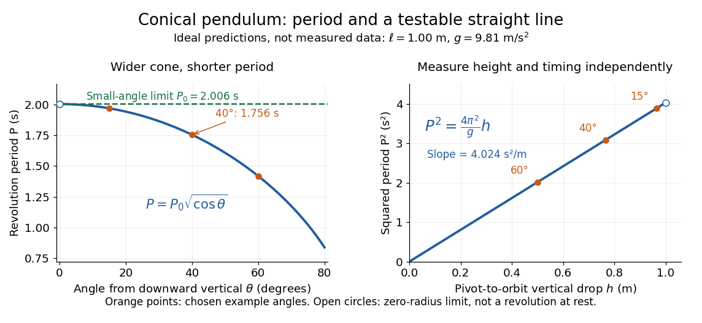

# Period and small-angle limit of a conical pendulum

↑ **Parent:** [Conical pendulum](conical-pendulum.md)

**[Figure 3](#image-ideal-conical-pendulum-period-decreases-with-cone-angle-and-its-square-is-proportional-to-the-vertical-drop). Ideal conical pendulum period decreases with cone angle and its square is proportional to the vertical drop**.

For fixed $\ell$ and $g$, the exact [conical pendulum](conical-pendulum.md) [oscillation period](period-of-an-oscillation.md) satisfies $P/P_0=\sqrt{\cos\theta}$. In the [small-angle approximation](small-angle-approximation.md), with $\theta$ in [radians](radian.md),

$$
\frac{P}{P_0}=1-\frac{\theta^2}{4}+O(\theta^4),\qquad P_0=2\pi\sqrt{\frac\ell g}.
$$

Thus the limiting revolution period equals the small-amplitude [oscillation period](period-of-an-oscillation.md) of a planar [simple pendulum](simple-pendulum.md). This equality has a geometric explanation: to first order, $x(t)=r\cos(\omega t)$ and $y(t)=r\sin(\omega t)$ are perpendicular [simple harmonic motions](simple-harmonic-motion.md) of equal [amplitude](wave-amplitude.md), a quarter period apart, with $\omega\to\sqrt{g/\ell}$. At finite [angle](angle.md), however, the [conical pendulum](conical-pendulum.md)'s [oscillation period](period-of-an-oscillation.md) decreases with $\theta$, whereas a planar [simple pendulum](simple-pendulum.md)'s [oscillation period](period-of-an-oscillation.md) increases with its angular [amplitude](wave-amplitude.md).

The endpoint $\theta=0$ itself is a stationary bob with $r=0$ and no observable revolution; $P_0$ is a limit of nonzero circular motions, not a measured revolution period at rest. For fixed $\ell$, nonzero [conical pendulum](conical-pendulum.md) motion also requires $\omega>\sqrt{g/\ell}$, because $\cos\theta=g/(\ell\omega^2)<1$. At the other endpoint, $\theta\to\pi/2$ gives $h\to0$, $P\to0$, and unbounded [tension](tension.md) and [speed](speed.md). These mathematical limits explain why the ideal string cannot sustain a horizontal orbit at finite [tension](tension.md); a real experiment ceases to satisfy the ideal assumptions before that limit.

## ↑ Ancestors (6)

1. [Conical pendulum](conical-pendulum.md)
2. [Simple pendulum](simple-pendulum.md)
3. [Classical mechanics](classical-mechanics-split.md)
4. [Branches of physics](branches-of-physics.md)
5. [Physics](physics-split.md)
6. [Codex Wiki](split.md)
