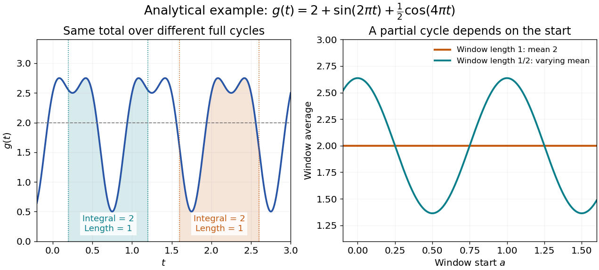

# Period average

↑ **Parent:** [Periodic function](periodic-function.md)

The period average extracts the reference level of an [integrable function](lebesgue-integrable-function.md) that repeats. For a real- or complex-valued [periodic function](periodic-function.md) $f$ with positive [period of a function](period-of-a-function.md) $T$, assume $f$ is [Lebesgue integrable](lebesgue-integrable-function.md) on every bounded interval. Its average is

$$
\boxed{\langle f\rangle=\frac1T\int_a^{a+T}f(t)\,dt.}
$$

The answer is independent of the starting point $a$. Splitting a shifted interval at the old endpoint and using $f(t+T)=f(t)$ moves its extra piece back into the missing piece. The interval length must be a [period](period-of-a-function.md); an arbitrary window can give a different average.

For $g(t)=2+\sin(2\pi t)+\tfrac12\cos(4\pi t)$, every length-one window has average $2$: both oscillating [integrals](integral-split.md) vanish over that window. A half-unit window instead has average $2+(2/\pi)\cos(2\pi a)$, which depends on its start. Thus a short sample of an oscillation can bias an estimate of its reference level even when the full-cycle average is known exactly.

**[Figure 5](#image-a-full-period-average-is-independent-of-its-starting-point-while-a-shorter-window-is-not). A full-period average is independent of its starting point, while a shorter window is not**.

In the complex [Fourier series](fourier-series-split.md) convention with basis $e^{2\pi int/T}$, the zero-frequency [Fourier coefficient](fourier-coefficient.md) is $c_0=\langle f\rangle$. This assertion defines the coefficient even when an additional convergence theorem is needed to reconstruct $f$ from its series. Strang's §4.1 explicitly identifies that constant coefficient with the average.[§4.1; pp. 317](computational-science-and-engineering-by-gilbert-strang/fourier-series-for-periodic-functions.md)

Averaging a square measures something different from averaging its original [function](function-split.md). For the illustrated $g$, [orthogonality](orthogonal-vectors.md) of the trigonometric terms gives $\langle g^2\rangle=4+1/2+1/8=37/8$, whereas $\langle g\rangle^2=4$. Its [root mean square](root-mean-square.md) is therefore $\sqrt{37/8}$. Similarly, the [period average](period-average.md) of $\sin^2$ is $1/2$. A zero mean need not imply a zero mean square.

## ↑ Ancestors (7)

1. [Periodic function](periodic-function.md)
2. [Function](function-split.md)
3. [Set theory](set-theory-split.md)
4. [Foundations of mathematics](foundations-of-mathematics-split.md)
5. [Area of mathematics](area-of-mathematics.md)
6. [Mathematics](mathematics-split.md)
7. [Codex Wiki](split.md)

## ← Incoming links (7)

- [Constant function](constant-function.md)
- [Oscillatory drift of an attenuated internal-wave beam](oscillatory-drift-of-an-attenuated-internal-wave-beam.md)
- [Solution](past-exam-of-the-mathematics-course-of-the-university-of-cambridge/2014/iii/paper-74/2/a/i/solution.md)
- [Solution](past-exam-of-the-mathematics-course-of-the-university-of-cambridge/2014/iii/paper-74/2/a/solution.md)
- [Solution](past-exam-of-the-mathematics-course-of-the-university-of-cambridge/2016/iii/paper-309/4/iv/solution.md)
- [Period average](period-average.md)
- [Periodic function](periodic-function.md)
