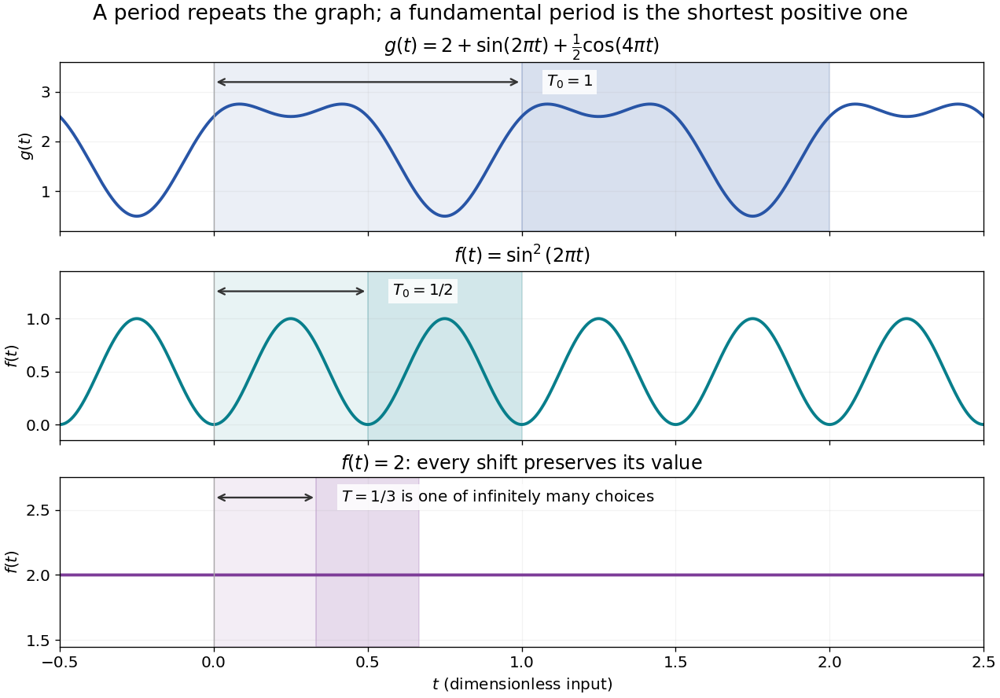

# Periodic function

↑ **Parent:** [Function](function-split.md)  
ⓦ [Wiki](https://en.wikipedia.org/wiki/Periodic_function)

A periodic [function](function-split.md) repeats exactly after a nonzero shift of its input. For $f:\mathbb R\to Y$, a positive [period of a function](period-of-a-function.md) $T$ satisfies

$$
\boxed{f(x+T)=f(x)\qquad\text{for every }x\in\mathbb R.}
$$

One interval of length $T$ therefore determines the whole [function](function-split.md). For another [domain of a function](domain-of-a-function.md) $D$, a period must also preserve the domain, $D+T=D$; equality only where two domains happen to overlap is weaker. Periodicity is an exact [translation of a function](translation-of-a-function.md) symmetry, rather than merely two similar-looking pieces of its graph.

The [sine](sine.md) $\sin(2\pi x)$ has [fundamental period](fundamental-period-of-a-function.md) one. The [function](function-split.md) $\sin^2(2\pi x)$ repeats after half a unit: the [sine](sine.md) changes sign under that shift, but squaring removes the sign. The mixed [function](function-split.md) $g(x)=2+\sin(2\pi x)+\tfrac12\cos(4\pi x)$ again has [fundamental period](fundamental-period-of-a-function.md) one. All positive integer multiples of a [period](period-of-a-function.md) are periods, so specifying one period need not identify the shortest repetition.

**[Figure 4](#image-mixed-harmonics-a-squared-sine-and-a-constant-have-different-sets-of-periods). Mixed harmonics, a squared sine, and a constant have different sets of periods**.

If the input is time and $T_0$ is the [fundamental period](fundamental-period-of-a-function.md), the [frequency](frequency.md) is $1/T_0$ and the [angular frequency](angular-frequency.md) is $2\pi/T_0$. Repetition lets a [Fourier series](fourier-series-split.md) describe a cycle using [sines](sine.md) and [cosines](cosine.md); the [period average](period-average.md) separates the reference level from the oscillating terms. Strang develops this representation and its [Fourier coefficients](fourier-coefficient.md) in §4.1 of [Computational Science and Engineering by Gilbert Strang](computational-science-and-engineering-by-gilbert-strang.md).[§4.1; pp. 317](computational-science-and-engineering-by-gilbert-strang/fourier-series-for-periodic-functions.md)

This connection grew out of a physical problem. In his 1822 book [Théorie analytique de la chaleur by Joseph Fourier](theorie-analytique-de-la-chaleur-by-joseph-fourier.md), [Joseph Fourier](joseph-fourier.md) used [periodic functions](periodic-function.md) to extend profiles beyond their initial interval while treating [heat conduction](thermal-conduction.md). Chapter III, §§233–234 combines [even functions](even-function.md) and [odd functions](odd-function.md) into sine–cosine expansions and rescales their period.[§§233–234; equation (p)](theorie-analytique-de-la-chaleur-by-joseph-fourier/propagation-de-la-chaleur-dans-un-solide-rectangle-infini.md) A modern [Fourier series](fourier-series-split.md) interpretation still requires the appropriate convergence conditions.

A [constant function](constant-function.md) has every real shift as a period and no [fundamental period](fundamental-period-of-a-function.md). Without [continuity](continuous-function.md), even a [nonconstant](nonconstant-function.md) [periodic function](periodic-function.md) can lack a smallest positive period; [periodic function without a least positive period](periodic-function-without-a-least-positive-period.md) gives a concrete example. The [period group of a function](period-group-of-a-function.md) organizes all these possibilities.

**Table of contents**

- [Fundamental period of a function](fundamental-period-of-a-function.md)
  - [Continuous periodic functions have a least positive period](continuous-periodic-functions-have-a-least-positive-period.md)
  - [Periodic function without a least positive period](periodic-function-without-a-least-positive-period.md)
- [Period group of a function](period-group-of-a-function.md)
- [Simply periodic function](simply-periodic-function.md)
- [Cardinality of integer-periodic function spaces](cardinality-of-integer-periodic-function-spaces.md)
- [Period average](period-average.md)
- [Triangular wave](triangular-wave.md)

## ↑ Ancestors (6)

1. [Function](function-split.md)
2. [Set theory](set-theory-split.md)
3. [Foundations of mathematics](foundations-of-mathematics-split.md)
4. [Area of mathematics](area-of-mathematics.md)
5. [Mathematics](mathematics-split.md)
6. [Codex Wiki](split.md)

## ← Incoming links (32)

- [Cardinality of integer-periodic function spaces](cardinality-of-integer-periodic-function-spaces.md)
- [Delayed negative feedback model](delayed-negative-feedback-model.md)
- [Fourier analysis](fourier-analysis-split.md)
- [Fourier series](fourier-series-split.md)
- [Fractional part](fractional-part.md)
- [Fundamental period of a function](fundamental-period-of-a-function.md)
- [Normalized angle integration on the circle](normalized-angle-integration-on-the-circle.md)
- [Solution](past-exam-of-the-mathematics-course-of-the-university-of-cambridge/2003/ia/paper-4/5c/solution.md)
- [Solution](past-exam-of-the-mathematics-course-of-the-university-of-cambridge/2005/iii/paper-6/1/iii/solution.md)
- [Solution](past-exam-of-the-mathematics-course-of-the-university-of-cambridge/2006/iii/paper-80/1/ii/solution.md)
- [Solution](past-exam-of-the-mathematics-course-of-the-university-of-cambridge/2006/iii/paper-88/1/solution.md)
- [Solution](past-exam-of-the-mathematics-course-of-the-university-of-cambridge/2007/iii/paper-30/1/solution.md)
- [Solution](past-exam-of-the-mathematics-course-of-the-university-of-cambridge/2009/iii/paper-7/4/ii/solution.md)
- [Solution](past-exam-of-the-mathematics-course-of-the-university-of-cambridge/2010/iii/paper-8/2/solution.md)
- [Solution](past-exam-of-the-mathematics-course-of-the-university-of-cambridge/2012/iii/paper-29/4/solution.md)
- [Solution](past-exam-of-the-mathematics-course-of-the-university-of-cambridge/2013/ia/paper-4/7e/ii/solution.md)
- [Solution](past-exam-of-the-mathematics-course-of-the-university-of-cambridge/2017/iii/paper-137/1/solution.md)
- [Solution](past-exam-of-the-mathematics-course-of-the-university-of-cambridge/2020/ia/paper-1/9d/b/iii/solution.md)
- [Solution](past-exam-of-the-mathematics-course-of-the-university-of-cambridge/2022/iii/paper-115/4/c/solution.md)
- [Solution](past-exam-of-the-mathematics-course-of-the-university-of-cambridge/2023/ib/paper-2/14a/a/solution.md)
- [Solution](past-exam-of-the-mathematics-course-of-the-university-of-cambridge/2023/iii/paper-336/1/a/solution.md)
- [Period average](period-average.md)
- [Periodic function](periodic-function.md)
- [Periodization of a Schwartz function](periodization-of-a-schwartz-function.md)
- [Phase folding of a light curve](phase-folding-of-a-light-curve.md)
- [Plus polarization](plus-polarization.md)
- [Quotient topological space](quotient-topological-space.md)
- [Raster sampling and reconstruction](raster-sampling-and-reconstruction.md)
- [Sine](sine.md)
- [Termwise derivative proof of Weierstrass periodicity](termwise-derivative-proof-of-weierstrass-periodicity.md)
- [Triangular wave](triangular-wave.md)
- [Trigonometric function](trigonometric-function.md)
