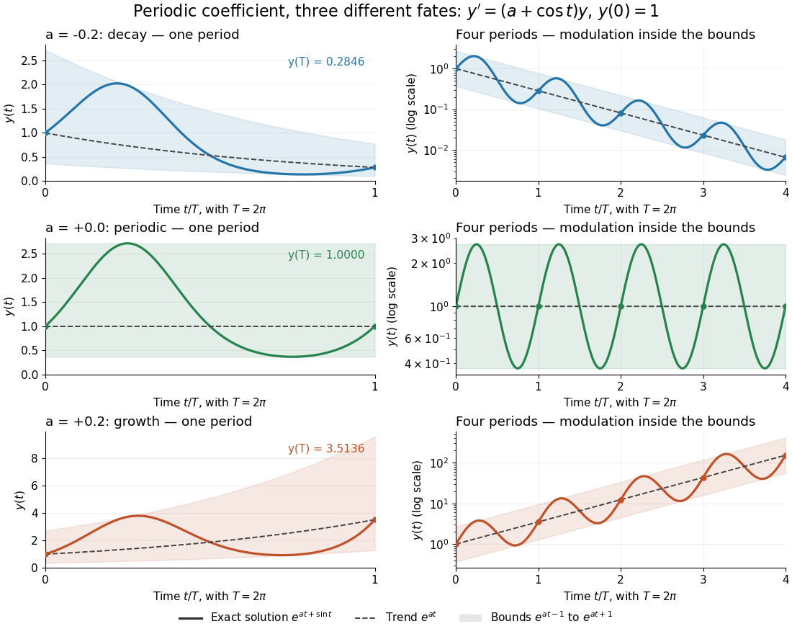

# Periodic solution

↑ **Parent:** [Ordinary differential equation](ordinary-differential-equation.md)

A [periodic solution](periodic-solution.md) is a [solution of a differential equation](solution-of-a-differential-equation.md) which is a [periodic function](periodic-function.md): for some $T>0$, $x(t+T)=x(t)$ at every time. This demands repetition of the state, rather than merely repetition of the coefficients in the [differential equation](differential-equation-split.md). A nonconstant [periodic solution](periodic-solution.md) of an [autonomous differential equation](autonomous-system-mathematics.md) traces a [periodic orbit](periodic-orbit.md); constant [equilibrium points](equilibrium-point-of-a-dynamical-system.md) are also [periodic functions](periodic-function.md), so they must be excluded when asserting absence of [periodic orbits](periodic-orbit.md).

For an explicit example, consider the [initial value problem](initial-value-problem.md)

$$
y'=(a+b\cos t)y,\qquad y(0)=1,\qquad a,b\in\mathbb R.
$$

Its coefficient has period $T=2\pi$. Taking a [logarithmic derivative](logarithmic-derivative.md) and then applying [integration](integral-split.md) gives

$$
\log y(t)=\int_0^t(a+b\cos s)\,ds=at+b\sin t,\qquad y(t)=e^{at+b\sin t}.
$$

Direct [differentiation](differentiation.md) verifies both the [differential equation](differential-equation-split.md) and the [initial condition](initial-condition.md). After one coefficient period,

$$
y(t+2\pi)=e^{2\pi a}y(t).
$$

Thus the repeating coefficient generally produces a repeating shape with a changed amplitude. With $b=1$, the three cases $a=-0.2,0,+0.2$ have one-period factors approximately $0.2846,1,3.5136$, respectively. Only $a=0$ gives a [periodic solution](periodic-solution.md) with this [initial condition](initial-condition.md). For $a<0$ the positive [solution of a differential equation](solution-of-a-differential-equation.md) tends to zero, and for $a>0$ it tends to infinity; neither can have any positive period. The zero [solution of a differential equation](solution-of-a-differential-equation.md), obtained with a different [initial condition](initial-condition.md), is periodic for every $a$.

**[Figure 5](#image-one-repeating-coefficient-can-produce-decay-periodic-motion-or-growth). One repeating coefficient can produce decay, periodic motion, or growth**. The original example $y'=\left(a+\cos t\right)y$, $y(0)=1$, shown over one coefficient period and four coefficient periods. Shading marks the bounds $e^{at-1}\leq y(t)\leq e^{at+1}$, and dashed curves mark $e^{at}$. The right column uses a logarithmic vertical scale.

The [exponential function](exponential-function.md) separates two roles:

$$
y(t)=\underbrace{e^{b\sin t}}_{\text{periodic modulation}}\underbrace{e^{at}}_{\text{exponential trend}},\qquad e^{at-|b|}\leq y(t)\leq e^{at+|b|}.
$$

For $b=1$, even the decaying case $a=-0.2$ initially rises, because $y'(0)=0.8>0$. The growing case $a=0.2$ has intervals of decline, because $a+\cos t$ becomes negative. This is the distinction between the instantaneous [logarithmic derivative](logarithmic-derivative.md) $y'/y$ and the [Floquet growth rate](floquet-growth-rate.md) measured over many periods.

More generally, for a real continuous [periodic function](periodic-function.md) $q$ of period $T$, the scalar [linear differential equation](linear-differential-equation.md) $y'=q(t)y$ has

$$
y(t)=y(0)\exp\left(\int_0^t q(s)\,ds\right),\qquad m=\exp\left(\int_0^T q(s)\,ds\right).
$$

A nonzero [solution of a differential equation](solution-of-a-differential-equation.md) is $T$-periodic exactly when $m=1$, or equivalently when the coefficient has zero integral over a period. This scalar calculation is the simplest example of a [Floquet multiplier](floquet-multiplier.md).[§3.6, printed p. 92, scalar example following Theorem 3.15](ordinary-differential-equations-and-dynamical-systems-by-gerald-teschl.md)

## ↑ Ancestors (6)

1. [Ordinary differential equation](ordinary-differential-equation.md)
2. [Differential equation](differential-equation-split.md)
3. [Analysis](analysis-split.md)
4. [Area of mathematics](area-of-mathematics.md)
5. [Mathematics](mathematics-split.md)
6. [Codex Wiki](split.md)

## ← Incoming links (7)

- [Floquet growth rate](floquet-growth-rate.md)
- [Floquet multiplier](floquet-multiplier.md)
- [Fourier solution of a first-order equation with periodic forcing](fourier-solution-of-a-first-order-equation-with-periodic-forcing.md)
- [Monodromy matrix of a periodic linear system](monodromy-matrix-of-a-periodic-linear-system.md)
- [Solution](past-exam-of-the-mathematics-course-of-the-university-of-cambridge/2005/ia/paper-2/7b/solution.md)
- [Solution](past-exam-of-the-mathematics-course-of-the-university-of-cambridge/2008/ii/paper-3/14a/c/solution.md)
- [Periodic solution](periodic-solution.md)
