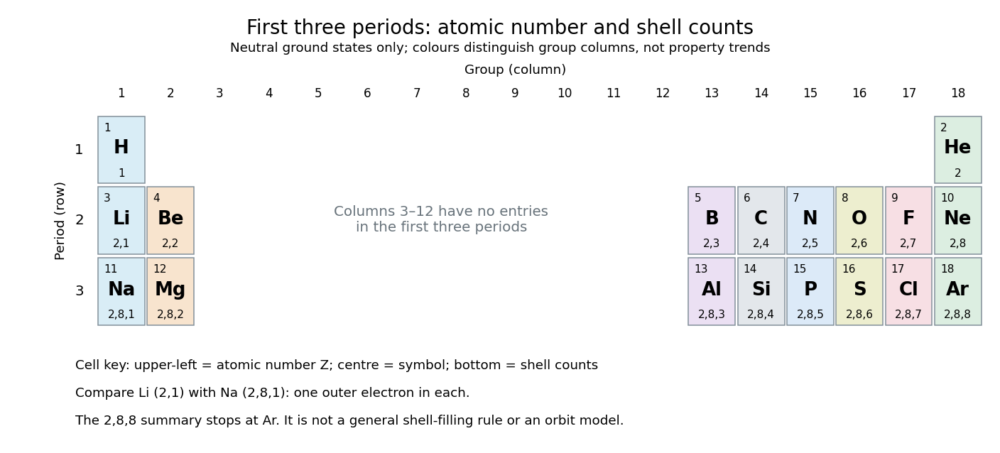

# Periodic table

↑ **Parent:** [Chemical element](chemical-element.md)  
ⓦ [Wiki](https://en.wikipedia.org/wiki/Periodic_table)

The [periodic table](periodic-table.md) arranges [chemical elements](chemical-element.md) in increasing [atomic number](atomic-number.md), across successive [periodic table periods](period-periodic-table.md). Its columns are [periodic groups](group-periodic-table.md), numbered 1–18. The layout places recurring outer [electron configurations](electron-configuration.md) above one another, making similarities in [chemical bonds](chemical-bond-split.md) and [chemical reactions](chemical-reaction-split.md) easier to recognize. Ordering is by [proton](proton.md) count, not by [mass](mass.md); the [mass number](mass-number.md) of a particular [isotope](isotope.md) does not determine its box. See the [official IUPAC periodic table and numbering conventions](https://iupac.org/what-we-do/periodic-table-of-elements/).

For the first eighteen neutral [chemical atoms](atom-physics.md) in their [ground states](ground-state.md), a compact description counts [electrons](electron.md) in successive [electron shells](electron-shell.md). Thus [carbon](carbon.md) has $(2,4)$, meaning two [electrons](electron.md) in the first [electron shell](electron-shell.md) and four in the second; the sum $2+4=6$ agrees with its [atomic number](atomic-number.md). [Sodium](sodium.md) has $(2,8,1)$, whose sum is $11$. These are occupancy counts, not circular trajectories of [electrons](electron.md).

**[Figure 10](#image-the-first-three-periodic-table-periods-atomic-numbers-and-neutral-ground-state-electron-shell-occupancies). The first three periodic table periods: atomic numbers and neutral ground state electron shell occupancies**. Colours distinguish [periodic group](group-periodic-table.md) columns only, without encoding numerical property trends. The spaces in columns 3–12 preserve the eighteen-column [periodic table](periodic-table.md) layout: no [chemical elements](chemical-element.md) occupy those positions in these three [periodic table periods](period-periodic-table.md). Each cell gives a [chemical element](chemical-element.md)'s symbol, [atomic number](atomic-number.md), and [electron shell](electron-shell.md) counts.

Reading each row from left to right gives:
- [Periodic table period](period-periodic-table.md) 1: [hydrogen](hydrogen.md) $(1)$ and [helium](helium.md) $(2)$.
- [Periodic table period](period-periodic-table.md) 2: [lithium](lithium.md) $(2,1)$, [beryllium](beryllium.md) $(2,2)$, [boron](boron.md) $(2,3)$, [carbon](carbon.md) $(2,4)$, [nitrogen](nitrogen.md) $(2,5)$, [oxygen](oxygen.md) $(2,6)$, [fluorine](fluorine.md) $(2,7)$, and [neon](neon.md) $(2,8)$.
- [Periodic table period](period-periodic-table.md) 3: [sodium](sodium.md) $(2,8,1)$, [magnesium](magnesium.md) $(2,8,2)$, [aluminium](aluminium.md) $(2,8,3)$, [silicon](silicon.md) $(2,8,4)$, [phosphorus](phosphorus.md) $(2,8,5)$, [sulfur](sulfur.md) $(2,8,6)$, [chlorine](chlorine.md) $(2,8,7)$, and [argon](argon.md) $(2,8,8)$.

The counting outline is short: the occupied [electron subshells](electron-subshell.md) in this range are $1s$, $2s$, $2p$, $3s$, and $3p$, filled in that order for these neutral [ground states](ground-state.md). Each $s$ [electron subshell](electron-subshell.md) holds up to two [electrons](electron.md) and each $p$ [electron subshell](electron-subshell.md) up to six, giving $2$, $2+6=8$, and $2+6=8$ along these three rows. This $2,8,8$ summary applies only through [argon](argon.md); it is not a general rule that each [electron shell](electron-shell.md) fills completely before the next begins, nor a claim that the third [electron shell](electron-shell.md) can hold only eight [electrons](electron.md). See [Flowers et al., Chemistry 2e, electronic structure and electron configurations](https://openstax.org/books/chemistry-2e/pages/6-4-electronic-structure-of-atoms-electron-configurations).

The recurring outer counts make the arrangement useful. [Lithium](lithium.md) and [sodium](sodium.md) each have one [valence electron](valence-electron.md), whereas [fluorine](fluorine.md) and [chlorine](chlorine.md) each have seven [valence electrons](valence-electron.md). Such similarities help anticipate [chemical reactions](chemical-reaction-split.md), without making all properties identical throughout a [periodic group](group-periodic-table.md). [Helium](helium.md) is an instructive exception to an eight-[electron](electron.md) shortcut: its two [electrons](electron.md) complete the first [electron shell](electron-shell.md), so it belongs above [neon](neon.md) and [argon](argon.md) in [periodic group](group-periodic-table.md) 18. [Hydrogen](hydrogen.md) shares column 1 with [lithium](lithium.md) and [sodium](sodium.md) but has its own distinct chemistry. See [Flowers et al., Chemistry 2e, periodic-table organization](https://openstax.org/books/chemistry-2e/pages/2-5-the-periodic-table).

**Table of contents**

- [Actinide](actinide.md)
- [Lanthanide](lanthanide.md)
  - [Ytterbium](ytterbium.md)
  - [Europium](europium.md)
- [Periodic trend](periodic-trend.md)
  - [Atomic radius](atomic-radius.md)
  - [Inert-pair effect](inert-pair-effect.md)
- [Lanthanide contraction](lanthanide-contraction.md)
- [Group (periodic table)](group-periodic-table.md)
- [Period (periodic table)](period-periodic-table.md)

## ↑ Ancestors (4)

1. [Chemical element](chemical-element.md)
2. [Chemical substance](chemical-substance-split.md)
3. [Chemistry](chemistry-split.md)
4. [Codex Wiki](split.md)

## ← Incoming links (9)

- [Atomic number](atomic-number.md)
- [Chemical element](chemical-element.md)
- [Counting spin orbitals in an electron shell](counting-spin-orbitals-in-an-electron-shell.md)
- [Group (periodic table)](group-periodic-table.md)
- [Isotope](isotope.md)
- [Noble gas](noble-gas.md)
- [Period (periodic table)](period-periodic-table.md)
- [Periodic table](periodic-table.md)
- [Siegbahn precision X-ray wavelength spectroscopy](siegbahn-precision-x-ray-wavelength-spectroscopy.md)
