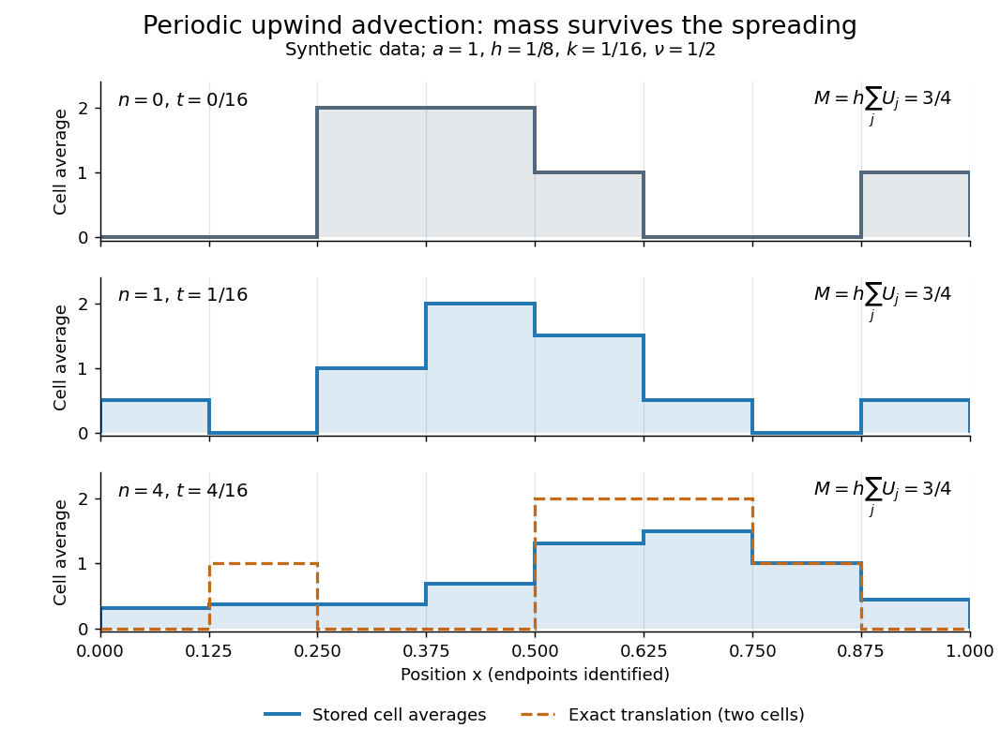

# Periodic upwind finite volume advection

↑ **Parent:** [Finite volume method](finite-volume-method.md)

Consider the [advection equation](transport-equation.md) $u_t+a u_x=0$ with constant speed $a>0$, no sources, and [periodic boundary conditions](periodic-boundary-conditions.md) on $[0,1]$. Use $N$ equal cells of width $h=1/N$, time step $k>0$, and indices modulo $N$. The exact solution is the periodic translation $u(x,t)=u_0(x-at)$. At a face, the [Riemann problem](riemann-problem.md) transports the left state to the right, so the two-state upwind [numerical flux](numerical-flux.md) is $F(L,R)=aL$, with $F(U,U)=aU$.[Advection, equations adv:advection and adv:solution, §The Riemann problem; Approximate solvers, §High-resolution methods: reduction to upwind advection](riemann-problems-and-jupyter-solutions-by-david-i-ketcheson-randall-j-leveque-and-mauricio-j-del-razo.md)

The [finite volume method](finite-volume-method.md) with this [numerical flux](numerical-flux.md) and an [explicit Euler method](euler-method.md) step gives

$$
F_{j+1/2}^n=aU_j^n,\qquad \nu=\frac{ak}{h},\qquad U_j^{n+1}=(1-\nu)U_j^n+\nu U_{j-1}^n.
$$

Here $U_j^n$ represents a [cell average](average-value-of-a-function.md); the recurrence also occurs in the [upwind finite difference scheme](upwind-finite-difference-scheme.md). Impose the specific [CFL condition](courant-friedrichs-lewy-condition.md) $0<\nu\leq1$. Each updated [cell average](average-value-of-a-function.md) is then a [convex combination](convex-combination.md) of two old ones. This proves preservation of their initial minimum and maximum, including nonnegativity for nonnegative data, and contraction of the [maximum norm](supremum-norm.md) of the difference of two solutions on this periodic grid. These statements concern this constant-speed scalar update with this time step.

For an original synthetic example, take $N=8$, $a=1$, $h=1/8$, $k=1/16$, hence [Courant number](courant-number.md) $\nu=1/2$. Choose a [function](function-split.md) constant on each successive cell, with the following values, so these are exact initial [cell averages](average-value-of-a-function.md). One step gives

$$
\begin{array}{c|rrrrrrrr}
j&0&1&2&3&4&5&6&7\\\hline
U_j^0&0&0&2&2&1&0&0&1\\
U_j^1&1/2&0&1&2&3/2&1/2&0&1/2
\end{array}
\qquad M^0=M^1=\frac18\cdot6=\frac34.
$$

For example, cell zero receives from cell seven across the periodic face: $U_0^1=(0+1)/2=1/2$. All eight face transfers cancel in the total by [shared face flux cancellation](shared-face-flux-cancellation.md). More generally this periodic recurrence conserves the total algebraically for any $\nu$, even though the [CFL condition](courant-friedrichs-lewy-condition.md) is needed for the [convex combination](convex-combination.md) argument. With the same initial data and $\nu=3/2$, one step gives $U_2^1=-1$ and $U_4^1=5/2$, despite preserving the total.

**[Figure 19](#image-original-periodic-upwind-profile-at-zero-one-and-four-steps-the-integral-remains-three-quarters-while-jumps-spread). Original periodic upwind profile at zero, one and four steps: the integral remains three quarters while jumps spread**.

After four steps, $t=1/4$, the exact translated profile has moved two cells to the right. Repeated averaging instead gives the explicit [binomial coefficient](binomial-coefficient.md) formula

$$
U_j^4=\frac1{16}\bigl(U_j^0+4U_{j-1}^0+6U_{j-2}^0+4U_{j-3}^0+U_{j-4}^0\bigr),
$$

with all indices modulo eight. The diagram compares these computed [cell averages](average-value-of-a-function.md) with the exact translated [cell averages](average-value-of-a-function.md). Their [integrals](integral.md) agree, but the numerical jumps spread across cells. The [finite volume method](finite-volume-method.md) is useful for [jump discontinuities](jump-discontinuity.md) because it retains the integral balance even at a jump; conservation alone does not guarantee a sharp profile. At $\nu=1$ this particular update is an exact one-cell shift, whereas for $0<\nu<1$ it mixes neighboring states. No accuracy conclusion at a jump follows just from the conserved total.

## ↑ Ancestors (6)

1. [Finite volume method](finite-volume-method.md)
2. [Numerical analysis](numerical-analysis-split.md)
3. [Analysis](analysis-split.md)
4. [Area of mathematics](area-of-mathematics.md)
5. [Mathematics](mathematics-split.md)
6. [Codex Wiki](split.md)

## ← Incoming links (2)

- [Finite volume method](finite-volume-method.md)
- [Numerical flux](numerical-flux.md)
