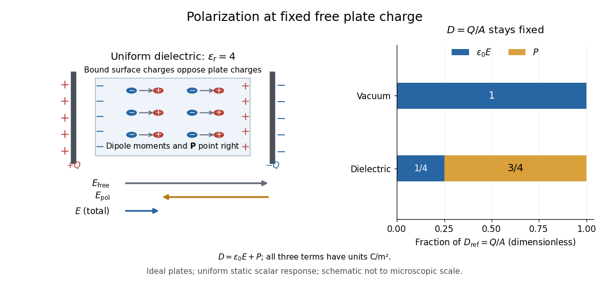
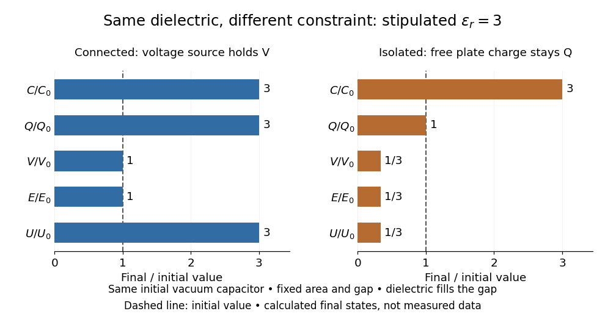

# Permittivity

↑ **Parent:** [Electromagnetism](electromagnetism.md)  
ⓦ [Wiki](https://en.wikipedia.org/wiki/Permittivity)

[Permittivity](permittivity.md) describes how an [electric field](electric-field.md) and a material's [electric polarization](electromagnetism.md#polarization-density) combine into the [electric displacement field](electromagnetism.md#electric-displacement-field). In a static, local response with [linearity](vector-space.md#linearity) and [isotropy](continuum-mechanics.md#isotropy), and no [electric polarization](electromagnetism.md#polarization-density) at zero [electric field](electric-field.md), the [constitutive equation](continuum-mechanics.md#constitutive-equation) is

$$
\mathbf D=\epsilon\mathbf E,\qquad \epsilon=\epsilon_0\epsilon_r.
$$

Here $\epsilon_0$ is [vacuum permittivity](#vacuum-permittivity), while $\epsilon_r$ is the [relative permittivity](quantum-mechanics.md#relative-permittivity), a [dimensionless quantity](physics.md#dimensionless-quantity). The [SI](physics.md#international-system-of-units) unit of [permittivity](permittivity.md) is [farad](electromagnetism.md#farad) per metre, $\mathrm{F/m}$: multiplying it by an [electric field](electric-field.md) in $\mathrm{V/m}$ gives an [electric displacement field](electromagnetism.md#electric-displacement-field) in $\mathrm{C/m^2}$. A larger positive [permittivity](permittivity.md) lets the same [parallel-plate capacitor](electromagnetism.md#parallel-plate-capacitor) hold more plate [electric charge](electric-charge.md) at the same [electric potential difference](electric-field.md#electric-potential-difference).

The material contribution is [electric polarization](electromagnetism.md#polarization-density) $\mathbf P$, the [electric dipole moment](electrostatics.md#electric-dipole-moment) per unit [volume](geometry-and-topology.md#volume). The [electric displacement field](electromagnetism.md#electric-displacement-field) and [electric susceptibility](#electric-susceptibility) $\chi_e$ satisfy

$$
\mathbf D=\epsilon_0\mathbf E+\mathbf P,\qquad
\mathbf P=\epsilon_0\chi_e\mathbf E,\qquad
\epsilon_r=1+\chi_e.
$$

Substitution gives the first [constitutive equation](continuum-mechanics.md#constitutive-equation). The [electric field](electric-field.md) here is the averaged, total field inside the material, not just the field of the external plate [electric charges](electric-charge.md). The [continuum approximation](continuum-mechanics.md#continuum-approximation) averages over many [chemical atoms](physics.md#atom-physics) or [molecules](molecule.md); locality means that the [electric polarization](electromagnetism.md#polarization-density) at a position depends on the [electric field](electric-field.md) there. Static equilibrium, fixed material conditions and sufficiently small [electric fields](electric-field.md) are needed for this scalar proportionality. [Polarization](physics-bibliography.md#classical-electromagnetism-an-intermediate-level-course-by-richard-fitzpatrick/polarization).

For an ideal [parallel-plate capacitor](electromagnetism.md#parallel-plate-capacitor) completely filled by a uniform [dielectric](#dielectric), hold the free plate [electric charge](electric-charge.md) magnitude $Q$ fixed and neglect the [fringing field of a capacitor](electromagnetism.md#fringing-field-of-a-capacitor). Writing $A$ for the plate [area](differential-geometry.md#surface-area), [Gauss's law](maxwell-equations.md#gauss-s-law) gives $D=Q/A$. Thus

$$
E=\frac{Q}{\epsilon_0\epsilon_r A},\qquad
P=\frac{Q}{A}\left(1-\frac1{\epsilon_r}\right).
$$

The [electric dipoles](electrostatics.md#electric-dipole) point along the [electric field](electric-field.md). Their surface [electric charges](electric-charge.md), described by [polarization density](electromagnetism.md#polarization-density), oppose the field from the free plate [electric charges](electric-charge.md). For a hypothetical [dielectric](#dielectric) with $\epsilon_r=4$, the internal [electric field](electric-field.md) is one quarter of its [vacuum](physics.md#vacuum) value, while $P=3D/4$. At fixed [electric potential difference](electric-field.md#electric-potential-difference) instead, the internal [electric field](electric-field.md) stays approximately $V/d$ and the plate [electric charge](electric-charge.md) grows fourfold. These are different experimental constraints. [Feynman, Leighton and Sands, II.10–3, equations (10.5)–(10.11): polarization surface charge, field reduction and capacitance](https://www.feynmanlectures.caltech.edu/II_10.html#Ch10-S3).

**[Figure 1](#image-electric-polarization-and-electric-field-reduction-at-fixed-plate-electric-charge). Electric polarization and electric field reduction at fixed plate electric charge**. An original schematic and normalized model comparison for a uniform [dielectric](#dielectric) with [relative permittivity](quantum-mechanics.md#relative-permittivity) four. The arrows for [electric dipole moments](electrostatics.md#electric-dipole-moment) run from negative to positive [electric charge](electric-charge.md); the two field contributions oppose each other. The bar values compare [electric displacement field](electromagnetism.md#electric-displacement-field) $D$, $\epsilon_0E$, and [electric polarization](electromagnetism.md#polarization-density) $P$, which all have units $\mathrm{C/m^2}$. The schematic is not to microscopic scale.

[Permittivity](permittivity.md) is a useful material summary, not a universal constant of the material under every condition. [Temperature](temperature.md), [frequency](wave.md#frequency) and [electric field](electric-field.md) strength can change the response. In a [linear anisotropic dielectric](maxwell-equations.md#linear-anisotropic-dielectric), [permittivity](permittivity.md) is a [tensor](multilinear-algebra.md#tensor), $D_i=\sum_j\epsilon_{ij}E_j$, so the [electric displacement field](electromagnetism.md#electric-displacement-field) need not be parallel to the [electric field](electric-field.md). At nonzero [frequency](wave.md#frequency), delayed [electric polarization](electromagnetism.md#polarization-density) requires [complex permittivity](#complex-permittivity) and may produce [dielectric loss](#dielectric-loss). [Feynman, Leighton and Sands, II.32–2, equations (32.5)–(32.8) and following paragraph: frequency dependence and phase lag](https://www.feynmanlectures.caltech.edu/II_32.html#Ch32-S2).

**Table of contents**

- [Permittivity tensor](#permittivity-tensor)
- [Dielectric](#dielectric)
  - [Steady fields in two leaky dielectric layers](#steady-fields-in-two-leaky-dielectric-layers)
  - [Transverse electrostatic field inside a dielectric cylinder](#transverse-electrostatic-field-inside-a-dielectric-cylinder)
  - [Electret](#electret)
  - [Electric susceptibility](#electric-susceptibility)
    - [Lorentz oscillator model](#lorentz-oscillator-model)
      - [Optical oscillator strength](#optical-oscillator-strength)
      - [Phase of a negatively charged driven oscillator](#phase-of-a-negatively-charged-driven-oscillator)
      - [Scattering cross-section of a harmonically bound charge](#scattering-cross-section-of-a-harmonically-bound-charge)
  - [Microscopic dielectric polarization](#microscopic-dielectric-polarization)
  - [Dielectric capacitor response](#dielectric-capacitor-response)
  - [Electrical insulator](#electrical-insulator)
    - [Charge-transfer insulator](#charge-transfer-insulator)
  - [Dielectric breakdown](#dielectric-breakdown)
    - [Breakdown-limited parallel-plate charge](#breakdown-limited-parallel-plate-charge)
    - [Dielectric strength](#dielectric-strength)
- [Complex permittivity](#complex-permittivity)
  - [Conductive contribution to complex permittivity](#conductive-contribution-to-complex-permittivity)
  - [Dielectric loss](#dielectric-loss)
  - [Dielectric relaxation](#dielectric-relaxation)
- [Dielectric capacitance measurement](#dielectric-capacitance-measurement)
  - [Capacitance measurement calibration](#capacitance-measurement-calibration)
  - [Foil capacitor dielectric experiment](#foil-capacitor-dielectric-experiment)
- [Vacuum permittivity](#vacuum-permittivity)

## Permittivity tensor

↑ **Parent:** [Permittivity](permittivity.md)

The [permittivity tensor](#permittivity-tensor) is the linear material-response matrix relating [electric displacement field](electromagnetism.md#electric-displacement-field) to [electric field](electric-field.md) at a specified [frequency](wave.md#frequency). An isotropic local medium has $\epsilon_{ij}=\epsilon\delta_{ij}$. A magnetically biased transparent medium can have an imaginary antisymmetric transverse contribution; its eigenmodes can have opposite [circular polarizations](electromagnetic-wave.md#circular-polarization) and different [refractive indices](electromagnetic-wave.md#refractive-index).

## Dielectric

↑ **Parent:** [Permittivity](permittivity.md)  
ⓦ [Wiki](https://en.wikipedia.org/wiki/Dielectric)

A [dielectric](#dielectric) is a material in which an [electric field](electric-field.md) produces [electric polarization](electromagnetism.md#polarization-density) while transport of [electric charge](electric-charge.md) is sufficiently small for the intended use. An insulating solid in a [capacitor](electromagnetism.md#capacitor) is an example; real [dielectrics](#dielectric) can still have [dielectric loss](#dielectric-loss) and nonzero [electrical conductivity](electric-charge.md#electrical-conductivity).

The important distinction is between rearranging bound [electric charge](electric-charge.md) and transporting mobile [charge carriers](electric-charge.md#charge-carrier) through the specimen. Bound [electric charges](electric-charge.md) can move a little within a [chemical atom](physics.md#atom-physics) or [molecule](molecule.md), or an existing [electric dipole](electrostatics.md#electric-dipole) can turn. Their averaged [electric dipole moments](electrostatics.md#electric-dipole-moment) produce [electric polarization](electromagnetism.md#polarization-density) even if there is negligible steady [electric current](electric-charge.md#electric-current) between the [electrodes](electrochemistry.md#electrode). A changing [electric polarization](electromagnetism.md#polarization-density) does give a [bound current](electromagnetism.md#bound-current); the absence of steady conduction does not mean that the material is electrically unresponsive.[II.10–2 and II.10–3: induced atomic dipoles and relaxation of bound surface charge](physics-bibliography.md#the-feynman-lectures-on-physics-volume-ii-by-richard-feynman-and-others/chapter-10-dielectrics)

For uniform [electric polarization](electromagnetism.md#polarization-density) $\mathbf P=P\widehat{\mathbf x}$ in a rectangular slab, [polarization density](electromagnetism.md#polarization-density) gives zero bound volume [charge density](electric-charge.md#charge-density) in the interior and opposite bound [surface charge densities](electrostatics.md#surface-charge-density) $-P,+P$ on the left and right faces. The [electric charge](electric-charge.md) has been redistributed, not created. More generally, the [divergence theorem](multivariable-calculus.md#divergence-theorem) makes the cancellation explicit:

$$
\int_{\mathcal V}(-\nabla\cdot\mathbf P)\,d\mathcal V
+\int_{\partial\mathcal V}\mathbf P\cdot\mathbf n\,dA=0.
$$

Here $\mathbf n$ is the outward [normal vector](differential-geometry.md#normal-vector) on the material boundary. This accounts for both bound volume [charge density](electric-charge.md#charge-density) and bound [surface charge density](electrostatics.md#surface-charge-density); omitting either can falsely suggest that an initially neutral [dielectric](#dielectric) acquired net [electric charge](electric-charge.md).

An [electrical insulator](#electrical-insulator) between [capacitor](electromagnetism.md#capacitor) plates supports a useful combination: appreciable [electric polarization](electromagnetism.md#polarization-density), little leakage [electric current](electric-charge.md#electric-current), and tolerance of the intended [electric field](electric-field.md). This lets a small [parallel-plate capacitor](electromagnetism.md#parallel-plate-capacitor) store separated [electric charge](electric-charge.md) and recoverable [capacitor energy](electromagnetism.md#capacitor-energy). The comparison in [dielectric capacitor response](#dielectric-capacitor-response) explains why specifying fixed [electric charge](electric-charge.md) or fixed [electric potential difference](electric-field.md#electric-potential-difference) changes the answer. High [relative permittivity](quantum-mechanics.md#relative-permittivity) alone does not establish good insulation or a large usable [energy density](statistical-physics.md#energy-density); [dielectric loss](#dielectric-loss) and [dielectric breakdown](#dielectric-breakdown) matter as well.

### Steady fields in two leaky dielectric layers

↑ **Parent:** [Dielectric](#dielectric)

For two planar homogeneous layers in series, [charge conservation](electric-charge.md#charge-conservation) makes the steady normal [current density](electric-charge.md#current-density) the same in both layers. Combining [Ohm's law](electric-charge.md#ohm-s-law) with $E_1d_1+E_2d_2=V$ determines the fields when both conductivities are positive. The free interfacial [surface charge density](electrostatics.md#surface-charge-density) is $\epsilon_2E_2-\epsilon_1E_1$, whereas total free-plus-bound charge is $\epsilon_0(E_2-E_1)$. The two notions of charge are distinct. This DC state can differ from the immediate response to switching the voltage; interfacial free charge accumulates during the transient.

### Transverse electrostatic field inside a dielectric cylinder

↑ **Parent:** [Dielectric](#dielectric)

For an infinitely long circular [dielectric](#dielectric) cylinder in a uniform transverse field in vacuum, the inside [electrostatic potential](electric-field.md#electric-potential) is linear in the transverse coordinate. Matching the tangential [electric field](electric-field.md) and normal [electric displacement field](electromagnetism.md#electric-displacement-field) to the outside dipolar solution gives the displayed uniform internal field. The result assumes no free interface charge and neglects end effects; an exterior [dielectric](#dielectric) changes the [permittivity](permittivity.md) ratio.

### Electret

↑ **Parent:** [Dielectric](#dielectric)

A dielectric retaining a persistent [electric polarization](electromagnetism.md#polarization-density) or trapped charge.

### Electric susceptibility

↑ **Parent:** [Dielectric](#dielectric)  
ⓦ [Wiki](https://en.wikipedia.org/wiki/Electric_susceptibility)

The [dimensionless quantity](physics.md#dimensionless-quantity) relating induced [electric polarization](electromagnetism.md#polarization-density) to the internal [electric field](electric-field.md) through $\mathbf P=\epsilon_0\chi_e\mathbf E$ in the static scalar model. It describes the material contribution; [relative permittivity](quantum-mechanics.md#relative-permittivity) includes the [vacuum](physics.md#vacuum) term as well, $\epsilon_r=1+\chi_e$. Zero [electric susceptibility](#electric-susceptibility) gives $\epsilon_r=1$, not zero [permittivity](permittivity.md).

The scalar $\chi_e$ assumes a local response with [linearity](vector-space.md#linearity) and [isotropy](continuum-mechanics.md#isotropy), settled [electric polarization](electromagnetism.md#polarization-density), fixed material conditions, and no residual [electric polarization](electromagnetism.md#polarization-density) at zero [electric field](electric-field.md). It relates $\mathbf P$ to the averaged total internal [electric field](electric-field.md), which already includes the field of the bound [electric charges](electric-charge.md). It does not relate $\mathbf P$ to the field the external [electrodes](electrochemistry.md#electrode) would produce in [vacuum](physics.md#vacuum). The distinction is essential for a self-consistent calculation.[equations (807)–(812): total field, displacement, linear susceptibility and relative dielectric constant](physics-bibliography.md#classical-electromagnetism-an-intermediate-level-course-by-richard-fitzpatrick/polarization)

Substitute the scalar relation into the definition of [electric displacement field](electromagnetism.md#electric-displacement-field):

$$
\mathbf D=\epsilon_0\mathbf E+\mathbf P
=\epsilon_0(1+\chi_e)\mathbf E.
$$

Comparison with $\mathbf D=\epsilon\mathbf E$ proves $\epsilon=\epsilon_0(1+\chi_e)$ and $\epsilon_r=1+\chi_e$. Both $\mathbf D$ and $\mathbf P$ have units $\mathrm{C/m^2}$, so $\chi_e$ is a [dimensionless quantity](physics.md#dimensionless-quantity). In a stipulated static model with $\epsilon_r=3$, $\chi_e=2$: at a prescribed internal [electric field](electric-field.md), the material contribution $P$ is twice $\epsilon_0E$. This is a hypothetical response, not a measured material constant. The [electric susceptibility](#electric-susceptibility) is a convenient bridge from [microscopic dielectric polarization](#microscopic-dielectric-polarization) to a macroscopic [capacitance](electromagnetism.md#capacitance) measurement, but it is not a measure of [electrical conductivity](electric-charge.md#electrical-conductivity).

#### Lorentz oscillator model

↑ **Parent:** [Electric susceptibility](#electric-susceptibility)

A bound charge obeying $m\ddot u+m\gamma\dot u+m\omega_0^2u=qE$ gives a resonant [electric susceptibility](#electric-susceptibility). For [carrier density](electric-charge.md#carrier-density) $n$ and the $e^{-i\omega t}$ convention,

$$
\epsilon_r(\omega)=1+\frac{\omega_p^2}{\omega_0^2-\omega^2-i\gamma\omega},\qquad
\omega_p^2=\frac{nq^2}{m\epsilon_0}.
$$

Positive damping gives $\operatorname{Im}\epsilon_r\geq0$ for $\omega>0$, expressing passive absorption. Independent resonances add to the [electric susceptibility](#electric-susceptibility). Setting $\omega_0=0$ gives the [Drude frequency response](electric-charge.md#drude-frequency-response).

##### Optical oscillator strength

↑ **Parent:** [Lorentz oscillator model](#lorentz-oscillator-model)

An [optical oscillator strength](#optical-oscillator-strength) is a dimensionless weight assigned to an optical resonance. In an independent-resonance [Lorentz oscillator model](#lorentz-oscillator-model) using a reference [electron mass](physics.md#electron-mass) $m_e$ and a specified participating [number density](statistical-physics.md#number-density) $n$,

$$
\epsilon_r(\omega)=1+\frac{ne^2}{\epsilon_0m_e}
\sum_j\frac{f_j}{\omega_j^2-\omega^2-i\gamma_j\omega}.
$$

Its normalization must be stated: assigning one unit of total strength per participating [electron](physics.md#electron) means $\sum_jf_j=1$. A one-resonance approximation with $f_1=1$ represents the whole chosen electron population, rather than asserting that the first allowed [interband transition](bloch-s-theorem.md#interband-transition) carries all optical strength. The smallest [band gap](bloch-s-theorem.md#band-gap) therefore need not equal the fitted resonance energy.

##### Phase of a negatively charged driven oscillator

↑ **Parent:** [Lorentz oscillator model](#lorentz-oscillator-model)

For $\ddot z+2\gamma\dot z+\omega_0^2z=(qE_0/m)\cos\omega t$, the $e^{i\omega t}$ convention gives complex displacement amplitude $\widetilde z=(qE_0/m)/(\omega_0^2-\omega^2+2i\gamma\omega)$. If the real amplitude is defined nonnegative, the phase is $-\delta$ for $q>0$ but $\pi-\delta$ for $q<0$, where $\delta=\operatorname{atan2}(2\gamma\omega,\omega_0^2-\omega^2)$. An electron's low-frequency displacement is opposite to the electric field; its high-frequency displacement is in phase. The induced [electric dipole moment](electrostatics.md#electric-dipole-moment) $qz$ instead has phase $-\delta$ for either sign of charge. A signed amplitude can absorb the extra $\pi$, but that convention must be stated.

##### Scattering cross-section of a harmonically bound charge

↑ **Parent:** [Lorentz oscillator model](#lorentz-oscillator-model)

For a charge $q$ of [mass](classical-mechanics.md#mass) $m$ bound by spring constant $k=m\omega_0^2$, the undamped equation $m\ddot x+kx=qE_0e^{-i\omega t}$ has [complex amplitude](wave.md#complex-amplitude) $x_0=qE_0/[m(\omega_0^2-\omega^2)]$. The induced [electric dipole moment](electrostatics.md#electric-dipole-moment) is $p_0=qx_0$. Averaged [electric dipole radiation](electromagnetic-wave.md#electric-dipole-radiation) [power](energy.md#power), divided by incident [light intensity](wave.md#light-intensity), gives

$$
\sigma(\omega)=\frac{q^4\omega^4}{6\pi\epsilon_0^2c^4(k-m\omega^2)^2}
=\sigma_T\frac{\omega^4}{(\omega_0^2-\omega^2)^2}.
$$

The [Rayleigh scattering](electromagnetic-radiation.md#rayleigh-scattering) limit $\omega\ll\omega_0$ gives $\sigma\sim\sigma_T(\omega/\omega_0)^4$, proportional to $\lambda^{-4}$. For $\omega_0\ll\omega\ll mc^2/\hbar$, the charge behaves as free and the [Thomson cross-section](cosmic-microwave-background-anisotropy.md#thomson-cross-section) is recovered. At resonance the undamped steady-state formula is invalid; a finite [damping](wave-equation.md#damping) mechanism or [radiation reaction](electromagnetic-radiation.md#radiation-reaction) must be included. The formula describes independent weakly driven scatterers, not arbitrary coherent scattering from an extended medium.

### Microscopic dielectric polarization

↑ **Parent:** [Dielectric](#dielectric)

Two routes to [electric polarization](electromagnetism.md#polarization-density) are displacement and reorientation. An [electric field](electric-field.md) can shift the centres of positive and negative [electric charge](electric-charge.md) in a neutral [chemical atom](physics.md#atom-physics) or [molecule](molecule.md), inducing an [electric dipole moment](electrostatics.md#electric-dipole-moment). A [polar molecule](physical-chemistry.md#polar-molecule) already has an [electric dipole moment](electrostatics.md#electric-dipole-moment); a field biases its orientation. At finite [temperature](temperature.md), random molecular motion opposes complete alignment, so a nonzero average need not mean that every [electric dipole](electrostatics.md#electric-dipole) points the same way.[§8.5, Figures 8.19–8.20 and the thermal-fluctuation qualification following Figure 8.20](physics-bibliography.md#university-physics-volume-2-by-samuel-j-ling-and-others/8-5-molecular-model-of-a-dielectric)

For a single species with number per unit [volume](geometry-and-topology.md#volume) $n$, the [electric polarization](electromagnetism.md#polarization-density) is

$$
\mathbf P=n\langle\mathbf p\rangle.
$$

The brackets denote the local average [electric dipole moment](electrostatics.md#electric-dipole-moment), rather than its magnitude. Opposite orientations can cancel while individual [electric dipole moments](electrostatics.md#electric-dipole-moment) remain nonzero.[equation (803): number density times locally averaged molecular dipole moment](physics-bibliography.md#classical-electromagnetism-an-intermediate-level-course-by-richard-fitzpatrick/polarization) This averaging explains how an initially unpolarized material can respond strongly without acquiring net [electric charge](electric-charge.md).

**[Figure 2](#image-two-microscopic-routes-to-electric-polarization). Two microscopic routes to electric polarization**. Original schematic: upper panels show coincident charge centres becoming separated; lower panels show existing [electric dipoles](electrostatics.md#electric-dipole) changing from cancelling orientations to a biased distribution with incomplete alignment. Arrows run from negative to positive [electric charge](electric-charge.md). Positions, displacements and orientations are illustrative, not measurements or a simulation of a particular substance.

### Dielectric capacitor response

↑ **Parent:** [Dielectric](#dielectric)

Compare two initially identical [parallel-plate capacitors](electromagnetism.md#parallel-plate-capacitor) with plate [area](differential-geometry.md#surface-area) $A$, fixed gap $d$, [vacuum](physics.md#vacuum) [capacitance](electromagnetism.md#capacitance) $C_0=\epsilon_0A/d$, and initial [electric potential difference](electric-field.md#electric-potential-difference) $V_0$. Completely fill both gaps with the same uniform linear [dielectric](#dielectric) of static [relative permittivity](quantum-mechanics.md#relative-permittivity) $\epsilon_r>1$, neglecting the [fringing field of a capacitor](electromagnetism.md#fringing-field-of-a-capacitor). Keep one connected to an ideal voltage source and isolate the other. The geometric [capacitance](electromagnetism.md#capacitance) becomes $C=\epsilon_r C_0$ in both cases; the electrical constraint determines what else changes.[§8.4, Figure 8.17 and equation (8.11): isolated capacitor, unchanged free plate charge and increased capacitance](physics-bibliography.md#university-physics-volume-2-by-samuel-j-ling-and-others/8-4-capacitor-with-a-dielectric)

Write $Q_0=C_0V_0$, $E_0=V_0/d$ and $U_0=C_0V_0^2/2$. Applying $Q=CV$, $E=V/d$ and the [capacitor energy](electromagnetism.md#capacitor-energy) formula gives the complete comparison:

$$
\begin{array}{c|cc}
&\text{fixed voltage}&\text{isolated, fixed charge}\\ \hline
C/C_0&\epsilon_r&\epsilon_r\\
Q/Q_0&\epsilon_r&1\\
V/V_0&1&1/\epsilon_r\\
E/E_0&1&1/\epsilon_r\\
U/U_0&\epsilon_r&1/\epsilon_r
\end{array}
$$

Thus the statement that a [dielectric](#dielectric) reduces the [electric field](electric-field.md) needs the fixed-free-charge condition. With fixed [electric potential difference](electric-field.md#electric-potential-difference), the voltage source supplies additional free plate [electric charge](electric-charge.md), maintaining $E=V_0/d$ despite the new bound [electric charges](electric-charge.md).

**[Figure 3](#image-dielectric-capacitor-response-at-fixed-voltage-and-fixed-charge). Dielectric capacitor response at fixed voltage and fixed charge**. Original normalized comparison for the stipulated model $\epsilon_r=3$: every ratio is relative to the same initially charged [vacuum](physics.md#vacuum) [capacitor](electromagnetism.md#capacitor). The dashed line marks the initial value. The bars show final values, not a time history or measured data. Plate geometry is unchanged and the [dielectric](#dielectric) completely fills the gap.

For the stipulated $\epsilon_r=3$ example, the voltage source supplies $\Delta Q=2Q_0$. At constant $V_0$, its delivered electrical [work](energy.md#work) is $V_0\Delta Q=4U_0$, whereas the increase in [capacitor energy](electromagnetism.md#capacitor-energy) is $2U_0$. In an ideal reversible quasistatic insertion, the remaining $2U_0$ is mechanical [work](energy.md#work) delivered by the assembly, as accounted for in [fixed-voltage capacitor energy balance](electromagnetism.md#fixed-voltage-capacitor-energy-balance). For the isolated assembly, [capacitor energy](electromagnetism.md#capacitor-energy) falls from $U_0$ to $U_0/3$, allowing $2U_0/3$ of mechanical [work](energy.md#work) in the same ideal limit. Actual losses reduce recoverable [work](energy.md#work); energy increases in the connected case do not arise from the [dielectric](#dielectric) supplying free [energy](energy.md).

### Electrical insulator

↑ **Parent:** [Dielectric](#dielectric)  
ⓦ [Wiki](https://en.wikipedia.org/wiki/Insulator_(electricity))

An [electrical insulator](#electrical-insulator) has sufficiently small transport of [electric charge](electric-charge.md) for its operating conditions. Insulation is a practical requirement involving [electric potential difference](electric-field.md#electric-potential-difference), [temperature](temperature.md), geometry and duration, rather than a universal claim of zero [electrical conductivity](electric-charge.md#electrical-conductivity). [Electric polarization](electromagnetism.md#polarization-density) can be substantial in an [electrical insulator](#electrical-insulator); [dielectric breakdown](#dielectric-breakdown) can end the insulating regime.

For an idealized uniform slab with small constant [electrical conductivity](electric-charge.md#electrical-conductivity) $\sigma$, the [Ohmic conductor](electric-charge.md#ohmic-conductor) model predicts leakage [electrical resistance](electric-charge.md#electrical-resistance) $R=d/(\sigma A)$ in parallel with [capacitance](electromagnetism.md#capacitance) $C=\epsilon A/d$. An isolated [capacitor](electromagnetism.md#capacitor) then has

$$
\frac{dQ}{dt}=-\frac{Q}{RC},\qquad
Q(t)=Q(0)e^{-t/(RC)},\qquad RC=\frac{\epsilon}{\sigma}.
$$

This is a derived model of slow discharge, not an assertion that every leakage mechanism obeys [Ohm's law](electric-charge.md#ohm-s-law). Its time scale matches [charge relaxation](electric-charge.md#charge-relaxation). The fixed-charge comparison in [dielectric capacitor response](#dielectric-capacitor-response) needs an observation time short compared with $RC$, but long enough for [electric polarization](electromagnetism.md#polarization-density) to settle. During a maintained voltage, leakage consumes [power](energy.md#power) $V^2/R$ as [Joule heating](electric-charge.md#joule-heating); delayed [electric polarization](electromagnetism.md#polarization-density) can add [dielectric loss](#dielectric-loss) under changing [electric fields](electric-field.md).[Overview: real and imaginary permittivity, storage and dissipated loss](physics-bibliography.md#materials-measurement-dielectric-materials)

Large [relative permittivity](quantum-mechanics.md#relative-permittivity) alone does not rule out either mechanism.[§8.5, paragraph following Table 8.1: high dielectric constant does not ensure a good insulator; mobile ions permit conduction](physics-bibliography.md#university-physics-volume-2-by-samuel-j-ling-and-others/8-5-molecular-model-of-a-dielectric)

#### Charge-transfer insulator

↑ **Parent:** [Electrical insulator](#electrical-insulator)

A correlated transition-metal compound whose lowest charge excitation primarily transfers an electron between a ligand orbital and a metal orbital. Its gap is controlled by charge-transfer and Coulomb energies rather than a weakly interacting single-band picture alone. Many cuprate parent compounds are usefully described this way. This distinguishes the orbital character of the low-energy excitation from an idealized single-band [Mott insulator](bloch-s-theorem.md#mott-insulator).

### Dielectric breakdown

↑ **Parent:** [Dielectric](#dielectric)  
ⓦ [Wiki](https://en.wikipedia.org/wiki/Dielectric_breakdown)

[Dielectric breakdown](#dielectric-breakdown) is failure of an insulating regime under a sufficiently strong [electric field](electric-field.md), allowing substantial [electric current](electric-charge.md#electric-current) through the material. For example, an [electron](physics.md#electron) freed from a [chemical atom](physics.md#atom-physics) or [molecule](molecule.md) can become a mobile [charge carrier](electric-charge.md#charge-carrier). The small-field linear [electric susceptibility](#electric-susceptibility) model does not describe this conducting state.[§8.5, dielectric breakdown paragraph immediately before the definition of dielectric strength](physics-bibliography.md#university-physics-volume-2-by-samuel-j-ling-and-others/8-5-molecular-model-of-a-dielectric)

#### Breakdown-limited parallel-plate charge

↑ **Parent:** [Dielectric breakdown](#dielectric-breakdown)

For an ideal uniform [dielectric](#dielectric) between large parallel plates, $Q=CV=(\epsilon A/d)(Ed)=\epsilon AE$. A prescribed breakdown field $E_{\rm bd}$ therefore limits charge independently of plate separation. [Voltage](random-walk.md#voltage) capacity still grows with separation. This ideal result neglects field enhancement near edges and any dependence of the breakdown field on gap geometry or environmental conditions.

#### Dielectric strength

↑ **Parent:** [Dielectric breakdown](#dielectric-breakdown)  
ⓦ [Wiki](https://en.wikipedia.org/wiki/Dielectric_strength)

[Dielectric strength](#dielectric-strength) characterizes the [electric field](electric-field.md) at [dielectric breakdown](#dielectric-breakdown) under specified test conditions. In an ideal uniform gap, it sets a voltage scale $V_{\rm bd}\simeq E_{\rm bd}d$.[§8.5: dielectric strength definition and voltage limit for a specified plate separation](physics-bibliography.md#university-physics-volume-2-by-samuel-j-ling-and-others/8-5-molecular-model-of-a-dielectric) The [parallel-plate capacitor](electromagnetism.md#parallel-plate-capacitor) model consequently gives the stored [energy density](statistical-physics.md#energy-density) scale

$$
u_{\rm bd}\simeq\frac12\epsilon E_{\rm bd}^2.
$$

This is a model scale, not an operating rating: [fringing field of a capacitor](electromagnetism.md#fringing-field-of-a-capacitor) make local [electric fields](electric-field.md) differ from $V/d$, while leakage and [dielectric loss](#dielectric-loss) spend some supplied [energy](energy.md) as heat. Comparing usable [capacitor energy](electromagnetism.md#capacitor-energy) therefore requires insulation and breakdown performance as well as [permittivity](permittivity.md).

## Complex permittivity

↑ **Parent:** [Permittivity](permittivity.md)

For harmonic [electric fields](electric-field.md) with time convention $e^{i\omega t}$, write $\mathbf D=\epsilon^*(\omega)\mathbf E$ for their complex amplitudes, where $\omega$ is [angular frequency](lagrangian-mechanics.md#angular-frequency). The [real part](complex-analysis.md#real-part) $\epsilon'$ describes the in-phase [electric displacement field](electromagnetism.md#electric-displacement-field); the minus [imaginary part](complex-analysis.md#imaginary-part) $\epsilon''$ describes the loss component. The sign reverses with the opposite time convention. [Complex permittivity](#complex-permittivity) can also be a [tensor](multilinear-algebra.md#tensor) in a [linear anisotropic dielectric](maxwell-equations.md#linear-anisotropic-dielectric).

### Conductive contribution to complex permittivity

↑ **Parent:** [Complex permittivity](#complex-permittivity)

With phasor convention $e^{-i\omega t}$, the [Ampere-Maxwell law](maxwell-equations.md#ampere-s-circuital-law) in a scalar conductor reads $\nabla\times\mathbf H=(\sigma-i\omega\varepsilon_0\varepsilon_r)\mathbf E$. Factoring $-i\omega\varepsilon_0$ gives the displayed effective relative [complex permittivity](#complex-permittivity). Its positive imaginary conductive term expresses loss in this convention; the sign reverses for $e^{+i\omega t}$. This combines conduction and displacement currents for the same field and must not be confused with the material's loss-free relative permittivity alone.

### Dielectric loss

↑ **Parent:** [Complex permittivity](#complex-permittivity)  
ⓦ [Wiki](https://en.wikipedia.org/wiki/Dielectric_loss)

Conversion of electrical [energy](energy.md) into heat in a [dielectric](#dielectric) driven by an [electric field](electric-field.md). In the stated harmonic convention, a passive scalar response has $\epsilon''\geq0$ for positive [angular frequency](lagrangian-mechanics.md#angular-frequency). A [dielectric capacitance measurement](#dielectric-capacitance-measurement) measures a dissipative component as well as [capacitance](electromagnetism.md#capacitance); leakage from [electrical conductivity](electric-charge.md#electrical-conductivity) can contribute to the inferred loss.

### Dielectric relaxation

↑ **Parent:** [Complex permittivity](#complex-permittivity)

Delayed adjustment of [electric polarization](electromagnetism.md#polarization-density) after a change in [electric field](electric-field.md). A simple illustrative model lets the slowly adjusting part $\mathbf P_s$ obey $\tau\,d\mathbf P_s/dt+\mathbf P_s=\epsilon_0\Delta\epsilon_r\mathbf E$, with a positive response time $\tau$. A harmonic [electric field](electric-field.md) then gives a contribution $\Delta\epsilon_r/(1+i\omega\tau)$ to [complex permittivity](#complex-permittivity) divided by [vacuum permittivity](#vacuum-permittivity). This model is an assumption, not a claim that all [dielectrics](#dielectric) have one response time.

## Dielectric capacitance measurement

↑ **Parent:** [Permittivity](permittivity.md)

The motivating observation is that inserting an insulating material between fixed [capacitor](electromagnetism.md#capacitor) plates increases its [capacitance](electromagnetism.md#capacitance). [Feynman, Leighton and Sands, II.10–1, opening paragraphs: observed increase in capacitance with an inserted insulator](https://www.feynmanlectures.caltech.edu/II_10.html#Ch10-S1). To investigate this response, use two flat parallel metal electrodes with measured overlapping [area](differential-geometry.md#surface-area) $A$ and separation $d$, a uniform specimen filling the gap, and an instrument that measures [electrical impedance](electrical-circuit.md#electrical-impedance). Record the [capacitance](electromagnetism.md#capacitance) with and without the specimen at the same small applied [electric potential difference](electric-field.md#electric-potential-difference), [frequency](wave.md#frequency) and [temperature](temperature.md), after [capacitance measurement calibration](#capacitance-measurement-calibration). An increase in corrected [capacitance](electromagnetism.md#capacitance) indicates a larger [permittivity](permittivity.md), provided the geometry is unchanged. A guard electrode reduces the contribution of the [fringing field of a capacitor](electromagnetism.md#fringing-field-of-a-capacitor). [Materials Measurement: Dielectric Materials](physics-bibliography.md#materials-measurement-dielectric-materials).

For negligible [dielectric loss](#dielectric-loss) in the [parallel-plate capacitor](electromagnetism.md#parallel-plate-capacitor) approximation,

$$
C=\frac{\epsilon A}{d},\qquad C_0=\frac{\epsilon_0A}{d},\qquad
\epsilon_r=\frac{C}{C_0}=\frac{Cd}{\epsilon_0A}.
$$

An air reference approximates $C_0$; it is not an exact [vacuum](physics.md#vacuum) reference. For the following synthetic example, stipulate $A=0.010\,\mathrm{m^2}$, $d=1.00\,\mathrm{mm}$ and the rounded [vacuum permittivity](#vacuum-permittivity) $\epsilon_0\approx8.854\times10^{-12}\,\mathrm{F/m}$. Then $C_0=88.54\,\mathrm{pF}$ in this model, and [relative permittivity](quantum-mechanics.md#relative-permittivity) four gives $C=354.16\,\mathrm{pF}$. A residual parallel [capacitance](electromagnetism.md#capacitance) of $20\,\mathrm{pF}$ would make an uncorrected sample/reference ratio $374.16/108.54\approx3.447$, rather than four. This additive error does not cancel in a ratio.

**[Figure 4](#image-synthetic-capacitance-response-to-relative-permittivity-and-frequency). Synthetic capacitance response to relative permittivity and frequency**. Left: the ideal scalar [capacitance](electromagnetism.md#capacitance) and a hypothetical additive stray [capacitance](electromagnetism.md#capacitance) of $20\,\mathrm{pF}$. Right: a hypothetical [dielectric relaxation](#dielectric-relaxation) model, $\epsilon_r^*=2+2/(1+if/f_0)$ with $f_0=1\,\mathrm{kHz}$, for the same geometry. The solid curve is the parallel [capacitance](electromagnetism.md#capacitance) $C_p=C_0\epsilon_r'$; the dashed curve is the loss component $C_0\epsilon_r''$, not an independently measured storage [capacitance](electromagnetism.md#capacitance). Every plotted value is synthetic.

At nonzero [frequency](wave.md#frequency) $f$, measure both magnitude and [phase](wave.md#phase-waves) of the [electric current](electric-charge.md#electric-current) relative to the applied [electric potential difference](electric-field.md#electric-potential-difference). Define $Y=I/V=1/Z$, where $Z$ is [electrical impedance](electrical-circuit.md#electrical-impedance). For the stated [complex permittivity](#complex-permittivity) convention, the ideal uniform specimen gives

$$
Y=i\omega C_0\epsilon_r^*=\omega C_0\epsilon_r''+i\omega C_0\epsilon_r',\qquad
C_p=\frac{\operatorname{Im}Y}{\omega},\qquad \omega=2\pi f.
$$

Thus a parallel [capacitor](electromagnetism.md#capacitor) and [electrical conductance](electric-charge.md#electrical-conductance) describe the readout at that [frequency](wave.md#frequency); a single scalar [capacitance](electromagnetism.md#capacitance) cannot describe both components. The diagram's assumed [dielectric relaxation](#dielectric-relaxation) gives $C_p=265.62\,\mathrm{pF}$ and $C_0\epsilon_r''=88.54\,\mathrm{pF}$ at $1\,\mathrm{kHz}$. These are model predictions, not observations.

Repeat the reference measurement after removing the specimen and vary the small applied [electric potential difference](electric-field.md#electric-potential-difference) to test drift and [linearity](vector-space.md#linearity). Record specimen thickness, electrode [area](differential-geometry.md#surface-area), contact conditions, [frequency](wave.md#frequency) and [temperature](temperature.md). Air gaps act as additional layers in series and can lower inferred [relative permittivity](quantum-mechanics.md#relative-permittivity); roughness, uncertain thickness and the [fringing field of a capacitor](electromagnetism.md#fringing-field-of-a-capacitor) limit the geometric formula. At sufficiently high [frequency](wave.md#frequency), the fixture itself changes the [electromagnetic field](electromagnetism.md#electromagnetic-field), so low-[frequency](wave.md#frequency) guarding and a lumped [capacitor](electromagnetism.md#capacitor) model require reassessment. [Materials Measurement: Dielectric Materials](physics-bibliography.md#materials-measurement-dielectric-materials).

### Capacitance measurement calibration

↑ **Parent:** [Dielectric capacitance measurement](#dielectric-capacitance-measurement)

Characterize the instrument and fixture before inferring [permittivity](permittivity.md): use the prescribed open and short measurements to compensate residual parallel response and series [electrical impedance](electrical-circuit.md#electrical-impedance), and check a known reference [capacitor](electromagnetism.md#capacitor) or the required load standard. Keep cables and electrode geometry reproducible. An open fixture measurement is distinct from the empty-gap reference [capacitor](electromagnetism.md#capacitor); blindly subtracting its entire [capacitance](electromagnetism.md#capacitance) would remove the desired reference signal. Compensation cannot determine an incorrectly measured specimen thickness or eliminate all specimen-dependent [fringing field of a capacitor](electromagnetism.md#fringing-field-of-a-capacitor) errors. [Open and Short Compensation and Z Port Extension](physics-bibliography.md#open-and-short-compensation-and-z-port-extension).

### Foil capacitor dielectric experiment

↑ **Parent:** [Dielectric capacitance measurement](#dielectric-capacitance-measurement)

Southern Methodist University's teaching lab, Introduction to the Parallel Plate Capacitor Lab, makes the response tangible with a [capacitor](electromagnetism.md#capacitor) assembled from aluminium foil, paper and taped wire contacts. Its instructions specify approximately $10\,\mathrm{cm}\times10\,\mathrm{cm}$ foil rectangles, aligned with the paper completely separating them. A [multimeter](electrical-engineering.md#multimeter) in [capacitance](electromagnetism.md#capacitance) mode supplies the readout; a ruler measures plate dimensions and a micrometer measures specimen thickness. The lab replaces the paper with other sheets, including cardstock, plastic wrap and wax paper. It asks students to keep foil [area](differential-geometry.md#surface-area) and alignment consistent, measure thickness at several positions, estimate thickness uncertainty, and wait for the [capacitance](electromagnetism.md#capacitance) reading to stabilize. These are published preparation and measurement instructions, not measured results reported here.[Experiments 1–2, Equipment You Will Be Using, and final construction and dielectric-study instructions](physics-bibliography.md#smu-physics-110x-labs/introduction-to-the-parallel-plate-capacitor-lab)

The inference uses each specimen's own thickness $t$, not just a comparison of raw meter readings. With corrected [capacitance](electromagnetism.md#capacitance) $C_s$ and overlapping [area](differential-geometry.md#surface-area) $A$, the ideal estimate is $\epsilon_r=C_s t/(\epsilon_0A)$. A thicker sheet can give a smaller [capacitance](electromagnetism.md#capacitance) despite larger [relative permittivity](quantum-mechanics.md#relative-permittivity). This is why changing material while letting the plate gap change does not isolate [electric susceptibility](#electric-susceptibility) by itself.

Useful additional controls are to keep leads in the same positions, use [capacitance measurement calibration](#capacitance-measurement-calibration), repeat one sheet after the others to check drift, and repeat the assembly to assess contact reproducibility. An air-gap reference must have known spacers maintaining the same separation; removing a supporting sheet and letting the foil touch is not such a reference. Record the instrument's test [frequency](wave.md#frequency) and measurement mode when available. A [capacitance](electromagnetism.md#capacitance) display alone does not establish negligible [dielectric loss](#dielectric-loss) or a strictly static [permittivity](permittivity.md). These are proposed controls extending the published teaching instructions.

Air gaps produce a particularly revealing systematic error. Suppose a uniform sheet of thickness $t$ and [relative permittivity](quantum-mechanics.md#relative-permittivity) $\epsilon_r$ is separated from the [electrodes](electrochemistry.md#electrode) by air layers of total thickness $g$. Approximate air [permittivity](permittivity.md) by [vacuum permittivity](#vacuum-permittivity), neglect the [fringing field of a capacitor](electromagnetism.md#fringing-field-of-a-capacitor) and use the same [area](differential-geometry.md#surface-area) in each layer. The common normal [electric displacement field](electromagnetism.md#electric-displacement-field) has magnitude $D=Q/A$, so integrating the [electric field](electric-field.md) through the layers gives

$$
V=\frac{Q}{\epsilon_0A}\left(g+\frac{t}{\epsilon_r}\right),\qquad
C_s=\frac{\epsilon_0A}{g+t/\epsilon_r}.
$$

If the analyst inserts the sheet thickness alone into the ideal filled-gap formula, the inferred value is

$$
\widehat\epsilon_r=\frac{C_s t}{\epsilon_0A}
=\frac{\epsilon_r}{1+\epsilon_r g/t}.
$$

For the stipulated model $\epsilon_r=3$ and $g=t/10$, this gives $\widehat\epsilon_r=30/13\simeq2.308$, not three. These values are calculated examples, not measured sheet properties. If total plate separation $d=t+g$ is used instead, the effective estimate is $(t+g)/(g+t/\epsilon_r)$; it still mixes the sheet and the air. Thus measuring a thickness accurately cannot compensate for an unrecognized layer.

The [fringing field of a capacitor](electromagnetism.md#fringing-field-of-a-capacitor) and additive lead [capacitance](electromagnetism.md#capacitance) further limit a foil measurement. Keep lateral plate dimensions large relative to separation, and use a [guard electrode of a capacitor](electromagnetism.md#guard-electrode-of-a-capacitor) in a suitable fixture for more demanding work.[Solution: guarded three-electrode fixture, fringe capacitance, specimen flatness and air gaps](physics-bibliography.md#materials-measurement-dielectric-materials) A family of thickness measurements can help distinguish material response from an additive offset, but air gaps can vary with the assembly. A large, repeatable reading supports a [capacitance](electromagnetism.md#capacitance) change; extracting a material [electric susceptibility](#electric-susceptibility) requires the geometry, gaps, instrument response and [dielectric loss](#dielectric-loss) assumptions to survive these checks. No measured [relative permittivity](quantum-mechanics.md#relative-permittivity) is claimed for any of the lab's sheets.

## Vacuum permittivity

↑ **Parent:** [Permittivity](permittivity.md)  
ⓦ [Wiki](https://en.wikipedia.org/wiki/Vacuum_permittivity)

[Vacuum permittivity](#vacuum-permittivity) is the electromagnetic constant $\epsilon_0$ in [Coulomb's law](electrostatics.md#coulomb-s-law) and the [Vacuum Maxwell equations](maxwell-equations.md#vacuum-maxwell-equations). In classical [vacuum](physics.md#vacuum), $\mathbf P=0$ and the [electric displacement field](electromagnetism.md#electric-displacement-field) is $\mathbf D=\epsilon_0\mathbf E$. A material's [permittivity](permittivity.md) includes its [electric polarization](electromagnetism.md#polarization-density) response; [vacuum permittivity](#vacuum-permittivity) supplies the common reference, not a separate adjustable material property. Its [SI](physics.md#international-system-of-units) unit is [farad](electromagnetism.md#farad) per metre.

For elementary calculations, [vacuum permittivity](#vacuum-permittivity) is approximately $8.854\times10^{-12}\,\mathrm{F/m}$. This is a deliberately rounded value, not an exact decimal or a statement of current measurement precision.[2022 CODATA adjustment, vacuum electric permittivity row: value and nonzero standard uncertainty](chemistry-bibliography.md#fundamental-physical-constants-complete-listing-by-national-institute-of-standards-and-technology-and-others) It sets the scale in [Coulomb's law](electrostatics.md#coulomb-s-law), $F=|q_1q_2|/(4\pi\epsilon_0r^2)$ for two stationary point [electric charges](electric-charge.md) with separation [length](physics.md#length) $r$ in [vacuum](physics.md#vacuum), and therefore enters the reference [capacitance](electromagnetism.md#capacitance) $C_0=\epsilon_0A/d$ of a [parallel-plate capacitor](electromagnetism.md#parallel-plate-capacitor).

Since the revised [SI](physics.md#international-system-of-units) took effect on 20 May 2019, the numerical value of [vacuum permittivity](#vacuum-permittivity) in [SI](physics.md#international-system-of-units) units is determined experimentally, rather than fixed exactly by the unit definitions. The numerical values of the [elementary charge](electric-charge.md#elementary-charge) $e$, [Planck constant](quantum-mechanics.md#planck-constant) $h$ and [speed of light](special-relativity.md#speed-of-light) $c$ are fixed exactly. The [fine-structure constant](perturbative-quantum-field-theory.md#fine-structure-constant) $\alpha$ is measured, and

$$
\alpha=\frac{e^2}{2\epsilon_0hc},\qquad
\epsilon_0=\frac{e^2}{2\alpha hc},\qquad
\epsilon_0\mu_0=\frac1{c^2},
$$

where $\mu_0$ is [vacuum permeability](maxwell-equations.md#vacuum-permeability). Consequently [vacuum permittivity](#vacuum-permittivity) and [vacuum permeability](maxwell-equations.md#vacuum-permeability) have experimental uncertainty, while their product is exact in [SI](physics.md#international-system-of-units) units because $c$ is exact. This is a change in metrological status, not a new material dependence of [vacuum permittivity](#vacuum-permittivity).[pp. 123–125 (defining constants and alpha relation); section 2.3.1, printed p. 128 (ampere, epsilon0 and mu0); 26th CGPM Resolution 1, printed p. 194 (20 May 2019 effective date)](physics-bibliography.md#the-international-system-of-units-si-ninth-edition-si-brochure)

## ↑ Ancestors (4)

1. [Electromagnetism](electromagnetism.md)
2. [Branches of physics](physics.md#branches-of-physics)
3. [Physics](physics.md)
4. [Codex Wiki](README.md)

## ← Incoming links (91)

- [Arithmetic-harmonic bounds for dielectric capacitance](electromagnetism.md#arithmetic-harmonic-bounds-for-dielectric-capacitance)
- [Bounded two-dimensional capacitor field model](electromagnetism.md#bounded-two-dimensional-capacitor-field-model)
- [Breakdown-limited energy of a conducting sphere](electromagnetism.md#breakdown-limited-energy-of-a-conducting-sphere)
- [Capacitance](electromagnetism.md#capacitance)
- [Capacitance measurement calibration](#capacitance-measurement-calibration)
- [Capacitance of an isolated conducting sphere](electromagnetism.md#capacitance-of-an-isolated-conducting-sphere)
- [Capacitor](electromagnetism.md#capacitor)
- [Capacitor energy](electromagnetism.md#capacitor-energy)
- [Debye-Hückel potential of a charged sphere](electrostatics.md#debye-huckel-potential-of-a-charged-sphere)
- [Depletion region](semiconductor.md#depletion-region)
- [Dielectric capacitance measurement](#dielectric-capacitance-measurement)
- [Dielectric strength](#dielectric-strength)
- [Diffusion-capacitance analogy](critical-phenomenon.md#diffusion-capacitance-analogy)
- [Electric susceptibility](#electric-susceptibility)
- [Electrostatic boundary conditions at a conductor](electrostatics.md#electrostatic-boundary-conditions-at-a-conductor)
- [Electrostatic interface boundary conditions](electrostatics.md#electrostatic-interface-boundary-conditions)
- [Foil capacitor dielectric experiment](#foil-capacitor-dielectric-experiment)
- [Form birefringence](maxwell-equations.md#form-birefringence)
- [Fringing field of a capacitor](electromagnetism.md#fringing-field-of-a-capacitor)
- [Grahame equation](electrostatics.md#grahame-equation)
- [Guard electrode of a capacitor](electromagnetism.md#guard-electrode-of-a-capacitor)
- [Hydrogenic donor state](semiconductor.md#hydrogenic-donor-state)
- [Image charge at a dielectric interface](electric-field.md#image-charge-at-a-dielectric-interface)
- [Linear anisotropic dielectric](maxwell-equations.md#linear-anisotropic-dielectric)
- [Lossless coaxial line parameters](electrical-engineering.md#lossless-coaxial-line-parameters)
- [Multivalent-electrolyte screening-length ratio](mathematical-biology.md#multivalent-electrolyte-screening-length-ratio)
- [Parallel-plate capacitor](electromagnetism.md#parallel-plate-capacitor)
- [Parallel-plate transmission line](electrical-engineering.md#parallel-plate-transmission-line)
- [Solution](past-exam-of-the-advanced-quantum-condensed-matter-physics-course-of-the-university-of-cambridge/2013/paper-1.md#1/solution)
- [Solution](past-exam-of-the-materials-science-course-of-the-university-of-cambridge/2017/paper-1.md#2/b/solution)
- [Solution](past-exam-of-the-materials-science-course-of-the-university-of-cambridge/2019/paper-1.md#2/b/solution)
- [Solution](past-exam-of-the-mathematics-course-of-the-university-of-cambridge/2009/iii/paper-78.md#3/b/ii/solution)
- [Solution](past-exam-of-the-mathematics-course-of-the-university-of-cambridge/2014/iii/paper-71.md#3/solution)
- [Solution](past-exam-of-the-mathematics-course-of-the-university-of-cambridge/2019/iii/paper-344.md#3/e/solution)
- [Solution](past-exam-of-the-mphil-in-micro-and-nanotechnology-enterprise-course-of-the-university-of-cambridge/2017/paper-1.md#section-b/12/i/solution)
- [Solution](past-exam-of-the-mphil-in-micro-and-nanotechnology-enterprise-course-of-the-university-of-cambridge/2018/paper-2.md#section-a-iii/16/i/solution)
- [Solution](past-exam-of-the-mphil-in-micro-and-nanotechnology-enterprise-course-of-the-university-of-cambridge/2018/paper-2.md#section-a-iii/16/ii/solution)
- [Solution](past-exam-of-the-mphil-in-micro-and-nanotechnology-enterprise-course-of-the-university-of-cambridge/2019/paper-1.md#section-b/10/iv/b/solution)
- [Solution](past-exam-of-the-mphil-in-micro-and-nanotechnology-enterprise-course-of-the-university-of-cambridge/2019/paper-1.md#section-b/10/iv/c/solution)
- [Solution](past-exam-of-the-nonlinear-optics-and-quantum-states-of-light-course-of-the-university-of-cambridge/2015/paper-1.md#1/solution)
- [Solution](past-exam-of-the-optics-and-electrodynamics-course-of-the-university-of-cambridge/2016/paper-1.md#4/solution)
- [Solution](past-exam-of-the-optics-and-electrodynamics-course-of-the-university-of-cambridge/2017.md#4/solution)
- [Solution](past-exam-of-the-physics-a-course-of-the-university-of-cambridge/2018/paper-2.md#section-d/d12/solution)
- [Solution](past-exam-of-the-physics-a-course-of-the-university-of-cambridge/2019/paper-2.md#section-d/d12/solution)
- [Solution](past-exam-of-the-physics-b-course-of-the-university-of-cambridge/2010/paper-2a.md#section-b/b6/solution)
- [Solution](past-exam-of-the-physics-b-course-of-the-university-of-cambridge/2011/paper-2.md#section-b/b6/solution)
- [Solution](past-exam-of-the-physics-b-course-of-the-university-of-cambridge/2012/paper-1.md#section-b/b6/solution)
- [Solution](past-exam-of-the-physics-b-course-of-the-university-of-cambridge/2013/paper-1.md#section-a/a2/solution)
- [Solution](past-exam-of-the-physics-b-course-of-the-university-of-cambridge/2013/paper-1.md#section-b/b9/solution)
- [Solution](past-exam-of-the-physics-b-course-of-the-university-of-cambridge/2013/paper-2.md#section-b/b6/b/solution)
- [Solution](past-exam-of-the-physics-b-course-of-the-university-of-cambridge/2013/paper-2.md#section-b/b6/d/solution)
- [Solution](past-exam-of-the-physics-b-course-of-the-university-of-cambridge/2015/paper-1.md#section-a/a1/solution)
- [Solution](past-exam-of-the-physics-b-course-of-the-university-of-cambridge/2015/paper-1.md#section-b/b6/solution)
- [Solution](past-exam-of-the-physics-b-course-of-the-university-of-cambridge/2016/paper-1.md#section-b/b9/solution)
- [Solution](past-exam-of-the-physics-b-course-of-the-university-of-cambridge/2016/paper-2.md#section-b/b7/solution)
- [Solution](past-exam-of-the-physics-b-course-of-the-university-of-cambridge/2017/paper-1.md#section-b/b9/solution)
- [Solution](past-exam-of-the-physics-b-course-of-the-university-of-cambridge/2018/paper-1.md#section-b/b8/solution)
- [Solution](past-exam-of-the-physics-b-course-of-the-university-of-cambridge/2018/paper-1.md#section-b/b9/solution)
- [Solution](past-exam-of-the-physics-b-course-of-the-university-of-cambridge/2018/paper-2.md#section-b/b7/solution)
- [Solution](past-exam-of-the-physics-b-course-of-the-university-of-cambridge/2019/paper-2.md#section-b/b6/b/solution)
- [Solution](past-exam-of-the-physics-b-course-of-the-university-of-cambridge/2021/paper-2.md#section-b/b7/solution)
- [Solution](past-exam-of-the-physics-b-course-of-the-university-of-cambridge/2022/paper-2.md#section-b/b7/b/solution)
- [Solution](past-exam-of-the-physics-b-course-of-the-university-of-cambridge/2022/paper-2.md#section-b/b7/d/solution)
- [Solution](past-exam-of-the-quantum-condensed-matter-course-of-the-university-of-cambridge/2009.md#section-a/a1/c/solution)
- [Solution](past-exam-of-the-quantum-condensed-matter-course-of-the-university-of-cambridge/2012.md#1/a/solution)
- [Solution](past-exam-of-the-quantum-condensed-matter-course-of-the-university-of-cambridge/2012.md#4/solution)
- [Solution](past-exam-of-the-quantum-condensed-matter-course-of-the-university-of-cambridge/2013.md#1/a/solution)
- [Solution](past-exam-of-the-quantum-condensed-matter-course-of-the-university-of-cambridge/2013.md#3/solution)
- [Solution](past-exam-of-the-quantum-condensed-matter-course-of-the-university-of-cambridge/2017.md#2/a/solution)
- [Solution](past-exam-of-the-quantum-condensed-matter-course-of-the-university-of-cambridge/2019.md#section-a/2/solution)
- [Solution](past-exam-of-the-quantum-condensed-matter-course-of-the-university-of-cambridge/2022.md#section-b/4/b/solution)
- [Solution](past-exam-of-the-soft-condensed-matter-course-of-the-university-of-cambridge/2012/paper-1.md#1/c/solution)
- [Solution](past-exam-of-the-soft-condensed-matter-course-of-the-university-of-cambridge/2015/paper-1.md#1/a/solution)
- [Solution](past-exam-of-the-soft-condensed-matter-course-of-the-university-of-cambridge/2019.md#section-b/b6/solution)
- [Solution](past-exam-of-the-soft-condensed-matter-course-of-the-university-of-cambridge/2022.md#section-b/6/c/solution)
- [Solution](past-exam-of-the-soft-matter-and-biological-physics-course-of-the-university-of-cambridge/2013/paper-1.md#3/b/solution)
- [Solution](past-exam-of-the-theoretical-physics-i-course-of-the-university-of-cambridge/2019.md#1/e/solution)
- [Permittivity](permittivity.md)
- [Piezoelectric polymer](energy.md#piezoelectric-polymer)
- [Rayleigh scattering by a small sphere](electromagnetic-radiation.md#rayleigh-scattering-by-a-small-sphere)
- [Refractive index and electromagnetic response](electromagnetic-wave.md#refractive-index-and-electromagnetic-response)
- [Relative permittivity](quantum-mechanics.md#relative-permittivity)
- [Surface plasmon polariton](physics.md#surface-plasmon-polariton)
- [Thomas-Fermi screening](quantum-mechanics.md#thomas-fermi-screening)
- [Transverse electrostatic field inside a dielectric cylinder](#transverse-electrostatic-field-inside-a-dielectric-cylinder)
- [Two-wire capacitance at large separation](electromagnetism.md#two-wire-capacitance-at-large-separation)
- [Uniaxial optical medium](maxwell-equations.md#uniaxial-optical-medium)
- [Uniqueness of an electrostatic dielectric boundary-value problem](electrostatics.md#uniqueness-of-an-electrostatic-dielectric-boundary-value-problem)
- [Vacuum permittivity](#vacuum-permittivity)
- [Wave impedance](electromagnetic-wave.md#wave-impedance)
- [Waveguide phase and group velocities](electromagnetic-wave.md#waveguide-phase-and-group-velocities)
