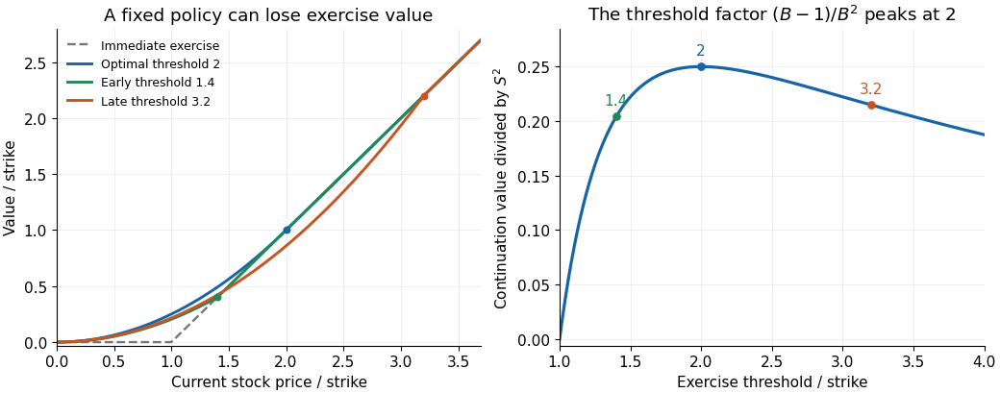

# Perpetual American call option

↑ **Parent:** [American call option](american-call-option.md)

An [American call option](american-call-option.md) with no expiry. For [geometric Brownian motion](geometric-brownian-motion.md) with drift $r-y$ under a [risk-neutral measure](risk-neutral-measure.md), positive dividend yield $y$, $r>0$, and volatility $\sigma>0$, let $p>1$ solve $\sigma^2p(p-1)/2+(r-y)p-r=0$. Its value is $(S_*-K)(S/S_*)^p$ below $S_*=pK/(p-1)$ and $S-K$ above. The power solves the stationary [Black-Scholes equation with continuous stock dividends](black-scholes-equation-with-continuous-stock-dividends.md); value matching and [smooth fit](smooth-pasting.md) determine the threshold.

The candidate dominates the [positive part](positive-part-of-a-real-valued-function.md) $(S-K)^+$ because its continuation branch is [convex](convex-function.md) and tangent to $S-K$ at $S_*$. In the exercise region its discounted-generator residual is $rK-yS\leq0$: the root equation gives $yS_*=K[r+\sigma^2p/2]>rK$. Applying [Itô's formula](ito-s-lemma.md) to the discounted value, localized if necessary, gives an upper bound on every exercise policy. Stopping at the first hit of $S_*$ attains it; on paths not yet hitting, the bounded discounted continuation value tends to zero. This supplies the [optimal stopping](optimal-stopping.md) verification. As $y\downarrow0$, $p\downarrow1$, the threshold diverges and the value tends to $S$.

**[Figure 3](#image-early-and-late-exercise-thresholds-both-lose-value-relative-to-the-optimal-perpetual-call-threshold). Early and late exercise thresholds both lose value relative to the optimal perpetual-call threshold**. An ideal Black-Scholes example with strike one, interest rate 0.05, volatility 0.2 and dividend yield 0.045 gives exponent two and optimal threshold two. A late fixed-policy value may lie below the immediate exercise payoff; it cannot be the price of an unrestricted American option.

**Table of contents**

- [Fixed-threshold value of a perpetual call](fixed-threshold-value-of-a-perpetual-call.md)

## ↑ Ancestors (7)

1. [American call option](american-call-option.md)
2. [American option](american-option.md)
3. [Mathematical finance](mathematical-finance-split.md)
4. [Mathematical optimization](mathematical-optimization-split.md)
5. [Area of mathematics](area-of-mathematics.md)
6. [Mathematics](mathematics-split.md)
7. [Codex Wiki](split.md)

## ← Incoming links (3)

- [Fixed-threshold value of a perpetual call](fixed-threshold-value-of-a-perpetual-call.md)
- [Solution](past-exam-of-the-mathematical-models-of-financial-derivatives-course-of-the-university-of-oxford/2017/3/b/solution.md)
- [Solution](past-exam-of-the-mathematical-models-of-financial-derivatives-course-of-the-university-of-oxford/2017/3/c/solution.md)
