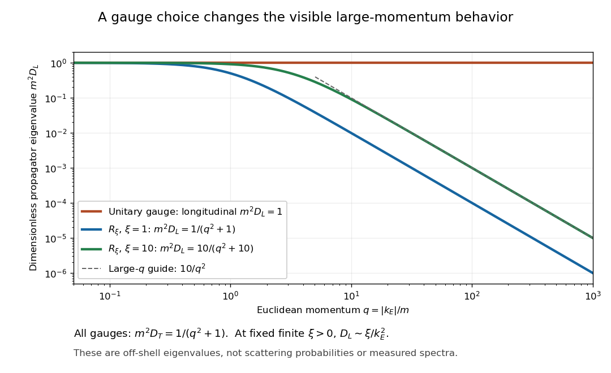
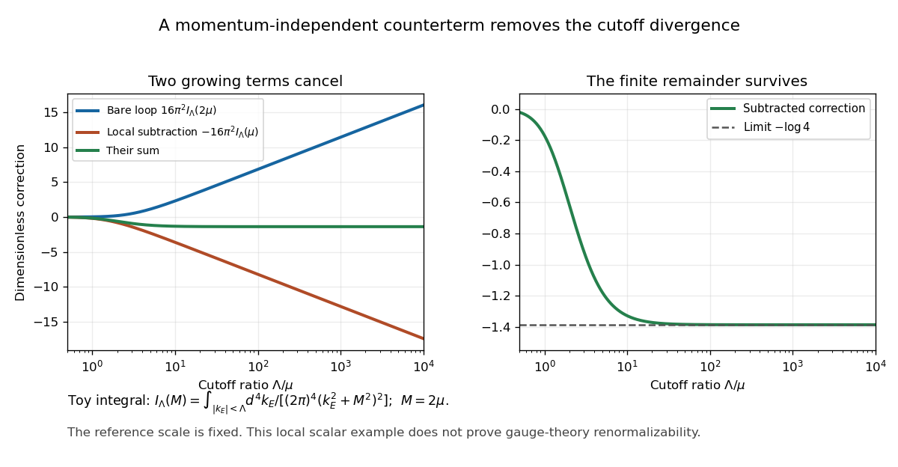
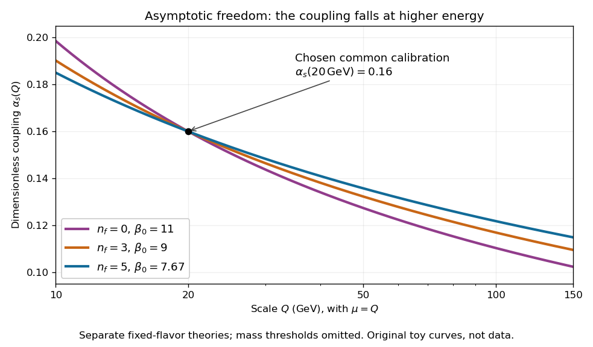
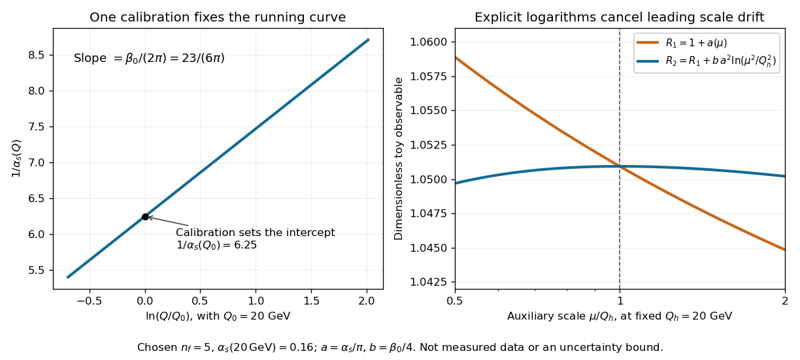
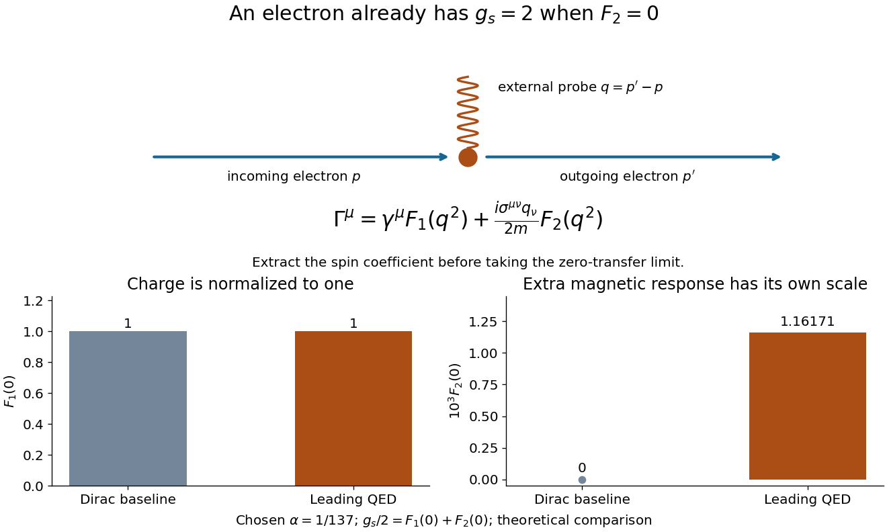
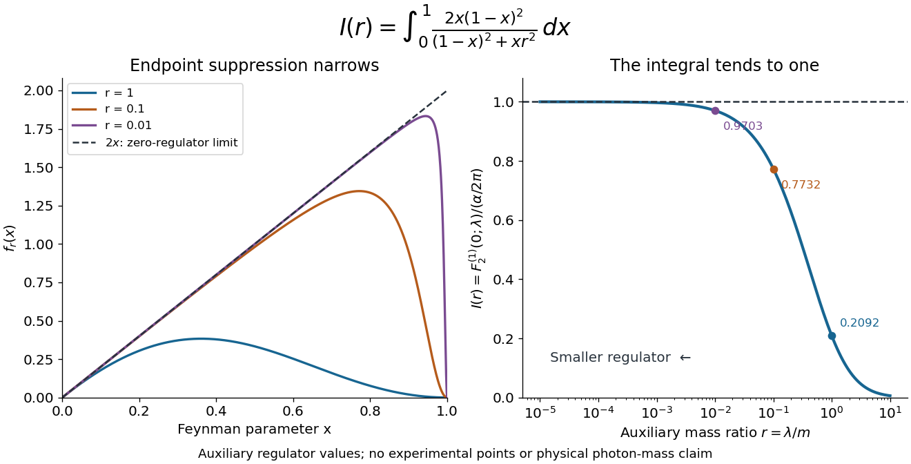

# Perturbative quantum field theory

↑ **Parent:** [Quantum field theory](quantum-field-theory.md)

**Table of contents**

- [Hermitian matrix model](#hermitian-matrix-model)
  - [Matrix diagonalization ghost determinant](#matrix-diagonalization-ghost-determinant)
  - [Quartic Hermitian matrix two-point function](#quartic-hermitian-matrix-two-point-function)
- [Radiative correction](#radiative-correction)
- [Perturbation series](#perturbation-series)
  - [Weak coupling](#weak-coupling)
- [Dyson series](#dyson-series)
  - [Differentiation of the Dyson time-ordered exponential](#differentiation-of-the-dyson-time-ordered-exponential)
- [Wick's theorem](#wick-s-theorem)
  - [Two-field Wick contraction identity](#two-field-wick-contraction-identity)
  - [Two-field scalar Wick identity](#two-field-scalar-wick-identity)
  - [Inductive proof of the scalar Wick theorem](#inductive-proof-of-the-scalar-wick-theorem)
  - [Free scalar four-point function](#free-scalar-four-point-function)
  - [Vanishing odd correlators of a free Gaussian field](#vanishing-odd-correlators-of-a-free-gaussian-field)
  - [Time ordering](#time-ordering)
    - [Time-ordered exponential](#time-ordered-exponential)
      - [Magnus expansion](#magnus-expansion)
      - [Constant pulse-axis condition for removing time ordering](#constant-pulse-axis-condition-for-removing-time-ordering)
    - [Time-ordered product](#time-ordered-product)
  - [Normal ordering](#normal-ordering)
    - [Normally ordered density correlation](#normally-ordered-density-correlation)
      - [Coincident-point bunching factors](#coincident-point-bunching-factors)
      - [Three-point density correlation of an ideal quantum gas](#three-point-density-correlation-of-an-ideal-quantum-gas)
      - [Bosonic number-state corrections to Gaussian density correlations](#bosonic-number-state-corrections-to-gaussian-density-correlations)
    - [Normal and Weyl symbols of a harmonic oscillator](#normal-and-weyl-symbols-of-a-harmonic-oscillator)
    - [Normal-ordered product](#normal-ordered-product)
  - [Wick contraction](#wick-contraction)
- [Fermionic sign](#fermionic-sign)
  - [Antifermion sign of a normal-ordered bilinear](#antifermion-sign-of-a-normal-ordered-bilinear)
- [Wick rotation](#wick-rotation)
  - [Imaginary time](#imaginary-time)
  - [Euclidean action](#euclidean-action)
- [Generating functional](#generating-functional)
  - [Polynomial interactions as source differential operators](#polynomial-interactions-as-source-differential-operators)
  - [Source (quantum field theory)](#source-quantum-field-theory)
  - [Source differentiation inserts time-ordered field operators](#source-differentiation-inserts-time-ordered-field-operators)
  - [Normalized vacuum generating functional](#normalized-vacuum-generating-functional)
    - [Uniform-source vacuum functional and spacetime volume](#uniform-source-vacuum-functional-and-spacetime-volume)
    - [Vacuum source functional of a quantum oscillator](#vacuum-source-functional-of-a-quantum-oscillator)
  - [Connected generating functional](#connected-generating-functional)
    - [Centered four-point cumulant decomposition](#centered-four-point-cumulant-decomposition)
    - [Source renormalization of a scalar generating functional](#source-renormalization-of-a-scalar-generating-functional)
- [Feynman diagram](#feynman-diagram)
  - [Quark-flow diagram](#quark-flow-diagram)
  - [Effective hadronic vertex](#effective-hadronic-vertex)
  - [Feynman rules](#feynman-rules)
  - [Loop Feynman diagram](#loop-feynman-diagram)
  - [Feynman integral](#feynman-integral)
  - [Fermion flow](#fermion-flow)
  - [Box diagram](#box-diagram)
  - [Fermion loop](#fermion-loop)
    - [Yukawa fermion triangle](#yukawa-fermion-triangle)
      - [Cubic counterterm from a Yukawa fermion triangle](#cubic-counterterm-from-a-yukawa-fermion-triangle)
    - [Yukawa fermion box](#yukawa-fermion-box)
    - [Closed fermion loop sign](#closed-fermion-loop-sign)
  - [Disconnected Feynman diagram](#disconnected-feynman-diagram)
  - [Triangle Feynman diagram](#triangle-feynman-diagram)
    - [Scalar triangle Feynman integral](#scalar-triangle-feynman-integral)
  - [Supergraph](#supergraph)
  - [Box Feynman diagram](#box-feynman-diagram)
  - [Interaction vertex](#interaction-vertex)
  - [Squared-amplitude diagram](#squared-amplitude-diagram)
  - [Feynman rule](#feynman-rule)
    - [Scalar-field cubic and quartic Feynman vertices](#scalar-field-cubic-and-quartic-feynman-vertices)
    - [Four-leg vertex of a factorial-normalized scalar interaction](#four-leg-vertex-of-a-factorial-normalized-scalar-interaction)
    - [Feynman-diagram symmetry factor](#feynman-diagram-symmetry-factor)
    - [Feynman parameter](#feynman-parameter)
      - [Schwinger parameterization](#schwinger-parameterization)
  - [Vacuum Feynman diagram](#vacuum-feynman-diagram)
    - [Cancellation of vacuum bubbles](#cancellation-of-vacuum-bubbles)
    - [Vacuum energy](#vacuum-energy)
      - [Vacuum energy density](#vacuum-energy-density)
        - [Electromagnetic vacuum energy with a wavelength cutoff](#electromagnetic-vacuum-energy-with-a-wavelength-cutoff)
      - [Vacuum energy sign of a fermionic oscillator](#vacuum-energy-sign-of-a-fermionic-oscillator)
    - [Linked-cluster theorem](#linked-cluster-theorem)
  - [Tadpole diagram](#tadpole-diagram)
    - [Tadpole contribution to a cubic-theory two-point function](#tadpole-contribution-to-a-cubic-theory-two-point-function)
    - [Tadpole subtraction](#tadpole-subtraction)
  - [Bubble diagram](#bubble-diagram)
    - [Scalar bubble integral](#scalar-bubble-integral)
      - [Minimal-subtraction scalar four-point bubble channels](#minimal-subtraction-scalar-four-point-bubble-channels)
      - [Massless scalar bubble pole](#massless-scalar-bubble-pole)
  - [Sunset diagram](#sunset-diagram)
  - [Tree-level Feynman diagram](#tree-level-feynman-diagram)
    - [Distinguishable scalar scattering by a shared mediator](#distinguishable-scalar-scattering-by-a-shared-mediator)
  - [Loop order](#loop-order)
    - [Vertex-count bounds for bounded scalar valence](#vertex-count-bounds-for-bounded-scalar-valence)
    - [Planck-constant loop counting with source normalization](#planck-constant-loop-counting-with-source-normalization)
    - [Loop momentum](#loop-momentum)
  - [Connected Feynman diagram](#connected-feynman-diagram)
    - [One-particle-reducible Feynman diagram](#one-particle-reducible-feynman-diagram)
      - [Cubic-scalar exchange corrections at zero momentum](#cubic-scalar-exchange-corrections-at-zero-momentum)
    - [One-particle-irreducible Feynman diagram](#one-particle-irreducible-feynman-diagram)
      - [One-particle-irreducible correlation function](#one-particle-irreducible-correlation-function)
        - [One-particle-irreducible two-point vertex](#one-particle-irreducible-two-point-vertex)
        - [Amputation of external propagators](#amputation-of-external-propagators)
        - [Self-energy](#self-energy)
          - [Dyson resummation](#dyson-resummation)
          - [Fermion self-energy](#fermion-self-energy)
            - [Electron self-energy](#electron-self-energy)
            - [QED one-loop running-mass to pole-mass conversion](#qed-one-loop-running-mass-to-pole-mass-conversion)
          - [Pole mass](#pole-mass)
        - [Four-point one-particle-irreducible correlation function](#four-point-one-particle-irreducible-correlation-function)
          - [Derivative expansion of a four-point vertex](#derivative-expansion-of-a-four-point-vertex)
- [Schwinger-Dyson equation](#schwinger-dyson-equation)
- [LSZ reduction formula](#lsz-reduction-formula)
  - [Asymptotic scalar field](#asymptotic-scalar-field)
- [Equivalence theorem for field redefinitions](#equivalence-theorem-for-field-redefinitions)
  - [Field redefinition](#field-redefinition)
    - [Redundant operator](#redundant-operator)
- [Effective action](#effective-action)
  - [Vacuum-normalized effective action of a free scalar field](#vacuum-normalized-effective-action-of-a-free-scalar-field)
  - [Minkowski inverse-Hessian relation for an effective action](#minkowski-inverse-hessian-relation-for-an-effective-action)
  - [Logarithmic-source inverse-kernel vertices](#logarithmic-source-inverse-kernel-vertices)
  - [Quantum effective potential](#quantum-effective-potential)
    - [One-loop scalar effective potential](#one-loop-scalar-effective-potential)
      - [Quartic closure of scalar effective-potential counterterms](#quartic-closure-of-scalar-effective-potential-counterterms)
  - [Background gauge invariance of a scalar effective action](#background-gauge-invariance-of-a-scalar-effective-action)
  - [One-particle-irreducible vertex](#one-particle-irreducible-vertex)
    - [Three-point amputation in the connected-action convention](#three-point-amputation-in-the-connected-action-convention)
  - [Finite higher-point scalar vertex](#finite-higher-point-scalar-vertex)
  - [One-loop scalar effective action](#one-loop-scalar-effective-action)
    - [Gaussian fluctuation approximation](#gaussian-fluctuation-approximation)
      - [Quadratic fluctuation Hamiltonian](#quadratic-fluctuation-hamiltonian)
  - [Wilsonian effective action](#wilsonian-effective-action)
    - [Polchinski equation](#polchinski-equation)
    - [Wilsonian rescaling of a scalar coupling](#wilsonian-rescaling-of-a-scalar-coupling)
    - [Connected shell-contraction expansion](#connected-shell-contraction-expansion)
      - [Momentum-support exclusion for Wilsonian bridge diagrams](#momentum-support-exclusion-for-wilsonian-bridge-diagrams)
    - [Momentum-shell decomposition of a scalar field](#momentum-shell-decomposition-of-a-scalar-field)
- [Renormalization](#renormalization)
  - [Renormalization of spontaneously broken gauge theories](#renormalization-of-spontaneously-broken-gauge-theories)
    - [Massive-vector propagators at large momentum](#massive-vector-propagators-at-large-momentum)
    - [Local subtraction with a sharp momentum cutoff](#local-subtraction-with-a-sharp-momentum-cutoff)
    - [From renormalizability to electroweak predictions](#from-renormalizability-to-electroweak-predictions)
  - [Bare coupling](#bare-coupling)
  - [Bare mass](#bare-mass)
  - [Renormalization scheme](#renormalization-scheme)
  - [Running mass](#running-mass)
    - [Renormalization-group mass suppression criterion](#renormalization-group-mass-suppression-criterion)
  - [Zero-momentum renormalized mass](#zero-momentum-renormalized-mass)
  - [Renormalizable quantum field theory](#renormalizable-quantum-field-theory)
  - [Counterterm](#counterterm)
    - [Counterterm closure](#counterterm-closure)
      - [Counterterm closure of a massive Yukawa theory](#counterterm-closure-of-a-massive-yukawa-theory)
    - [Mass counterterm](#mass-counterterm)
  - [Renormalization condition](#renormalization-condition)
    - [Renormalized coupling](#renormalized-coupling)
    - [Momentum-subtraction scheme](#momentum-subtraction-scheme)
    - [On-shell renormalization scheme](#on-shell-renormalization-scheme)
  - [Callan-Symanzik equation](#callan-symanzik-equation)
    - [Massless renormalization-group characteristics with a source](#massless-renormalization-group-characteristics-with-a-source)
    - [Characteristic solution of the massless Callan-Symanzik equation](#characteristic-solution-of-the-massless-callan-symanzik-equation)
    - [Renormalization-group characteristic solution for a two-point function](#renormalization-group-characteristic-solution-for-a-two-point-function)
      - [Logarithmic two-point scaling at a cubic asymptotically free beta function](#logarithmic-two-point-scaling-at-a-cubic-asymptotically-free-beta-function)
    - [Characteristic solution of the multiplicative Callan-Symanzik equation](#characteristic-solution-of-the-multiplicative-callan-symanzik-equation)
    - [Callan-Symanzik equation with additive renormalization](#callan-symanzik-equation-with-additive-renormalization)
  - [Continuum limit of a quantum field theory](#continuum-limit-of-a-quantum-field-theory)
    - [Asymptotic safety](#asymptotic-safety)
    - [Quantum triviality](#quantum-triviality)
  - [Renormalization scale](#renormalization-scale)
    - [Principle of minimal sensitivity](#principle-of-minimal-sensitivity)
      - [One-loop stationary scale for the hadronic annihilation correction](#one-loop-stationary-scale-for-the-hadronic-annihilation-correction)
    - [Running coupling](#running-coupling)
      - [Two-loop asymptotic running coupling](#two-loop-asymptotic-running-coupling)
      - [One-loop inverse gauge coupling evolution](#one-loop-inverse-gauge-coupling-evolution)
      - [One-loop running of the strong coupling](#one-loop-running-of-the-strong-coupling)
        - [Infrared limitations of one-loop QCD running](#infrared-limitations-of-one-loop-qcd-running)
        - [Matching the QCD scale across a quark threshold](#matching-the-qcd-scale-across-a-quark-threshold)
      - [Landau pole](#landau-pole)
        - [Higgs self-coupling Landau-pole bound](#higgs-self-coupling-landau-pole-bound)
      - [Beta function (physics)](#beta-function-physics)
        - [Spectator multiplicities in gauge beta functions](#spectator-multiplicities-in-gauge-beta-functions)
        - [Gauge-coupling beta function in logarithmic squared scale](#gauge-coupling-beta-function-in-logarithmic-squared-scale)
        - [Engineering term in a dimensionally continued beta function](#engineering-term-in-a-dimensionally-continued-beta-function)
        - [Standard Model one-loop gauge coefficients](#standard-model-one-loop-gauge-coefficients)
        - [Nonzero ultraviolet fixed point of a cubic-quintic beta function](#nonzero-ultraviolet-fixed-point-of-a-cubic-quintic-beta-function)
        - [Two-loop inverse-coupling logarithmic remainder](#two-loop-inverse-coupling-logarithmic-remainder)
        - [Asymptotic freedom](#asymptotic-freedom)
          - [Banks-Zaks fixed point](#banks-zaks-fixed-point)
          - [Logarithmic two-point scaling from a cubic beta function](#logarithmic-two-point-scaling-from-a-cubic-beta-function)
          - [Strong-coupling scale](#strong-coupling-scale)
            - [Dimensional transmutation](#dimensional-transmutation)
          - [One-loop QCD antiscreening](#one-loop-qcd-antiscreening)
          - [Calibrated one-loop QCD evolution](#calibrated-one-loop-qcd-evolution)
          - [From deep inelastic scaling to asymptotic freedom](#from-deep-inelastic-scaling-to-asymptotic-freedom)
          - [Discovery of asymptotic freedom and the 2004 Nobel Prize](#discovery-of-asymptotic-freedom-and-the-2004-nobel-prize)
      - [Gauge coupling unification](#gauge-coupling-unification)
        - [One-loop normalized hypercharge unification](#one-loop-normalized-hypercharge-unification)
        - [SU(5) grand unified theory](#su-5-grand-unified-theory)
          - [Doublet-triplet splitting](#doublet-triplet-splitting)
          - [Monopole core and mass scales in an SU(5) transition](#monopole-core-and-mass-scales-in-an-su-5-transition)
          - [One-loop SU(5) prediction with common flavor coefficients](#one-loop-su-5-prediction-with-common-flavor-coefficients)
  - [Wave-function renormalization](#wave-function-renormalization)
    - [Canonical field normalization](#canonical-field-normalization)
  - [Charge renormalization](#charge-renormalization)
    - [Pure Yang-Mills one-loop beta function](#pure-yang-mills-one-loop-beta-function)
    - [Background gauge-field renormalization identity](#background-gauge-field-renormalization-identity)
    - [Adjoint Dirac contribution to the Yang-Mills beta function](#adjoint-dirac-contribution-to-the-yang-mills-beta-function)
      - [Integer obstruction to one-loop marginality with adjoint Dirac fermions](#integer-obstruction-to-one-loop-marginality-with-adjoint-dirac-fermions)
  - [Regularization in quantum field theory](#regularization-in-quantum-field-theory)
    - [Ultraviolet divergence](#ultraviolet-divergence)
      - [Ultraviolet subdivergence](#ultraviolet-subdivergence)
    - [Cutoff regularization](#cutoff-regularization)
    - [Dimensional regularization](#dimensional-regularization)
      - [Euclidean massive loop integral](#euclidean-massive-loop-integral)
        - [Massive scalar bubble pole in four dimensions](#massive-scalar-bubble-pole-in-four-dimensions)
      - [Minimal subtraction scheme](#minimal-subtraction-scheme)
        - [Simple-pole formulas for minimal-subtraction renormalization group functions](#simple-pole-formulas-for-minimal-subtraction-renormalization-group-functions)
      - [Modified minimal subtraction scheme](#modified-minimal-subtraction-scheme)
- [Quantum electrodynamics](#quantum-electrodynamics)
  - [Pair production](#pair-production)
    - [Electron-induced pair-production threshold](#electron-induced-pair-production-threshold)
    - [Photon-photon pair production](#photon-photon-pair-production)
      - [Blackbody-peak photon pair-production estimate](#blackbody-peak-photon-pair-production-estimate)
  - [Cavity quantum electrodynamics](#cavity-quantum-electrodynamics)
    - [Dispersive atom-cavity coupling](#dispersive-atom-cavity-coupling)
  - [Electron electromagnetic vertex form factors](#electron-electromagnetic-vertex-form-factors)
  - [Schwinger correction to the electron magnetic moment](#schwinger-correction-to-the-electron-magnetic-moment)
    - [Regulator limit of the one-loop magnetic form factor](#regulator-limit-of-the-one-loop-magnetic-form-factor)
    - [Finite precision tests of the leading electron anomaly](#finite-precision-tests-of-the-leading-electron-anomaly)
  - [Complementary formulations of renormalized QED](#complementary-formulations-of-renormalized-qed)
  - [Electron-positron annihilation into two photons](#electron-positron-annihilation-into-two-photons)
  - [Muon-antimuon annihilation into two photons](#muon-antimuon-annihilation-into-two-photons)
  - [Fine-structure constant](#fine-structure-constant)
  - [Minimal electromagnetic coupling of a Dirac field](#minimal-electromagnetic-coupling-of-a-dirac-field)
    - [Gauge covariance of the charged Dirac equation](#gauge-covariance-of-the-charged-dirac-equation)
  - [Electron-positron annihilation into a muon pair](#electron-positron-annihilation-into-a-muon-pair)
  - [QED Feynman rules](#qed-feynman-rules)
    - [Vertex parity of a QED amplitude](#vertex-parity-of-a-qed-amplitude)
    - [Electron-positron annihilation into a quark pair](#electron-positron-annihilation-into-a-quark-pair)
  - [Bhabha scattering](#bhabha-scattering)
  - [Pauli term](#pauli-term)
  - [Vacuum polarization](#vacuum-polarization)
    - [Photon vacuum polarization](#photon-vacuum-polarization)
      - [Hadronic electromagnetic-current spectral density](#hadronic-electromagnetic-current-spectral-density)
  - [Perturbative interactions in scalar electrodynamics](#perturbative-interactions-in-scalar-electrodynamics)
    - [Scalar particle-antiparticle tree scattering](#scalar-particle-antiparticle-tree-scattering)
    - [Scalar electrodynamics three-point vertex](#scalar-electrodynamics-three-point-vertex)
    - [Seagull vertex](#seagull-vertex)
  - [Ward identity](#ward-identity)
    - [Three-photon fermion Ward identity](#three-photon-fermion-ward-identity)
    - [Proper-vertex Ward-Takahashi identity in QED](#proper-vertex-ward-takahashi-identity-in-qed)
      - [Ward identity for QED renormalization constants](#ward-identity-for-qed-renormalization-constants)
    - [Two-photon fermion Ward identity](#two-photon-fermion-ward-identity)
    - [Ward identity contact terms](#ward-identity-contact-terms)
    - [Scalar quantum electrodynamics Ward identity](#scalar-quantum-electrodynamics-ward-identity)
      - [Two-photon scalar Ward identity](#two-photon-scalar-ward-identity)
    - [Soft photon theorem](#soft-photon-theorem)
- [Power counting in quantum field theory](#power-counting-in-quantum-field-theory)
  - [Truncation error in effective field theory](#truncation-error-in-effective-field-theory)
  - [Mass dimension](#mass-dimension)
    - [Engineering dimensions of relativistic fields](#engineering-dimensions-of-relativistic-fields)
  - [Superficial degree of divergence](#superficial-degree-of-divergence)
    - [Monomial scalar interaction power-counting identity](#monomial-scalar-interaction-power-counting-identity)
    - [A superficially convergent graph can have a divergent subgraph](#a-superficially-convergent-graph-can-have-a-divergent-subgraph)
    - [Derivative-interaction scalar power counting](#derivative-interaction-scalar-power-counting)
    - [Scalar graph power-counting identity](#scalar-graph-power-counting-identity)
  - [Marginal coupling](#marginal-coupling)
  - [Relevant coupling](#relevant-coupling)
  - [Irrelevant coupling](#irrelevant-coupling)
    - [Nonrenormalizable interaction](#nonrenormalizable-interaction)

## Hermitian matrix model

↑ **Parent:** [Perturbative quantum field theory](perturbative-quantum-field-theory.md)

A [Hermitian matrix model](#hermitian-matrix-model) replaces a spacetime field by a finite-dimensional [Hermitian matrix](hilbert-space.md#hermitian-operator). Its normalized integral supplies correlation functions and a zero-dimensional [perturbative quantum field theory](perturbative-quantum-field-theory.md) expansion. For an action built from [traces](linear-algebra.md#matrix-trace) of matrix powers, [unitary matrix](linear-operator-theory.md#unitary-matrix) conjugation is a symmetry and the [eigenvalues](linear-operator-theory.md#eigenvalue) describe the invariant degrees of freedom. A quartic real integral needs a nonnegative highest-order coupling for convergence; a formal power series can be studied independently of this convergence issue.

### Matrix diagonalization ghost determinant

↑ **Parent:** [Hermitian matrix model](#hermitian-matrix-model)

Imposing vanishing off-diagonal entries with auxiliary integrations and an off-diagonal [Grassmann Gaussian integral](quantum-field-theory.md#grassmann-gaussian-integral) gives a determinant of the commutator map on the off-diagonal matrix units. Its eigenvalues are $\lambda_i-\lambda_j$, $i\ne j$. Up to a constant sign, their product is the squared [Vandermonde determinant](galois-theory.md#vandermonde-determinant). It contributes $-2\sum_{i<j}\log|\lambda_i-\lambda_j|$ to the eigenvalue action, encoding repulsion between distinct [eigenvalues](linear-operator-theory.md#eigenvalue). Diagonal zero modes and constant normalization factors must be treated separately.

### Quartic Hermitian matrix two-point function

↑ **Parent:** [Hermitian matrix model](#hermitian-matrix-model)

For $S=a\operatorname{tr}(M^2)/2+b\operatorname{tr}(M^4)/4$ with $a>0$, the [Wick theorem](#wick-s-theorem) gives

$$
\langle M^i{}_jM^k{}_l\rangle_c
=\frac1a\delta^i{}_l\delta^k{}_j-\frac b{a^3}\left(2N\delta^i{}_l\delta^k{}_j+\delta^i{}_j\delta^k{}_l\right)+O(b^2).
$$

There are eight adjacent external-attachment contractions with one free matrix-index sum and four opposite attachments with no free sum. The second tensor structure is needed at finite $N$; omitting it is an additional large-$N$ approximation, not merely restricting to [connected Feynman diagrams](#connected-feynman-diagram).

## Radiative correction

↑ **Parent:** [Perturbative quantum field theory](perturbative-quantum-field-theory.md)

A radiative correction is a quantum correction beyond the classical or tree approximation, represented in [perturbative quantum field theory](perturbative-quantum-field-theory.md) by [Feynman diagrams](#feynman-diagram) of positive [loop order](#loop-order). Such corrections can alter a [scalar potential](classical-field-theory.md#scalar-potential) and its derivatives; symmetries and [renormalization](#renormalization) constrain which changes are allowed.

## Perturbation series

↑ **Parent:** [Perturbative quantum field theory](perturbative-quantum-field-theory.md)

A perturbation series expands a correlation function or scattering amplitude in powers of interaction couplings. In quantum field theory it is commonly asymptotic because diagram counts grow factorially and nonperturbative effects are invisible to every finite order.

### Weak coupling

↑ **Parent:** [Perturbation series](#perturbation-series)

[Weak coupling](#weak-coupling) means a suitably dimensionless interaction strength is small. In [BCS theory](fermi-liquid.md#bcs-theory), $\nu_sV\ll1$ gives a gap exponentially small compared with the pairing-shell energy cutoff; the expansion parameter is not the dimensional quantity $V$ alone.

## Dyson series

↑ **Parent:** [Perturbative quantum field theory](perturbative-quantum-field-theory.md)  
ⓦ [Wiki](https://en.wikipedia.org/wiki/Dyson_series)

The Dyson series expands the interaction-picture time-evolution operator as

$$
S=T\exp\!\left(-i\int d^4x\,\mathcal H_{\mathrm{int}}(x)\right)
=\sum_{n\geq0}\frac{(-i)^n}{n!}\int d^4x_1\cdots d^4x_n\,T\!\left\{\prod_{j=1}^n\mathcal H_{\mathrm{int}}(x_j)\right\}.
$$

### Differentiation of the Dyson time-ordered exponential

↑ **Parent:** [Dyson series](#dyson-series)

For bounded norm-continuous [Hamiltonian operators](quantum-system.md#hamiltonian-quantum-mechanics) on $[t_0,t]$, the [Dyson series](#dyson-series) has an $n$-th term bounded by $M^n|t-t_0|^n/n!$, so it converges in operator norm. In its nested-integral form, differentiating the outer endpoint puts $H_I(t)$ on the left of the $(n-1)$-fold term. Summing yields $\partial_tU=-iH_I(t)U$ and $U(t_0,t_0)=I$. If $H_I$ is Hermitian, differentiating $U^\dagger U$ proves unitarity. For unbounded field operators the same algebra is a formal perturbative identity unless domain and convergence assumptions or a regulator justify the steps. Evolution backward uses inverse, anti-time-ordered evolution.

<h2 id="wick-s-theorem">Wick's theorem</h2>

↑ **Parent:** [Perturbative quantum field theory](perturbative-quantum-field-theory.md)  
ⓦ [Wiki](https://en.wikipedia.org/wiki/Wick's_theorem)

Wick theorem expresses a time-ordered product of free fields as its normal-ordered product plus the sum over every possible contraction. It turns the [Dyson series](#dyson-series) into [Feynman diagrams](#feynman-diagram).

### Two-field Wick contraction identity

↑ **Parent:** [Wick's theorem](#wick-s-theorem)

Split a free scalar field into its annihilation and creation parts. For $x^0>y^0$, changing the product into [normal ordering](#normal-ordering) adds $[\phi^{(+)}(x),\phi^{(-)}(y)]$, the positive-frequency two-point function. For the opposite ordering interchange the two points. Their combination is the [Feynman propagator](quantum-field-theory.md#feynman-propagator), equal to the vacuum expectation of the [time-ordered product](#time-ordered-product). Iterating this identity gives the scalar [Wick theorem](#wick-s-theorem).

### Two-field scalar Wick identity

↑ **Parent:** [Wick's theorem](#wick-s-theorem)

For a free real [scalar field](classical-field-theory.md#scalar-field), split $\phi=\phi^{(+)}+\phi^{(-)}$ into annihilation and creation parts. Moving the creation operators left gives $\phi(x)\phi(y)=:\phi(x)\phi(y):+[\phi^{(+)}(x),\phi^{(-)}(y)]$. The [commutator](lie-algebra.md#commutator) is the [Wightman function](quantum-field-theory.md#wightman-function). Choosing either time order gives the displayed identity with the [Feynman propagator](quantum-field-theory.md#feynman-propagator). It is an identity of [operator-valued distributions](quantum-field-theory.md#operator-valued-distribution); coincident-point products need a suitable prescription.

### Inductive proof of the scalar Wick theorem

↑ **Parent:** [Wick's theorem](#wick-s-theorem)

Split each free [real scalar field](scalar-field-theory.md#real-scalar-field) as $\phi=\phi^{(-)}+\phi^{(+)}$, into creation and annihilation parts. For chronologically ordered arguments, the first field has the latest time. Multiplying it into a [normal-ordered product](#normal-ordered-product) of the remaining fields gives

$$
\phi_1:\!\prod_{r\in I}\phi_r\!:
=:\!\phi_1\prod_{r\in I}\phi_r\!:
+\sum_{j\in I}[\phi_1^{(+)},\phi_j^{(-)}]:\!\prod_{r\in I\setminus\{j\}}\phi_r\!:.
$$

This follows by commuting the annihilation part through each creation part; each [commutator](lie-algebra.md#commutator) is a scalar, and all creation parts commute among themselves, as do all annihilation parts. The scalar commutator is the [Feynman propagator](quantum-field-theory.md#feynman-propagator) for the chronological pair. Induction on the number of fields therefore lists every partial pairing exactly once: either field 1 remains unpaired or it pairs with one $j$. This proves the [Wick theorem](#wick-s-theorem) for free bosonic fields, including the empty pairing. Vacuum expectation retains only complete pairings. The identities are understood for regulated or smeared [operator-valued distributions](quantum-field-theory.md#operator-valued-distribution).

### Free scalar four-point function

↑ **Parent:** [Wick's theorem](#wick-s-theorem)

For a centered free [real scalar field](scalar-field-theory.md#real-scalar-field), its vacuum [time-ordered product](#time-ordered-product) has expectation $\langle T\phi_1\phi_2\phi_3\phi_4\rangle=G_{12}G_{34}+G_{13}G_{24}+G_{14}G_{23}$, where $G_{ij}$ is the [Feynman propagator](quantum-field-theory.md#feynman-propagator) between insertions $i,j$. These are the three complete pairings in the [Wick theorem](#wick-s-theorem). All remaining [normal-ordered products](#normal-ordered-product) have zero vacuum expectation. No fermionic interchange signs occur for a bosonic field.

### Vanishing odd correlators of a free Gaussian field

↑ **Parent:** [Wick's theorem](#wick-s-theorem)

A centered free field in a Gaussian vacuum has only pair contractions, so every odd correlator vanishes by [Wick theorem](#wick-s-theorem). Equivalently, number parity reverses the field while preserving the vacuum. This statement applies to smeared or regulated fields; it does not assert that unregulated coincident products exist. Interactions or a nonzero field mean can invalidate it.

### Time ordering

↑ **Parent:** [Wick's theorem](#wick-s-theorem)  
ⓦ [Wiki](https://en.wikipedia.org/wiki/Time_ordering)

Time ordering places operators with later time arguments to the left. Interchanging fermionic operators also contributes the sign of the required permutation.

#### Time-ordered exponential

↑ **Parent:** [Time ordering](#time-ordering)

The time-ordered exponential solves $i\hbar\partial_tU=H(t)U$ with initial condition $U(t_0,t_0)=I$. Its expansion is the [Dyson series](#dyson-series). For bounded continuous [Hamiltonian operators](quantum-system.md#hamiltonian-quantum-mechanics) the series converges, as in [differentiation of the Dyson time-ordered exponential](#differentiation-of-the-dyson-time-ordered-exponential). If the generators commute at all times, time ordering is unnecessary and an ordinary operator exponential suffices.

##### Magnus expansion

↑ **Parent:** [Time-ordered exponential](#time-ordered-exponential)  
ⓦ [Wiki](https://en.wikipedia.org/wiki/Magnus_expansion)

For $\dot U=A(t)U$ and $U(0)=I$, the Magnus expansion writes the logarithm of the propagator as iterated integrals of [commutators](lie-algebra.md#commutator). Its first terms are $\Omega_1=\int_0^TA(t)dt$ and $\Omega_2=\tfrac12\int_0^Tdt\int_0^tds\,[A(t),A(s)]$. For a [Quantum Hamiltonian](quantum-system.md#hamiltonian-quantum-mechanics), $A=-iH/\hbar$, so a noncommuting time-dependent control has corrections beyond the exponential of its integrated [Quantum Hamiltonian](quantum-system.md#hamiltonian-quantum-mechanics). This formula is a local convergent expansion under suitable smallness conditions, or a formal expansion; it must not be assumed globally convergent for arbitrary pulse durations.

##### Constant pulse-axis condition for removing time ordering

↑ **Parent:** [Time-ordered exponential](#time-ordered-exponential)

For $H(t)=\Omega_1(t)A+\Omega_2(t)B$ with fixed noncommuting [Hermitian operators](hilbert-space.md#hermitian-operator), $[H(t),H(s)]=[\Omega_1(t)\Omega_2(s)-\Omega_2(t)\Omega_1(s)][A,B]$. A constant ratio of the envelopes is sufficient to remove [time ordering](#time-ordering). Independently changing that ratio generally produces [commutator](lie-algebra.md#commutator) corrections in the [Magnus expansion](#magnus-expansion), and a product of successive pulses need not equal the exponential of their summed areas.

#### Time-ordered product

↑ **Parent:** [Time ordering](#time-ordering)

A [time-ordered product](#time-ordered-product) sorts operator insertions from latest time on the left to earliest time on the right. Reordering odd [fermionic operators](supersymmetric-quantum-mechanics.md#fermionic-operator) contributes the sign of their permutation. For bosonic $A,B$, $T[A(t)B(t')]=\theta(t-t')A(t)B(t')+\theta(t'-t)B(t')A(t)$. Vacuum expectations of free [time-ordered products](#time-ordered-product) are evaluated by the [Wick theorem](#wick-s-theorem).

### Normal ordering

↑ **Parent:** [Wick's theorem](#wick-s-theorem)  
ⓦ [Wiki](https://en.wikipedia.org/wiki/Normal_ordering)

Normal ordering places creation operators to the left of annihilation operators. For free fields it removes vacuum self-contractions from a composite operator.

#### Normally ordered density correlation

↑ **Parent:** [Normal ordering](#normal-ordering)

This correlation counts distinct detection events without the delta-function self-counting term in an un-ordered product of densities. It is nonnegative as the expectation of $A^\dagger A$ with $A=\psi_n\cdots\psi_1$. For a single occupied bosonic mode with sharp occupation $N$, the coincident $n$-point value contains the [falling factorial](combinatorics.md#falling-factorial) $N(N-1)\cdots(N-n+1)$, rather than $N^n$.

##### Coincident-point bunching factors

↑ **Parent:** [Normally ordered density correlation](#normally-ordered-density-correlation)

A single-component chaotic Gaussian bosonic field has normalized coincident normally ordered correlation $n!$: every pairing contributes the same product of densities. A same-component fermionic field instead has zero coincident correlations for $n\geq2$ by exclusion. These are state-dependent statements: a coherent bosonic field has factor one, and a single-mode [number state](quantum-harmonic-oscillator.md#number-state) has $N^{\underline n}/N^n$. Ratios to distant unnormalized correlations additionally require the compared densities to agree and distant correlations to factorize.

##### Three-point density correlation of an ideal quantum gas

↑ **Parent:** [Normally ordered density correlation](#normally-ordered-density-correlation)

For a number-conserving Gaussian pairing state, six [permutations](combinatorics.md#permutation) give this expression. Each [transposition](combinatorics.md#transposition-permutation) has sign $\epsilon$, positive for [bosons](tensor-product-of-quantum-systems.md#boson) and negative for [fermions](tensor-product-of-quantum-systems.md#fermion); the two three-cycles have positive sign for either statistics. Equivalently it is the permanent or [determinant](multilinear-algebra.md#determinant) of the three-by-three [one-body density matrix](density-matrix.md#one-body-density-matrix). For bosonic [number states](quantum-harmonic-oscillator.md#number-state), repeated-mode [factorial](combinatorics.md#factorial) corrections must be included instead of assuming that [Wick theorem](#wick-s-theorem).

##### Bosonic number-state corrections to Gaussian density correlations

↑ **Parent:** [Normally ordered density correlation](#normally-ordered-density-correlation)

For a product of bosonic [number states](quantum-harmonic-oscillator.md#number-state), direct and exchange contractions correctly count distinct modes. They overcount repeated-mode terms because $\langle a^{\dagger2}a^2\rangle=N(N-1)$, while [Wick theorem](#wick-s-theorem) would give $2N^2$. Subtracting the excess yields the displayed exact two-point correction. At higher order the occupation decrements carry [falling factorials](combinatorics.md#falling-factorial). This distinction is essential when comparing a fixed-number condensate with independent thermal modes.

#### Normal and Weyl symbols of a harmonic oscillator

↑ **Parent:** [Normal ordering](#normal-ordering)

For the [quantum harmonic oscillator](quantum-harmonic-oscillator.md) $H=\hbar\omega(a^\dagger a+1/2)$, its normal symbol is $H_N=\hbar\omega(\bar\psi\psi+1/2)$. The [Weyl ordering](quantum-mechanics.md#weyl-ordering) symbol of $a^\dagger a$ is $\bar\psi\psi-1/2$, so $H_W=\hbar\omega\bar\psi\psi=p^2/(2m)+m\omega^2q^2/2$. Switching from adjacent-label [coherent-state time slicing](quantum-field-theory.md#coherent-state-time-slicing) to a midpoint [phase-space path integral](quantum-field-theory.md#phase-space-path-integral) must retain this ordering correction. Both correctly normalized constructions give the [thermal partition function of a quantum harmonic oscillator](quantum-harmonic-oscillator.md#thermal-partition-function-of-a-quantum-harmonic-oscillator) $Z=[2\sinh(\beta\hbar\omega/2)]^{-1}$; retaining the normal-symbol constant after switching prescriptions would count the zero-point shift twice.

#### Normal-ordered product

↑ **Parent:** [Normal ordering](#normal-ordering)

A [normal-ordered product](#normal-ordered-product) of free-field oscillator operators places all [creation operators](quantum-harmonic-oscillator.md#creation-operator) to the left of all [annihilation operators](quantum-harmonic-oscillator.md#annihilation-operator), including the [fermionic sign](#fermionic-sign) required to reorder fermions. Its vacuum expectation vanishes if any nontrivial oscillator factors remain. The [Wick theorem](#wick-s-theorem) expresses a free-field [time-ordered product](#time-ordered-product) through these products and all [Wick contractions](#wick-contraction).

### Wick contraction

↑ **Parent:** [Wick's theorem](#wick-s-theorem)

A Wick contraction replaces a selected pair of free fields by their two-point function. Summing pairings computes Gaussian correlation functions and supplies the propagator lines and combinatorial factors of a [Feynman diagram](#feynman-diagram).

## Fermionic sign

↑ **Parent:** [Perturbative quantum field theory](perturbative-quantum-field-theory.md)

A fermionic sign is a factor $-1$ produced whenever two Grassmann-odd fields or fermionic creation and annihilation operators are interchanged. Relative signs between diagrams must be computed after putting every external fermion operator into one common order.

### Antifermion sign of a normal-ordered bilinear

↑ **Parent:** [Fermionic sign](#fermionic-sign)

In a [Dirac field](relativistic-quantum-field.md#dirac-field) mode expansion, the antiparticle contribution to $\bar\psi\Gamma\psi$ first appears with operator order $dd^\dagger$. [Normal ordering](#normal-ordering) changes it to $-d^\dagger d$ using the fermionic anticommutation relations. Thus its scattering coefficient is $-\bar v_{\rm in}\Gamma v_{\rm out}$. Pair-annihilation and creation terms have the operator orders $db$ and $b^\dagger d^\dagger$. Keeping these orders and a fixed external-state convention determines interference signs, especially between exchange and annihilation graphs in a [Yukawa interaction](standard-model.md#yukawa-interaction).

## Wick rotation

↑ **Parent:** [Perturbative quantum field theory](perturbative-quantum-field-theory.md)  
ⓦ [Wiki](https://en.wikipedia.org/wiki/Wick_rotation)

A Wick rotation deforms a time or energy contour from real to imaginary values, converting suitable Minkowski integrals into Euclidean integrals while respecting pole prescriptions.

### Imaginary time

↑ **Parent:** [Wick rotation](#wick-rotation)

Analytic continuation from real [time](classical-mechanics.md#time-in-physics) to $t=-i\tau$ turns unitary evolution into $e^{-\tau H/\hbar}$. A [thermal trace](canonical-ensemble.md#thermal-trace) has extent $\beta\hbar$, or $\beta$ when $\hbar=1$. This converts oscillatory [action](lagrangian-mechanics.md#action) phases into an [Euclidean path integral](quantum-field-theory.md#euclidean-path-integral) where convergence permits it; it is not the actual laboratory [time](classical-mechanics.md#time-in-physics) of a dissipative process.

### Euclidean action

↑ **Parent:** [Wick rotation](#wick-rotation)

A [Wick rotation](#wick-rotation) from real time to imaginary time replaces the oscillatory weight $e^{iS}$ by $e^{-S_E}$. For a real scalar with positive kinetic normalization, $S_E=\int[\tfrac12(\partial\phi)^2+V(\phi)]\,d^dx$. Positivity of its kinetic term does not ensure convergence if the potential is unbounded below. Fermionic integrals instead use independent [Grassmann fields](quantum-field-theory.md#grassmann-field) and need not define a positive measure.

## Generating functional

↑ **Parent:** [Perturbative quantum field theory](perturbative-quantum-field-theory.md)  
ⓦ [Wiki](https://en.wikipedia.org/wiki/Generating_functional)

A generating functional is a [path integral](quantum-field-theory.md#path-integral) with a source $J$ coupled to a field. Its [functional derivatives](calculus-of-variations.md#functional-derivative) with respect to $J$ generate time-ordered correlation functions.

### Polynomial interactions as source differential operators

↑ **Parent:** [Generating functional](#generating-functional)

In a finite-dimensional integral, $u_i e^{b\cdot u}=\partial_{b_i}e^{b\cdot u}$. Expand $e^{V(u)}$ as a formal perturbation series to obtain $\int du\,e^{-u^TAu/2+b\cdot u+V(u)}=e^{V(\partial_b)}I_0(b)$. With a finite-mode regulator, a Minkowski source insertion satisfies $\phi(x)e^{i\int J\phi}=(1/i)\delta e^{i\int J\phi}/\delta J(x)$; this gives the displayed interacting [generating functional](#generating-functional). The substitution is a perturbative differential-operator identity, not an assertion that the interaction exponential defines a convergent series. Divide the resulting functional by $Z[0]$ for normalized [correlation functions](critical-phenomenon.md#correlation-function).

### Source (quantum field theory)

↑ **Parent:** [Generating functional](#generating-functional)

An external [source](#source-quantum-field-theory) is a prescribed field coupled to a dynamical field or operator in the action, for example $S_J=S_0+\int J_i(x)\phi_i(x)\,d^dx$. Functional derivatives of the [generating functional](#generating-functional) with respect to $J$ insert the corresponding fields into correlation functions. The source is varied to generate these insertions, rather than integrated over as a dynamical degree of freedom. Transforming it in the appropriate representation maintains an invariant source coupling when deriving a [Ward identity](#ward-identity).

### Source differentiation inserts time-ordered field operators

↑ **Parent:** [Generating functional](#generating-functional)

A [functional derivative](calculus-of-variations.md#functional-derivative) of the source term in a Minkowski [scalar field path integral](quantum-field-theory.md#scalar-field-path-integral) inserts $i\phi(x)$. Time-slicing identifies the resulting product with the [time-ordered product](#time-ordered-product) of field operators. Dividing by the zero-source vacuum functional removes disconnected vacuum diagrams. The normalized formula has one factor $1/i$ for every insertion.

### Normalized vacuum generating functional

↑ **Parent:** [Generating functional](#generating-functional)

For a vacuum [generating functional](#generating-functional) $Z[J]$, normalization gives $\widehat Z[J]=Z[J]/Z[0]$ and $\widehat Z[0]=1$. [Functional derivatives](calculus-of-variations.md#functional-derivative) of $\widehat Z$ give normalized [vacuum expectation values](quantum-field-theory.md#vacuum-expectation-value). The [linked-cluster theorem](#linked-cluster-theorem) shows that this ratio cancels [Vacuum Feynman diagrams](#vacuum-feynman-diagram), while $-i\log\widehat Z[J]$ gives connected correlators. Components attached to external insertions are not removed merely by the normalization.

#### Uniform-source vacuum functional and spacetime volume

↑ **Parent:** [Normalized vacuum generating functional](#normalized-vacuum-generating-functional)

A translation-invariant connected [generating functional](#generating-functional) with a constant [external source](#source-quantum-field-theory) is extensive in spacetime volume $\mathcal V_d$. Its total logarithm is dimensionless, while its density has [mass dimension](#mass-dimension) $d$. Consequently its dimensionless representation at fixed physical volume must retain $\mu^d\mathcal V_d$. For a free massive scalar with source coupling $\mu^{-\epsilon/2}h\phi$, [completing the square](polynomial.md#completing-the-square) gives $F=\mathcal V_d\mu^{-\epsilon}h^2/(2m^2)$. This already disproves a literal rewriting of the full uniform-source logarithm using only $\lambda,m^2/\mu^2,h/\mu^3$ at fixed volume. In infinite volume the total functional is generally infinite; use the density, a source of compact support, or an explicit volume regulator. After writing the density as $\mu^d f$, its [renormalization group](critical-phenomenon.md#renormalization-group) equation has the engineering term $+df$. Ultraviolet subtraction alone does not establish infrared finiteness for a massless constant source.

#### Vacuum source functional of a quantum oscillator

↑ **Parent:** [Normalized vacuum generating functional](#normalized-vacuum-generating-functional)

[Completing the square](polynomial.md#completing-the-square) in $S[q]=\tfrac12qKq+Jq$ with $K=-\partial_t^2-m^2+i\epsilon$ gives the displayed source factor, where $G=K^{-1}$. In the frequency convention $e^{i\omega t}$, $\widetilde G=(\omega^2-m^2+i\epsilon)^{-1}$ and $G(t)=-ie^{-im|t|}/(2m)$ for $m>0$. The physical time-ordered oscillator [quantum field theory propagator](quantum-field-theory.md#propagator) is $iG$. Sources are first taken as [test functions](distribution-theory.md#test-function) so the pairings are defined.

### Connected generating functional

↑ **Parent:** [Generating functional](#generating-functional)

The logarithm of a [generating functional](#generating-functional) generates connected correlation functions because its cumulant expansion removes products of disconnected vacuum components.

#### Centered four-point cumulant decomposition

↑ **Parent:** [Connected generating functional](#connected-generating-functional)

For a normalized Minkowski source functional $Z=e^{iW}$ with vanishing [one-point function](critical-phenomenon.md#one-point-correlation-function), $C_n=i^{1-n}\delta^nW/\delta J^n$ and

$$
G_{1234}=C_{1234}+C_{12}C_{34}+C_{13}C_{24}+C_{14}C_{23}.
$$

Differentiating $e^{iW}$ assigns the four labels to connected blocks. Blocks of size one vanish, leaving one block of four or one of the three pair partitions. Thus $G_4=iW_4-\sum W_2W_2$ in this source convention.

// Target: perturbative-quantum-field-theory.bigb

#### Source renormalization of a scalar generating functional

↑ **Parent:** [Connected generating functional](#connected-generating-functional)

For $d=4-\epsilon$, write the bare field as $\phi_0=Z^{1/2}\phi$ and the renormalized source coupling as $\mu^{-\epsilon/2}h\phi$. In bare variables this is $h_0\phi_0$, with the displayed source. At fixed bare parameters, the source running is $\mu\,d\log h/d\mu=\epsilon/2+\tfrac12\widehat\beta\,\partial_\lambda\log Z$. Normalizing the [generating functional](#generating-functional) by its zero-source value cancels source-independent vacuum diagrams and the constant measure factor from field rescaling. It does not remove source-dependent [ultraviolet divergences](#ultraviolet-divergence) or [infrared divergences](quantum-field-theory.md#infrared-divergence); the former require the ordinary field, mass and interaction [counterterms](#counterterm).

## Feynman diagram

↑ **Parent:** [Perturbative quantum field theory](perturbative-quantum-field-theory.md)  
ⓦ [Wiki](https://en.wikipedia.org/wiki/Feynman_diagram)

A Feynman diagram records a term in the perturbative expansion: edges represent propagators, vertices represent interactions, and loops represent unconstrained momentum integrals.

### Quark-flow diagram

↑ **Parent:** [Feynman diagram](#feynman-diagram)

A schematic tracking of valence [quark](standard-model.md#quark) and [antiquark](standard-model.md#antiquark) flavor through a hadronic process. It can explain flavor conservation and required pair creation without computing the nonperturbative [hadronization](standard-model.md#hadronization) amplitude. A complete elementary perturbative diagram contains additional interaction and color information.

### Effective hadronic vertex

↑ **Parent:** [Feynman diagram](#feynman-diagram)

A vertex written in terms of composite [hadron](physics.md#hadron) fields, with a coupling or form factor that summarizes unresolved [Quantum chromodynamics](standard-model.md#quantum-chromodynamics). For a strong [Delta baryon](physics.md#delta-baryon) decay, a $\Delta p\pi$ vertex describes the external channel but does not assert that the decay is perturbative at constituent-quark scales.

### Feynman rules

↑ **Parent:** [Feynman diagram](#feynman-diagram)

[Feynman rules](#feynman-rules) translate a [Feynman diagram](#feynman-diagram) into a contribution to a [scattering amplitude](quantum-scattering.md#scattering-amplitude) or correlation function in [perturbation theory](asymptotic-expansion.md#perturbation-theory). They specify factors for external states, interaction vertices, internal [propagators](quantum-field-theory.md#propagator), momentum-conservation constraints and loop integrals, with statistics-dependent signs and symmetry factors. For [quantum electrodynamics](#quantum-electrodynamics), a photon-fermion vertex contains the coupling $e$, while a photon propagator supplies an inverse squared four-momentum. The complete amplitude also contains currents, so propagator powers alone do not determine the energy dependence of a [scattering cross-section](quantum-scattering.md#scattering-cross-section).

### Loop Feynman diagram

↑ **Parent:** [Feynman diagram](#feynman-diagram)

A connected [loop Feynman diagram](#loop-feynman-diagram) has at least one independent internal [loop momentum](#loop-momentum). With $I$ internal lines and $V$ vertices, the number of independent loops is $L=I-V+1$. A [tree-level Feynman diagram](#tree-level-feynman-diagram) has $L=0$. A multi-leg amplitude generated by a loop is not an extra fundamental [interaction vertex](#interaction-vertex) of the original [Lagrangian](calculus-of-variations.md#lagrangian).

### Feynman integral

↑ **Parent:** [Feynman diagram](#feynman-diagram)

A [Feynman integral](#feynman-integral) is the momentum-space integral associated with a [Feynman diagram](#feynman-diagram): each independent [loop momentum](#loop-momentum) is integrated with measure $d^dk/(2\pi)^d$, and [propagators](quantum-field-theory.md#propagator), vertex numerators and momentum conservation determine the integrand. Its definition also requires a pole prescription and, when divergent, a [regularization in quantum field theory](#regularization-in-quantum-field-theory). [Feynman parameters](#feynman-parameter) combine propagator denominators and permit shifts of loop momenta. A massless two-propagator example is $\int d^dk/[(2\pi)^d k^2(p-k)^2]$, with its causal prescriptions understood. Subtracting local [counterterms](#counterterm) turns a regulated diagram into a finite contribution to a renormalized amplitude.

### Fermion flow

↑ **Parent:** [Feynman diagram](#feynman-diagram)

The arrow on a charged-fermion line in a [Feynman diagram](#feynman-diagram) tracks fermion-number flow and fixes the order of the [gamma matrices](algebra-over-a-field.md#gamma-matrices) between external [Dirac spinors](relativistic-quantum-field.md#dirac-spinor). For an external particle it agrees with the particle direction; for an external antiparticle it is opposite to the antiparticle direction. It therefore need not point along the assigned four-momentum of every external leg.

### Box diagram

↑ **Parent:** [Feynman diagram](#feynman-diagram)

A [box diagram](#box-diagram) has a one-loop cycle of four propagator edges and four vertices connecting external legs. Its internal particle types depend on the theory. In a [charged weak box contribution to kaon mixing](physics.md#charged-weak-box-contribution-to-kaon-mixing), two charged weak-boson propagators connect two up-type [quark](standard-model.md#quark) lines, with flavor-changing charged-current vertices.

### Fermion loop

↑ **Parent:** [Feynman diagram](#feynman-diagram)

A closed chain of [Dirac propagators](quantum-field-theory.md#dirac-propagator) is a [fermion loop](#fermion-loop). Its [closed fermion loop sign](#closed-fermion-loop-sign) distinguishes it from a bosonic loop. Tracing spinor indices produces [gamma matrix](algebra-over-a-field.md#gamma-matrices) traces, and the high-momentum powers of the propagators determine possible [ultraviolet divergences](#ultraviolet-divergence).

#### Yukawa fermion triangle

↑ **Parent:** [Fermion loop](#fermion-loop)

Three scalar [Yukawa interactions](standard-model.md#yukawa-interaction) on a closed [Dirac field](relativistic-quantum-field.md#dirac-field) loop give two cyclic orientations. Odd [gamma matrix](algebra-over-a-field.md#gamma-matrices) traces vanish, while $\operatorname{tr}(\gamma^\mu\gamma^\nu)=4g^{\mu\nu}$ gives the displayed numerator. For external invariant mass squares $M^2,\mu^2,\mu^2$, write $D_a=a^2-m^2$ and similarly for the other two lines. The numerator becomes $4m[D_a+D_b+D_c+4m^2-\mu^2-M^2/2]$, reducing the [fermion loop](#fermion-loop) to three scalar bubbles and a [scalar triangle Feynman integral](#scalar-triangle-feynman-integral). The [closed fermion loop sign](#closed-fermion-loop-sign) must be included. A massive [fermion](tensor-product-of-quantum-systems.md#fermion) produces a logarithmic local divergence.

##### Cubic counterterm from a Yukawa fermion triangle

↑ **Parent:** [Yukawa fermion triangle](#yukawa-fermion-triangle)

For interactions $-G\bar\psi\psi\Phi-g\bar\psi\psi\phi$, the two [Yukawa fermion triangle](#yukawa-fermion-triangle) orientations generate a local divergent three-scalar vertex proportional to $mGg^2$. In $d=4-2\epsilon$, with $S-1=i\mathcal M$ convention, its loop pole is $\mathcal M_{\mathrm{div}}=-24mGg^2/(16\pi^2\bar\epsilon)$. A $\Phi\phi^2$ [counterterm](#counterterm) cancels it. The finite renormalized coefficient is additional data, fixed by a [renormalization condition](#renormalization-condition). Declaring this cubic absent from the displayed bare interaction is not by itself a prescription for its loop-generated finite value.

#### Yukawa fermion box

↑ **Parent:** [Fermion loop](#fermion-loop)

Four scalar [Yukawa interactions](standard-model.md#yukawa-interaction) on a closed [fermion loop](#fermion-loop) generate a scalar four-point [one-particle-irreducible vertex](#one-particle-irreducible-vertex). At high momentum four [dirac propagators](quantum-field-theory.md#dirac-propagator) contribute $k^{-4}$, leaving a logarithmic four-dimensional [ultraviolet divergence](#ultraviolet-divergence). Its local scalar-fourth-power term requires a quartic scalar coupling; scalar mass and field [counterterms](#counterterm) cannot cancel it.

#### Closed fermion loop sign

↑ **Parent:** [Fermion loop](#fermion-loop)

A closed [fermion loop](#fermion-loop) carries an additional minus sign from the odd [Grassmann parity](multilinear-algebra.md#grassmann-parity) of the fields in the [Wick theorem](#wick-s-theorem) contraction expansion. Equivalently, integrating out [Grassmann fields](quantum-field-theory.md#grassmann-field) gives a [determinant](multilinear-algebra.md#determinant), whose logarithmic interaction expansion has the fermionic sign relative to a bosonic inverse [determinant](multilinear-algebra.md#determinant). This sign must be included in addition to propagator and vertex phases.

### Disconnected Feynman diagram

↑ **Parent:** [Feynman diagram](#feynman-diagram)

A [Feynman diagram](#feynman-diagram) with more than one connected component. Products of component contributions exponentiate; taking the logarithm of a Gaussian perturbation expansion removes disconnected products and keeps [connected Feynman diagrams](#connected-feynman-diagram).

### Triangle Feynman diagram

↑ **Parent:** [Feynman diagram](#feynman-diagram)

A triangle [Feynman diagram](#feynman-diagram) has a loop of three propagators joining three vertices. In [six-dimensional cubic scalar field theory](scalar-field-theory.md#six-dimensional-cubic-scalar-field-theory) it gives a one-loop three-point proper vertex. Attaching a cubic tree vertex makes a four-point connected diagram, but the connecting propagator is a bridge, so the latter is a [one-particle-reducible Feynman diagram](#one-particle-reducible-feynman-diagram).

#### Scalar triangle Feynman integral

↑ **Parent:** [Triangle Feynman diagram](#triangle-feynman-diagram)

In mostly-minus signature, take $D_j=(\ell+r_j)^2-m^2+i0$. [Feynman parameters](#feynman-parameter) and a momentum shift give

$$
C=-\frac{i}{16\pi^2}\int_{x_j\ge0}dx_0dx_1dx_2\,\delta(1-\textstyle\sum_jx_j)\left[m^2-\sum_{i<j}x_ix_j(r_i-r_j)^2-i0\right]^{-1}.
$$

For massive internal lines this is ultraviolet finite in four dimensions. Physical external kinematics can still create threshold cuts, encoded by the [Feynman i-epsilon prescription](quantum-field-theory.md#feynman-i-epsilon-prescription).

### Supergraph

↑ **Parent:** [Feynman diagram](#feynman-diagram)

A supergraph is a [Feynman diagram](#feynman-diagram) formulated with [superfield](supersymmetry.md#superfield) propagators and vertices in [superspace](supersymmetry.md#superspace). Performing its spinor-derivative algebra organizes perturbative corrections into [superspace integration](supersymmetry.md#superspace-integration) terms and provides a proof of the local [superpotential](supersymmetry.md#superpotential) [non-renormalization theorem](supersymmetry.md#non-renormalization-theorem).

### Box Feynman diagram

↑ **Parent:** [Feynman diagram](#feynman-diagram)

A one-loop [Feynman diagram](#feynman-diagram) with four vertices joined into a box. Two [W bosons](standard-model.md#w-boson) and two internal [quarks](standard-model.md#quark) give a short-distance contribution to [neutral D-meson mixing](physics.md#neutral-d-meson-mixing).

### Interaction vertex

↑ **Parent:** [Feynman diagram](#feynman-diagram)

An [interaction vertex](#interaction-vertex) joins the field insertions from one interaction term in a [Feynman diagram](#feynman-diagram). Its number of incident lines is the number of fields in that term, and its momentum-space [Feynman rule](#feynman-rule) includes the interaction coefficient and [momentum conservation](momentum.md#momentum-conservation).

### Squared-amplitude diagram

↑ **Parent:** [Feynman diagram](#feynman-diagram)

A squared-amplitude diagram consists of an amplitude graph and its complex-conjugate graph, with matching external states. Summing an external fermion spin sews the associated spinor indices using a [fermion spin sum](relativistic-quantum-field.md#fermion-spin-sum). The resulting closed spinor chains become [gamma-matrix traces](relativistic-quantum-field.md#gamma-matrix-trace). This notation represents probabilities and must be distinguished from adding another physical interaction loop to the amplitude.

### Feynman rule

↑ **Parent:** [Feynman diagram](#feynman-diagram)

Feynman rules translate each diagram into momentum-space factors for propagators, vertices, external states, momentum conservation and loop integration.

#### Scalar-field cubic and quartic Feynman vertices

↑ **Parent:** [Feynman rule](#feynman-rule)

With interaction density $\mu\phi^3/3!-\lambda\phi^4/4!$, the [Dyson series](#dyson-series) contains $i\mathcal L_{\rm int}$ and hence cubic vertex $i\mu$ and quartic vertex $-i\lambda$. Wick contractions into the labelled slots cancel each factorial. Position integration gives the four-momentum delta function, and equivalent unlabelled contractions leave the [Feynman-diagram symmetry factor](#feynman-diagram-symmetry-factor). The free line carries $i/(p^2-m^2+i0)$ in the mostly-minus convention.

#### Four-leg vertex of a factorial-normalized scalar interaction

↑ **Parent:** [Feynman rule](#feynman-rule)

An interaction $\mathcal L_{\rm int}=+\lambda\phi^4/4!$ produces a four-leg momentum-space vertex $i\lambda$. The $4!$ assignments of external legs cancel the coefficient factorial. With a negative interaction sign the vertex is $-i\lambda$. Graph [Feynman-diagram symmetry factors](#feynman-diagram-symmetry-factor) are a separate combinatorial issue.

#### Feynman-diagram symmetry factor

↑ **Parent:** [Feynman rule](#feynman-rule)

The symmetry factor of a Feynman diagram divides out permutations of indistinguishable internal lines and vertices that leave the labeled diagram unchanged. It is the order of the corresponding automorphism group after external labels are fixed.

#### Feynman parameter

↑ **Parent:** [Feynman rule](#feynman-rule)  
ⓦ [Wiki](https://en.wikipedia.org/wiki/Feynman_parameter)

A Feynman parameter combines propagator denominators; for example,

$$
\frac1{AB}=\int_0^1\frac{dx}{[xA+(1-x)B]^2}.
$$

After a momentum shift, this often converts a loop integral into a rotationally symmetric one.

##### Schwinger parameterization

↑ **Parent:** [Feynman parameter](#feynman-parameter)

For $\operatorname{Re}A>0$ and $\operatorname{Re}v>0$, rescaling the defining [gamma function](complex-analysis.md#gamma-function) integral proves this representation, with compatible complex-power branches. It turns denominator powers into exponential factors, making [Gaussian integrals](integral.md#gaussian-integral) possible. Combining two parameters by their sum and ratio gives the usual [Feynman parameter](#feynman-parameter) identity. Outside its convergence domain a further continuation or pole prescription is needed.

### Vacuum Feynman diagram

↑ **Parent:** [Feynman diagram](#feynman-diagram)

A vacuum Feynman diagram has no external lines and contributes a source-independent factor to the partition function. Taking the logarithm retains only connected vacuum diagrams, while normalizing $Z[0]=1$ removes all of them.

#### Cancellation of vacuum bubbles

↑ **Parent:** [Vacuum Feynman diagram](#vacuum-feynman-diagram)

A perturbative correlator factors into an exponential of connected [Vacuum Feynman diagrams](#vacuum-feynman-diagram) times a sum of [Feynman diagrams](#feynman-diagram) attached to external insertions. Dividing its [path integral](quantum-field-theory.md#path-integral) by the vacuum [generating functional](#generating-functional) at zero source cancels that exponential, including all disconnected products of vacuum components. The corresponding [operator formalism](quantum-mechanics.md#operator-formalism) uses the same denominator in the vacuum expectation of the [Dyson series](#dyson-series). This leaves externally disconnected correlators intact; the [connected generating functional](#connected-generating-functional) removes their products.

#### Vacuum energy

↑ **Parent:** [Vacuum Feynman diagram](#vacuum-feynman-diagram)  
ⓦ [Wiki](https://en.wikipedia.org/wiki/Vacuum_energy)

##### Vacuum energy density

↑ **Parent:** [Vacuum energy](#vacuum-energy)

The vacuum energy density is the bulk limit $\rho_{\mathrm{vac}}=\lim_{\mathcal V\to\infty}E_0(\mathcal V)/\mathcal V$, with boundary effects removed and a fixed convention for the Hamiltonian. In an effective field theory at a homogeneous vacuum it is the value of the renormalized scalar potential. A global supersymmetry algebra expresses the regulated vacuum energy as a sum of supercharge norms, giving nonnegative density; the scalar potential of supergravity instead includes a negative gravitational term.

###### Electromagnetic vacuum energy with a wavelength cutoff

↑ **Parent:** [Vacuum energy density](#vacuum-energy-density)

Counting two transverse [polarizations](wave.md#polarization-waves) and [zero-point energy](quantum-harmonic-oscillator.md#zero-point-energy) $\hbar ck/2$ per mode gives $u=\hbar ck_{\max}^4/(8\pi^2)=2\pi^2\hbar c/\lambda_{\min}^4$. This is a bare cutoff-dependent mode sum, not a classical incident radiation bath or a renormalization-independent absolute observable.

##### Vacuum energy sign of a fermionic oscillator

↑ **Parent:** [Vacuum energy](#vacuum-energy)

A fermionic mode with [canonical anticommutation relations](supersymmetric-quantum-mechanics.md#canonical-anticommutation-relations) $\{b,b^\dagger\}=1$ has the symmetrically ordered [Hamiltonian operator](quantum-system.md#hamiltonian-quantum-mechanics) $H=\tfrac E2(b^\dagger b-bb^\dagger)=E(b^\dagger b-1/2)$. Its empty-state zero-point contribution is $-E/2$. A [quantum harmonic oscillator](quantum-harmonic-oscillator.md) with bosonic [canonical commutation relations](quantum-mechanics.md#canonical-commutation-relation) contributes $+E/2$ instead. For a [Dirac field](relativistic-quantum-field.md#dirac-field), sum over both particle and [antiparticle](relativistic-quantum-field.md#antiparticle) modes and over [spin](angular-momentum-operator.md#spin): there are four independent oscillators per spatial [momentum](momentum.md) in four spacetime dimensions. Comparing bosonic and fermionic [vacuum energies](#vacuum-energy) requires a common [regularization in quantum field theory](#regularization-in-quantum-field-theory), matching degrees of freedom and a stated vacuum-energy subtraction convention.

#### Linked-cluster theorem

↑ **Parent:** [Vacuum Feynman diagram](#vacuum-feynman-diagram)  
ⓦ [Wiki](https://en.wikipedia.org/wiki/Linked-cluster_theorem)

The linked-cluster theorem states that the logarithm of a vacuum generating functional is the sum of connected vacuum diagrams. Exponentiating that sum reconstructs arbitrary products of disconnected connected components with their correct factorials.

### Tadpole diagram

↑ **Parent:** [Feynman diagram](#feynman-diagram)

A tadpole diagram contains an internal line that begins and ends at the same interaction vertex. In a scalar theory it commonly gives a momentum-independent correction to a mass or lower-order coupling.

#### Tadpole contribution to a cubic-theory two-point function

↑ **Parent:** [Tadpole diagram](#tadpole-diagram)

Use $-g\phi^3/3!$ and $D=6-2\epsilon$ with $m>0$. In an unshifted vacuum, the one-loop mean field has pole $v_{\rm div}=-gm^2/[4(4\pi)^3\epsilon]$. Attaching it to a cubic vertex gives the connected but one-particle-reducible two-point insertion $(-ig)v_{\rm div}=ig^2m^2/[4(4\pi)^3\epsilon]$. It supplements the proper bubble unless a [tadpole subtraction](#tadpole-subtraction) sets the renormalized mean field to zero. A disconnected product of two one-point functions is a separate two-loop term and is not a [propagator](quantum-field-theory.md#propagator) insertion.

// Target: relativistic-quantum-field.bigb

#### Tadpole subtraction

↑ **Parent:** [Tadpole diagram](#tadpole-diagram)

A linear [counterterm](#counterterm) can be chosen so that the renormalized one-point function, or equivalently the chosen [vacuum expectation value](quantum-field-theory.md#vacuum-expectation-value), is zero. This cancels attached [tadpole diagrams](#tadpole-diagram) in the perturbative expansion about that vacuum. In a massive [six-dimensional cubic scalar field theory](scalar-field-theory.md#six-dimensional-cubic-scalar-field-theory), the one-loop proper tadpole is $t=gI_1/2$; without subtraction the stationary background shifts by $v=-t/m^2+O(g^3)$ at one-loop order. One must specify this convention when comparing reducible exchange diagrams or mass corrections.

### Bubble diagram

↑ **Parent:** [Feynman diagram](#feynman-diagram)

A bubble diagram has two interaction vertices joined by two internal propagators to form one loop. In scalar quartic theory it gives the one-loop correction to the four-point coupling.

#### Scalar bubble integral

↑ **Parent:** [Bubble diagram](#bubble-diagram)

The [loop momentum](#loop-momentum) integral with two massive [quantum field theory propagators](quantum-field-theory.md#propagator) is

$$
B(P)=\int\frac{d^dq}{(2\pi)^d}\frac{1}{(q^2+m^2)((q+P)^2+m^2)}.
$$

Its momentum dependence gives a one-loop [self-energy](#self-energy) in [cubic scalar field theory](scalar-field-theory.md#phi-cubed-theory) and a quartic effective vertex in [quartic scalar field theory](scalar-field-theory.md#quartic-interaction).

##### Minimal-subtraction scalar four-point bubble channels

↑ **Parent:** [Scalar bubble integral](#scalar-bubble-integral)

For one real [phi-fourth theory](scalar-field-theory.md#quartic-interaction) field, each of the three labeled one-loop four-point channels has [symmetry factor](#feynman-diagram-symmetry-factor) $1/2$. In $d=4-2\epsilon$, the displayed expression is its amplitude through the finite part. The three poles require $\delta\lambda=3\lambda^2/(32\pi^2\epsilon)$, and differentiating $\lambda_B=\mu^{2\epsilon}(\lambda+\delta\lambda)$ at fixed bare coupling gives $\beta(\lambda)=3\lambda^2/(16\pi^2)+O(\lambda^3)$ in four dimensions. The [minimal subtraction scheme](#minimal-subtraction-scheme) retains $\log(4\pi)-\gamma_E$; [modified minimal subtraction](#modified-minimal-subtraction-scheme) absorbs that constant. The Feynman-parameter logarithm is left unevaluated.

##### Massless scalar bubble pole

↑ **Parent:** [Scalar bubble integral](#scalar-bubble-integral)

With a mostly-plus [metric signature](topological-manifold.md#metric-signature), define $f_d=(1/i)\int d^dk/[(2\pi)^d(k^2-i\epsilon)((P-k)^2-i\epsilon)]$. [Wick rotation](#wick-rotation) and a [Feynman parameter](#feynman-parameter) give $f_d=\Gamma(2-d/2)(4\pi)^{-d/2}\int_0^1[x(1-x)P^2]^{d/2-2}dx$. At nonzero Euclidean $P^2$, the [Gamma function](complex-analysis.md#gamma-function) supplies the pole. Exceptional massless [momentum](momentum.md) can introduce infrared ambiguity.

### Sunset diagram

↑ **Parent:** [Feynman diagram](#feynman-diagram)

A sunset diagram is a two-point diagram with two interaction vertices joined by three internal propagators. Its dependence on the external momentum produces [wave-function renormalization](#wave-function-renormalization) in scalar quartic theory.

### Tree-level Feynman diagram

↑ **Parent:** [Feynman diagram](#feynman-diagram)

A tree-level diagram has no loops and gives the leading classical contribution allowed by the interaction vertices.

#### Distinguishable scalar scattering by a shared mediator

↑ **Parent:** [Tree-level Feynman diagram](#tree-level-feynman-diagram)

For three [real scalar fields](scalar-field-theory.md#real-scalar-field) with [field interaction term](classical-field-theory.md#field-interaction-term) $\mathcal L_I=-\frac12(g_1\phi^2\Phi+g_2\psi^2\Phi)$ and mediator mass $M$, the connected [tree-level Feynman diagram](#tree-level-feynman-diagram) for $\phi\psi\to\phi\psi$ has one exchanged $\Phi$ and [Mandelstam invariant](special-relativity.md#mandelstam-variables) $t=(p-p')^2$. Each vertex has a factor $-ig_j$: its two identical-field [Wick contractions](#wick-contraction) cancel the factor $1/2$. Thus $i\mathcal M=(-ig_1)(-ig_2)i/(t-M^2+i0)$. There is no $s$- or $u$-channel at this order because the interaction has no mixed $\phi\psi\Phi$ vertex. Distinguishable external particles also require no exchange symmetrization.

### Loop order

↑ **Parent:** [Feynman diagram](#feynman-diagram)

The loop order of a connected [Feynman diagram](#feynman-diagram) is the number $L=I-V+1$ of independent momentum cycles, where $I$ is the number of internal lines and $V$ the number of vertices. Each loop introduces an unconstrained momentum integral.

#### Vertex-count bounds for bounded scalar valence

↑ **Parent:** [Loop order](#loop-order)

For a connected [Feynman diagram](#feynman-diagram) with external valence $n$ and cubic, quartic and sextic vertices, counting half-edges gives $2I+n=3V_3+4V_4+6V_6$. Using $L=I-(V_3+V_4+V_6)+1$ yields $L-1+n/2=V_3/2+V_4+2V_6$. Since each summand lies between half and twice its vertex count, the displayed bounds follow. More generally vertices of valence between $r_{\min}$ and $r_{\max}$ give $(r_{\min}/2-1)V\le L-1+n/2\le(r_{\max}/2-1)V$.

#### Planck-constant loop counting with source normalization

↑ **Parent:** [Loop order](#loop-order)

In a [scalar field path integral](quantum-field-theory.md#scalar-field-path-integral) with weight $\exp[i(S+\int J\phi)/\hbar]$, each internal [propagator](quantum-field-theory.md#propagator) contributes $\hbar$, each interaction vertex contributes $\hbar^{-1}$, and each source insertion contributes $\hbar^{-1}$. A connected graph with $I$ internal lines and $V$ interaction vertices has [loop order](#loop-order) $L=I-V+1$. Its amputated amplitude, or its coefficient in $\log Z[J]$ with the source insertions included, is proportional to $\hbar^{I-V}=\hbar^{L-1}$. An ordinary unamputated connected $n$-field [correlation function](critical-phenomenon.md#correlation-function) instead has the additional $n$ external propagator factors and scales as $\hbar^{L+n-1}$. Multiplication by $-i\hbar$ to form the [connected generating functional](#connected-generating-functional) shifts the source-kernel counting to $\hbar^L$. These are compatible normalization conventions.

#### Loop momentum

↑ **Parent:** [Loop order](#loop-order)

A loop momentum is an independent momentum integrated over in a [Feynman diagram](#feynman-diagram). Momentum conservation leaves one independent loop momentum for each cycle counted by the [loop order](#loop-order).

### Connected Feynman diagram

↑ **Parent:** [Feynman diagram](#feynman-diagram)

A connected Feynman diagram has a path between every pair of its vertices. Normalized correlation functions discard disconnected vacuum bubbles, while full correlators can still factor into disconnected components carrying external insertions.

#### One-particle-reducible Feynman diagram

↑ **Parent:** [Connected Feynman diagram](#connected-feynman-diagram)

A connected [Feynman diagram](#feynman-diagram) is one-particle reducible if cutting one internal propagator disconnects it. These diagrams occur in [connected correlation functions](critical-phenomenon.md#connected-correlation-function) but do not contribute to a [quantum effective action](#effective-action) defined by a [Legendre transform](convex-optimization.md#convex-conjugate). For a strict [Wilsonian effective action](#wilsonian-effective-action), a bridge also cannot be a high-momentum propagator when the sum of external momenta on one side lies below the integrated shell.

##### Cubic-scalar exchange corrections at zero momentum

↑ **Parent:** [One-particle-reducible Feynman diagram](#one-particle-reducible-feynman-diagram)

In the [six-dimensional cubic scalar field theory](scalar-field-theory.md#six-dimensional-cubic-scalar-field-theory), use full external-propagator amputation and [tadpole subtraction](#tadpole-subtraction). The exchange part of the zero-momentum four-point amplitude is

$$
\mathcal A_{4,\mathrm{exchange}}=\frac{3g^2}{m^2}+\frac{6g^4}{m^2}I_3+\frac{3g^4}{2m^4}I_2+O(\text{two loops}).
$$

The triangle corrects either end of each of three exchanges, and the symmetry factor of an internal bubble is $1/2$. Equivalently insert $\Gamma^{(3)}=g+g^3I_3$ and $\Gamma^{(2)}=m^2-g^2I_2/2$ into $3[\Gamma^{(3)}]^2/\Gamma^{(2)}$. Without tadpole subtraction, the shift $v=-gI_1/(2m^2)$ adds $3g^4I_1/(2m^6)$. None of these is an additional local 1PI quartic coupling; zero-momentum bridges are also excluded from a strict high-mode Wilsonian shell. If bare rather than full external propagators are amputated, external-line decorations additionally contribute $6g^4I_2/m^4$, and $6g^4I_1/m^6$ without tadpole subtraction. Every displayed term has [mass dimension](#mass-dimension) minus two. In a renormalized expansion, the exchange diagrams also receive the [counterterm](#counterterm) insertions $6g\delta g/m^2-3g^2\delta m^2/m^4$. Without enforcing a zero one-point function, a linear [counterterm](#counterterm) $\delta h\phi$ contributes $3g^3\delta h/m^6$ through the background shift; choosing $\delta h=-gI_1/2$ cancels the attached tadpole. A kinetic [counterterm](#counterterm) is proportional to the exchanged momentum squared, so its insertion vanishes at this zero-momentum point.

#### One-particle-irreducible Feynman diagram

↑ **Parent:** [Connected Feynman diagram](#connected-feynman-diagram)

A one-particle-irreducible Feynman diagram is a connected [Feynman diagram](#feynman-diagram) that remains connected after any one internal line is cut. The vertices of the [quantum effective action](#effective-action) generate precisely these diagrams.

These [Feynman diagrams](#feynman-diagram) generate the vertices of the [quantum effective action](#effective-action).

##### One-particle-irreducible correlation function

↑ **Parent:** [One-particle-irreducible Feynman diagram](#one-particle-irreducible-feynman-diagram)

An $n$-point one-particle-irreducible correlation function is obtained by differentiating the [quantum effective action](#effective-action) $n$ times. Its diagrammatic expansion contains the amputated one-particle-irreducible diagrams with $n$ external legs.

###### One-particle-irreducible two-point vertex

↑ **Parent:** [One-particle-irreducible correlation function](#one-particle-irreducible-correlation-function)

The second derivative of a Legendre effective action is the inverse connected two-point kernel. In a translation-invariant scalar theory it is $\widetilde\Gamma^{(2)}(p)=\widetilde G(p)^{-1}$. Its loop expansion contains the reference inverse propagator, any separately displayed counterterms, and the [self-energy](#self-energy). A generic amputated connected higher-point function is not the same as a one-particle-irreducible vertex.

###### Amputation of external propagators

↑ **Parent:** [One-particle-irreducible correlation function](#one-particle-irreducible-correlation-function)

###### Self-energy

↑ **Parent:** [One-particle-irreducible correlation function](#one-particle-irreducible-correlation-function)  
ⓦ [Wiki](https://en.wikipedia.org/wiki/Self-energy)

A self-energy is the loop contribution to a one-particle-irreducible two-point function. Repeated self-energy insertions form a geometric series that shifts the propagator pole and changes its residue.

###### Dyson resummation

↑ **Parent:** [Self-energy](#self-energy)

Dyson resummation sums repeated self-energy insertions as a geometric series. If $G_0$ is the free propagator and $\Sigma$ is the proper two-point insertion, then

$$
G=G_0+G_0\Sigma G_0+\cdots=(G_0^{-1}-\Sigma)^{-1}
$$

for the convention in which an insertion contributes $+\Sigma$ inside the series.

###### Fermion self-energy

↑ **Parent:** [Self-energy](#self-energy)

The fermion self-energy is the amputated one-particle-irreducible two-point function $\Sigma(\not p)$. It corrects both the coefficient of $\not p$ and the fermion mass and thereby shifts the pole and residue of the exact propagator.

###### Electron self-energy

↑ **Parent:** [Fermion self-energy](#fermion-self-energy)

The [fermion self-energy](#fermion-self-energy) of an [electron](physics.md#electron) in [quantum electrodynamics](#quantum-electrodynamics). After [renormalization](#renormalization), its contribution in a bound [chemical atom](physics.md#atom-physics) is one source of the [Lamb shift](atomic-physics.md#lamb-shift); other [radiative corrections](#radiative-correction) and nuclear structure also affect the observed [energy levels](quantum-mechanics.md#energy-level).

###### QED one-loop running-mass to pole-mass conversion

↑ **Parent:** [Fermion self-energy](#fermion-self-energy)

In [quantum electrodynamics](#quantum-electrodynamics), the [modified minimal subtraction scheme](#modified-minimal-subtraction-scheme) running mass differs from the perturbative [pole mass](#pole-mass) by a finite correction. The displayed relation follows by evaluating the renormalized [fermion self-energy](#fermion-self-energy) at the mass shell and imposing a zero of the inverse [Dirac propagator](quantum-field-theory.md#dirac-propagator). The sign assigned to the self-energy insertion must be matched to its denominator convention; changing that naming convention does not change the conversion. A wave-function coefficient counterterm and multiplicative mass renormalization are also distinct: the coefficient of the mass term includes both at first order.

###### Pole mass

↑ **Parent:** [Self-energy](#self-energy)  
ⓦ [Wiki](https://en.wikipedia.org/wiki/Pole_mass)

The pole mass is the value of the invariant momentum at a pole of the full propagator. It is independent of the renormalization scheme, whereas a running mass parameter generally depends on the [renormalization scale](#renormalization-scale).

###### Four-point one-particle-irreducible correlation function

↑ **Parent:** [One-particle-irreducible correlation function](#one-particle-irreducible-correlation-function)

The four-point one-particle-irreducible correlation function is the fourth functional derivative of the [quantum effective action](#effective-action). It defines a renormalized quartic coupling after evaluation at the kinematic point specified by a [renormalization condition](#renormalization-condition).

###### Derivative expansion of a four-point vertex

↑ **Parent:** [Four-point one-particle-irreducible correlation function](#four-point-one-particle-irreducible-correlation-function)

The small-external-momentum expansion of a [four-point one-particle-irreducible correlation function](#four-point-one-particle-irreducible-correlation-function) generates a local quartic term followed by four-field terms with derivatives, for example $\phi^2(\partial\phi)^2$ and higher-derivative operators, modulo [integration by parts](calculus.md#integration-by-parts). This is an analytic expansion when there is an appropriate gap and regulator smoothness. A sharp projector on every internal momentum can instead generate nonanalytic boundary artifacts; then the local expansion is a smooth-regulator or fixed-loop-cutoff convention, not an automatic theorem about the entire sharp-cutoff vertex.

## Schwinger-Dyson equation

↑ **Parent:** [Perturbative quantum field theory](perturbative-quantum-field-theory.md)  
ⓦ [Wiki](https://en.wikipedia.org/wiki/Schwinger–Dyson_equation)

A Schwinger-Dyson equation follows from invariance of a path integral under a change of integration variable and relates correlation functions through the field equations and contact terms.

## LSZ reduction formula

↑ **Parent:** [Perturbative quantum field theory](perturbative-quantum-field-theory.md)  
ⓦ [Wiki](https://en.wikipedia.org/wiki/LSZ_reduction_formula)

The LSZ reduction formula obtains an S-matrix element from a time-ordered correlation function by amputating external propagators, taking external momenta on shell, and multiplying by pole-residue factors and external wavefunctions.

### Asymptotic scalar field

↑ **Parent:** [LSZ reduction formula](#lsz-reduction-formula)

An [asymptotic scalar field](#asymptotic-scalar-field) is a free field describing stable incoming or outgoing particles of an interacting [scalar field theory](scalar-field-theory.md). With a field that overlaps the stable one-particle state, the scattering asymptotic condition is $\phi\to\sqrt Z\phi_{\rm in}$ in the remote past and $\phi\to\sqrt Z\phi_{\rm out}$ in the remote future. These are scattering limits of suitably smeared matrix elements, not unrestricted strong pointwise limits of local fields. With covariant state normalization $\langle p'|p\rangle=(2\pi)^3 2E_p\delta^3(\mathbf p-\mathbf p')$, the free-field vacuum-to-one-particle matrix element is one. [Translation invariance](physics.md#translation-invariance) and the asymptotic condition then give $\langle p|\phi(0)|0\rangle=\sqrt Z$ after choosing its phase positive. The [wave-function renormalization](#wave-function-renormalization) residue $Z$ measures that overlap.

## Equivalence theorem for field redefinitions

↑ **Parent:** [Perturbative quantum field theory](perturbative-quantum-field-theory.md)

The equivalence theorem states that an invertible local field redefinition leaves on-shell S-matrix elements unchanged, although it changes off-shell correlation functions and individual interaction vertices.

### Field redefinition

↑ **Parent:** [Equivalence theorem for field redefinitions](#equivalence-theorem-for-field-redefinitions)

A field redefinition is an invertible change of variables among fields. Local field redefinitions can rearrange higher-derivative operators without changing on-shell scattering amplitudes.

#### Redundant operator

↑ **Parent:** [Field redefinition](#field-redefinition)  
ⓦ [Wiki](https://en.wikipedia.org/wiki/Redundant_operator)

A redundant operator is an interaction that can be removed by an invertible local field redefinition or by integration by parts together with the equations of motion. It can change off-shell formulas while leaving the on-shell S-matrix unchanged.

## Effective action

↑ **Parent:** [Perturbative quantum field theory](perturbative-quantum-field-theory.md)  
ⓦ [Wiki](https://en.wikipedia.org/wiki/Effective_action)

The quantum effective action is the [Legendre transform](convex-optimization.md#convex-conjugate) of the generating functional of connected correlation functions. Its functional derivatives are the [one-particle-irreducible vertex functions](#one-particle-irreducible-feynman-diagram).

### Vacuum-normalized effective action of a free scalar field

↑ **Parent:** [Effective action](#effective-action)

Write $S=\tfrac12\phi A\phi$ and use the vacuum prescription $A\mapsto A+i0$. Completing the [Gaussian path integral](quantum-field-theory.md#gaussian-path-integral) gives $Z[J]/Z[0]=\exp[-iJA^{-1}J/2]$, hence $W=-JA^{-1}J/2$, $\varphi=-A^{-1}J$ and $\Gamma=\varphi A\varphi/2=S[\varphi]$. The source-independent [determinant](multilinear-algebra.md#determinant) cancels in vacuum normalization. Without that normalization, the equality holds up to a field-independent vacuum constant.

// Target: perturbative-quantum-field-theory.bigb

### Minkowski inverse-Hessian relation for an effective action

↑ **Parent:** [Effective action](#effective-action)

With $W=-i\log Z$, $\varphi=\delta W/\delta J$ and $\Gamma=W-\int J\varphi$, variation gives $\delta\Gamma/\delta\varphi=-J$. Differentiating through the source-to-field map gives

$$
\int dz\,\Gamma^{(2)}(x,z)W^{(2)}(z,y)=-\delta(x-y).
$$

The inverse is taken on the regulated nonsingular fluctuation space. Since $W^{(2)}=iC_2$, the full connected [propagator](quantum-field-theory.md#propagator) is determined by the inverse effective-action quadratic kernel. Factors of $i$ and the minus sign depend on the explicitly chosen Minkowski [Legendre transform](convex-optimization.md#convex-conjugate) convention.

// Target: perturbative-quantum-field-theory.bigb

### Logarithmic-source inverse-kernel vertices

↑ **Parent:** [Effective action](#effective-action)

Use the Minkowski [generating functional](#generating-functional) convention $Z=e^W$, source insertion $iJ\phi$, classical field $\varphi=-i\delta W/\delta J$, and $i\Gamma=W-i\int J\varphi$. With $G_r^c=i^{-r}\delta^rW/\delta J^r$, the response kernel is $\delta\varphi/\delta J=iG_2^c$. Differentiating $\delta\Gamma/\delta\varphi=-J$ once gives the displayed two-point vertex, where the vertex means a derivative of $i\Gamma$. Differentiating the inverse kernel gives the three-point vertex: the connected three-point function is amputated by one inverse two-point kernel on each leg. In the alternative convention $W_c=-i\log Z$, the factors of $i$ are redistributed.

### Quantum effective potential

↑ **Parent:** [Effective action](#effective-action)

The quantum effective potential is the derivative-free part of the [quantum effective action](#effective-action) evaluated on a spatially constant background. The displayed sign uses $\Gamma=-W+\int J\varphi$ for $Z=e^{iW}$ and the source term $+J\phi$; the opposite effective-action convention gives $-\int V_{\rm eff}$. Its derivatives give zero-momentum [one-particle-irreducible vertices](#one-particle-irreducible-vertex). The value depends on a [renormalization scheme](#renormalization-scheme) and scale; an arbitrary additive vacuum-energy constant may be fixed separately.

#### One-loop scalar effective potential

↑ **Parent:** [Quantum effective potential](#quantum-effective-potential)

For one canonically normalized [real scalar field](scalar-field-theory.md#real-scalar-field) and $V''(\varphi)>0$, the [modified minimal subtraction scheme](#modified-minimal-subtraction-scheme) gives the displayed one-loop term. The [Gaussian fluctuation approximation](#gaussian-fluctuation-approximation) produces $\tfrac12\int d^dk_E\,(2\pi)^{-d}\log(k_E^2+V''(\varphi))$. Its derivative in $V''$ is half the [Euclidean massive loop integral](#euclidean-massive-loop-integral) with $n=1$. Integrating and subtracting its pole yields the formula, up to a field-independent constant. Other finite [counterterms](#counterterm) alter the scheme-dependent nonlogarithmic part. Negative curvature requires an analytic continuation and can yield an imaginary part indicating instability of that background.

##### Quartic closure of scalar effective-potential counterterms

↑ **Parent:** [One-loop scalar effective potential](#one-loop-scalar-effective-potential)

For $d=4-\epsilon$, the scalar one-loop determinant has the displayed local divergent potential. If $V$ is a quartic [polynomial](polynomial.md), then $V''$ has degree at most two and $(V'')^2$ has degree at most four. Its subtraction therefore uses the original polynomial couplings and a vacuum-energy term. A polynomial potential of degree $r>4$ instead produces degree $2r-4>r$, requiring new couplings. This is a direct potential-level illustration of [power counting in quantum field theory](#power-counting-in-quantum-field-theory) and [renormalizability](#renormalizable-quantum-field-theory).

### Background gauge invariance of a scalar effective action

↑ **Parent:** [Effective action](#effective-action)

For real scalar multiplets with antisymmetric generators $t_a$, transforming a source $J$ in the same representation leaves $J\cdot\phi$ invariant. With an invariant [functional measure](quantum-field-theory.md#functional-measure), local changes of integration variables imply the [Ward identity](#ward-identity) for the [quantum effective action](#effective-action). In the convention $Z=e^{iW}$, $\varphi=W_J$, $\Gamma=-W+\int J\varphi$, it is

$$
\left[(t_a\varphi)\cdot\frac{\delta}{\delta\varphi}+\partial_\mu\frac{\delta}{\delta A_{\mu a}}+f_{abc}A_{\mu b}\frac{\delta}{\delta A_{\mu c}}\right]\Gamma=0.
$$

The [Legendre transform](convex-optimization.md#convex-conjugate) gives $\Gamma_\varphi=J$ and $\Gamma_A|_\varphi=-W_A|_J$. Its classical limit is $\Gamma=-S_0$, not $S_0$, for the source term $+J\phi$. Differentiating twice in $\varphi$ produces two contact terms and the momentum-space identity $p_{1\mu}\tau^\mu_{a,ij}=i(t_a)_{ik}\tau_{kj}-\tau_{ik}i(t_a)_{kj}$ with the appropriate shifted two-point momenta. Changing the overall convention for $\Gamma$ changes both two-point and mixed vertices together; changing just one violates the identity. A [gauge anomaly](relativistic-quantum-field.md#gauge-anomaly) would invalidate the assumed invariant-measure argument.

### One-particle-irreducible vertex

↑ **Parent:** [Effective action](#effective-action)

A [functional derivative](calculus-of-variations.md#functional-derivative) of the [quantum effective action](#effective-action) gives an amputated [one-particle-irreducible correlation function](#one-particle-irreducible-correlation-function). Its perturbative graphs stay connected after cutting any single internal propagator. A free quadratic effective [action](lagrangian-mechanics.md#action) has no vertices of order greater than two; interactions generate higher vertices.

#### Three-point amputation in the connected-action convention

↑ **Parent:** [One-particle-irreducible vertex](#one-particle-irreducible-vertex)

Use the Minkowski [generating functional](#generating-functional) $Z=e^{iW}$, source $+J\phi$, mean field $\varphi=\delta W/\delta J$, and [quantum effective action](#effective-action) $\Gamma=W-\int J\varphi$. Then $W^{(2)}=iG_2^c$, $W^{(3)}=-G_3^c$, and $\Gamma^{(2)}=-(W^{(2)})^{-1}$. Differentiating this inverse gives $\Gamma^{(3)}=(W^{(2)})^{-1\otimes3}W^{(3)}=-i(G_2^c)^{-1\otimes3}G_3^c$, with integration over the repeated spacetime arguments. Thus [amputation of external propagators](#amputation-of-external-propagators) gives $i\Gamma^{(3)}$ in this convention. The full connected two-point functions, rather than bare propagators, perform the exact amputation.

### Finite higher-point scalar vertex

↑ **Parent:** [Effective action](#effective-action)

A finite higher-point scalar vertex is a term in the [quantum effective action](#effective-action) with more external scalar fields than the original interaction, whose coefficient remains finite after [renormalization](#renormalization). It can survive removal of an [ultraviolet cutoff](quantum-field-theory.md#ultraviolet-cutoff) even when no corresponding independent [counterterm](#counterterm) is needed. Its coefficient is then predicted by the renormalized parameters and external momenta.

### One-loop scalar effective action

↑ **Parent:** [Effective action](#effective-action)

In Euclidean signature, for a canonically normalized [real scalar field](scalar-field-theory.md#real-scalar-field) with potential $V$, the one-loop contribution to the [quantum effective action](#effective-action) is $\Gamma_1[\phi]=\tfrac12\operatorname{Tr}\log[-\partial^2+V''(\phi)]$, with a suitable [regularization in quantum field theory](#regularization-in-quantum-field-theory). Expanding this [functional determinant](quantum-field-theory.md#functional-determinant) generates [one-particle-irreducible Feynman diagrams](#one-particle-irreducible-feynman-diagram) with arbitrarily many external fields.

#### Gaussian fluctuation approximation

↑ **Parent:** [One-loop scalar effective action](#one-loop-scalar-effective-action)

Expanding an [action](lagrangian-mechanics.md#action) about a classical stationary field and retaining its [second variation](calculus-of-variations.md#second-variation) gives a Gaussian [path integral](quantum-field-theory.md#path-integral). Its nonzero fluctuation modes determine a [functional determinant](quantum-field-theory.md#functional-determinant) and a [one-loop soliton mass correction](classical-field-theory-soliton.md#one-loop-soliton-mass-correction). Symmetry-generated [zero modes in field theory](relativistic-quantum-field.md#zero-mode-in-field-theory) must be removed from that determinant and integrated as [collective coordinates](classical-field-theory-soliton.md#collective-coordinate-of-a-soliton).

##### Quadratic fluctuation Hamiltonian

↑ **Parent:** [Gaussian fluctuation approximation](#gaussian-fluctuation-approximation)

Expanding the [Hamiltonian](hamiltonian-mechanics.md#hamiltonian) about a static classical solution removes the linear term by its [Euler-Lagrange field equation](classical-field-theory.md#euler-lagrange-field-equation). For a canonical [real scalar field](scalar-field-theory.md#real-scalar-field) with potential $U$, the quadratic fluctuation operator is $\mathcal H=-\partial_X^2+U''(\varphi_{\rm cl})$. Positive-frequency [normal modes](wave-equation.md#normal-mode) become [quantum harmonic oscillators](quantum-harmonic-oscillator.md) under [canonical quantization](quantum-mechanics.md#canonical-quantization), yielding the Gaussian contribution to a [one-loop soliton mass correction](classical-field-theory-soliton.md#one-loop-soliton-mass-correction). A negative [eigenvalue](linear-operator-theory.md#eigenvalue) signals an instability, while a physical [zero mode in field theory](relativistic-quantum-field.md#zero-mode-in-field-theory) must be replaced by a [collective coordinate](classical-field-theory-soliton.md#collective-coordinate-of-a-soliton).

### Wilsonian effective action

↑ **Parent:** [Effective action](#effective-action)

A Wilsonian effective action is obtained by integrating out field modes above a chosen momentum scale while retaining lower-momentum modes as backgrounds. Its local couplings change with the scale according to a [renormalization-group flow](critical-phenomenon.md#renormalization-group-flow).

#### Polchinski equation

↑ **Parent:** [Wilsonian effective action](#wilsonian-effective-action)

The [Polchinski equation](#polchinski-equation) changes an interaction action with its regulated Gaussian covariance so that the normalized [functional integral](quantum-field-theory.md#functional-measure) stays unchanged. In operator notation, $\dot e^{-S_1}=-\dot C:\delta^2e^{-S_1}/2$. The resulting action flow has a product of first [functional derivatives](calculus-of-variations.md#functional-derivative), joining two vertices, and a second derivative, closing two legs into a loop. It generates a [Wilsonian effective action](#wilsonian-effective-action), which is not the same functional as the [one-particle-irreducible correlation functions](#one-particle-irreducible-correlation-function) encoded by the [quantum effective action](#effective-action).

#### Wilsonian rescaling of a scalar coupling

↑ **Parent:** [Wilsonian effective action](#wilsonian-effective-action)

After shell integration and $x^\prime=bx$, restore the [kinetic term](classical-field-theory.md#kinetic-term) by $\phi^\prime=b^{-(d-2)/2}\sqrt{1+\Delta Z}\,\phi$. An operator with $n$ scalar fields and $m$ derivatives scales by $b^{m+n(d-2)/2-d}$. In four dimensions this gives the displayed factor with $m+n-4$; the general exponent is $m+n(d-2)/2-d$. The coupling shift and [wavefunction renormalization](#wave-function-renormalization) arise before the rescaling.

#### Connected shell-contraction expansion

↑ **Parent:** [Wilsonian effective action](#wilsonian-effective-action)

The [cumulant expansion](probability-distribution.md#cumulant-expansion) of the shell integral keeps precisely [connected Feynman diagrams](#connected-feynman-diagram) built from [shell-restricted scalar propagators](scalar-field-theory.md#shell-restricted-scalar-propagator). The external low fields are backgrounds, not propagators. Connected graphs with bridges can contribute, so the expansion is not limited to [one-particle-irreducible Feynman diagrams](#one-particle-irreducible-feynman-diagram).

##### Momentum-support exclusion for Wilsonian bridge diagrams

↑ **Parent:** [Connected shell-contraction expansion](#connected-shell-contraction-expansion)

If a bridge is the only line carrying momentum away from a low external field, tadpole pairs do not change its momentum and the [shell-restricted scalar propagator](scalar-field-theory.md#shell-restricted-scalar-propagator) has zero support there. A bridge attached to a product such as $\phi_<^3$ can survive because the sum of three low momenta can enter the shell. This matters before a local [derivative expansion](quantum-field-theory.md#derivative-expansion).

#### Momentum-shell decomposition of a scalar field

↑ **Parent:** [Wilsonian effective action](#wilsonian-effective-action)

Split [Fourier transform](fourier-transform.md) modes into a low-momentum ball and its disjoint shell. The quadratic scalar action has no cross term between these supports. Integrating the shell at fixed low field defines the lower-cutoff [Wilsonian effective action](#wilsonian-effective-action).

## Renormalization

↑ **Parent:** [Perturbative quantum field theory](perturbative-quantum-field-theory.md)  
ⓦ [Wiki](https://en.wikipedia.org/wiki/Renormalization)

Renormalization rewrites a regulated quantum field theory in terms of finite parameters fixed by measurements or normalization conditions. Dependence on the regulator is absorbed into [counterterms](#counterterm), while dependence on the chosen [renormalization scale](#renormalization-scale) is governed by a [beta function](#beta-function-physics).

The [renormalization of spontaneously broken gauge theories](#renormalization-of-spontaneously-broken-gauge-theories) explains why generating [gauge boson](relativistic-quantum-field.md#gauge-boson) [masses](classical-mechanics.md#mass) with the [Higgs mechanism](standard-model.md#higgs-mechanism) need not destroy this predictivity. The essential combination is a finite set of allowed [counterterms](#counterterm) together with the [Ward identities](#ward-identity) that constrain them.

### Renormalization of spontaneously broken gauge theories

↑ **Parent:** [Renormalization](#renormalization)

[Renormalization of spontaneously broken gauge theories](#renormalization-of-spontaneously-broken-gauge-theories) means that the [Higgs mechanism](standard-model.md#higgs-mechanism) can generate [gauge boson](relativistic-quantum-field.md#gauge-boson) [masses](classical-mechanics.md#mass) while a fixed finite set of [renormalized couplings](#renormalized-coupling), [masses](classical-mechanics.md#mass) and field normalizations still suffices to absorb [ultraviolet divergences](#ultraviolet-divergence). The symmetry constrains the [counterterms](#counterterm) even when the chosen [vacuum expectation value](quantum-field-theory.md#vacuum-expectation-value) hides it. This makes [radiative corrections](#radiative-correction) to the [electroweak interaction](standard-model.md#electroweak-interaction) calculable after inputs have been fixed by [renormalization conditions](#renormalization-condition).

A useful distinction is between choosing variables that display the physical [particles](physics.md#particle-physics) and choosing variables that display good [power counting](#power-counting-in-quantum-field-theory). [Unitary gauge](standard-model.md#unitary-gauge) removes the would-be [Goldstone bosons](critical-phenomenon.md#goldstone-boson) from the explicit fields. [R-xi gauge](relativistic-quantum-field.md#r-xi-gauge) keeps them and the required [Faddeev-Popov ghosts](relativistic-quantum-field.md#faddeev-popov-ghost) in intermediate [Feynman diagrams](#feynman-diagram), exposing simpler large-[momentum](momentum.md) behavior. The physical [scattering amplitude](quantum-scattering.md#scattering-amplitude) must agree after all contributions and [counterterms](#counterterm) have been included consistently.

In Renormalizable Lagrangians for massive Yang-Mills fields (1971), [Gerard 't Hooft](physicist.md#gerardus-t-hooft) constructed spontaneously broken [gauge theories](classical-field-theory.md#gauge-theory) with massive [gauge bosons](relativistic-quantum-field.md#gauge-boson). His worked [SU(2) gauge theory with an adjoint Higgs field](relativistic-quantum-field.md#su-2-gauge-theory-with-an-adjoint-higgs-field) leaves a massless [photon](quantum-mechanics.md#photon); it is a demonstration model, not the full chiral [Standard Model](standard-model.md). The [gauge fixing](relativistic-quantum-field.md#gauge-fixing), [Faddeev-Popov ghosts](relativistic-quantum-field.md#faddeev-popov-ghost) and [Ward identities](#ward-identity) connect [renormalizability](#renormalizable-quantum-field-theory) with physical [unitarity](vector-space.md#unitary-operator).[§§3–5, pp. 171–177; Eqs. (3.8)–(3.14)](physics-bibliography.md#renormalizable-lagrangians-for-massive-yang-mills-fields-by-gerardus-t-hooft)

Regularization and renormalization of gauge fields (1972), by [Gerard 't Hooft](physicist.md#gerardus-t-hooft) and [Martinus J. G. Veltman](physicist.md#martinus-justinus-godefridus-veltman), developed [dimensional regularization](#dimensional-regularization) with recursive subtraction of [ultraviolet subdivergences](#ultraviolet-subdivergence). It continued [Feynman integrals](#feynman-integral) in the dimension, keeping the relevant [Ward identities](#ward-identity) in non-anomalous cases; its final section examined [quantum anomalies](relativistic-quantum-field.md#anomaly-physics). The procedure does not make an inconsistent chiral [gauge theory](classical-field-theory.md#gauge-theory) consistent: [gauge anomaly](relativistic-quantum-field.md#gauge-anomaly) cancellation remains essential.[§1, pp. 189–191; §4, pp. 198–205; §6, pp. 206–208](physics-bibliography.md#regularization-and-renormalization-of-gauge-fields-by-gerardus-t-hooft-and-martinus-justinus-godefridus-veltman)

The organizing proof outline is to use good large-[momentum](momentum.md) [propagators](quantum-field-theory.md#propagator), subtract every divergent subgraph, and constrain the remaining local divergences by the [Ward identities](#ward-identity). A finite family of allowed [counterterms](#counterterm) must close under this operation at every [loop order](#loop-order). The same identities must remove unphysical intermediate contributions from physical amplitudes. [Power counting](#power-counting-in-quantum-field-theory) alone establishes neither closure nor these cancellations. Modern [BRST symmetry](relativistic-quantum-field.md#brst-symmetry) packages these restrictions; the scalar subtraction below illustrates only locality.

#### Massive-vector propagators at large momentum

↑ **Parent:** [Renormalization of spontaneously broken gauge theories](#renormalization-of-spontaneously-broken-gauge-theories)

Consider one massive [gauge field](relativistic-quantum-field.md#gauge-field) with $m>0$ after [Higgs mechanism](standard-model.md#higgs-mechanism). For this comparison perform a [Wick rotation](#wick-rotation) and take a real nonzero [momentum](momentum.md) in [Euclidean space](normed-vector-space.md#euclidean-norm) $k_E$. The transverse and longitudinal [orthogonal projectors](hilbert-space.md#orthogonal-projection) are

$$
P^L_{\mu\nu}=\frac{k_{E\mu}k_{E\nu}}{k_E^2},\qquad P^T_{\mu\nu}=\delta_{\mu\nu}-P^L_{\mu\nu}.
$$

Here “longitudinal” means parallel to the off-shell four-[momentum](momentum.md), not the physical longitudinal polarization of an on-shell massive [gauge boson](relativistic-quantum-field.md#gauge-boson). The [R-xi gauge](relativistic-quantum-field.md#r-xi-gauge) quadratic vector operator and its inverse are

$$
K_\xi=(k_E^2+m^2)P^T+(k_E^2/\xi+m^2)P^L,\qquad
D_\xi=\frac{P^T}{k_E^2+m^2}+\frac{\xi P^L}{k_E^2+\xi m^2},\quad \xi>0.
$$

Multiplication verifies $K_\xi D_\xi=P^T+P^L=I$, since $P^TP^L=0$ and $(P^{T,L})^2=P^{T,L}$. The [unitary gauge](standard-model.md#unitary-gauge) vector operator lacks the [gauge fixing](relativistic-quantum-field.md#gauge-fixing) derivative term in the longitudinal sector, giving

$$
K_U=(k_E^2+m^2)P^T+m^2P^L,\qquad
D_U=\frac{P^T}{k_E^2+m^2}+\frac{P^L}{m^2}
=\frac{\delta_{\mu\nu}+k_{E\mu}k_{E\nu}/m^2}{k_E^2+m^2}.
$$

Thus every eigenvalue of $D_\xi$ falls as $1/k_E^2$ at fixed finite positive $\xi$, whereas $D_U$ has the constant longitudinal eigenvalue $1/m^2$. [Unitary gauge](standard-model.md#unitary-gauge) consequently obscures ordinary [power counting](#power-counting-in-quantum-field-theory); this is not a failure of the physical theory.

**[Figure 1](#image-large-momentum-eigenvalues-of-massive-vector-propagators-in-unitary-gauge-and-r-xi-gauge). Large-momentum eigenvalues of massive-vector propagators in unitary gauge and R-xi gauge**. Original curves from the displayed quadratic operators. The common transverse eigenvalue equals the blue curve. The plotted longitudinal sector is off shell and is not a physical polarization probability.

For a worked comparison choose $|k_E|=10m$. The dimensionless longitudinal eigenvalue $m^2D_L$ is $1$ in [unitary gauge](standard-model.md#unitary-gauge), $1/101$ at $\xi=1$, and $1/11$ at $\xi=10$. Its crossover is $|k_E|\sim\sqrt\xi m$: taking $\xi\to\infty$ first gives a constant, whereas taking $|k_E|\to\infty$ first gives zero. The two limits do not commute. Contracting the [propagator](quantum-field-theory.md#propagator) between conserved external [conserved currents](classical-field-theory.md#conserved-current) projects away $P^L$, but one cannot impose that simplification separately on every internal line of an interacting [Non-Abelian gauge theory](relativistic-quantum-field.md#yang-mills-theory).

#### Local subtraction with a sharp momentum cutoff

↑ **Parent:** [Renormalization of spontaneously broken gauge theories](#renormalization-of-spontaneously-broken-gauge-theories)

The following scalar toy isolates one step in [renormalization](#renormalization): removing a local divergence while retaining a finite dependence on a physical [mass](classical-mechanics.md#mass). For $M,\mu>0$ and a sharp [cutoff regularization](#cutoff-regularization) in [Euclidean space](normed-vector-space.md#euclidean-norm) with momentum bound $\Lambda$, define the dimensionless [Feynman integral](#feynman-integral)

$$
I_\Lambda(M)=\int_{|k_E|<\Lambda}\frac{d^4k_E}{(2\pi)^4}\frac1{(k_E^2+M^2)^2}.
$$

This is a zero-external-[momentum](momentum.md) [scalar bubble integral](#scalar-bubble-integral) stripped of coupling and combinatorial factors. Using the three-sphere area $2\pi^2$ and $t=k_E^2$ reduces the [integral](integral.md) to

$$
I_\Lambda(M)=\frac1{16\pi^2}\int_0^{\Lambda^2}\frac{t\,dt}{(t+M^2)^2}
=\frac1{16\pi^2}\left[\log\left(1+\frac{\Lambda^2}{M^2}\right)-\frac{\Lambda^2}{\Lambda^2+M^2}\right].
$$

The [antiderivative](integral.md#antiderivative) follows by writing $t=(t+M^2)-M^2$. At large $\Lambda$ the divergent part is $\log\Lambda^2/(16\pi^2)$, with the logarithm's dimensionful argument understood only within the displayed ratios. It has no external-[momentum](momentum.md) dependence. In a four-[scalar](vector-space.md#scalar)-field vertex this structure can therefore be removed by a [local operator](category-theory.md#lawvere-tierney-topology) proportional to $\phi^4$, rather than a momentum-dependent nonlocal interaction.

Choose the fixed reference [mass](classical-mechanics.md#mass) $\mu$ and subtract $I_\Lambda(\mu)$. If the loop contribution to a chosen four-point vertex coefficient is $c\lambda^2 I_\Lambda(M)$, choose the additive [counterterm](#counterterm) in that same coefficient as $\delta\lambda_\Lambda=-c\lambda^2I_\Lambda(\mu)$, where $c$ includes its stated diagram factors. This defines a finite subtraction prescription:

$$
I_R(M;\mu)=\lim_{\Lambda\to\infty}\left[I_\Lambda(M)-I_\Lambda(\mu)\right]
=\frac1{16\pi^2}\log\frac{\mu^2}{M^2}.
$$

The [renormalization condition](#renormalization-condition) for this toy loop contribution is $I_R(\mu;\mu)=0$. The reference [mass](classical-mechanics.md#mass) stays fixed when $M$ is varied; finite dependence on $M$ survives. A different finite subtraction changes the [renormalization scheme](#renormalization-scheme), and the defined [renormalized coupling](#renormalized-coupling) must change consistently.

**[Figure 2](#image-a-local-counterterm-cancels-a-logarithmic-cutoff-regularization-divergence). A local counterterm cancels a logarithmic cutoff regularization divergence**. Original scalar toy with $M=2\mu$: the two separately growing terms leave $16\pi^2I_R=-\log4$. The subtraction is constant in external momentum; it does not remove all mass dependence.

For $M=2\mu$, the limiting result is $16\pi^2I_R=-\log4\approx-1.38629436$. At $\Lambda=10\mu$, the exact regulated difference is about $-1.32846343$; at $\Lambda=100\mu$, it is about $-1.38569459$. Expanding the exact expression gives the leading residual $2(M^2-\mu^2)/\Lambda^2$ in $16\pi^2[I_\Lambda(M)-I_\Lambda(\mu)]$. This explicitly separates finite-cutoff error from the chosen finite [renormalization condition](#renormalization-condition).

A sharp [cutoff regularization](#cutoff-regularization) is convenient for this scalar demonstration, but shifts of a divergent [loop momentum](#loop-momentum) can change its integration domain. A [gauge theory](classical-field-theory.md#gauge-theory) calculation cannot assume that it preserves the [Ward identities](#ward-identity). The toy contains no interacting [gauge bosons](relativistic-quantum-field.md#gauge-boson), [ghost loops](relativistic-quantum-field.md#ghost-loop) or overlapping [ultraviolet subdivergences](#ultraviolet-subdivergence), so its successful subtraction does not prove [Non-Abelian gauge theory](relativistic-quantum-field.md#yang-mills-theory) [renormalizability](#renormalizable-quantum-field-theory).

#### From renormalizability to electroweak predictions

↑ **Parent:** [Renormalization of spontaneously broken gauge theories](#renormalization-of-spontaneously-broken-gauge-theories)

The 1999 recognition of [Gerard 't Hooft](physicist.md#gerardus-t-hooft) and [Martinus J. G. Veltman](physicist.md#martinus-justinus-godefridus-veltman) concerned the theoretical quantum structure of the [electroweak interaction](standard-model.md#electroweak-interaction).[Nobel Prize paragraph](physics-bibliography.md#gerard-t-hooft-homepage-by-gerardus-t-hooft) [Renormalizability](#renormalizable-quantum-field-theory) makes repeated [radiative corrections](#radiative-correction) predictive from a fixed set of inputs. It does not imply that the [perturbation series](#perturbation-series) converges, nor that [renormalization](#renormalization) alone chooses the correct [particle](physics.md#particle-physics) content or excludes all physics beyond the [Standard Model](standard-model.md).

The [Gargamelle](standard-model.md#gargamelle) collaboration prepared an experimental test by exposing its heavy-liquid [bubble chamber](particle-detection.md#bubble-chamber) to [neutrino](standard-model.md#neutrino) and [antineutrino](standard-model.md#antineutrino) beams at CERN. The readout selected events producing [hadrons](physics.md#hadron) without an identified [muon](standard-model.md#muon) or [electron](physics.md#electron), compared with events containing a charged [lepton](standard-model.md#lepton). Its 1974 report assessed alternative origins from [neutrons](neutron.md) and long-lived neutral [kaons](physics.md#kaon), finding them insufficient to explain the sample. That supported [neutral currents](standard-model.md#neutral-current); it did not isolate a [radiative correction](#radiative-correction) or demonstrate [renormalizability](#renormalizable-quantum-field-theory).[Abstract, Nuclear Physics B 73 (1974), pp. 1–22](physics-bibliography.md#observation-of-neutrino-like-interactions-without-muon-or-electron-in-the-gargamelle-neutrino-experiment-1974-by-f-j-hasert)

The distinction matters when using the [tree-level electroweak gauge-boson masses](standard-model.md#tree-level-electroweak-gauge-boson-masses):

$$
m_W=m_Z\cos\theta_W.
$$

Beyond tree level, [self-energies](#self-energy), [interaction vertices](#interaction-vertex) and [counterterms](#counterterm) alter how chosen input [observables](quantum-system.md#observable) predict another [observable](quantum-system.md#observable). The [Weinberg angle](standard-model.md#weinberg-angle) then needs a specified [renormalization scheme](#renormalization-scheme); inserting its value from one convention into a formula from another can create an apparent discrepancy. A meaningful higher-order test must state both its independent experimental inputs and the calculated [loop order](#loop-order).

### Bare coupling

↑ **Parent:** [Renormalization](#renormalization)

A [bare coupling](#bare-coupling) is an interaction coefficient in a regulated action. It is related to a [renormalized coupling](#renormalized-coupling) through counterterms and any required powers of the [renormalization scale](#renormalization-scale). For quartic scalar theory in $4-\epsilon$ dimensions, its [mass dimension](#mass-dimension) is $\epsilon$, and $\lambda_0=\mu^\epsilon[\lambda_R+a\lambda_R^2/\epsilon+\cdots]$. At fixed regulator, changing $\mu$ while leaving the theory unchanged keeps $\lambda_0$ fixed; the corresponding change of $\lambda_R$ defines its [renormalization-group beta function](#beta-function-physics).

### Bare mass

↑ **Parent:** [Renormalization](#renormalization)

The [bare mass](#bare-mass) is the mass parameter in a regulated field-theory action before a [renormalization condition](#renormalization-condition) relates it to a measured mass. For a scalar, loop [self-energy](#self-energy) corrections change the propagator denominator to $p^2-m_0^2-\Sigma(p^2)$. The [pole mass](#pole-mass) solves $m^2-m_0^2-\Sigma(m^2)=0$ for a stable particle. The [bare mass](#bare-mass) generally depends on the regulator when the [pole mass](#pole-mass) is held fixed.

### Renormalization scheme

↑ **Parent:** [Renormalization](#renormalization)

A choice of [renormalization conditions](#renormalization-condition) and finite [counterterms](#counterterm) defines a renormalization scheme. The [minimal subtraction scheme](#minimal-subtraction-scheme) removes only regulator poles; the [modified minimal subtraction scheme](#modified-minimal-subtraction-scheme) also removes conventional universal constants. Different schemes can assign different values to renormalized couplings while describing the same physical observables after parameters are consistently matched.

### Running mass

↑ **Parent:** [Renormalization](#renormalization)

A renormalized mass changes with the reference scale according to its mass [anomalous dimension](critical-phenomenon.md#anomalous-dimension) $\delta(g)$. In a dimensionless correlator at increasing physical energy, its effective argument includes the canonical factor $e^{-t}$. This distinguishes the [running mass](#running-mass) itself from its ratio to the growing energy scale.

#### Renormalization-group mass suppression criterion

↑ **Parent:** [Running mass](#running-mass)

The effective dimensionless mass is $e^{-t}m(t)/\mu$. It vanishes precisely when this integrated exponent tends to minus infinity, for positive initial mass. An eventual bound $\delta\le1-\eta$ is sufficient. Replacing the massive correlator by its [massless limit](quantum-field-theory.md#massless-limit) additionally requires regularity uniform along the coupling trajectory.

### Zero-momentum renormalized mass

↑ **Parent:** [Renormalization](#renormalization)

In a specified scalar-field normalisation, one can define a renormalized squared mass by $R=\widetilde\Gamma^{(2)}(0)$. Its value depends on the renormalization prescription and is not automatically the pole mass in a theory with momentum-dependent [self-energy](#self-energy). A reference propagator $(p^2+R)^{-1}$ and [mass counterterm](#mass-counterterm) then organise perturbation theory around that prescription.

### Renormalizable quantum field theory

↑ **Parent:** [Renormalization](#renormalization)

A renormalizable [quantum field theory](quantum-field-theory.md) permits ultraviolet divergences to be absorbed into a fixed finite set of parameters and field normalizations. In ordinary four-dimensional perturbative [power counting in quantum field theory](#power-counting-in-quantum-field-theory), its interaction coefficients have nonnegative [mass dimension](#mass-dimension).

### Counterterm

↑ **Parent:** [Renormalization](#renormalization)  
ⓦ [Wiki](https://en.wikipedia.org/wiki/Counterterm)

A counterterm is a local term added to a regulated [Lagrangian density](classical-field-theory.md#lagrangian-density) to cancel ultraviolet divergences and impose chosen [renormalization conditions](#renormalization-condition). Field-strength, mass and coupling counterterms respectively adjust propagator normalization, pole position and interaction strength.

#### Counterterm closure

↑ **Parent:** [Counterterm](#counterterm)

A family of actions is closed under [counterterms](#counterterm) when all required divergent local terms can be absorbed into that family. This does not imply that the full [quantum effective action](#effective-action) contains no additional finite effective [interaction vertices](#interaction-vertex) or terms in its [derivative expansion](quantum-field-theory.md#derivative-expansion).

##### Counterterm closure of a massive Yukawa theory

↑ **Parent:** [Counterterm closure](#counterterm-closure)

Without a symmetry excluding odd scalar powers, a real-scalar [Yukawa interaction](standard-model.md#yukawa-interaction) with a massive [Dirac field](relativistic-quantum-field.md#dirac-field) requires a general scalar potential through degree four. For a constant background, the fermion mass becomes $M+y\phi$, and its divergent local [determinant](multilinear-algebra.md#determinant) contribution contains $(M+y\phi)^4$. Linear and cubic terms are therefore generated when $M\ne0$. A zero renormalized tadpole is a [renormalization condition](#renormalization-condition), not a prohibition of its [counterterm](#counterterm). An exact discrete chiral symmetry in a massless fermion theory can instead enforce an even scalar potential.

#### Mass counterterm

↑ **Parent:** [Counterterm](#counterterm)

A mass counterterm cancels the divergent part of a self-energy that has the tensor structure of a mass term. Its finite part depends on the renormalization scheme, while an on-shell scheme chooses it so that the renormalized mass equals the pole mass.

### Renormalization condition

↑ **Parent:** [Renormalization](#renormalization)

A renormalization condition defines a renormalized field or parameter by prescribing a correlation function at a chosen kinematic point. Changing that point changes the renormalized parameters while leaving physical predictions invariant.

#### Renormalized coupling

↑ **Parent:** [Renormalization condition](#renormalization-condition)

A [renormalized coupling](#renormalized-coupling) is an interaction parameter defined by a specified finite [renormalization condition](#renormalization-condition) or subtraction scheme at a scale $\mu$. Observables remain independent of that arbitrary scale when its running and the loop corrections are included consistently. The coupling itself, and higher-order coefficients in its [renormalization-group beta function](#beta-function-physics), can depend on the scheme; they should not be identified without qualification with a regulator-independent bare coefficient.

#### Momentum-subtraction scheme

↑ **Parent:** [Renormalization condition](#renormalization-condition)

A momentum-subtraction scheme defines renormalized masses, fields, and couplings by fixing correlation functions at specified external momenta.

This is a particular choice of [renormalization scheme](#renormalization-scheme).

#### On-shell renormalization scheme

↑ **Parent:** [Renormalization condition](#renormalization-condition)  
ⓦ [Wiki](https://en.wikipedia.org/wiki/On-shell_renormalization_scheme)

The on-shell renormalization scheme fixes masses at physical propagator poles, fixes field normalizations by pole residues, and fixes couplings through amplitudes evaluated with external particles on their mass shells.

### Callan-Symanzik equation

↑ **Parent:** [Renormalization](#renormalization)  
ⓦ [Wiki](https://en.wikipedia.org/wiki/Callan-Symanzik_equation)

The Callan-Symanzik equation states that a renormalized correlation function is independent of the arbitrary renormalization scale after the couplings and field normalization run. For an $n$-point function it has the form

$$
\left(\mu\partial_\mu+\beta(g)\partial_g+n\gamma_\phi\right)\Gamma_R^{(n)}=0
$$

up to sign conventions for the anomalous dimension.

#### Massless renormalization-group characteristics with a source

↑ **Parent:** [Callan-Symanzik equation](#callan-symanzik-equation)

For a normalized connected functional obeying $(\mu\partial_\mu+\widehat\beta\partial_\lambda+\widehat\gamma_hh\partial_h)F=0$, solve the displayed ordinary differential equations and keep $F$ constant along their curves. Where $\widehat\beta\ne0$, $\log(\mu/\mu_*)=\int_{\lambda_*}^{\lambda(\mu)}dg/\widehat\beta(g)$ and $h(\mu)=h_*\exp\int_{\lambda_*}^{\lambda(\mu)}\widehat\gamma_h(g)dg/\widehat\beta(g)$. For the dimensionless density $f(\lambda,y)$ of a uniform source, with $y=h/\mu^3$, the equation is $[\widehat\beta\partial_\lambda+(\widehat\gamma_h-3)y\partial_y+d]f=0$. Its characteristic invariant is $y\exp[-\int(\widehat\gamma_h-3)dg/\widehat\beta]$, and its value acquires the factor $\exp[-\int d\,dg/\widehat\beta]$. A finite-volume total functional also retains the dimensionless volume argument.

#### Characteristic solution of the massless Callan-Symanzik equation

↑ **Parent:** [Callan-Symanzik equation](#callan-symanzik-equation)

For fixed external momenta, the massless [Callan-Symanzik equation](#callan-symanzik-equation) is $(\mu\partial_\mu+\beta(\lambda)\partial_\lambda+n\gamma_\phi)G_n=0$. Choose a [running coupling](#running-coupling) satisfying $d\lambda/d\log\mu=\beta(\lambda)$ and $\lambda(\mu_0)=\lambda_0$. The [chain rule](calculus.md#chain-rule) reduces the equation along this curve to $dG_n/d\log\mu=-n\gamma_\phi G_n$, whose integrating factor gives the displayed solution. The reference [correlation function](critical-phenomenon.md#correlation-function) at $\mu_0$ supplies boundary data; the [renormalization group](critical-phenomenon.md#renormalization-group) alone does not determine these data.

If $\beta=b\lambda^2$, then $\lambda(\mu)=\lambda_0/[1-b\lambda_0\log(\mu/\mu_0)]$. If in addition the [anomalous dimension](critical-phenomenon.md#anomalous-dimension) is $\gamma_\phi=c\lambda^2$, the integral in the exponent is $(c/b)(\lambda(\mu)-\lambda_0)$. These formulas use the stipulated truncated [renormalization group](critical-phenomenon.md#renormalization-group) functions and apply on a branch on which the running solution remains defined.

#### Renormalization-group characteristic solution for a two-point function

↑ **Parent:** [Callan-Symanzik equation](#callan-symanzik-equation)

For $t=\log(|p|/\mu)$ and $d\bar g/dt=\beta(\bar g)$, the displayed characteristic solution follows from $(-\partial_t+\beta\partial_g+2\gamma_\phi)d=0$. It separates the [running coupling](#running-coupling) from the accumulated [field-renormalization anomalous dimension](critical-phenomenon.md#field-renormalization-anomalous-dimension). The exponent sign is determined by the precise [Callan-Symanzik equation](#callan-symanzik-equation) convention.

##### Logarithmic two-point scaling at a cubic asymptotically free beta function

↑ **Parent:** [Renormalization-group characteristic solution for a two-point function](#renormalization-group-characteristic-solution-for-a-two-point-function)

For $\beta=-bg^3$, $\gamma_\phi=cg^2$, and $b>0$, one has $\bar g^2=g^2/(1+bg^2\log z)$. Integrating the [field-renormalization anomalous dimension](critical-phenomenon.md#field-renormalization-anomalous-dimension) gives the displayed logarithmic factor. At large $z$, a nonzero free matching factor yields $d\sim C(\log z)^{c/b}$ in the printed RG sign convention.

#### Characteristic solution of the multiplicative Callan-Symanzik equation

↑ **Parent:** [Callan-Symanzik equation](#callan-symanzik-equation)

For a dimensionless two-point factor obeying $(-2r\partial_r+\beta\partial_g+2\gamma)C=0$, evolve $g'=\beta(g)$ and accumulate the displayed anomalous-dimension multiplier. The flow property verifies the equation: its transport generator is $\beta\partial_g+2\gamma$. This fixes a frequent sign ambiguity between raising the physical momentum and changing the reference scale.

#### Callan-Symanzik equation with additive renormalization

↑ **Parent:** [Callan-Symanzik equation](#callan-symanzik-equation)

An additive subtraction can produce a source in the renormalization-group equation. If $G_R=G_B-a\log(\Lambda_0/\Lambda)$ and the bare correlator is invariant under $\mathcal D=\Lambda\partial_\Lambda+\beta(g)\partial_g$, then $\mathcal D G_R=a$. A vanishing operator [anomalous dimension](critical-phenomenon.md#anomalous-dimension) does not remove this source.

### Continuum limit of a quantum field theory

↑ **Parent:** [Renormalization](#renormalization)

A continuum limit removes an ultraviolet cutoff while keeping specified physical observables finite. In renormalization-group language, the bare trajectory must approach an ultraviolet fixed point and the correlation length measured in cutoff units must diverge.

#### Asymptotic safety

↑ **Parent:** [Continuum limit of a quantum field theory](#continuum-limit-of-a-quantum-field-theory)  
ⓦ [Wiki](https://en.wikipedia.org/wiki/Asymptotic_safety)

An asymptotically safe quantum field theory approaches a non-Gaussian ultraviolet fixed point with finitely many relevant directions. Those relevant coordinates are fixed by finitely many measurements.

#### Quantum triviality

↑ **Parent:** [Continuum limit of a quantum field theory](#continuum-limit-of-a-quantum-field-theory)  
ⓦ [Wiki](https://en.wikipedia.org/wiki/Quantum_triviality)

Quantum triviality means that removal of the cutoff forces the renormalized interaction to vanish, leaving a free continuum theory. Keeping a nonzero interaction then requires treating the model as an effective theory with finite cutoff.

### Renormalization scale

↑ **Parent:** [Renormalization](#renormalization)  
ⓦ [Wiki](https://en.wikipedia.org/wiki/Renormalization_scale)

The renormalization scale is the auxiliary momentum or energy scale at which [renormalization conditions](#renormalization-condition) define the parameters of a quantum field theory.

#### Principle of minimal sensitivity

↑ **Parent:** [Renormalization scale](#renormalization-scale)

This prescription selects an arbitrary scale or scheme parameter by making a truncated perturbative observable stationary under its variation. The complete physical observable is independent of the [renormalization scale](#renormalization-scale), but truncation leaves residual dependence. Stationarity is a prescription, not a guarantee of uniquely optimal accuracy or of a stationary point's existence.

##### One-loop stationary scale for the hadronic annihilation correction

↑ **Parent:** [Principle of minimal sensitivity](#principle-of-minimal-sensitivity)

Suppose $K=1+a+a^2[C-b\ln(q^2/\mu^2)]$, with $da/d\ln\mu^2=-ba^2$. Differentiation gives $dK/d\ln\mu^2=-2ba^3[C-b\ln(q^2/\mu^2)]$. For nonzero $a,b$, the [principle of minimal sensitivity](#principle-of-minimal-sensitivity) therefore gives $\boxed{\mu_*^2=q^2e^{-C/b}}$. The derivative vanishes identically through order $a^2$: this prescription retains the residual $a^3$ term generated by one-loop running of the truncated expression. Higher-order running and coefficients can shift the stationary scale. For $b=0$ or $a=0$, no unique scale is selected.

#### Running coupling

↑ **Parent:** [Renormalization scale](#renormalization-scale)  
ⓦ [Wiki](https://en.wikipedia.org/wiki/Running_coupling)

A running coupling is a renormalized coupling regarded as a function of the [renormalization scale](#renormalization-scale). Its scale derivative is its [beta function](#beta-function-physics).

##### Two-loop asymptotic running coupling

↑ **Parent:** [Running coupling](#running-coupling)

For $\beta(\lambda)=-\beta_0\lambda^3/(4\pi)^2-\beta_1\lambda^5/(4\pi)^4+O(\lambda^7)$, define $y=(4\pi)^2/\lambda^2$ and $L=\log(\mu^2/\Lambda^2)$. Then $dy/dL=\beta_0+\beta_1/y+O(y^{-2})$. In the asymptotically free regime $\beta_0>0$, successive substitution gives the displayed expansion. If the [beta function](#beta-function-physics) is exactly truncated to two loops, then $y-\frac{\beta_1}{\beta_0}\log[(y+\beta_1/\beta_0)/\beta_0]=\beta_0L$, after choosing the integration constant. Its next term is $\beta_1^2(\log L+1)/(\beta_0^3L)$. Thus the generic remainder after the first two terms is not $O(1/L)$ when $\beta_1\ne0$. Higher-loop terms change the constant coefficient of $1/L$, but not the forced $\log L/L$ term.

##### One-loop inverse gauge coupling evolution

↑ **Parent:** [Running coupling](#running-coupling)

From $\mu\,dg_i/d\mu=b_i g_i^3/(16\pi^2)$ and $\alpha_i=g_i^2/(4\pi)$, the [chain rule](calculus.md#chain-rule) gives $d\alpha_i/d\log\mu=b_i\alpha_i^2/(2\pi)$. Taking its reciprocal makes the differential equation linear, proving the displayed relation. It assumes a fixed set of active fields and constant one-loop coefficients between the two scales; mass thresholds require piecewise matching. A negative coefficient gives [asymptotic freedom](#asymptotic-freedom).

##### One-loop running of the strong coupling

↑ **Parent:** [Running coupling](#running-coupling)

With $\beta_0>0$, differentiating $\alpha_s=g^2/(4\pi)$ under $\mu\,dg/d\mu=-\beta_0g^3/(16\pi^2)$ gives $d(1/\alpha_s)/d\ln\mu=\beta_0/(2\pi)$. Integration defines the [strong-coupling scale](#strong-coupling-scale) $\Lambda$ and gives the displayed positive branch for $\mu>\Lambda$. The pole signals breakdown of [perturbative quantum field theory](perturbative-quantum-field-theory.md). The equivalence between specifying $\alpha_s$ and specifying $\Lambda$ is [dimensional transmutation](#dimensional-transmutation).

###### Infrared limitations of one-loop QCD running

↑ **Parent:** [One-loop running of the strong coupling](#one-loop-running-of-the-strong-coupling)

For positive $\beta_0$, the one-loop [running coupling](#running-coupling) tends to zero at high energy and grows as energy decreases. Near the [strong-coupling scale](#strong-coupling-scale), omitted perturbative terms cease to be small; the apparent infrared pole is not a controlled prediction of a physical infinity. Continuing the algebraic formula below $\Lambda$ gives a negative coupling and is not a valid physical continuation. [Confinement](standard-model.md#confinement) and hadron formation are nonperturbative phenomena, not a theorem proved by this one-loop pole. The integration constant obeys $\Lambda=\mu_0\exp[-1/(2\beta_0\alpha_0)]$, so an order-one coefficient alone cannot determine an absolute mass scale; a reference coupling or empirical input is also necessary.

###### Matching the QCD scale across a quark threshold

↑ **Parent:** [One-loop running of the strong coupling](#one-loop-running-of-the-strong-coupling)

At a heavy-quark mass $m$, leading-order continuity gives $\beta_- \ln(m/\Lambda_-)=\beta_+\ln(m/\Lambda_+)$. Therefore $\boxed{\Lambda_+=m(\Lambda_-/m)^{\beta_-/\beta_+}}$. This is a change of the [strong-coupling scale](#strong-coupling-scale) parametrization across a change of active flavour number, not a discontinuity of the matched [QCD coupling](standard-model.md#strong-coupling-constant). For four to five active flavours in $SU(3)$, $\beta_-=25/3$ and $\beta_+=23/3$, hence $\Lambda_5=\Lambda_4(m_b/\Lambda_4)^{-2/23}$.

##### Landau pole

↑ **Parent:** [Running coupling](#running-coupling)  
ⓦ [Wiki](https://en.wikipedia.org/wiki/Landau_pole)

A Landau pole is a finite renormalization scale at which a perturbatively running coupling diverges. It signals that the perturbative description cannot be continued to that scale without new physics or a nonperturbative completion.

###### Higgs self-coupling Landau-pole bound

↑ **Parent:** [Landau pole](#landau-pole)

In the self-coupling-dominated approximation $d\alpha_H/d\ln\mu^2=b\alpha_H^2$, $b>0$, the [running coupling](#running-coupling) reaches a perturbative [Landau pole](#landau-pole) at the displayed scale. With the conventional [Higgs potential](standard-model.md#higgs-field-potential), $m_H^2=2\lambda_Hv^2$ and one can normalize $\alpha_H=\lambda_H/(4\pi)$. A larger [Higgs boson](standard-model.md#higgs-boson) mass therefore decreases the logarithmic interval before the self-coupling becomes strong. Requiring perturbative validity up to a fixed high cutoff gives an upper Higgs-mass bound in this approximation. The full [Standard Model](standard-model.md) beta function also contains gauge and [Yukawa couplings](standard-model.md#yukawa-interaction); its sign is not universally positive. A perturbative pole is not a theorem excluding every nonperturbative ultraviolet completion.

##### Beta function (physics)

↑ **Parent:** [Running coupling](#running-coupling)  
ⓦ [Wiki](https://en.wikipedia.org/wiki/Beta_function_(physics))

The beta function of a coupling $g$ is

$$
\beta(g)=\mu\frac{dg}{d\mu}=\frac{dg}{d\log\mu}.
$$

It describes how the [running coupling](#running-coupling) changes when the [renormalization scale](#renormalization-scale) changes.

###### Spectator multiplicities in gauge beta functions

↑ **Parent:** [Beta function (physics)](#beta-function-physics)

For a field in a tensor-product [representation](representation-theory.md#group-representation) of a product [gauge group](relativistic-quantum-field.md#gauge-group), its contribution to the [beta function](#beta-function-physics) of factor $i$ includes the dimensions of all other factors. Those indices label independent copies for that factor. For an Abelian factor, replace its [Dynkin index](semisimple-lie-algebra.md#dynkin-index) by the squared charge. Thus a quark weak doublet contributes three copies to the weak beta function and two copies to the colour beta function; [hypercharge](standard-model.md#hypercharge) sums include all six components. [Chirality](relativistic-quantum-field.md#chirality-physics) conjugation changes a [representation](representation-theory.md#group-representation) and the sign of an Abelian charge, but not its quadratic index.

###### Gauge-coupling beta function in logarithmic squared scale

↑ **Parent:** [Beta function (physics)](#beta-function-physics)

For a four-dimensional dimensionless gauge coupling, the one-loop correction is cubic in $g$. With $\alpha=g^2/(4\pi)$, the chain rule and $d/d\ln\mu^2=(1/2)d/d\ln\mu$ give the displayed conversion. In [QCD](standard-model.md#quantum-chromodynamics), $c=-(11N-2n_f)/(48\pi^2)$, hence $d\alpha_s/d\ln\mu^2=-(11N-2n_f)\alpha_s^2/(12\pi)+O(\alpha_s^3)$. Other types of coupling or several interacting couplings can have different leading expansions; the squared-scale convention must not be mixed with the unsquared one.

###### Engineering term in a dimensionally continued beta function

↑ **Parent:** [Beta function (physics)](#beta-function-physics)

In $d=4-\epsilon$, the quartic scalar coupling has [engineering dimension](critical-phenomenon.md#engineering-dimension) $\epsilon$. Factoring out $\mu^\epsilon$ makes the renormalized [running coupling](#running-coupling) dimensionless. Differentiating its bare expression at fixed bare parameters generates the linear term $-\epsilon\lambda$, even when the quantum contribution to the [renormalization-group beta function](#beta-function-physics) begins quadratically. The [simple-pole formulas for minimal-subtraction renormalization group functions](#simple-pole-formulas-for-minimal-subtraction-renormalization-group-functions) determine the remaining contribution from the simple pole of $F$.

###### Standard Model one-loop gauge coefficients

↑ **Parent:** [Beta function (physics)](#beta-function-physics)

For three [quark generations](standard-model.md#quark-generation), their corresponding [leptons](standard-model.md#lepton), and one complex [Higgs doublet](standard-model.md#higgs-field), use $Q=T_3+Y$ and $D_\mu\supset ig_Y YB_\mu$. In $\mu\,dg_i/d\mu=b_i g_i^3/(16\pi^2)$ the coefficients are the displayed values. Per generation, the fermionic [Dynkin index](semisimple-lie-algebra.md#dynkin-index) sums are two for both non-Abelian factors and the sum of squared hypercharges is $10/3$. The Higgs index for $SU(2)$ and its sum of squared hypercharges are each $1/2$. Gauge terms are $-22/3,-11$ for $SU(2),SU(3)$, respectively. For the grand-unified normalization $g_1=\sqrt{5/3}\,g_Y$, the Abelian coefficient instead is $41/10$.

###### Nonzero ultraviolet fixed point of a cubic-quintic beta function

↑ **Parent:** [Beta function (physics)](#beta-function-physics)

For $A,B>0$, the nonzero zero of the [renormalization-group beta function](#beta-function-physics) has slope $\beta^{\prime}(g_*)=-2B^2/A<0$ and is ultraviolet attractive. The origin is infrared attractive. A fixed-point [field-renormalization anomalous dimension](critical-phenomenon.md#field-renormalization-anomalous-dimension) gives a power-law [quantum field theory propagator](quantum-field-theory.md#propagator) factor $d(z)\sim Cz^{\gamma_\phi(g_*)}$. A weak fixed point is needed for control by a perturbative truncation.

###### Two-loop inverse-coupling logarithmic remainder

↑ **Parent:** [Beta function (physics)](#beta-function-physics)

For the [asymptotically free](#asymptotic-freedom) two-loop [running coupling](#running-coupling) $da/d\log\mu=-\beta_0a^2-\beta_1a^3$, with $\beta_0>0$, let $y=1/a$, $c=\beta_1/\beta_0$, and $L=\log(\mu/\Lambda)$. A choice of the scale $\Lambda$ gives the exact implicit equation $y-c\log((y+c)/\beta_0)=\beta_0L$ on the ultraviolet branch. Its expansion is

$$
y=\beta_0L+c\log L+\frac{c^2}{\beta_0}\frac{\log L+1}{L}+O\!\left(\frac{(\log L)^2}{L^2}\right).
$$

The remainder after the first two terms is therefore $O(\log L/L)$, and is not $O(1/L)$ when $\beta_1\ne0$. A fixed rescaling of $\Lambda$ cannot change the coefficient of $\log L/L$. This distinction matters when quoting errors for [asymptotic expansions](asymptotic-expansion.md).

###### Asymptotic freedom

↑ **Parent:** [Beta function (physics)](#beta-function-physics)  
ⓦ [Wiki](https://en.wikipedia.org/wiki/Asymptotic_freedom)

An asymptotically free theory has a [running coupling](#running-coupling) that tends to zero at arbitrarily high energy. Its negative weak-coupling beta function makes short-distance perturbation theory increasingly accurate.

In [Quantum chromodynamics](standard-model.md#quantum-chromodynamics), this means that a short-distance probe can resolve [quarks](standard-model.md#quark) with a small [QCD coupling](standard-model.md#strong-coupling-constant), even though isolated [quarks](standard-model.md#quark) are absent from the observed [hadron](physics.md#hadron) spectrum. This made [asymptotic freedom](#asymptotic-freedom) a bridge between the approximately free constituents of the [parton model](standard-model.md#parton-model) and an interacting [quantum field theory](quantum-field-theory.md). [Asymptotic freedom](#asymptotic-freedom) supplies control at large [momentum transfer](quantum-scattering.md#momentum-transfer); it does not itself prove [confinement](standard-model.md#confinement).[Sections 1.1 and 2, pp. 5–6; 2005 version of the 2004 lecture](physics-bibliography.md#asymptotic-freedom-from-paradox-to-paradigm-by-frank-wilczek)

Use the four-dimensional [QCD coupling](standard-model.md#strong-coupling-constant) convention $\alpha_s=g_s^2/(4\pi)$. For the [SU(3)](topological-group.md#su-3-group) [gauge group](relativistic-quantum-field.md#gauge-group) and $n_f$ active [quark flavors](standard-model.md#quark-flavor) in the fundamental [representation](representation-theory.md#group-representation), the one-[loop order](#loop-order) [beta function](#beta-function-physics) is

$$
\mu\frac{dg_s}{d\mu}=-\frac{\beta_0g_s^3}{16\pi^2}+O(g_s^5),\qquad
\beta_0=11-\frac{2n_f}{3},\qquad
\frac{d\alpha_s}{d\ln\mu^2}=-\frac{\beta_0}{4\pi}\alpha_s^2+O(\alpha_s^3).
$$

Here $n_f$ counts [quark flavors](standard-model.md#quark-flavor), not the three values of [color charge](standard-model.md#color-charge). The [chain rule](calculus.md#chain-rule) converts the first equation to the last; changing from $\ln\mu$ to $\ln\mu^2$ supplies a factor of two. For $\beta_0>0$, the negative sign makes $g_s=0$ an attractive high-[energy](energy.md) [renormalization-group fixed point](critical-phenomenon.md#renormalization-group-fixed-point).[1973, p. 1344, Eqs. 8–9; SU(3) fermion example](physics-bibliography.md#ultraviolet-behavior-of-non-abelian-gauge-theories-by-david-j-gross-and-frank-wilczek)

For $\beta_0>0$, set the [renormalization scale](#renormalization-scale) $\mu=Q$, where $Q$ is a positive [energy](energy.md) scale. The [one-loop running of the strong coupling](#one-loop-running-of-the-strong-coupling) then gives

$$
\alpha_s(Q)=\frac{4\pi}{\beta_0\ln(Q^2/\Lambda^2)}.
$$

The [strong-coupling scale](#strong-coupling-scale) $\Lambda$ has the same [units of measurement](physics.md#unit-of-measurement) as $Q$, so the [logarithm](calculus.md#logarithm) has a [dimensionless](physics.md#dimensionless-quantity) argument. This is a fixed-$n_f$ approximation on the positive branch $Q>\Lambda$; controlled [perturbative quantum field theory](perturbative-quantum-field-theory.md) requires a small [QCD coupling](standard-model.md#strong-coupling-constant) and suitably small omitted corrections, not merely a positive denominator. Heavy [quark masses](standard-model.md#quark-mass) require [matching the QCD scale across a quark threshold](#matching-the-qcd-scale-across-a-quark-threshold), changing $n_f$ and the associated $\Lambda$. Both the [renormalization scheme](#renormalization-scheme) and the [loop order](#loop-order) matter when quoting a numerical $\Lambda$.

###### Banks-Zaks fixed point

↑ **Parent:** [Asymptotic freedom](#asymptotic-freedom)  
ⓦ [Wiki](https://en.wikipedia.org/wiki/Banks–Zaks_fixed_point)

A non-Abelian gauge theory can have a weak [infrared fixed point](critical-phenomenon.md#infrared-fixed-point) when the one-loop coefficient of its [renormalization-group beta function](#beta-function-physics) is small and positive while the two-loop coefficient is negative. For $a=g^2/(16\pi^2)$ and evolution in $\log\mu^2$, $\beta(a)=-\beta_0a^2-\beta_1a^3$ has the displayed zero and slope $-\beta_0^2/\beta_1>0$. Fundamental-fermion flavor number just below the asymptotic-freedom boundary produces this regime.

###### Logarithmic two-point scaling from a cubic beta function

↑ **Parent:** [Asymptotic freedom](#asymptotic-freedom)

For $\beta=-bg^3$ and $\gamma=cg^2$, integrate the [running coupling](#running-coupling) equation and then the anomalous-dimension multiplier. The correlator correction grows as a power $c/b$ of the logarithm of energy, rather than as a fixed power of energy. Higher perturbative orders change subleading terms while retaining this leading logarithmic exponent.

###### Strong-coupling scale

↑ **Parent:** [Asymptotic freedom](#asymptotic-freedom)

The strong-coupling scale of an asymptotically free gauge theory is the renormalization-group invariant scale at which the one-loop running coupling formally diverges. It replaces a dimensionless ultraviolet coupling through [dimensional transmutation](#dimensional-transmutation).

###### Dimensional transmutation

↑ **Parent:** [Strong-coupling scale](#strong-coupling-scale)  
ⓦ [Wiki](https://en.wikipedia.org/wiki/Dimensional_transmutation)

Dimensional transmutation replaces a dimensionless coupling by a dimensionful renormalization-group invariant scale. In an asymptotically free theory, specifying the coupling at one scale is equivalent to specifying its [strong-coupling scale](#strong-coupling-scale).

###### One-loop QCD antiscreening

↑ **Parent:** [Asymptotic freedom](#asymptotic-freedom)

The $+11$ contribution to $\beta_0$ is the net [Non-Abelian gauge theory](relativistic-quantum-field.md#yang-mills-theory) contribution; the $-2n_f/3$ term comes from [quark](standard-model.md#quark) loops. Thus [quarks](standard-model.md#quark) screen [color charge](standard-model.md#color-charge), opposing [asymptotic freedom](#asymptotic-freedom). It is the net [gluon](standard-model.md#gluon) contribution that produces antiscreening: the inferred [QCD coupling](standard-model.md#strong-coupling-constant) decreases toward shorter distances. Unlike the electrically neutral [photon](quantum-mechanics.md#photon), a [gluon](standard-model.md#gluon) carries [color charge](standard-model.md#color-charge) and has self-interactions. Describing this as [vacuum polarization](#vacuum-polarization) must not imply that all vacuum contributions have the screening sign of [quantum electrodynamics](#quantum-electrodynamics).[2005 reprint, pp. 843–844, magnetic-response explanation; Eqs. 1–3](physics-bibliography.md#the-discovery-of-asymptotic-freedom-and-the-emergence-of-qcd-by-david-j-gross)

Individual gauge-dependent [Feynman diagrams](#feynman-diagram) do not separately define observable screening clouds. A proof of the coefficient sums the [gauge fixing](relativistic-quantum-field.md#gauge-fixing), [Faddeev-Popov ghost](relativistic-quantum-field.md#faddeev-popov-ghost) and matter contributions and extracts the [charge renormalization](#charge-renormalization); the final one-[loop order](#loop-order) coefficient is independent of the gauge choice. The [beta function](#beta-function-physics) is negative near zero for integer $0\leq n_f\leq16$. This is a statement about [weak coupling](#weak-coupling), not a determination of the low-[energy](energy.md) [particle](physics.md#particle-physics) spectrum.[1973, pp. 1347–1348, Eqs. 3–7; warning below Eq. 7](physics-bibliography.md#reliable-perturbative-results-for-strong-interactions-by-hugh-david-politzer)

**[Figure 3](#image-one-loop-running-couplings-with-a-common-chosen-calibration). One-loop running couplings with a common chosen calibration**. Original fixed-[quark flavor](standard-model.md#quark-flavor) calculations with $\alpha_s(20\,\mathrm{GeV})=0.16$ in each theory. More [quark flavors](standard-model.md#quark-flavor) reduce $\beta_0$ and slow the decrease at higher [energy](energy.md). The three curves have different [strong-coupling scales](#strong-coupling-scale); they are not successive threshold intervals of one physical theory.

###### Calibrated one-loop QCD evolution

↑ **Parent:** [Asymptotic freedom](#asymptotic-freedom)

A useful original example fixes five active [quark flavors](standard-model.md#quark-flavor) and chooses $Q_0=20\,\mathrm{GeV}$ and $\alpha_0=\alpha_s(Q_0)=0.16$. These are illustrative inputs, not a measured determination. Integrating $d(1/\alpha_s)/d\ln Q=\beta_0/(2\pi)$ with $\beta_0=23/3$ gives

$$
\alpha_s^{-1}(Q)=6.25+\frac{23}{6\pi}\ln\frac{Q}{20\,\mathrm{GeV}},\qquad
\Lambda=Q_0\exp\!\left(-\frac{2\pi}{\beta_0\alpha_0}\right)\simeq0.1193\,\mathrm{GeV}.
$$

Consequently $\alpha_s(10\,\mathrm{GeV})\simeq0.1850$, $\alpha_s(40\,\mathrm{GeV})\simeq0.1409$, and $\alpha_s(100\,\mathrm{GeV})\simeq0.1217$. Substituting $Q=Q_0$ returns the input, while differentiating returns the stated [beta function](#beta-function-physics). Rescaling all dimensional inputs by the same factor leaves the [QCD coupling](standard-model.md#strong-coupling-constant) unchanged: only [ratios](arithmetic.md#ratio) enter. The [reciprocal](arithmetic.md#multiplicative-inverse) [QCD coupling](standard-model.md#strong-coupling-constant) is a straight line against $\ln(Q/Q_0)$, so the calibration sets the intercept and $n_f$ sets the slope.

Changing the physical probe [energy](energy.md) and changing an auxiliary [renormalization scale](#renormalization-scale) are different operations. To isolate the latter, hold a hypothetical hard scale $Q_h=20\,\mathrm{GeV}$ fixed and define $a(\mu)=\alpha_s(\mu)/\pi$, $b=\beta_0/4$, and the toy approximations

$$
R_1(\mu)=1+a(\mu),\qquad
R_2(\mu)=1+a(\mu)+b\,a(\mu)^2\ln\frac{\mu^2}{Q_h^2}.
$$

Using the one-[loop order](#loop-order) equation $da/d\ln\mu^2=-ba^2$ gives

$$
\frac{dR_1}{d\ln\mu^2}=-ba^2,\qquad
\frac{dR_2}{d\ln\mu^2}=-2b^2a^3\ln\frac{\mu^2}{Q_h^2}.
$$

The explicit [logarithm](calculus.md#logarithm) cancels the order-$a^2$ scale drift. At $\mu=10,20,40\,\mathrm{GeV}$, respectively, $R_1\simeq1.0589,1.0509,1.0449$, whereas $R_2\simeq1.0497,1.0509,1.0502$. These are values of an invented [dimensionless](physics.md#dimensionless-quantity) observable chosen to expose the cancellation; they are not a [cross section](physics.md#cross-section-physics) prediction. Smaller residual scale variation does not bound the unknown constant at the next [loop order](#loop-order).

**[Figure 4](#image-calibrating-a-running-coupling-and-cancelling-leading-auxiliary-scale-dependence). Calibrating a running coupling and cancelling leading auxiliary-scale dependence**. Left: the original five-[quark flavor](standard-model.md#quark-flavor) calibration written as an inverse [QCD coupling](standard-model.md#strong-coupling-constant). Right: varying the [renormalization scale](#renormalization-scale) at fixed $Q_h$ in the original toy $R_1,R_2$. The reduced variation illustrates cancellation between running and an explicit [logarithm](calculus.md#logarithm); it is not an experimental uncertainty band.

###### From deep inelastic scaling to asymptotic freedom

↑ **Parent:** [Asymptotic freedom](#asymptotic-freedom)

The 1969 [SLAC-MIT deep inelastic electron scattering experiment](standard-model.md#slac-mit-deep-inelastic-electron-scattering-experiment) found approximate [Bjorken scaling](standard-model.md#bjorken-scaling): an estimated [deep-inelastic structure function](standard-model.md#deep-inelastic-structure-function) depended mainly on a ratio of kinematic variables. Its restricted angular coverage did not separately determine both [deep-inelastic structure functions](standard-model.md#deep-inelastic-structure-function), and the extraction assumed transverse [virtual photons](quantum-field-theory.md#virtual-photon). This was motivation for a microscopic theory, not already a measurement of the [QCD coupling](standard-model.md#strong-coupling-constant).[Printed p. 935, abstract; the stated transverse-photon assumption and limited separation of W1 and W2](physics-bibliography.md#observed-behavior-of-highly-inelastic-electron-proton-scattering-by-m-breidenbach-and-others)

The 1973 [David Gross](physicist.md#david-j-gross)–[Frank Wilczek](physicist.md#frank-wilczek) calculation supplied a [quantum field theory](quantum-field-theory.md) explanation of approximately free [partons](standard-model.md#parton) with calculable logarithmic corrections. [Asymptotic freedom](#asymptotic-freedom) therefore permits approximate [Bjorken scaling](standard-model.md#bjorken-scaling) without requiring exact scale independence. The [QCD coupling](standard-model.md#strong-coupling-constant) governs the corrections, while [parton distribution functions](standard-model.md#parton-distribution-function) and their evolution connect the short-distance calculation to a [proton](physics.md#proton).[Section 2, pp. 5–6: finite-energy radiation and calculable corrections](physics-bibliography.md#asymptotic-freedom-from-paradox-to-paradigm-by-frank-wilczek)

In a later direct test, H1 collided [Positrons](physics.md#positron) and [protons](physics.md#proton) at HERA and selected [deep inelastic scattering](standard-model.md#deep-inelastic-scattering) events. A liquid-argon [particle calorimeter](particle-detection.md#calorimeter-particle-physics) identified the outgoing [Positron](physics.md#positron) with an associated track; calorimeter deposits and charged tracks reconstructed [particle jets](standard-model.md#jet-particle-physics) in the [Breit frame](standard-model.md#breit-frame). Vertex, timing and longitudinal [energy](energy.md)-balance cuts suppressed backgrounds; two simulations checked detector corrections. Fits of [particle jet](standard-model.md#jet-particle-physics) [cross sections](physics.md#cross-section-physics) to next-to-leading-order [QCD](standard-model.md#quantum-chromodynamics) extracted $\alpha_s(E_T)$ in transverse-[energy](energy.md) bins, consistent with decreasing [QCD coupling](standard-model.md#strong-coupling-constant). [Hadronization](standard-model.md#hadronization), [parton distribution functions](standard-model.md#parton-distribution-function) and [renormalization scale](#renormalization-scale) choices limited the inference. This measures rates and fits a coupling, rather than directly reading a force meter.[2007, sections 2.1–2.4 and 5; Fig. 5](physics-bibliography.md#measurement-of-inclusive-jet-production-in-deep-inelastic-scattering-at-high-q2-and-determination-of-the-strong-coupling-by-h1-collaboration)

###### Discovery of asymptotic freedom and the 2004 Nobel Prize

↑ **Parent:** [Asymptotic freedom](#asymptotic-freedom)

[David Gross](physicist.md#david-j-gross) and [Frank Wilczek](physicist.md#frank-wilczek), and independently [H. David Politzer](physicist.md#hugh-david-politzer), published their one-[loop order](#loop-order) [Non-Abelian gauge theory](relativistic-quantum-field.md#yang-mills-theory) results in adjacent 1973 Physical Review Letters papers. Both established a high-[energy](energy.md) route to [weak coupling](#weak-coupling); extrapolating into the low-[energy](energy.md) region was a separate dynamical problem.[1973, p. 1345, acknowledgment of the independent calculation](physics-bibliography.md#ultraviolet-behavior-of-non-abelian-gauge-theories-by-david-j-gross-and-frank-wilczek)[1973, p. 1348, low-energy hypotheses versus the asymptotic result](physics-bibliography.md#reliable-perturbative-results-for-strong-interactions-by-hugh-david-politzer)

The three shared the 2004 Nobel Prize in Physics for discovering [asymptotic freedom](#asymptotic-freedom) in the theory of the [strong interaction](standard-model.md#strong-interaction). [David Gross](physicist.md#david-j-gross)'s Nobel lecture describes the unexpected sign and their comparison of independent calculations.[2005 reprint, p. 837, award footnote; p. 843, discovery narrative](physics-bibliography.md#the-discovery-of-asymptotic-freedom-and-the-emergence-of-qcd-by-david-j-gross) In his lecture The Dilemma of Attribution, [H. David Politzer](physicist.md#hugh-david-politzer) emphasizes that the prize marks a wider community's work and that a tidy prize-centered history hides how discovery actually proceeds.[Lecture of 8 December 2004, pp. 1–2 and 6–9](physics-bibliography.md#the-dilemma-of-attribution-by-hugh-david-politzer)

##### Gauge coupling unification

↑ **Parent:** [Running coupling](#running-coupling)  
ⓦ [Wiki](https://en.wikipedia.org/wiki/Gauge_coupling_unification)

Gauge coupling unification is the convergence of several low-energy gauge couplings to one coupling at a high scale because the gauge factors embed into one simple group.

###### One-loop normalized hypercharge unification

↑ **Parent:** [Gauge coupling unification](#gauge-coupling-unification)

The normalization of an Abelian [gauge coupling](relativistic-quantum-field.md#gauge-coupling) matters in testing [gauge coupling unification](#gauge-coupling-unification). If $\mu\,dg_i/d\mu=b_ig_i^3$, then $\alpha_i^{-1}(\mu)=\alpha_i^{-1}(\mu_0)-8\pi b_i\log(\mu/\mu_0)$. For normalized hypercharge $\alpha_Y^{\mathrm{GUT}}=(5/3)\alpha_Y$, the inverse slope is $(3/5)b_Y$. Subtracting pairs of inverse couplings at the common scale and eliminating its logarithm gives a low-energy consistency relation. Division by the difference of two slopes requires that difference to be nonzero; a scale above $\mu_0$ additionally requires a positive inferred logarithm.

<h6 id="su-5-grand-unified-theory">SU(5) grand unified theory</h6>

↑ **Parent:** [Gauge coupling unification](#gauge-coupling-unification)

An SU(5) grand unified theory embeds $SU(3)_c\times SU(2)_L\times U(1)_Y$ into $SU(5)$. Canonical normalization of its hypercharge generator predicts $g_s^2=g_w^2=(5/3)g_Y^2$ at the unification scale.

###### Doublet-triplet splitting

↑ **Parent:** [SU(5) grand unified theory](#su-5-grand-unified-theory)

In a minimal SU(5) scalar multiplet, the weak doublet and a colored triplet share a unified representation. The doublet must remain near the electroweak scale while the triplet is much heavier, notably to suppress [proton decay](standard-model.md#proton-decay). Arranging this splitting without an unprotected cancellation is a model-building problem distinct from merely embedding the [Standard Model](standard-model.md) gauge group.

<h6 id="monopole-core-and-mass-scales-in-an-su-5-transition">Monopole core and mass scales in an SU(5) transition</h6>

↑ **Parent:** [SU(5) grand unified theory](#su-5-grand-unified-theory)

For [simply connected space](algebraic-topology.md#simply-connected-space) $SU(5)$ broken to the connected [Standard Model](standard-model.md) subgroup, the exact homotopy sequence gives $\pi_2(G/H)\cong\pi_1(H)\cong\mathbb Z$. Stable [magnetic monopoles](mathematical-physics.md#magnetic-monopole) form. Their gauge and scalar cores have scales $(g\eta)^{-1}$ and $(\sqrt\lambda\eta)^{-1}$; their masses are $M_M\sim4\pi\eta/g$ times a dimensionless profile factor. The physical subgroup is $(SU(3)\times SU(2)\times U(1))/\mathbb Z_6$, which retains an infinite-cyclic fundamental group.

// Target: cosmology.bigb

<h6 id="one-loop-su-5-prediction-with-common-flavor-coefficients">One-loop SU(5) prediction with common flavor coefficients</h6>

↑ **Parent:** [SU(5) grand unified theory](#su-5-grand-unified-theory)

Normalize the Abelian coupling by $g_1^2=(5/3)g'^2$ and match $g_1=g_2=g_3$ in magnitude at scale $M_X$. With common-flavor coefficients $b_3=(33-2n_f)/3$, $b_2=(22-2n_f)/3$ and $b_1=-2n_f/3$, the [one-loop running of the strong coupling](#one-loop-running-of-the-strong-coupling) extends to $1/\alpha_i(\mu)=1/\alpha_5-b_i\log(M_X^2/\mu^2)/(4\pi)$. The differences obey $\alpha_1^{-1}-\alpha_2^{-1}=2(\alpha_2^{-1}-\alpha_s^{-1})$. Using $\alpha_2^{-1}=\sin^2\theta_W/\alpha$ and $\alpha_1^{-1}=3\cos^2\theta_W/(5\alpha)$ gives the displayed prediction and $\log(M_X/\mu)=\frac\pi{11}(\alpha^{-1}-8/(3\alpha_s))$. These simplified coefficients omit the full matter and [scalar](vector-space.md#scalar) counting of a realistic unified model; threshold changes require piecewise running with the actual coefficients.

### Wave-function renormalization

↑ **Parent:** [Renormalization](#renormalization)  
ⓦ [Wiki](https://en.wikipedia.org/wiki/Wave-function_renormalization)

Wave-function renormalization rescales a field so that its kinetic term or propagator residue has the chosen normalization. Its scale dependence gives the field's [anomalous dimension](critical-phenomenon.md#anomalous-dimension).

#### Canonical field normalization

↑ **Parent:** [Wave-function renormalization](#wave-function-renormalization)

Canonical field normalization rescales a field so that its kinetic term has unit coefficient. For a [chiral superfield](supersymmetry.md#chiral-superfield) with $K=Z\Phi^\dagger\Phi$, the change $\Phi_c=Z^{1/2}\Phi$ turns holomorphic [superpotential](supersymmetry.md#superpotential) parameters into canonical parameters $m_c=m/Z$ and $g_c=g/Z^{3/2}$.

### Charge renormalization

↑ **Parent:** [Renormalization](#renormalization)

Charge renormalization relates a bare gauge coupling to a coupling fixed by a physical normalization condition. In QED, the [Ward identity](#ward-identity) equates vertex and fermion wave-function renormalization, leaving photon wave-function renormalization to determine the charge counterterm.

#### Pure Yang-Mills one-loop beta function

↑ **Parent:** [Charge renormalization](#charge-renormalization)

For pure [Yang-Mills theory](relativistic-quantum-field.md#yang-mills-theory) with a compact simple [gauge group](relativistic-quantum-field.md#gauge-group) and canonically normalized [gauge field](relativistic-quantum-field.md#gauge-field), the one-loop [renormalization-group beta function](#beta-function-physics) is $\mu\,dg/d\mu=-11C_Ag^3/[3(4\pi)^2]+O(g^5)$, where $C_A>0$ is the [Casimir operator](semisimple-lie-algebra.md#casimir-element) eigenvalue in the [Adjoint representation](lie-algebra.md#adjoint-representation-of-a-lie-algebra). This coefficient includes the gauge-field and [Faddeev-Popov ghost field](relativistic-quantum-field.md#faddeev-popov-ghost) loops; it is the standard pure-gauge input when adding matter-loop contributions. Its negative sign gives [asymptotic freedom](#asymptotic-freedom). Integrating the leading equation gives $g(\mu)^{-2}=g(\mu_0)^{-2}+11C_A\log(\mu/\mu_0)/[24\pi^2]$, while perturbation theory is valid. Combining this term with the [adjoint Dirac contribution to the Yang-Mills beta function](#adjoint-dirac-contribution-to-the-yang-mills-beta-function) gives the [integer obstruction to one-loop marginality with adjoint Dirac fermions](#integer-obstruction-to-one-loop-marginality-with-adjoint-dirac-fermions).

#### Background gauge-field renormalization identity

↑ **Parent:** [Charge renormalization](#charge-renormalization)

For a background [gauge field](relativistic-quantum-field.md#gauge-field) with $A_0=Z_A^{1/2}A$ and $g_0=\mu^{\epsilon/2}Z_gg$, background gauge covariance preserves the combination $gA$ in the [gauge covariant derivative](relativistic-quantum-field.md#gauge-covariant-derivative). Its [Ward identity](#ward-identity) therefore gives the displayed relation. This refers to background-field [renormalization](#renormalization), not an unrestricted identity between the coupling and the ordinary quantum-gluon wave-function factor. Gauge-invariant one-loop matter determinants can be renormalized with this identity to extract their coupling running from vacuum polarization.

#### Adjoint Dirac contribution to the Yang-Mills beta function

↑ **Parent:** [Charge renormalization](#charge-renormalization)

One adjoint [Dirac spinor](relativistic-quantum-field.md#dirac-spinor) contributes the displayed screening term to the four-dimensional [renormalization-group beta function](#beta-function-physics) in the [modified minimal subtraction scheme](#modified-minimal-subtraction-scheme). The fermion contribution to the gluon [self-energy](#self-energy) insertion has pole $-8g^2C_A(k^2\delta_{\mu\nu}-k_\mu k_\nu)/(3\epsilon(4\pi)^2)$. The corresponding background gauge-field [counterterm](#counterterm) is $\delta Z_A=-8g^2C_A/(3\epsilon(4\pi)^2)$; the [background gauge-field renormalization identity](#background-gauge-field-renormalization-identity) $Z_g=Z_A^{-1/2}$ gives $g_0=\mu^{\epsilon/2}(g+4C_Ag^3/[3\epsilon(4\pi)^2])$. Differentiation at fixed $g_0$ yields the screening coefficient. The mass-independent subtraction includes massive fields until effective-theory threshold matching is performed.

##### Integer obstruction to one-loop marginality with adjoint Dirac fermions

↑ **Parent:** [Adjoint Dirac contribution to the Yang-Mills beta function](#adjoint-dirac-contribution-to-the-yang-mills-beta-function)

For a non-Abelian simple gauge factor with $C_A>0$, pure [Yang-Mills theory](relativistic-quantum-field.md#yang-mills-theory) contributes $-11C_Ag^3/[3(4\pi)^2]$. Adding $N_D$ adjoint [Dirac spinors](relativistic-quantum-field.md#dirac-spinor) changes this to $-C_A(11-4N_D)g^3/[3(4\pi)^2]$. Vanishing would require $N_D=11/4$, which is not a nonnegative integer. This excludes cancellation by these fermions alone, apart from the trivial value $g=0$; other matter representations or fields change the coefficient.

### Regularization in quantum field theory

↑ **Parent:** [Renormalization](#renormalization)

Regularization modifies divergent loop integrals by introducing an auxiliary parameter. The regulator is removed after its dependence has been absorbed into [counterterms](#counterterm).

#### Ultraviolet divergence

↑ **Parent:** [Regularization in quantum field theory](#regularization-in-quantum-field-theory)  
ⓦ [Wiki](https://en.wikipedia.org/wiki/Ultraviolet_divergence)

An ultraviolet divergence comes from arbitrarily large loop momentum, equivalently from singular short-distance behavior. Locality makes its regulator dependence cancellable by local counterterms in a renormalizable theory.

##### Ultraviolet subdivergence

↑ **Parent:** [Ultraviolet divergence](#ultraviolet-divergence)

An ultraviolet [subdivergence](#ultraviolet-subdivergence) arises when [loop momenta](#loop-momentum) internal to a proper subgraph tend to infinity while the momenta entering that subgraph are held fixed. It can occur even if simultaneous scaling of all momenta of the full [Feynman diagram](#feynman-diagram) is convergent. Recursive local [counterterms](#counterterm) subtract these subgraph divergences before the remaining overall divergence is analyzed. A [tadpole diagram](#tadpole-diagram) inserted into an otherwise convergent six-point [phi-fourth theory](scalar-field-theory.md#quartic-interaction) [Feynman diagram](#feynman-diagram) is a simple massive example.

#### Cutoff regularization

↑ **Parent:** [Regularization in quantum field theory](#regularization-in-quantum-field-theory)  
ⓦ [Wiki](https://en.wikipedia.org/wiki/Cutoff_regularization)

Cutoff regularization restricts loop momenta to $|\ell|<\Lambda$. The ultraviolet cutoff $\Lambda$ makes individual integrals finite while displaying power and logarithmic ultraviolet divergences explicitly.

#### Dimensional regularization

↑ **Parent:** [Regularization in quantum field theory](#regularization-in-quantum-field-theory)  
ⓦ [Wiki](https://en.wikipedia.org/wiki/Dimensional_regularization)

Dimensional regularization analytically continues loop integrals from an integer spacetime dimension to $d=d_0-\epsilon$. Ultraviolet logarithms then appear as poles in $1/\epsilon$.

##### Euclidean massive loop integral

↑ **Parent:** [Dimensional regularization](#dimensional-regularization)

For $m^2>0$ and $n>d/2$, [Schwinger parameterization](#schwinger-parameterization) and a [Gaussian integral](integral.md#gaussian-integral) give $I_{d,n}(m)=\int d^dk\,(2\pi)^{-d}(k^2+m^2)^{-n}=\Gamma(n-d/2)(m^2)^{d/2-n}/[(4\pi)^{d/2}\Gamma(n)]$. Its meromorphic continuation supplies [dimensional regularization](#dimensional-regularization) poles.

###### Massive scalar bubble pole in four dimensions

↑ **Parent:** [Euclidean massive loop integral](#euclidean-massive-loop-integral)

For positive $m^2$, a [Feynman parameter](#feynman-parameter) and a momentum shift turn the integral into $\int_0^1I_{d,2}(\sqrt{m^2+x(1-x)p^2})\,dx$. The [Euclidean massive loop integral](#euclidean-massive-loop-integral) has factor $\Gamma(\epsilon/2)=2/\epsilon+O(1)$, while its other factors tend to $(4\pi)^{-2}$. The pole is independent of the external [momentum](momentum.md) and the [mass](classical-mechanics.md#mass), so it is removable by a local [counterterm](#counterterm).

##### Minimal subtraction scheme

↑ **Parent:** [Dimensional regularization](#dimensional-regularization)  
ⓦ [Wiki](https://en.wikipedia.org/wiki/Minimal_subtraction_scheme)

The minimal subtraction scheme chooses [counterterms](#counterterm) that remove only the poles in the dimensional regulator $\epsilon$, without additional finite terms.

###### Simple-pole formulas for minimal-subtraction renormalization group functions

↑ **Parent:** [Minimal subtraction scheme](#minimal-subtraction-scheme)

In the [minimal subtraction scheme](#minimal-subtraction-scheme), let $\lambda_B=\mu^\epsilon F$, $F=\lambda+\sum_{k\geq1}f_k(\lambda)/\epsilon^k$, and $m_B^2=m^2H$, $H=1+\sum_{k\geq1}b_k(\lambda)/\epsilon^k$. Define the [renormalization-group beta function](#beta-function-physics) at fixed bare parameters by $\widehat\beta=\mu d\lambda/d\mu=-\epsilon\lambda+\beta(\lambda)$, and the [running mass](#running-mass) function by $\gamma_{m^2}=\mu d\log m^2/d\mu$.

The bare coupling is scale independent, so $0=\epsilon F+\widehat\beta F'$. Its finite coefficient is $f_1+\beta-\lambda f_1'$, giving the first formula. Similarly $0=\gamma_{m^2}H+\widehat\beta H'$ has finite coefficient $\gamma_{m^2}-\lambda b_1'$. The remaining poles cancel recursively: $(\lambda\partial_\lambda-1)f_{k+1}=\beta f_k'$ and $\lambda b_{k+1}'=\gamma_{m^2}b_k+\beta b_k'$. Thus the simple poles determine the finite [renormalization group](critical-phenomenon.md#renormalization-group) functions, while higher poles obey consistency conditions.

##### Modified minimal subtraction scheme

↑ **Parent:** [Dimensional regularization](#dimensional-regularization)

The modified minimal subtraction scheme removes the dimensional pole together with the universal constants conventionally grouped as $-\gamma+\log4\pi$. This simplifies renormalization-group formulas while differing from minimal subtraction only by finite parameter redefinitions.

## Quantum electrodynamics

↑ **Parent:** [Perturbative quantum field theory](perturbative-quantum-field-theory.md)  
ⓦ [Wiki](https://en.wikipedia.org/wiki/Quantum_electrodynamics)

[QED](#quantum-electrodynamics) predicts how [electrons](physics.md#electron), [Positrons](physics.md#positron) and [photons](quantum-mechanics.md#photon) interact by coupling a [Dirac field](relativistic-quantum-field.md#dirac-field) to an Abelian [gauge field](relativistic-quantum-field.md#gauge-field). For a field of signed [electric charge](electric-charge.md) $q_e$, the interaction is $\mathcal L_{\rm int}=-q_e\bar\psi\gamma^\mu\psi A_\mu$; an [electron](physics.md#electron) has $q_e=-e$, $e>0$. Quantizing both fields lets an [electron magnetic moment](electromagnetism.md#electron-magnetic-moment) receive [radiative corrections](#radiative-correction) beyond the [Dirac equation](relativistic-quantum-field.md#dirac-equation) value. The small [fine-structure constant](#fine-structure-constant) organizes these corrections into a useful [perturbation series](#perturbation-series).

A motivating question is concrete: once [mass](classical-mechanics.md#mass) and [electric charge](electric-charge.md) are fixed, can the theory predict a small excess in the [electron magnetic moment](electromagnetism.md#electron-magnetic-moment)? The [Kusch-Foley magnetic moment experiment](electromagnetism.md#kusch-foley-magnetic-moment-experiment) compared [hyperfine structure](quantum-mechanics.md#hyperfine-structure) frequencies in a constant [magnetic field](magnetic-field.md), using different atomic states to separate [spin](angular-momentum-operator.md#spin) and orbital contributions. Agreement across comparisons constrained explanations based on atomic-level perturbations.[Abstract: states, frequency ratios and perturbation control](physics-bibliography.md#the-magnetic-moment-of-the-electron-by-polykarp-kusch-and-henry-michael-foley-1948) The [Lamb-Retherford experiment](atomic-physics.md#lamb-retherford-experiment) posed a complementary [energy level](quantum-mechanics.md#energy-level) problem. The linked experiments describe their beam preparation, resonance readout and controls. Together they motivate asking whether [renormalized](#renormalization) [QED](#quantum-electrodynamics) predicts more than its input [mass](classical-mechanics.md#mass) and [electric charge](electric-charge.md).

### Pair production

↑ **Parent:** [Quantum electrodynamics](#quantum-electrodynamics)

[Pair production](#pair-production) creates a [particle](physics.md#particle-physics) and its [antiparticle](relativistic-quantum-field.md#antiparticle) while conserving [energy](energy.md), [momentum](momentum.md) and the relevant charges. The available [invariant mass](special-relativity.md#invariant-mass) must reach the sum of their rest masses.

#### Electron-induced pair-production threshold

↑ **Parent:** [Pair production](#pair-production)

For a free target [electron](physics.md#electron) at rest, $e^-e^-\to e^-e^-e^-e^+$ has threshold [invariant mass](special-relativity.md#invariant-mass) $4m_e$. In [natural units](mathematical-physics.md#natural-units), $s=2m_e^2+2m_eE_{\rm incident}$ gives incident total [energy](energy.md) $7m_e$, or incident [kinetic energy](energy.md#kinetic-energy) $6m_e$. Atomic binding and recoil of the rest of an atom are excluded by this free-target model. This threshold differs from photon-induced pair production.

#### Photon-photon pair production

↑ **Parent:** [Pair production](#pair-production)

Two [photons](quantum-mechanics.md#photon) meeting at angle $\alpha$ can produce an [electron](physics.md#electron) and a [Positron](physics.md#positron) when their combined [four-momentum](special-relativity.md#four-momentum) has sufficient [invariant mass](special-relativity.md#invariant-mass). For a head-on collision the threshold is $E_1E_2=m_e^2c^4$. Threshold means zero relative [momentum](momentum.md) in the [centre-of-momentum frame](special-relativity.md#center-of-momentum-frame), not necessarily in the laboratory.

##### Blackbody-peak photon pair-production estimate

↑ **Parent:** [Photon-photon pair production](#photon-photon-pair-production)

Two head-on [photons](quantum-mechanics.md#photon) can create an electron-positron pair at the limiting product $E_1E_2=(m_ec^2)^2$. A target at the peak of the frequency-density [blackbody spectrum](statistical-physics.md#blackbody-spectrum) has $E_1=2.82144k_BT$, whereas the wavelength-density peak corresponds to $E_1=4.96511k_BT$. At $T=3\,\mathrm K$ these conventions give incident thresholds approximately $3.58\times10^{14}\,\mathrm{eV}$ and $2.03\times10^{14}\,\mathrm{eV}$ respectively. A real blackbody has a continuum of target energies and angles, so an absorption calculation integrates the spectrum and cross section rather than imposing a sharp peak-photon opacity boundary.

### Cavity quantum electrodynamics

↑ **Parent:** [Quantum electrodynamics](#quantum-electrodynamics)  
ⓦ [Wiki](https://en.wikipedia.org/wiki/Cavity_quantum_electrodynamics)

[Cavity quantum electrodynamics](#cavity-quantum-electrodynamics) studies [chemical atoms](physics.md#atom-physics) interacting with an [electromagnetic field](electromagnetism.md#electromagnetic-field) confined in a cavity, including regimes where a single [photon](quantum-mechanics.md#photon) appreciably affects the dynamics.

#### Dispersive atom-cavity coupling

↑ **Parent:** [Cavity quantum electrodynamics](#cavity-quantum-electrodynamics)

Detuned [chemical atom](physics.md#atom-physics)–cavity coupling whose leading effect is an [energy](energy.md) shift depending on [photon number](quantum-harmonic-oscillator.md#photon-number), with resonant [energy](energy.md) exchange suppressed.

### Electron electromagnetic vertex form factors

↑ **Parent:** [Quantum electrodynamics](#quantum-electrodynamics)

For external [electrons](physics.md#electron) [on shell](classical-field-theory.md#on-shell), factor out signed [electric charge](electric-charge.md) in the parity-preserving [interaction vertex](#interaction-vertex):

$$
\bar u(p')\Gamma^\mu u(p)
=\bar u(p')\left[\gamma^\mu F_1(q^2)
+\frac{i\sigma^{\mu\nu}q_\nu}{2m}F_2(q^2)\right]u(p),
\qquad q=p'-p,\quad p^2=p'^2=m^2,
\quad\sigma^{\mu\nu}=\frac i2[\gamma^\mu,\gamma^\nu].
$$

The $u$ are [Dirac spinors](relativistic-quantum-field.md#dirac-spinor); $\gamma^\mu$ are [gamma matrices](algebra-over-a-field.md#gamma-matrices). With [on-shell renormalization scheme](#on-shell-renormalization-scheme) normalization $F_1(0)=1$, the [Gordon identity](classical-field-theory.md#gordon-identity) gives $g_s/2=F_1(0)+F_2(0)$ and $a_e=F_2(0)$.[Eqs. (3), (36)–(38)](physics-bibliography.md#qed-vertex-correction-vadim-kaplunovsky-course-notes)

This explains a subtlety: the [Dirac equation](relativistic-quantum-field.md#dirac-equation) already predicts a [spin](angular-momentum-operator.md#spin) [magnetic dipole moment](electromagnetism.md#magnetic-dipole-moment) with $F_2=0$. Rewriting its [Dirac electromagnetic current](classical-field-theory.md#dirac-electromagnetic-current) with the [Gordon identity](classical-field-theory.md#gordon-identity) produces a spin-dependent term even before any [loop order](#loop-order) correction. $F_2$ measures the additional response after that baseline is included. The limit $q\to0$ is taken after extracting its coefficient; setting $q=0$ in the [interaction vertex](#interaction-vertex) at the outset would hide it. This electromagnetic [anomalous magnetic moment](electromagnetism.md#anomalous-magnetic-moment) is not a failure of [gauge invariance](relativistic-quantum-field.md#gauge-invariance) of the kind called a [quantum anomaly](relativistic-quantum-field.md#anomaly-physics).

**[Figure 5](#image-charge-normalization-and-the-additional-magnetic-response). Charge normalization and the additional magnetic response**. Original schematic of the [electron electromagnetic vertex form factors](#electron-electromagnetic-vertex-form-factors). The [photon](quantum-mechanics.md#photon) line denotes a weak external probe, not necessarily a real emitted [photon](quantum-mechanics.md#photon). The lower bars use the chosen [fine-structure constant](#fine-structure-constant) $\alpha=1/137$: their vertical scales differ so the small $F_2(0)$ remains visible. The [Dirac equation](relativistic-quantum-field.md#dirac-equation) baseline is $g_s=2$, not zero [magnetic dipole moment](electromagnetism.md#magnetic-dipole-moment); the comparison is theoretical, not measured data.

### Schwinger correction to the electron magnetic moment

↑ **Parent:** [Quantum electrodynamics](#quantum-electrodynamics)

The first [QED](#quantum-electrodynamics) [radiative correction](#radiative-correction) predicts a positive [anomalous magnetic moment](electromagnetism.md#anomalous-magnetic-moment). In [Julian Seymour Schwinger](physicist.md#julian-seymour-schwinger)'s 1948 paper On Quantum-Electrodynamics and the Magnetic Moment of the Electron, the extra spin moment is $\delta\mu/\mu=\alpha/(2\pi)$. His $e^2/(\hbar c)$ uses the unrationalized charge convention; in rationalized [natural units](mathematical-physics.md#natural-units) the same [fine-structure constant](#fine-structure-constant) is $\alpha=e^2/(4\pi)$. He explicitly connected the result to [mass](classical-mechanics.md#mass) and [charge renormalization](#charge-renormalization).[p. 416: free-electron mass and experimental charge; additional spin magnetic moment](https://physics.umd.edu/grt/taj/624c/Schwinger_AnomalousMoment.pdf)

In the [electron spin g-factor](electromagnetism.md#electron-spin-g-factor) convention used here,

$$
a_e^{(1)}=\frac{\alpha}{2\pi},\qquad
g_s=2\left(1+\frac{\alpha}{2\pi}+O(\alpha^2)\right).
$$

For the deliberately rounded teaching input $\alpha=1/137$, $a_e^{(1)}\simeq0.0011617149$ and $g_s^{(1)}\simeq2.0023234298$. The correction is about $0.116\%$ of the [Dirac equation](relativistic-quantum-field.md#dirac-equation) spin moment. These digits describe the stipulated calculation, not the precision of a measured [fine-structure constant](#fine-structure-constant) or a current experimental comparison.

#### Regulator limit of the one-loop magnetic form factor

↑ **Parent:** [Schwinger correction to the electron magnetic moment](#schwinger-correction-to-the-electron-magnetic-moment)

In [Feynman gauge](relativistic-quantum-field.md#feynman-gauge), use the auxiliary [photon propagator](quantum-field-theory.md#photon-propagator) $-ig_{\mu\nu}/(k^2-\lambda^2+i0)$ and $r=\lambda/m>0$. The projected one-loop [Feynman parameter](#feynman-parameter) integral is

$$
F_2^{(1)}(0;\lambda)=\frac{\alpha}{2\pi}I(r),
\qquad
I(r)=\int_0^1\frac{2x(1-x)^2}{(1-x)^2+xr^2}\,dx.
$$

Here $x$ is the source's photon parameter $z$.[Eqs. (32), (35), (40), (68)](physics-bibliography.md#qed-vertex-correction-vadim-kaplunovsky-course-notes)

To check the reduction, use $N_2=4z(1-z)m^2$ and $\Delta'=(1-z)^2m^2+z\lambda^2$. The three-parameter expression has prefactor $e^2/(16\pi^2)$ multiplying $N_2/\Delta'$. At fixed $z$, $\int_0^{1-z}du=1-z$, giving $e^2/(4\pi^2)\int_0^1 z(1-z)^2/[(1-z)^2+zr^2]\,dz$. Substituting $e^2=4\pi\alpha$ gives exactly the displayed integral. This starts from the projected [QED](#quantum-electrodynamics) numerator; it is not a derivation of the whole [QED](#quantum-electrodynamics) calculation from an arbitrarily chosen integral.

The regulator can then be removed by a short independent argument. Write its integrand as $f_r(x)$. For $0\le x<1$, $f_r(x)\to2x$, and

$$
0\le f_r(x)=2x\frac{(1-x)^2}{(1-x)^2+xr^2}\le2x,
\qquad\int_0^1 2x\,dx=1.
$$

The [dominated convergence theorem](measure-theory.md#dominated-convergence-theorem) therefore gives $I(r)\to1$ and $F_2^{(1)}(0)=\alpha/(2\pi)$. At $x=1$ the regulated integrand is zero, whereas the limiting function can be assigned value $2$; one point has zero measure and changes no integral. For every $r>0$, $0<I(r)<1$, and decreasing $r$ increases the integral. The visible suppression near $x=1$ narrows as the regulator shrinks; it is not a uniform pointwise approximation at that endpoint.

**[Figure 6](#image-a-finite-magnetic-coefficient-survives-removal-of-the-regulator). A finite magnetic coefficient survives removal of the regulator**. Original numerical evaluation of the reduced one-loop [Feynman parameter](#feynman-parameter) integral, with $r=\lambda/m$. The left panel shows suppression near the endpoint; the right panel plots $I(r)=F_2^{(1)}(0;\lambda)/(\alpha/2\pi)$ against the auxiliary mass ratio. The dashed limit is the exact integral $\int_0^1 2x\,dx=1$. Finite $r$ values illustrate [regularization in quantum field theory](#regularization-in-quantum-field-theory), not alternative measured [photon](quantum-mechanics.md#photon) masses.

This auxiliary mass regulates an [infrared divergence](quantum-field-theory.md#infrared-divergence), not an [ultraviolet divergence](#ultraviolet-divergence); the finite-mass prescription alone is not fully [gauge-invariant](relativistic-quantum-field.md#gauge-invariance).[p. 15, Eqs. (65)–(68)](physics-bibliography.md#qed-vertex-correction-vadim-kaplunovsky-course-notes)

The ultraviolet problem belongs to the full [QED](#quantum-electrodynamics) amplitude. [Electron self-energy](#electron-self-energy), [wave-function renormalization](#wave-function-renormalization) and the charge vertex require consistent [counterterms](#counterterm) and [renormalization conditions](#renormalization-condition). The [Ward identity for QED renormalization constants](#ward-identity-for-qed-renormalization-constants) ties $Z_1$ to $Z_2$, rather than allowing the vertex and external [electron](physics.md#electron) normalization to be fitted independently. Minimal renormalizable [QED](#quantum-electrodynamics) has no independent [Pauli term](#pauli-term) to adjust this finite one-loop $F_2(0)$: its dimension-five coefficient is predicted from the [mass](classical-mechanics.md#mass) and [electric charge](electric-charge.md) inputs. Adding a free [Pauli term](#pauli-term) would define a different theory with an extra parameter. Finiteness of the reduced integral alone proves neither all-order [renormalizability](#renormalizable-quantum-field-theory) nor finiteness of every [QED](#quantum-electrodynamics) observable.

#### Finite precision tests of the leading electron anomaly

↑ **Parent:** [Schwinger correction to the electron magnetic moment](#schwinger-correction-to-the-electron-magnetic-moment)

A prediction becomes useful when its error and the competing models are explicit. Consider an original hypothetical readout $a_*=0.00116$ with stipulated absolute tolerance $2\times10^{-5}$. Hold the teaching input $\alpha=1/137$ fixed. Compare three models: the [Dirac equation](relativistic-quantum-field.md#dirac-equation) baseline $a_e=0$, the leading [QED](#quantum-electrodynamics) value $a_e=\alpha/(2\pi)$, and a trial coefficient twice as large, $a_e=\alpha/\pi$. Their absolute residuals are respectively $0.00116$, approximately $1.7149\times10^{-6}$, and approximately $0.00116343$. Only the leading [QED](#quantum-electrodynamics) value lies inside this stipulated tolerance. The example tests both the existence and the size of a correction; it does not quote an actual observation or assign the tolerance a statistical interpretation.

At tighter precision, including more [loop orders](#loop-order) and propagating the uncertainty in the [fine-structure constant](#fine-structure-constant) becomes essential. The first omitted term has order $\alpha^2$, but the order symbol alone gives no numerical error bound. If $\alpha$ changes by a small $\delta\alpha$, this leading prediction changes by $\delta a_e=\delta\alpha/(2\pi)$. Thus a comparison must state which input determined $\alpha$: extracting it from the very [electron magnetic moment](electromagnetism.md#electron-magnetic-moment) being tested would not supply an independent test of that input. Agreement with one leading term at one tolerance does not establish agreement to arbitrarily many digits.

### Complementary formulations of renormalized QED

↑ **Parent:** [Quantum electrodynamics](#quantum-electrodynamics)

The achievement depended on complementary ways to organize the same physics. In his Nobel lecture, delivered in 1966 for the 1965 prize, [Sin-Itiro Tomonaga](physicist.md#sin-itiro-tomonaga) described covariant contact transformations and replacing the unobservable bare [mass](classical-mechanics.md#mass) and [electric charge](electric-charge.md) by experimental values. He also credited [Julian Seymour Schwinger](physicist.md#julian-seymour-schwinger)'s magnetic-moment work and [Richard Feynman](physicist.md#richard-feynman)'s methods for extending the approximation.[Development of Quantum Electrodynamics, May 6, 1966; concluding discussion of renormalization and complementary calculations](physics-bibliography.md#development-of-quantum-electrodynamics-personal-recollections-by-sin-itiro-tomonaga)

[Richard Feynman](physicist.md#richard-feynman)'s 1965 lecture traced his spacetime and [path integral](quantum-field-theory.md#path-integral) viewpoint and the [Feynman diagrams](#feynman-diagram) that made [perturbation theory](asymptotic-expansion.md#perturbation-theory) easier to organize. He emphasized that the [path integral](quantum-field-theory.md#path-integral) viewpoint helped him find expressions without being essential to every calculation. These accounts support shared credit for workable [renormalized](#renormalization) [QED](#quantum-electrodynamics), not attribution of the whole theory to a single person.[The Development of the Space-Time View of Quantum Electrodynamics, December 11, 1965; paragraphs on manifest covariance, diagrams and the final assessment of path integrals](physics-bibliography.md#the-development-of-the-space-time-view-of-quantum-electrodynamics-by-richard-feynman)

### Electron-positron annihilation into two photons

↑ **Parent:** [Quantum electrodynamics](#quantum-electrodynamics)

The leading [scattering amplitude](quantum-scattering.md#scattering-amplitude) is the sum of two [tree-level Feynman diagrams](#tree-level-feynman-diagram), with the outgoing photons attached in either order to the fermion line. The [Dirac propagator](quantum-field-theory.md#dirac-propagator) carries momentum $p-k_1$ or $p-k_2$ for incoming electron momentum $p$. Their sum obeys the [two-photon fermion Ward identity](#two-photon-fermion-ward-identity), although individual diagrams need not. [Crossing symmetry](quantum-scattering.md#crossing-symmetry) relates this amplitude to [Compton scattering](mathematical-physics.md#compton-scattering).

### Muon-antimuon annihilation into two photons

↑ **Parent:** [Quantum electrodynamics](#quantum-electrodynamics)

At tree level this [QED](#quantum-electrodynamics) process has two internal [muon](standard-model.md#muon) exchange diagrams, differing by the order of the two outgoing [photon](quantum-mechanics.md#photon) vertices. Their propagator momenta are $p_1-k_1$ and $p_1-k_2$ for incoming [muon](standard-model.md#muon) momentum $p_1$. The amplitude begins at order $e^2$ and obeys the [two-photon fermion Ward identity](#two-photon-fermion-ward-identity). Identical final [photons](quantum-mechanics.md#photon) require the usual factorial correction when integration over the full final-state [Lorentz-invariant phase space](relativistic-quantum-field.md#lorentz-invariant-phase-space) would otherwise count them twice.

### Fine-structure constant

↑ **Parent:** [Quantum electrodynamics](#quantum-electrodynamics)  
ⓦ [Wiki](https://en.wikipedia.org/wiki/Fine-structure_constant)

In rationalized [natural units](mathematical-physics.md#natural-units), the [fine-structure constant](#fine-structure-constant) is $\alpha=e^2/(4\pi)$. It measures the electromagnetic interaction strength. Its use in a specified perturbative calculation requires a consistent coupling and [renormalization scale](#renormalization-scale) convention.

### Minimal electromagnetic coupling of a Dirac field

↑ **Parent:** [Quantum electrodynamics](#quantum-electrodynamics)

Replace the derivative in the [Dirac action](relativistic-quantum-field.md#dirac-action) by the [gauge covariant derivative](relativistic-quantum-field.md#gauge-covariant-derivative) $D_\mu=\partial_\mu+iqA_\mu$. The interaction is then $-qA_\mu\bar\Psi\gamma^\mu\Psi$. With $\Psi\mapsto e^{-iq\alpha}\Psi$ and $A_\mu\mapsto A_\mu+\partial_\mu\alpha$, the covariant derivative transforms in the same way as the spinor, proving local [gauge invariance](relativistic-quantum-field.md#gauge-invariance).

#### Gauge covariance of the charged Dirac equation

↑ **Parent:** [Minimal electromagnetic coupling of a Dirac field](#minimal-electromagnetic-coupling-of-a-dirac-field)

The derivative of the local phase in $\Psi\mapsto e^{-iq\alpha}\Psi$ cancels the added gradient in the electromagnetic potential. Thus $D'_\mu\Psi'=e^{-iq\alpha}D_\mu\Psi$, and the charged [Dirac equation](relativistic-quantum-field.md#dirac-equation) maps solutions to solutions. The same cancellation makes its action gauge invariant.

### Electron-positron annihilation into a muon pair

↑ **Parent:** [Quantum electrodynamics](#quantum-electrodynamics)

At tree level, the [Feynman diagram](#feynman-diagram) has an electron-positron current and a muon-antimuon current joined by one virtual [photon](quantum-mechanics.md#photon). In the massless limit, the [spin average](relativistic-quantum-field.md#spin-average) and final-state [spin sum](relativistic-quantum-field.md#spin-sum) give $\overline{|\mathcal M|^2}=e^4(1+\cos^2\theta)$, and the integrated [relativistic scattering cross-section](quantum-scattering.md#relativistic-scattering-cross-section) is $4\pi\alpha^2/(3s)$.

### QED Feynman rules

↑ **Parent:** [Quantum electrodynamics](#quantum-electrodynamics)

The QED Feynman rules combine the [Dirac propagator](quantum-field-theory.md#dirac-propagator), [photon propagator](quantum-field-theory.md#photon-propagator), and vertex $-ie\gamma^\mu$ with external Dirac spinors and photon polarization vectors. In a covariant gauge they generate perturbative electron-photon scattering amplitudes.

#### Vertex parity of a QED amplitude

↑ **Parent:** [QED Feynman rules](#qed-feynman-rules)

Each elementary [QED](#quantum-electrodynamics) vertex has one photon leg, so counting these legs gives $V=2I_\gamma+E_\gamma$. An amplitude with two external photons has even $V$. In particular [Compton scattering](mathematical-physics.md#compton-scattering) has no cubic-order elementary-vertex contribution. With four external legs and $V=4$, a connected diagram has four internal lines and one loop.

#### Electron-positron annihilation into a quark pair

↑ **Parent:** [QED Feynman rules](#qed-feynman-rules)

For massless quarks at photon-exchange tree level, the initial-spin-averaged, final-color-summed amplitude is $\overline{|\mathcal M|^2}=8N_c e^4Q_q^2[(p_1\cdot q_1)(p_2\cdot q_2)+(p_1\cdot q_2)(p_2\cdot q_1)]/s^2$. In the centre-of-mass frame this is $N_c e^4Q_q^2(1+\cos^2\theta)$. With $N_c=3$ and the standard two-body flux, its integrated cross-section is the displayed result.

### Bhabha scattering

↑ **Parent:** [Quantum electrodynamics](#quantum-electrodynamics)  
ⓦ [Wiki](https://en.wikipedia.org/wiki/Bhabha_scattering)

Bhabha scattering is electron-positron elastic scattering $e^-e^+\to e^-e^+$. At tree level it receives an annihilation diagram in the $s$ channel and a photon-exchange diagram in the $t$ channel.

### Pauli term

↑ **Parent:** [Quantum electrodynamics](#quantum-electrodynamics)  
ⓦ [Wiki](https://en.wikipedia.org/wiki/Pauli_term)

The Pauli term couples a fermion bilinear to electromagnetic field strength through $\bar\psi\sigma^{\mu\nu}F_{\mu\nu}\psi$. In four dimensions it is a dimension-five interaction.

### Vacuum polarization

↑ **Parent:** [Quantum electrodynamics](#quantum-electrodynamics)  
ⓦ [Wiki](https://en.wikipedia.org/wiki/Vacuum_polarization)

#### Photon vacuum polarization

↑ **Parent:** [Vacuum polarization](#vacuum-polarization)

Photon vacuum polarization is the one-particle-irreducible photon two-point function generated by charged-particle loops.

##### Hadronic electromagnetic-current spectral density

↑ **Parent:** [Photon vacuum polarization](#photon-vacuum-polarization)

For $J_h^\mu=\sum_fQ_f\bar q_f\gamma^\mu q_f$ without a factor of $e$, use $i\int e^{iqx}\langle T J_h^\mu(x)J_h^\nu(0)\rangle d^4x=(q^\mu q^\nu-q^2g^{\mu\nu})\Pi_J(q^2)$. The inclusive tensor is $W_J^{\mu\nu}=2\pi\rho_J(s)(q^\mu q^\nu-sg^{\mu\nu})$. A massless free-quark calculation gives $\rho_J=N_c\sum_fQ_f^2/(12\pi^2)$; strong interactions alter this function.

### Perturbative interactions in scalar electrodynamics

↑ **Parent:** [Quantum electrodynamics](#quantum-electrodynamics)

Expanding the covariant kinetic term of [scalar electrodynamics](relativistic-quantum-field.md#scalar-electrodynamics) gives a one-photon two-scalar vertex and a two-photon two-scalar [seagull vertex](#seagull-vertex). Their tree amplitudes and [Ward identities](#ward-identity) depend on a consistent choice of charge-flow and [gauge covariant derivative](relativistic-quantum-field.md#gauge-covariant-derivative) convention.

#### Scalar particle-antiparticle tree scattering

↑ **Parent:** [Perturbative interactions in scalar electrodynamics](#perturbative-interactions-in-scalar-electrodynamics)

At order $e^2$, charged-scalar particle-antiparticle scattering has $s$ annihilation and $t$ photon exchange. For the convention $D=\partial+ieA$ and incoming momenta $p_1,p_2$, outgoing $p_3,p_4$, its amplitude is

$$
\mathcal M=e^2\left[\frac{(p_1-p_2)\cdot(p_3-p_4)}{s+i0}-\frac{(p_1+p_3)\cdot(p_2+p_4)}{t+i0}\right].
$$

Equal external masses turn the numerators into $u-t$ and $s-u$. The [scalar electrodynamics three-point vertex](#scalar-electrodynamics-three-point-vertex) gives conserved currents, allowing the [Coulomb-gauge propagator between conserved currents](quantum-field-theory.md#coulomb-gauge-propagator-between-conserved-currents) identity to replace each propagator by the covariant one. The [seagull vertex](#seagull-vertex) has only two scalar legs and does not give a four-scalar tree at this order.

#### Scalar electrodynamics three-point vertex

↑ **Parent:** [Perturbative interactions in scalar electrodynamics](#perturbative-interactions-in-scalar-electrodynamics)

Expanding the covariant scalar kinetic term gives $ieA_\mu(\phi\partial^\mu\phi^*-\phi^*\partial^\mu\phi)$. With $D=\partial+ieA$, the vertex for an incoming charged particle of momentum $p$ and an outgoing one of momentum $p'$ is $-ie(p+p')^\mu$. The antiparticle has the opposite charge-flow sign. The quadratic term $e^2A^2\phi^*\phi$ gives the separate [seagull vertex](#seagull-vertex) $2ie^2\eta^{\mu\nu}$. On equal-mass external shells, contracting the three-point momentum with the photon momentum gives zero, the tree [scalar quantum electrodynamics Ward identity](#scalar-quantum-electrodynamics-ward-identity).

#### Seagull vertex

↑ **Parent:** [Perturbative interactions in scalar electrodynamics](#perturbative-interactions-in-scalar-electrodynamics)

The scalar-QED term $e^2A_\mu A^\mu\phi^*\phi$ produces a local two-photon two-scalar vertex, conventionally called the seagull vertex.

### Ward identity

↑ **Parent:** [Quantum electrodynamics](#quantum-electrodynamics)

For an on-shell amplitude $\mathcal M=\epsilon_\mu(k)\mathcal M^\mu$ with an external photon, gauge invariance implies $k_\mu\mathcal M^\mu=0$.

#### Three-photon fermion Ward identity

↑ **Parent:** [Ward identity](#ward-identity)

For tree [electron](physics.md#electron)-[Positron](physics.md#positron) annihilation into three [photons](quantum-mechanics.md#photon), all six orders along the [fermion](tensor-product-of-quantum-systems.md#fermion) line must be summed. Write $D(r)=\not r-m$ and $S(r)=D(r)^{-1}=(\not r+m)/(r^2-m^2)$. Contracting an internal photon with its momentum gives $S(R)\not q S(r)=S(R)-S(r)$ when $q=r-R$. Contracting an end photon removes its adjacent [Dirac propagator](quantum-field-theory.md#dirac-propagator) by the external [Dirac equation](relativistic-quantum-field.md#dirac-equation), with a minus sign at the electron end and a plus sign at the positron end. For either fixed order of the two uncontracted photons, the three insertion positions therefore telescope to zero. Summing their two orders proves the [Ward identity](#ward-identity). The mass terms in both remaining [Dirac propagators](quantum-field-theory.md#dirac-propagator) are essential when $m\ne0$. The result expresses the invariance of the [scattering amplitude](quantum-scattering.md#scattering-amplitude) under $\epsilon_\ell\mapsto\epsilon_\ell+cq_\ell$.

#### Proper-vertex Ward-Takahashi identity in QED

↑ **Parent:** [Ward identity](#ward-identity)

Define the proper electromagnetic vertex with the [electric charge](electric-charge.md) removed, and define $S^{-1}$ without the propagator's overall factor $i$. The displayed off-shell identity follows by localizing the vector symmetry in a time-ordered correlation function, including the contact terms at the charged-field insertions, and amputating. Its on-shell form gives the [Ward identity](#ward-identity) for physical [photon](quantum-mechanics.md#photon) amplitudes. At zero [photon](quantum-mechanics.md#photon) momentum it identifies the vertex with the momentum derivative of the inverse [fermion](tensor-product-of-quantum-systems.md#fermion) propagator.

##### Ward identity for QED renormalization constants

↑ **Parent:** [Proper-vertex Ward-Takahashi identity in QED](#proper-vertex-ward-takahashi-identity-in-qed)

In a gauge-preserving regularization and consistent [renormalization](#renormalization) convention, the [proper-vertex Ward-Takahashi identity in QED](#proper-vertex-ward-takahashi-identity-in-qed) equates the vertex and electron [wave-function renormalization](#wave-function-renormalization) constants. With $\psi_0=Z_2^{1/2}\psi$ and $A_0=Z_3^{1/2}A$, the vertex coefficient gives $e_0=\mu_R^\epsilon Z_1e/(Z_2\sqrt{Z_3})$, proving the displayed charge relation in $d=4-2\epsilon$. [Gauge invariance](relativistic-quantum-field.md#gauge-invariance) restricts [counterterms](#counterterm) but does not forbid charge running.

#### Two-photon fermion Ward identity

↑ **Parent:** [Ward identity](#ward-identity)

The two [photon](quantum-mechanics.md#photon) orders in a tree-level charged-[fermion](tensor-product-of-quantum-systems.md#fermion) amplitude must be summed. Contracting one [photon](quantum-mechanics.md#photon) vertex with its momentum writes the contracted slash as a difference of inverse [Dirac propagators](quantum-field-theory.md#dirac-propagator). The external [Dirac equations](relativistic-quantum-field.md#dirac-equation) remove the [on shell](classical-field-theory.md#on-shell) inverse factors; the two remaining terms have equal size and opposite sign. Thus the sum vanishes under the momentum replacement although individual diagrams generally do not. This implements the gauge equivalence of [photon polarization vectors](quantum-mechanics.md#photon-polarization-vector).

#### Ward identity contact terms

↑ **Parent:** [Ward identity](#ward-identity)

Localizing an infinitesimal symmetry inside a normalized [path integral](quantum-field-theory.md#path-integral) turns current conservation into a distributional identity. The variation of each inserted field contributes a delta function at that insertion. The displayed sign uses $\delta S=-\int(\partial_\mu\epsilon^a)j_a^\mu$; the opposite current convention reverses the left side. Measure anomalies or noninvariant boundary states can add terms.

#### Scalar quantum electrodynamics Ward identity

↑ **Parent:** [Ward identity](#ward-identity)

##### Two-photon scalar Ward identity

↑ **Parent:** [Scalar quantum electrodynamics Ward identity](#scalar-quantum-electrodynamics-ward-identity)

#### Soft photon theorem

↑ **Parent:** [Ward identity](#ward-identity)  
ⓦ [Wiki](https://en.wikipedia.org/wiki/Soft_photon_theorem)

The soft photon theorem factorizes emission of a low-energy photon into the hard amplitude times $\sum_i\eta_iQ_i\,p_i\cdot\epsilon/(p_i\cdot q)$. Its Ward identity is equivalent to conservation of total electric charge.

## Power counting in quantum field theory

↑ **Parent:** [Perturbative quantum field theory](perturbative-quantum-field-theory.md)

Power counting assigns mass dimensions to fields and couplings. An interaction is relevant, marginal or irrelevant when its coupling has positive, zero or negative mass dimension, respectively.

### Truncation error in effective field theory

↑ **Parent:** [Power counting in quantum field theory](#power-counting-in-quantum-field-theory)

The [truncation error in effective field theory](#truncation-error-in-effective-field-theory) is the uncertainty from omitted orders of a stated energy, derivative or loop expansion. It is commonly estimated from the first omitted terms using an explicit assumption about [Wilson coefficients](quantum-field-theory.md#wilson-coefficient). Small energy alone does not justify ignoring an anomalously large coupling or a nearby omitted pole.

### Mass dimension

↑ **Parent:** [Power counting in quantum field theory](#power-counting-in-quantum-field-theory)

In units with $\hbar=c=1$, the mass dimension $[X]$ is the exponent with which a quantity scales under a common rescaling of energies and momenta. In $d$ spacetime dimensions a Lagrangian density has mass dimension $d$.

#### Engineering dimensions of relativistic fields

↑ **Parent:** [Mass dimension](#mass-dimension)

Canonical free scalar and gauge-vector kinetic terms contain two derivatives and two fields, whereas the Dirac kinetic term contains one derivative and two spinor fields. Matching their [mass dimension](#mass-dimension) to $d$ in $d$ spacetime dimensions gives the displayed engineering dimensions. These are the dimensions used in [power counting](#power-counting-in-quantum-field-theory); interacting scaling dimensions can additionally contain anomalous contributions.

### Superficial degree of divergence

↑ **Parent:** [Power counting in quantum field theory](#power-counting-in-quantum-field-theory)  
ⓦ [Wiki](https://en.wikipedia.org/wiki/Superficial_degree_of_divergence)

The superficial degree of divergence $D$ is the ultraviolet power predicted by rescaling all independent loop momenta together. For a scalar graph with $L$ loops and $I$ propagators behaving as $p^{-2}$ in $d$ dimensions, $D=dL-2I$ before cancellations and subdivergences are considered.

#### Monomial scalar interaction power-counting identity

↑ **Parent:** [Superficial degree of divergence](#superficial-degree-of-divergence)

For a connected scalar graph with nonderivative interaction $-\lambda\phi^n$, $E$ external legs and $V$ vertices, $nV=2I+E$ and $L=I-V+1$. Since $[\phi]=(d-2)/2$ and $[\lambda]=d-n(d-2)/2$, the [superficial degree of divergence](#superficial-degree-of-divergence) is

$$
\Delta=dL-2I=d-\frac{d-2}{2}E-[\lambda]V.
$$

The graph contributes at order $\lambda^V$. This is simultaneous large-loop-momentum counting for an amputated graph; it does not test subdivergences or guarantee that the predicted pole coefficient is nonzero.

// Target: perturbative-quantum-field-theory.bigb

#### A superficially convergent graph can have a divergent subgraph

↑ **Parent:** [Superficial degree of divergence](#superficial-degree-of-divergence)

In massive four-dimensional [phi-fourth theory](scalar-field-theory.md#quartic-interaction), a six-point triangle is [one-particle irreducible](#one-particle-irreducible-feynman-diagram) and has superficial degree $-2$. Insert a [tadpole diagram](#tadpole-diagram) self-energy into one of its internal lines. The resulting graph is still one-particle irreducible and still has degree $-2$, but its tadpole loop diverges. Recursive local [counterterms](#counterterm) remove the subgraph divergence before overall power counting is applied. Convergence requires attention to all ultraviolet subgraphs, not merely to simultaneous scaling of all loop momenta.

#### Derivative-interaction scalar power counting

↑ **Parent:** [Superficial degree of divergence](#superficial-degree-of-divergence)

For interaction $\lambda\Phi^n(\partial\Phi)^r$ with a two-derivative kinetic term, each vertex has $n+r$ legs and $r$ momentum powers. Since $[\Phi]=(d-2)/2$, its coupling has dimension $[\lambda]=d-(n+r)(d-2)/2-r$. The graph identities $2I+E=(n+r)V$ and $L=I-V+1$, inserted into $D=dL-2I+rV$, prove the displayed formula. It is an upper bound on ultraviolet scaling; momentum contractions and symmetry can cause cancellations.

#### Scalar graph power-counting identity

↑ **Parent:** [Superficial degree of divergence](#superficial-degree-of-divergence)

For a connected [scalar field theory](scalar-field-theory.md) graph without derivative vertices, each independent [loop momentum](#loop-momentum) supplies $d$ powers and each internal [scalar propagator](scalar-field-theory.md#scalar-propagator) removes two. Thus $D=dL-2I$. The graph identities $L=I-\sum_nV_n+1$ and $2I+E=\sum_n nV_n$ give the displayed formula. The [mass dimension](#mass-dimension) of the field is $(d-2)/2$ and that of $g_n$ is $n-d(n/2-1)$. Negative-dimensional couplings allow the superficial degree to grow with vertex count. This is overall [power counting in quantum field theory](#power-counting-in-quantum-field-theory); subgraphs can diverge even when the whole graph has negative degree.

### Marginal coupling

↑ **Parent:** [Power counting in quantum field theory](#power-counting-in-quantum-field-theory)

A marginal coupling is dimensionless under classical power counting.

The marginal interaction coefficient is distinct from the operator it multiplies.

### Relevant coupling

↑ **Parent:** [Power counting in quantum field theory](#power-counting-in-quantum-field-theory)

A relevant coupling has positive mass dimension and grows under scaling toward long distances.

### Irrelevant coupling

↑ **Parent:** [Power counting in quantum field theory](#power-counting-in-quantum-field-theory)

An irrelevant coupling has negative mass dimension and is suppressed toward long distances.

#### Nonrenormalizable interaction

↑ **Parent:** [Irrelevant coupling](#irrelevant-coupling)

A power-counting nonrenormalizable interaction has a coupling of negative mass dimension, so higher loop orders generally require counterterms of unbounded operator dimension. It is naturally interpreted within an effective field theory below a cutoff.

## ↑ Ancestors (4)

1. [Quantum field theory](quantum-field-theory.md)
2. [Branches of physics](physics.md#branches-of-physics)
3. [Physics](physics.md)
4. [Codex Wiki](README.md)

## ← Incoming links (10)

- [Asymptotic freedom](#asymptotic-freedom)
- [Hermitian matrix model](#hermitian-matrix-model)
- [One-loop running of the strong coupling](#one-loop-running-of-the-strong-coupling)
- [Solution](past-exam-of-the-gauge-field-theory-course-of-the-university-of-cambridge/2014/paper-1.md#3/b/solution)
- [Solution](past-exam-of-the-mathematics-course-of-the-university-of-cambridge/2009/iii/paper-48.md#2/solution)
- [Solution](past-exam-of-the-mathematics-course-of-the-university-of-cambridge/2014/iii/paper-44.md#1/b/solution)
- [Solution](past-exam-of-the-mathematics-course-of-the-university-of-cambridge/2016/iii/paper-304.md#2/solution)
- [Solution](past-exam-of-the-mathematics-course-of-the-university-of-cambridge/2018/iii/paper-307.md#3/solution)
- [Radiative correction](#radiative-correction)
- [Zero-dimensional scalar field theory](classical-field-theory.md#zero-dimensional-scalar-field-theory)
