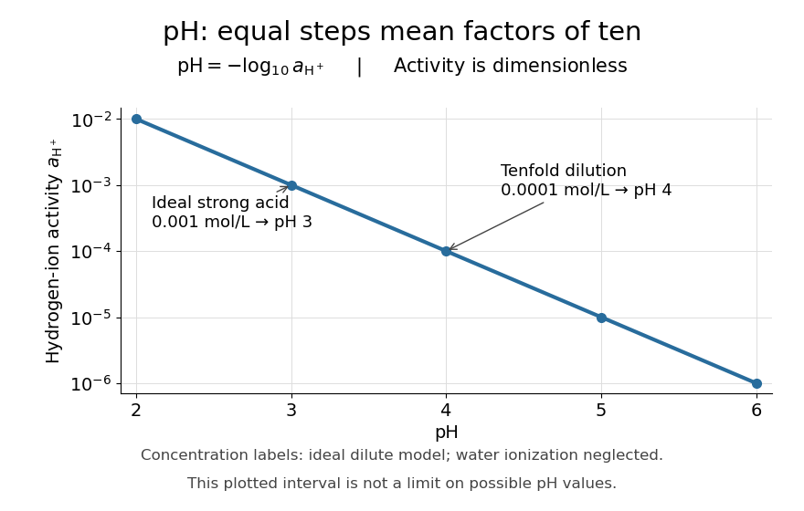

# pH

↑ **Parent:** [Acid-base chemistry](acid-base-chemistry-split.md)  
ⓦ [Wiki](https://en.wikipedia.org/wiki/pH)

The [pH](ph.md) of a [chemical solution](solution-chemistry.md) is the negative base-ten [logarithm](logarithm.md) of its [hydrogen ion](hydrogen-ion.md) [thermodynamic activity](thermodynamic-activity.md):

$$
\mathrm{pH}=-\log_{10}a_{\mathrm H^+},\qquad a_{\mathrm H^+}=10^{-\mathrm{pH}}.
$$

The [thermodynamic activity](thermodynamic-activity.md) is a [dimensionless quantity](dimensionless-quantity.md), so the [logarithm](logarithm.md) has a [dimensionless](dimensionless-quantity.md) argument. The definition uses [thermodynamic activity](thermodynamic-activity.md), rather than total [chemical acid](acid-chemistry.md) [concentration](concentration.md). Single-[ion](ion.md) [thermodynamic activities](thermodynamic-activity.md) require a convention; practical [pH](ph.md) measurements are tied to calibrated standards. See [IUPAC Gold Book, pH](https://goldbook.iupac.org/terms/view/P04524).

In a dilute ideal [chemical solution](solution-chemistry.md) in [water](water.md), a useful approximation is

$$
a_{\mathrm H^+}\approx\frac{[\mathrm H^+]}{c^\circ},\qquad c^\circ=1\,\mathrm{mol\,L^{-1}},\qquad
\mathrm{pH}\approx-\log_{10}\!\left(\frac{[\mathrm H^+]}{1\,\mathrm{mol\,L^{-1}}}\right).
$$

Square brackets denote [concentration](concentration.md) in [moles](mole-unit.md) per litre. In [water](water.md), $[\mathrm H^+]$ is shorthand for the [hydronium](hydronium.md) [concentration](concentration.md), often written $[\mathrm H_3\mathrm O^+]$; it does not describe isolated bare [protons](proton.md). Departures from ideal behavior need [activity coefficients](activity-coefficient.md). The [concentration](concentration.md) formula approximates the [thermodynamic activity](thermodynamic-activity.md) definition.

For an ideal [strong acid](strong-acid.md) supplying one [proton](proton.md) per initial unit, stipulate a total [concentration](concentration.md) of $0.001\,\mathrm{mol\,L^{-1}}$ and negligible [self-ionization of water](self-ionization-of-water.md). Then $[\mathrm H^+]\approx10^{-3}\,\mathrm{mol\,L^{-1}}$, so

$$
\mathrm{pH}\approx-\log_{10}(10^{-3})=3.
$$

Reducing that [concentration](concentration.md) tenfold by [dilution](dilution.md) gives $10^{-4}\,\mathrm{mol\,L^{-1}}$ and [pH](ph.md) $4$, under the same assumptions. More generally, dividing the [hydrogen ion](hydrogen-ion.md) [thermodynamic activity](thermodynamic-activity.md) by ten raises [pH](ph.md) by one. This is why the scale compresses an enormous range: equal steps of [pH](ph.md) represent multiplicative changes, rather than equal differences in [concentration](concentration.md). These are model calculations, rather than measured samples.

**[Figure 7](#image-one-step-of-ph-represents-a-tenfold-change-in-hydrogen-ion-thermodynamic-activity). One step of pH represents a tenfold change in hydrogen ion thermodynamic activity**. The [logarithm](logarithm.md) makes equal spacing on the [pH](ph.md) axis correspond to factors of ten on the [thermodynamic activity](thermodynamic-activity.md) axis. The marked [strong acid](strong-acid.md) example uses the dilute ideal [concentration](concentration.md) approximation and negligible [self-ionization of water](self-ionization-of-water.md). The plotted interval is illustrative; it does not bound possible [pH](ph.md) values.

Neutrality depends on [temperature](temperature-split.md). In the dilute ideal [water](water.md) model, define the [dimensionless](dimensionless-quantity.md) ion product $K_w=([\mathrm H^+]/c^\circ)([\mathrm{OH}^-]/c^\circ)$ and $\mathrm pK_w=-\log_{10}K_w$. Equal [hydronium](hydronium.md) and [hydroxide](hydroxide.md) [concentrations](concentration.md) imply

$$
\mathrm{pH}_{\mathrm{neutral}}=\frac{\mathrm pK_w}{2}.
$$

At $25\,{}^\circ\mathrm C$, the textbook approximation $K_w\approx10^{-14}$ gives neutral [pH](ph.md) $7$. Since $K_w$ varies with [temperature](temperature-split.md), neutrality need not mean [pH](ph.md) $7$. Nor is [pH](ph.md) restricted to $0$–$14$: the activity definition permits negative [pH](ph.md) when $a_{\mathrm H^+}>1$, and [pH](ph.md) above $14$ when $a_{\mathrm H^+}<10^{-14}$. High [concentrations](concentration.md) can invalidate the dilute ideal approximation. See [Flowers et al., Chemistry 2e, pH and pOH](https://openstax.org/books/chemistry-2e/pages/14-2-ph-and-poh).

[S. P. L. Sørensen](s-p-l-sorensen.md) introduced [pH](ph.md) at the Carlsberg Laboratory in 1909, as recorded in the [Carlsberg Foundation historical timeline](https://carlsbergfondet.dk/en/about-the-foundation/our-history/timeline-of-the-foundation-s-history/).

## ↑ Ancestors (3)

1. [Acid-base chemistry](acid-base-chemistry-split.md)
2. [Chemistry](chemistry-split.md)
3. [Codex Wiki](split.md)

## ← Incoming links (92)

- [Acid-base chemistry](acid-base-chemistry-split.md)
- [Acid-base titration](acid-base-titration.md)
- [Acid-base titration measurement](acid-base-titration-measurement.md)
- [Acid (chemistry)](acid-chemistry.md)
- [Acid dissociation constant](acid-dissociation-constant.md)
- [Adenosine triphosphate](adenosine-triphosphate.md)
- [Amino acid](amino-acid.md)
- [Antibody surface plasmon resonance experiment](antibody-surface-plasmon-resonance-experiment.md)
- [Arginine](arginine.md)
- [ATP-driven sugar phosphorylation](atp-driven-sugar-phosphorylation.md)
- [ATP synthase energy and proton budget](atp-synthase-energy-and-proton-budget.md)
- [Batch glass leach test](batch-glass-leach-test.md)
- [Beer-Lambert measurement controls](beer-lambert-measurement-controls.md)
- [Buffer capacity](buffer-capacity.md)
- [Buffer capacity and concentration](buffer-capacity-and-concentration.md)
- [Buffer capacity measurement](buffer-capacity-measurement.md)
- [Buffer capacity of a monoprotic acid](buffer-capacity-of-a-monoprotic-acid.md)
- [Buffer solution](buffer-solution.md)
- [Catalysed peroxide comparison](catalysed-peroxide-comparison.md)
- [Charge regulation](charge-regulation.md)
- [Conjugate base](conjugate-base.md)
- [Denaturation (biochemistry)](denaturation-biochemistry.md)
- [Dialysis salt-removal and protein-retention experiments](dialysis-salt-removal-and-protein-retention-experiments.md)
- [Dilution](dilution.md)
- [Disulfide bond](disulfide-bond.md)
- [Enzyme](enzyme-split.md)
- [Equivalence point](equivalence-point.md)
- [Finite titrant response of a buffer](finite-titrant-response-of-a-buffer.md)
- [Forward glass dissolution rate](forward-glass-dissolution-rate.md)
- [Glass electrode](glass-electrode.md)
- [Glucose mutarotation experiment](glucose-mutarotation-experiment.md)
- [Glycine speciation model](glycine-speciation-model.md)
- [Glycine titration](glycine-titration.md)
- [Glycine titration experiment](glycine-titration-experiment.md)
- [Henderson-Hasselbalch equation](henderson-hasselbalch-equation.md)
- [Hydrogen ion](hydrogen-ion.md)
- [Hydronium](hydronium.md)
- [Inorganic phosphate](inorganic-phosphate.md)
- [Isoelectric point](isoelectric-point.md)
- [KHP standardization protocol](khp-standardization-protocol.md)
- [Lysine](lysine.md)
- [Lysosomal enzyme latency](lysosomal-enzyme-latency.md)
- [Neutralization](neutralization.md)
- [Solution](past-exam-of-the-biochemistry-and-molecular-biology-course-of-the-university-of-cambridge/2025/paper-1/section-c/8/solution.md)
- [Solution](past-exam-of-the-biochemistry-course-of-the-university-of-cambridge/2025/paper-1/section-i/2/solution.md)
- [Solution](past-exam-of-the-biochemistry-course-of-the-university-of-cambridge/2025/paper-1/section-ii/6/solution.md)
- [Solution](past-exam-of-the-biochemistry-course-of-the-university-of-cambridge/2025/paper-1/section-ii/7/solution.md)
- [Solution](past-exam-of-the-biochemistry-course-of-the-university-of-cambridge/2025/paper-4/section-iii/7/solution.md)
- [Solution](past-exam-of-the-chemistry-b-course-of-the-university-of-cambridge/2025/paper-2/b10/a/iii/solution.md)
- [Solution](past-exam-of-the-chemistry-b-course-of-the-university-of-cambridge/2025/paper-2/b10/a/iv/solution.md)
- [Solution](past-exam-of-the-chemistry-b-course-of-the-university-of-cambridge/2025/paper-2/b10/b/i/solution.md)
- [Solution](past-exam-of-the-chemistry-course-of-the-year-1-of-the-natural-sciences-course-of-the-university-of-cambridge/2021/paper-1/4/d/ii/solution.md)
- [Solution](past-exam-of-the-chemistry-course-of-the-year-1-of-the-natural-sciences-course-of-the-university-of-cambridge/2021/paper-1/5/b/ii/solution.md)
- [Solution](past-exam-of-the-chemistry-course-of-the-year-1-of-the-natural-sciences-course-of-the-university-of-cambridge/2025/4/a/iii/solution.md)
- [Solution](past-exam-of-the-chemistry-course-of-the-year-1-of-the-natural-sciences-course-of-the-university-of-cambridge/2025/4/b/iii/solution.md)
- [Solution](past-exam-of-the-chemistry-course-of-the-year-1-of-the-natural-sciences-course-of-the-university-of-cambridge/2025/4/b/iv/solution.md)
- [Solution](past-exam-of-the-chemistry-course-of-the-year-3-of-the-natural-sciences-course-of-the-university-of-cambridge/2021/paper-1/4/a/solution.md)
- [Solution](past-exam-of-the-chemistry-course-of-the-year-3-of-the-natural-sciences-course-of-the-university-of-cambridge/2021/paper-1/4/c/solution.md)
- [Solution](past-exam-of-the-mphil-in-micro-and-nanotechnology-enterprise-course-of-the-university-of-cambridge/2021/paper-2/section-a-iii/18/iv/solution.md)
- [Solution](past-exam-of-the-mphil-in-nuclear-energy-course-of-the-university-of-cambridge/2019/paper-ne4/4/b/solution.md)
- [Solution](past-exam-of-the-mphil-in-nuclear-energy-course-of-the-university-of-cambridge/2019/paper-ne4/4/c/solution.md)
- [Solution](past-exam-of-the-mphil-in-nuclear-energy-course-of-the-university-of-cambridge/2021/paper-ne4/2/a/solution.md)
- [Solution](past-exam-of-the-mphil-in-nuclear-energy-course-of-the-university-of-cambridge/2021/paper-ne4/4/c/solution.md)
- [Solution](past-exam-of-the-mphil-in-nuclear-energy-course-of-the-university-of-cambridge/2021/paper-ne4/4/d/solution.md)
- [Solution](past-exam-of-the-soft-condensed-matter-course-of-the-university-of-cambridge/2013/paper-1/2/b/solution.md)
- [Solution](past-exam-of-the-soft-condensed-matter-course-of-the-university-of-cambridge/2019/section-b/b4/solution.md)
- [Solution](past-exam-of-the-soft-condensed-matter-course-of-the-university-of-cambridge/2019/section-b/b6/solution.md)
- [Solution](past-exam-of-the-soft-matter-and-biological-physics-course-of-the-university-of-cambridge/2013/paper-1/3/a/solution.md)
- [Solution](past-exam-of-the-zoology-course-of-the-university-of-cambridge/2025/paper-zl6/3/b/solution.md)
- [pH](ph.md)
- [pH indicator](ph-indicator.md)
- [Phosphatidylserine](phosphatidylserine.md)
- [Phospholipid](phospholipid.md)
- [pKa](pka.md)
- [Potentiometric titration](potentiometric-titration.md)
- [Primary standard inventory](primary-standard-inventory.md)
- [Rat-liver acid-phosphatase latency experiment](rat-liver-acid-phosphatase-latency-experiment.md)
- [Regulated physiological variable](regulated-physiological-variable.md)
- [Ribonuclease A refolding experiment](ribonuclease-a-refolding-experiment.md)
- [Ribozyme](ribozyme.md)
- [SEC light-scattering detection](sec-light-scattering-detection.md)
- [SEC protein conformation experiment](sec-protein-conformation-experiment.md)
- [Strong acid](strong-acid.md)
- [Strong acid titration model](strong-acid-titration-model.md)
- [TAE buffer](tae-buffer.md)
- [Titration curve](titration-curve.md)
- [Trypsin](trypsin.md)
- [Trypsin cleavage specificity](trypsin-cleavage-specificity.md)
- [Trypsin colorimetric assay](trypsin-colorimetric-assay.md)
- [Weak acid](weak-acid.md)
- [Weak acid dissociation fraction](weak-acid-dissociation-fraction.md)
- [Weak acid dissociation measurement](weak-acid-dissociation-measurement.md)
