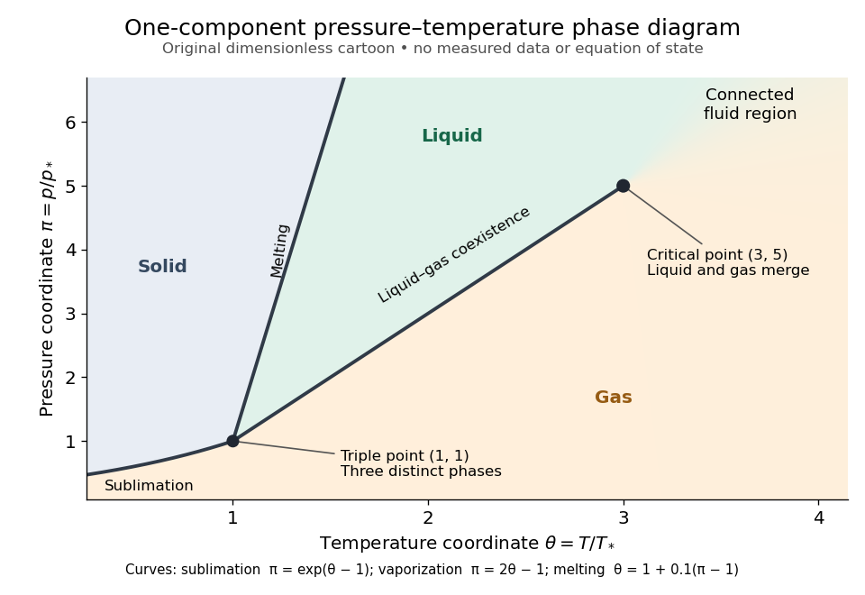
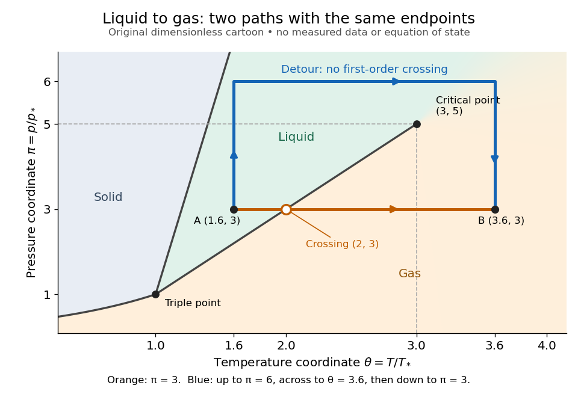

# Phase diagram

↑ **Parent:** [Phase coexistence curve](phase-coexistence-curve.md)  
ⓦ [Wiki](https://en.wikipedia.org/wiki/Phase_diagram)

A phase diagram partitions a space of thermodynamic variables into regions occupied by different equilibrium [thermodynamic phases](thermodynamic-phase.md) and records the [phase coexistence curves](phase-coexistence-curve.md) between them. For a pure, one-component substance, a [pressure](pressure-split.md)–[temperature](temperature-split.md) [phase diagram](phase-diagram.md) gives one point for each pair $(T,p)$. In a single-[thermodynamic phase](thermodynamic-phase.md) region both controls can vary independently. On a two-[thermodynamic phase](thermodynamic-phase.md) [phase coexistence curve](phase-coexistence-curve.md), they obey one relation; at a [triple point](triple-point.md), both are fixed. These statements assume bulk [thermodynamic equilibrium](thermodynamic-equilibrium.md), fixed composition and no additional applied fields.[Gibbs Phase Rule, single-, two- and three-phase counts and final pressure–temperature diagram paragraphs](gibbs-phase-rule-mit-10-213-course-material.md)

At fixed [temperature](temperature-split.md) and [pressure](pressure-split.md), the stable bulk [thermodynamic phase](thermodynamic-phase.md) minimizes [Gibbs free energy](gibbs-free-energy.md) for a fixed [amount of substance](amount-of-substance.md). For a pure substance this is a comparison of [chemical potentials](chemical-potential-split.md) on a common normalization. Two candidate [thermodynamic phases](thermodynamic-phase.md) coexist where $\mu_\alpha(T,p)=\mu_\beta(T,p)$ and neither is exceeded in stability by a third [thermodynamic phase](thermodynamic-phase.md). Differentiating their equality gives the [Clapeyron equation](clausius-clapeyron-relation.md). Thus a [phase coexistence curve](phase-coexistence-curve.md) is a locus of equal stability, rather than a trajectory that every heated sample must follow.[§5.1.1, equations (5.3)–(5.4), printed p. 137: chemical-potential equality; §5.1.2, equation (5.6), printed pp. 140–141: coexistence slope](statistical-physics-by-david-tong.md)

The following original cartoon uses dimensionless positive coordinates $\theta=T/T_*$ and $\pi=p/p_*$, with arbitrary reference scales $T_*,p_*$. It represents no particular substance and contains no measured data. Stipulate a [triple point](triple-point.md) at $(1,1)$, a [liquid-gas critical point](liquid-gas-critical-point.md) at $(3,5)$, and these drawing rules:

$$
\begin{aligned}
\pi_{\rm sub}(\theta)&=e^{\theta-1},&&0<\theta\le1,\\
\pi_{\rm vap}(\theta)&=2\theta-1,&&1\le\theta\le3,\\
\theta_{\rm melt}(\pi)&=1+0.1(\pi-1),&&\pi\ge1.
\end{aligned}
$$

They specify [sublimation](sublimation.md), [liquid](liquid.md)–[gas](gas.md) [phase coexistence](phase-coexistence.md) and [melting](melting.md) boundaries for the picture. They are not an [equation of state](equation-of-state.md), do not predict [latent heat](latent-heat.md) or [mass density](density.md), and do not supply a quantitative critical theory. In particular, the [melting](melting.md) slope is merely an illustrative choice.

**[Figure 3](#image-generic-dimensionless-pressure-temperature-phase-diagram-curves-triple-point-and-liquid-gas-critical-point). Generic dimensionless pressure–temperature phase diagram: curves, triple point and liquid-gas critical point**. Original cartoon with stipulated drawing rules. Three distinct bulk [thermodynamic phases](thermodynamic-phase.md) coexist at $(1,1)$; the [liquid](liquid.md)–[gas](gas.md) boundary ends at $(3,5)$. The fluid region beyond that endpoint is connected: no extra boundary is implied by the fading background. These coordinates are not [water](water.md) data.

For example, at fixed $\pi=3$ the [melting](melting.md) boundary is at $\theta=1.2$ and the [liquid](liquid.md)–[gas](gas.md) boundary is at $\theta=2$. Heating from $(\theta,\pi)=(1.6,3)$ to $(3.6,3)$ therefore starts in [liquid](liquid.md), crosses [phase coexistence](phase-coexistence.md) at $(2,3)$, and ends in [gas](gas.md). In an equilibrium conversion at that crossing, added [heat](heat-split.md) can change the [phase fraction](phase-fraction.md) at fixed [temperature](temperature-split.md) through [latent heat](latent-heat.md). The [pressure](pressure-split.md)–[temperature](temperature-split.md) point alone does not specify how much of each [thermodynamic phase](thermodynamic-phase.md) is present: for that one needs an additional amount or [volume](volume-thermodynamics.md) constraint.

Now connect exactly the same endpoints by raising $\pi$ from $3$ to $6$ at $\theta=1.6$, moving to $\theta=3.6$ at $\pi=6$, then lowering $\pi$ to $3$. The first leg stays on the [liquid](liquid.md) side because $\theta_{\rm melt}$ ranges only from $1.2$ to $1.5$ and $\pi_{\rm vap}(1.6)=2.2<3$. The second leg lies above the entire [liquid](liquid.md)–[gas](gas.md) boundary, whose largest drawn [pressure](pressure-split.md) coordinate is $5$; the third lies beyond its largest [temperature](temperature-split.md) coordinate, $3$. No leg crosses a [first-order phase transition](first-order-phase-transition.md) boundary. The middle leg passes through a [supercritical fluid](supercritical-fluid.md) region, with $\theta>3$ and $\pi>5$, and the final leg returns to a gaslike state continuously.

**[Figure 4](#image-the-same-liquid-and-gas-endpoints-crossing-phase-coexistence-or-going-around-the-liquid-gas-critical-point). The same liquid and gas endpoints: crossing phase coexistence or going around the liquid-gas critical point**. Original dimensionless cartoon. The orange constant-[pressure](pressure-split.md) path crosses the [liquid](liquid.md)–[gas](gas.md) boundary at $(2,3)$. The blue path follows $(1.6,3)$ to $(1.6,6)$ to $(3.6,6)$ to $(3.6,3)$ and avoids every drawn [phase coexistence curve](phase-coexistence-curve.md). Dashed coordinate guides locate the critical endpoint without representing additional boundaries.

Avoiding a [first-order phase transition](first-order-phase-transition.md) does not mean that no [heat](heat-split.md) or [work](work.md) is exchanged. Along the detour, [mass density](density.md), [enthalpy](enthalpy-split.md) and [heat capacity](heat-capacity.md) may change substantially but continuously. The [liquid-gas critical point](liquid-gas-critical-point.md) itself has singular behavior, so the detour goes around it rather than through it. This connected fluid region is the striking lesson of a [phase diagram](phase-diagram.md): a familiar change from [liquid](liquid.md) to [gas](gas.md) need not involve boiling across a sharp boundary.

An equilibrium [phase diagram](phase-diagram.md) also does not predict how rapidly a conversion occurs. [Metastability](metastability.md) and a barrier described by [classical nucleation theory](classical-nucleation-theory.md) can delay the observed [phase transition](phase-transition.md). Nor should a binary-composition [phase diagram](phase-diagram.md) be read as the same picture: its coexistence regions and [lever rule](lever-rule.md) encode composition and [phase fractions](phase-fraction.md), and can occupy an area even though pure-substance two-[thermodynamic phase](thermodynamic-phase.md) coexistence occupies a curve in the [pressure](pressure-split.md)–[temperature](temperature-split.md) plane.

**Table of contents**

- [Solvus](solvus.md)
- [Lower critical solution temperature](lower-critical-solution-temperature.md)
- [Upper critical solution temperature](upper-critical-solution-temperature.md)
- [Phase rule](phase-rule.md)
- [Solidus](solidus.md)
- [Lever rule](lever-rule.md)
- [Bicritical point](bicritical-point.md)
- [Liquidus](liquidus.md)
  - [Freezing-point depression](freezing-point-depression.md)
- [Eutectic system](eutectic-system.md)
  - [Eutectic solidification](eutectic-solidification.md)
  - [Eutectic point](eutectic-point.md)
  - [Eutectic microstructure](eutectic-microstructure.md)
    - [Eutectic constituent fraction](eutectic-constituent-fraction.md)
  - [Eutectic composition](eutectic-composition.md)
  - [Eutectic temperature](eutectic-temperature.md)

## ↑ Ancestors (9)

1. [Phase coexistence curve](phase-coexistence-curve.md)
2. [Gibbs free energy](gibbs-free-energy.md)
3. [Thermodynamic free energy](thermodynamic-free-energy.md)
4. [Thermodynamic potential](thermodynamic-potential-split.md)
5. [Thermodynamics](thermodynamics-split.md)
6. [Statistical physics](statistical-physics-split.md)
7. [Branches of physics](branches-of-physics.md)
8. [Physics](physics-split.md)
9. [Codex Wiki](split.md)

## ← Incoming links (38)

- [Block-copolymer sphere phase](block-copolymer-sphere-phase.md)
- [Eutectic composition](eutectic-composition.md)
- [Hexagonal cylinder block-copolymer phase](hexagonal-cylinder-block-copolymer-phase.md)
- [Lever rule](lever-rule.md)
- [Liquidus](liquidus.md)
- [Negative melting-point slope of water](negative-melting-point-slope-of-water.md)
- [Solution](past-exam-of-the-mathematics-course-of-the-university-of-cambridge/2002/iii/paper-55/1/solution.md)
- [Solution](past-exam-of-the-mathematics-course-of-the-university-of-cambridge/2003/iii/paper-46/1/solution.md)
- [Solution](past-exam-of-the-mathematics-course-of-the-university-of-cambridge/2004/iii/paper-46/1/e/solution.md)
- [Solution](past-exam-of-the-mathematics-course-of-the-university-of-cambridge/2005/iii/paper-51/1/b/solution.md)
- [Solution](past-exam-of-the-mathematics-course-of-the-university-of-cambridge/2005/iii/paper-51/1/f/solution.md)
- [Solution](past-exam-of-the-mathematics-course-of-the-university-of-cambridge/2005/iii/paper-51/1/solution.md)
- [Solution](past-exam-of-the-mathematics-course-of-the-university-of-cambridge/2006/iii/paper-51/1/f/solution.md)
- [Solution](past-exam-of-the-mathematics-course-of-the-university-of-cambridge/2008/iii/paper-50/1/solution.md)
- [Solution](past-exam-of-the-mathematics-course-of-the-university-of-cambridge/2009/iii/paper-43/1/solution.md)
- [Solution](past-exam-of-the-mathematics-course-of-the-university-of-cambridge/2010/iii/paper-72/4/solution.md)
- [Solution](past-exam-of-the-mathematics-course-of-the-university-of-cambridge/2013/iii/paper-71/1/solution.md)
- [Solution](past-exam-of-the-mathematics-course-of-the-university-of-cambridge/2015/iii/paper-45/1/solution.md)
- [Solution](past-exam-of-the-mathematics-course-of-the-university-of-cambridge/2018/iii/paper-303/3/a/solution.md)
- [Solution](past-exam-of-the-mathematics-course-of-the-university-of-cambridge/2026/iii/paper-332/2/d/solution.md)
- [Solution](past-exam-of-the-mphil-in-micro-and-nanotechnology-enterprise-course-of-the-university-of-cambridge/2019/paper-2/section-a-i/14/i/solution.md)
- [Solution](past-exam-of-the-mphil-in-micro-and-nanotechnology-enterprise-course-of-the-university-of-cambridge/2021/paper-2/section-b/22/vi/solution.md)
- [Solution](past-exam-of-the-physics-b-course-of-the-university-of-cambridge/2012/paper-2/section-c/c10/solution.md)
- [Solution](past-exam-of-the-physics-b-course-of-the-university-of-cambridge/2013/paper-2/section-c/c13/solution.md)
- [Solution](past-exam-of-the-physics-b-course-of-the-university-of-cambridge/2016/paper-2/section-c/c13/solution.md)
- [Solution](past-exam-of-the-physics-b-course-of-the-university-of-cambridge/2021/paper-2/section-c/c8/e/solution.md)
- [Solution](past-exam-of-the-soft-condensed-matter-course-of-the-university-of-cambridge/2021/section-b/6/b/solution.md)
- [Solution](past-exam-of-the-soft-condensed-matter-course-of-the-university-of-cambridge/2022/section-b/6/d/solution.md)
- [Solution](past-exam-of-the-soft-condensed-matter-course-of-the-university-of-cambridge/2022/section-b/6/e/solution.md)
- [Solution](past-exam-of-the-soft-condensed-matter-course-of-the-university-of-cambridge/2022/section-b/6/f/solution.md)
- [Solution](past-exam-of-the-theoretical-physics-i-course-of-the-university-of-cambridge/2019/4/e/solution.md)
- [Phase diagram](phase-diagram.md)
- [Polymorphism (materials science)](polymorphism-materials-science.md)
- [Screened Coulomb pair potential](screened-coulomb-pair-potential.md)
- [Solidus](solidus.md)
- [State of matter](state-of-matter.md)
- [Terminal solid solution](terminal-solid-solution.md)
- [Van der Waals liquid-gas coexistence](van-der-waals-liquid-gas-coexistence.md)
