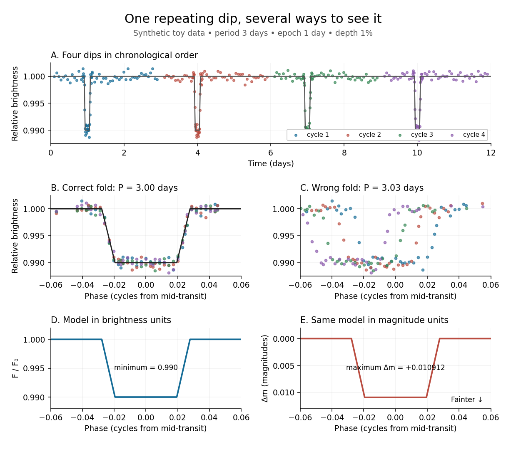

# Phase folding of a light curve

↑ **Parent:** [Light curve](light-curve.md)

[Phase folding of a light curve](phase-folding-of-a-light-curve.md) maps timestamps onto a trial cycle of duration $P>0$. Given a reference time $t_0$, define the phase in cycles by

$$
\phi_i=\operatorname{frac}\left(\frac{t_i-t_0}{P}\right),\qquad 0\le\phi_i<1,
$$

where $\operatorname{frac}(x)=x-\lfloor x\rfloor$ is the [fractional part](fractional-part.md), using the [floor function](floor-function.md) also for negative $x$. Plot brightness against $\phi_i$ rather than $t_i$; measurements separated by an integer multiple of $P$ occupy the same phase. For a [periodic function](periodic-function.md) $F(t+P)=F(t)$, this reveals the shared shape of many cycles. Folding changes coordinates; it neither averages samples nor chooses the correct $P$ by itself. Welsh et al.'s folded Kepler plot separates the [exoplanet transit](exoplanet-transit.md) and orbital brightness modulation. [Welsh et al. (2010), figure 1](https://www.ucolick.org/~jfortney/papers/Welsh10.pdf).

The second figure uses a completely synthetic trapezoidal dip: $P=3$ days, $t_0=1$ day, and the same $1\%$ depth and four-hour duration as the first figure. Different colours identify four successive cycles. Correct folding superimposes the dips; a wrong trial [orbital period](orbital-period.md) spreads them out. If $P'=P+\epsilon$, the centre of the $n$th repeated event shifts by approximately $-n\epsilon/P$ cycles when folded on $P'$, for $|\epsilon|\ll P$. With $P'=3.03$ days, the fourth plotted event is displaced by $-3(0.03)/3.03\simeq-0.0297$ cycles. [Transit-timing variations](transit-timing-variation.md) can also smear a constant-period fold, so retain the original timestamps and inspect individual events.

**[Figure 9](#image-toy-phase-folding-repeated-synthetic-dips-align-at-the-correct-period-a-flux-dip-becomes-a-positive-magnitude-change). Toy phase folding: repeated synthetic dips align at the correct period; a flux dip becomes a positive magnitude change**.

One may combine nearby phases with a [weighted mean](weighted-arithmetic-mean.md), but the uncertainty reduction requires assumptions. For $N$ independent measurements with common [standard deviation](standard-deviation.md) $\sigma$ and effectively the same expected brightness within the bin, their [arithmetic mean](arithmetic-mean.md) has [standard deviation](standard-deviation.md) $\sigma/\sqrt N$. Thus sixteen independent $0.0006$-precision samples give $0.00015$ precision on that phase-bin mean. Shared calibration errors, changing [starspots](starspot.md), and bins wide enough to mix ingress with out-of-transit brightness violate these assumptions. A folded plot can conceal changes between cycles. [Gaussian process](gaussian-process-split.md) models can represent correlated variability and interpolate irregular samples, but their predictions and uncertainties depend on their assumed [covariance function](covariance-function.md).

The bottom panels show the same model as relative brightness $f=F/F_0$ and as [magnitude difference](magnitude-difference.md) in one fixed [photometric passband](photometric-passband.md) with a fixed [magnitude zero point](magnitude-zero-point.md):

$$
\Delta m(t)=-2.5\log_{10}f(t),\qquad f(t)>0.
$$

A dip to $f=0.99$ gives $\Delta m\simeq+0.010912$ magnitudes: fainter means a larger [apparent magnitude](apparent-magnitude.md). The figure places larger [magnitude differences](magnitude-difference.md) lower on the page so the two dip shapes are easy to compare; reversing that plotting convention does not change the formula. For $f=1-\delta$ and small $\delta$, expansion of the [logarithm](logarithm.md) gives $\Delta m\simeq(2.5/\ln10)\delta\simeq1.085736\delta$. The exact transform is nonlinear: transforming an exposure's mean brightness is generally different from averaging its instantaneous [apparent magnitudes](apparent-magnitude.md). The ordinary [logarithm](logarithm.md) cannot be applied to a nonpositive background-subtracted measurement; keep such measurements and their uncertainties in brightness units for an appropriate statistical model.

## ↑ Ancestors (5)

1. [Light curve](light-curve.md)
2. [Astrophysics](astrophysics-split.md)
3. [Branches of physics](branches-of-physics.md)
4. [Physics](physics-split.md)
5. [Codex Wiki](split.md)

## ← Incoming links (3)

- [Light curve](light-curve.md)
- [Phase folding of a light curve](phase-folding-of-a-light-curve.md)
- [Pulsar period folding and alias checks](pulsar-period-folding-and-alias-checks.md)
