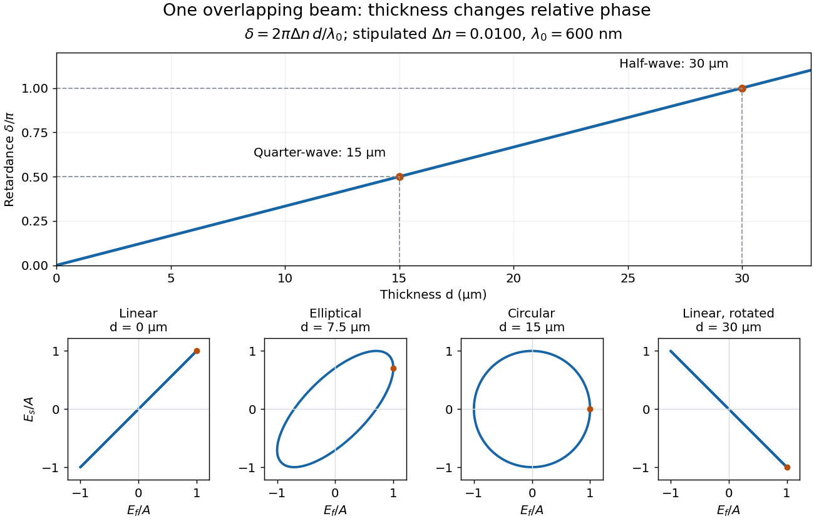

# Phase retardation

↑ **Parent:** [Waveplate](waveplate.md)

For the overlapping [monochromatic wave](monochromatic-wave.md) components, let $d$ be the thickness and $\lambda_0$ the vacuum [wavelength](wavelength.md). Define $\Delta n=n_s-n_f>0$ using the slow and fast [refractive indices](refractive-index.md). With [complex amplitude](complex-amplitude.md) convention $e^{i(kz-\omega t)}$, the accumulated slow-minus-fast [phase difference](phase-difference.md) is

$$
\delta=(k_s-k_f)d=\frac{2\pi}{\lambda_0}(n_s-n_f)d.
$$

This is the [optical path difference](optical-path-difference.md) $\Delta n\,d$ expressed as a [wave phase](phase-waves.md). It is a signed accumulation convention; with the opposite time convention the sign reverses. The outgoing [polarization of an electromagnetic wave](polarization-of-an-electromagnetic-wave.md) depends on $\delta$ modulo $2\pi$. Here the positive slow-minus-fast $\Delta n$ differs from the signed principal-index $n_e-n_o$ used in the parent [birefringence](birefringence.md) entry when $n_e<n_o$.

For an original worked example, stipulate $\Delta n=0.0100$ at $\lambda_0=600\,\mathrm{nm}$ and a uniform thickness $d=15.0\,\mathrm{\mu m}$. These are design assumptions, not measured material data. The [optical path difference](optical-path-difference.md) is $150\,\mathrm{nm}$, so

$$
\delta=2\pi\frac{150\,\mathrm{nm}}{600\,\mathrm{nm}}=\frac{\pi}{2}.
$$

It is a [quarter-wave plate](quarter-wave-plate.md). At the same [wavelength](wavelength.md) and [refractive indices](refractive-index.md), doubling $d$ to $30.0\,\mathrm{\mu m}$ gives $\delta=\pi$, a [half-wave plate](half-wave-plate.md). A $1.0\,\mathrm{\mu m}$ thickness increase changes $\delta$ by $\pi/30$, or $6^\circ$; retaining the same [birefringence](birefringence.md) at $500\,\mathrm{nm}$ would instead give $\delta=3\pi/5$ for the $15.0\,\mathrm{\mu m}$ plate. Real [refractive indices](refractive-index.md) also vary with [wavelength](wavelength.md), so this last calculation explicitly neglects [optical dispersion](dispersion-optics.md).

**[Figure 2](#image-phase-retardation-grows-with-thickness-while-overlapping-components-change-polarization-of-an-electromagnetic-wave). Phase retardation grows with thickness while overlapping components change polarization of an electromagnetic wave**. The stipulated $\Delta n=0.0100$, $\lambda_0=600\,\mathrm{nm}$ model gives quarter-wave and half-wave thicknesses of $15$ and $30\,\mathrm{\mu m}$. Insets trace the normalized [electric field](electric-field-split.md) at a fixed point for equal fast/slow [wave amplitudes](wave-amplitude.md), with $E_f=\cos\tau$ and $E_s=\cos(\tau+\delta)$. The intermediate [ellipse](ellipse.md), circle and rotated line require no spatial beam separation.

For these equal transmitted [wave amplitudes](wave-amplitude.md), [orthogonal projection](orthogonal-projection.md) onto a [polarizer](polarizer.md) crossed with the initial $45^\circ$ [linear polarization](linear-polarization.md) gives a simple independent readout. After removing a common [wave phase](phase-waves.md), the component [complex amplitudes](complex-amplitude.md) are proportional to $(1,e^{i\delta})/\sqrt2$; [orthogonal projection](orthogonal-projection.md) onto $(1,-1)/\sqrt2$ gives $(1-e^{i\delta})/2$. Squaring its [modulus](modulus.md) yields $I_\perp/I_{\mathrm{in}}=\sin^2(\delta/2)$: zero at $d=0$, one half at $15\,\mathrm{\mu m}$, and one at $30\,\mathrm{\mu m}$. This assumes ideal [polarizers](polarizer.md), negligible [specular reflection](specular-reflection.md) and [wave absorption](wave-absorption.md), overlapping components and stable relative [wave phase](phase-waves.md). It measures a periodic function of [phase retardation](phase-retardation.md), so one brightness measurement cannot determine the thickness uniquely.

**Table of contents**

- [Waveplate retardance detuning](waveplate-retardance-detuning.md)

## ↑ Ancestors (9)

1. [Waveplate](waveplate.md)
2. [Birefringence](birefringence.md)
3. [Linear anisotropic dielectric](linear-anisotropic-dielectric.md)
4. [Maxwell equations in matter](maxwell-equations-in-matter.md)
5. [Maxwell equations](maxwell-equations-split.md)
6. [Electromagnetism](electromagnetism-split.md)
7. [Branches of physics](branches-of-physics.md)
8. [Physics](physics-split.md)
9. [Codex Wiki](split.md)

## ← Incoming links (15)

- [Birefringence](birefringence.md)
- [Birefringent walk-off](birefringent-walk-off.md)
- [Double-pass quarter-wave plate](double-pass-quarter-wave-plate.md)
- [Electro-optic Kerr effect](electro-optic-kerr-effect.md)
- [Linear birefringence](linear-birefringence.md)
- [Solution](past-exam-of-the-materials-science-course-of-the-university-of-cambridge/2019/paper-1/2/b/solution.md)
- [Solution](past-exam-of-the-optics-and-electrodynamics-course-of-the-university-of-cambridge/2012/paper-1/3/solution.md)
- [Solution](past-exam-of-the-optics-and-electrodynamics-course-of-the-university-of-cambridge/2017/3/solution.md)
- [Retardation mechanism](past-exam-of-the-optics-and-electrodynamics-course-of-the-university-of-cambridge/2019/section-a/a2/retardation-mechanism.md)
- [Returned polarization](past-exam-of-the-optics-and-electrodynamics-course-of-the-university-of-cambridge/2019/section-a/a2/returned-polarization.md)
- [Solution](past-exam-of-the-optics-and-electrodynamics-course-of-the-university-of-cambridge/2022/section-b/4/a/solution.md)
- [Phase retardation](phase-retardation.md)
- [Polarizing microscope](polarizing-microscope.md)
- [Quarter-wave plate](quarter-wave-plate.md)
- [Waveplate](waveplate.md)
