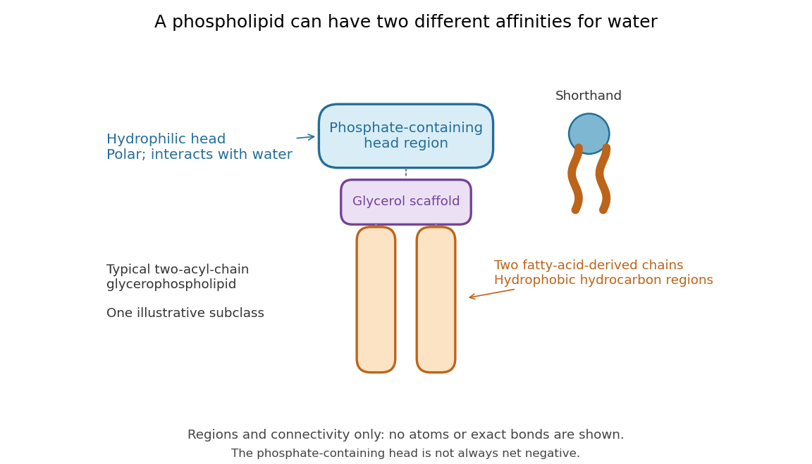
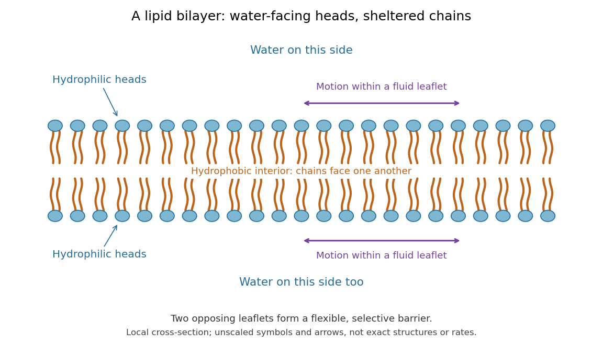

# Phospholipid

↑ **Parent:** [Lipid](lipid.md)  
ⓦ [Wiki](https://en.wikipedia.org/wiki/Phospholipid)

[Phospholipids](phospholipid.md) are [lipids](lipid.md) containing a [phosphate](phosphate.md) group as part of their structure linked by [covalent bonds](covalent-bond.md). The familiar membrane-forming [phospholipids](phospholipid.md) are [amphiphilic](amphiphile.md): a [hydrophilic](hydrophilicity.md) head region with [chemical polarity](chemical-polarity.md) coexists with a [hydrophobic](hydrophobicity.md), largely [nonpolar](nonpolar-molecule.md) [hydrocarbon](hydrocarbon.md) region. These descriptions refer to different parts of the same [molecule](molecule.md), not to two separate substances. See [IUPAC Gold Book: phospholipids](https://goldbook.iupac.org/terms/view/P04559) and [IUPAC Gold Book: amphiphilic](https://goldbook.iupac.org/terms/view/A00303).

A typical two-chain [glycerophospholipid](glycerophospholipid.md) provides a useful example: a [glycerol](glycerol.md) scaffold carries two [fatty acid](fatty-acid.md)-derived [acyl groups](acyl-group.md) through [ester](ester.md) linkages, plus a [phosphate](phosphate.md)-containing head region. [Phosphatidylcholine](phosphatidylcholine.md) is one example. This scaffold describes an important subclass, rather than all [phospholipids](phospholipid.md): [sphingomyelin](sphingomyelin.md) has a different backbone, and even [glycerophospholipids](glycerophospholipid.md) need not all have two [acyl groups](acyl-group.md). See [IUPAC–IUB, Nomenclature of Lipids (1976), Lip-1.5 and Lip-2.1–2.6](https://iupac.qmul.ac.uk/lipid/lip1n2.html).

**[Figure 76](#image-polar-head-and-hydrophobic-chains-of-an-illustrative-glycerophospholipid). Polar head and hydrophobic chains of an illustrative glycerophospholipid**. Colored regions represent a [phosphate](phosphate.md)-containing head, a [glycerol](glycerol.md) scaffold, and two [fatty acid](fatty-acid.md)-derived chains. The small paired-chain symbol is shorthand for this illustrative subclass. Shapes and connectors show organization, not [chemical atoms](atom-physics.md), exact [chemical bonds](chemical-bond.md), chain lengths, or a measured [molecular geometry](molecular-geometry.md). The head is not assigned a universal [electric charge](electric-charge.md).

Polar does not mean negatively charged overall. At near-neutral [pH](ph.md), [phosphatidylcholine](phosphatidylcholine.md) is [zwitterionic](zwitterion.md): its [phosphate](phosphate.md) region carries negative [electric charge](electric-charge.md) and its [choline](choline.md) region positive [electric charge](electric-charge.md), with zero net [electric charge](electric-charge.md) for the [molecule](molecule.md). Counting those opposite charges gives $(-1)+(+1)=0$; it does not remove their local interactions with [water](water.md). See [Lodish et al., Molecular Cell Biology: membrane lipids](https://www.ncbi.nlm.nih.gov/books/NBK21726/).

In a [lipid bilayer](lipid-bilayer.md), two [membrane leaflets](membrane-leaflet.md) orient their [hydrophilic](hydrophilicity.md) heads toward the [water](water.md) on either side and their [hydrophobic](hydrophobicity.md) chains toward the shared interior. The [hydrophobic effect](hydrophobic-effect.md) helps explain this organization through the [free energy](thermodynamic-free-energy.md) of the [water](water.md) and [lipids](lipid.md) together. It is not a special repulsive [chemical bond](chemical-bond.md) between chains and [water](water.md). Which organization is favored also depends on [molecular geometry](molecular-geometry.md), [temperature](temperature.md), [concentration](concentration.md), and the surrounding [chemical solution](solution-chemistry.md); a [phospholipid](phospholipid.md) label alone does not guarantee a [lipid bilayer](lipid-bilayer.md). See [Alberts et al., Molecular Biology of the Cell: the lipid bilayer](https://www.ncbi.nlm.nih.gov/books/NBK26871/).

**[Figure 77](#image-two-membrane-leaflets-shelter-a-hydrophobic-interior-between-water-facing-heads). Two membrane leaflets shelter a hydrophobic interior between water-facing heads**. An illustrative [phospholipid](phospholipid.md)-based [lipid bilayer](lipid-bilayer.md) has [water](water.md) on both sides. Individual [phospholipids](phospholipid.md) can undergo [diffusion](diffusion.md) within a fluid [membrane leaflet](membrane-leaflet.md). The heads and chains are schematic regions; spacing, arrows, and chain shapes are unscaled. This is a local cross-section, without assigning either side to a particular [biological cell](biological-cell.md) compartment.

This organization supplies a flexible barrier for compartments. A fluid [lipid bilayer](lipid-bilayer.md) allows [lipids](lipid.md) to undergo [diffusion](diffusion.md) within each [membrane leaflet](membrane-leaflet.md); barrier function therefore coexists with motion of [molecules](molecule.md), as in the [fluid mosaic model](fluid-mosaic-model.md). It is not completely impermeable: small [nonpolar](nonpolar-molecule.md) [molecules](molecule.md) such as [molecular oxygen](molecular-oxygen.md) and [carbon dioxide](carbon-dioxide.md) cross much more readily than [ions](ion.md). In a [cell membrane](cell-membrane.md), [ion channels](ion-channel.md) and other [membrane transport proteins](membrane-transport-protein.md) provide selective routes; the existing [membrane transport](membrane-transport.md) article explains their driving forces. See [Alberts et al.: principles of membrane transport](https://www.ncbi.nlm.nih.gov/books/NBK26815/).

In 1925, E. Gorter and F. Grendel extracted [lipids](lipid.md) from [red blood cells](red-blood-cell.md) and compared the [surface area](surface-area.md) of a one-[molecule](molecule.md)-thick film on [water](water.md) with the estimated total [surface area](surface-area.md) of the [red blood cells](red-blood-cell.md). Their table gave ratios near two, supporting a two-layer covering; they also proposed heads facing the aqueous surroundings on both sides. The inference depends on recovering the relevant [lipids](lipid.md), estimating the [red blood cell](red-blood-cell.md) [surface area](surface-area.md) correctly, and comparing compatible packing in the film and the [cell membrane](cell-membrane.md). It was indirect evidence, not an image of the [lipid bilayer](lipid-bilayer.md). The paper itself notes possible losses during evaporation. See [Gorter and Grendel, On Bimolecular Layers of Lipoids on the Chromocytes of the Blood, Journal of Experimental Medicine 41 (1925), 439–443](https://doi.org/10.1084/jem.41.4.439).

**Table of contents**

- [Glycerophospholipid](glycerophospholipid.md)
  - [Phosphatidylcholine](phosphatidylcholine.md)
- [Sphingomyelin](sphingomyelin.md)

## ↑ Ancestors (4)

1. [Lipid](lipid.md)
2. [Chemical substance](chemical-substance.md)
3. [Chemistry](chemistry-split.md)
4. [Codex Wiki](split.md)

## ← Incoming links (10)

- [Amphiphile](amphiphile.md)
- [Cell membrane](cell-membrane.md)
- [Cholesterol](cholesterol.md)
- [Glycerophospholipid](glycerophospholipid.md)
- [Hydrophilicity](hydrophilicity.md)
- [Hydrophobicity](hydrophobicity.md)
- [Lipid](lipid.md)
- [Membrane leaflet](membrane-leaflet.md)
- [Phospholipid](phospholipid.md)
- [Sphingomyelin](sphingomyelin.md)
