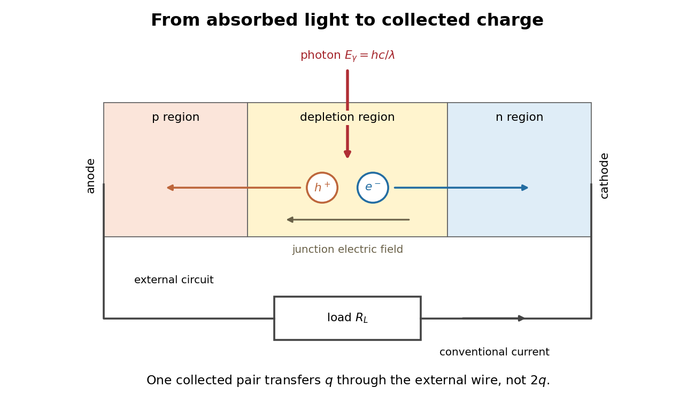

# Photodiode

↑ **Parent:** [Photodetector](photodetector.md)  
ⓦ [Wiki](https://en.wikipedia.org/wiki/Photodiode)

A [photodiode](photodiode.md) is a [semiconductor](semiconductor-split.md) [diode](diode.md) producing [photocurrent](photocurrent.md) from [photon absorption](photon-absorption.md). Exciting an [electron](electron.md) across the [band gap](band-gap.md) leaves an [electron hole](electron-hole.md). The [depletion region](depletion-region.md)'s [electric field](electric-field-split.md) separates the [charge carriers](charge-carrier.md); others can arrive by [diffusion](diffusion.md) before [electron-hole recombination](electron-hole-recombination.md). Contacts complete the [electrical circuit](electrical-circuit-split.md).[Si photodiodes, p. 2, §1-1 and Figs. 1-1–1-2: generation, separation and collection](si-photodiodes-by-hamamatsu-photonics-k-k.md)

The useful bridge is from [light](light.md) to a measurable [electric current](electric-current.md): [spectral responsivity](spectral-responsivity.md) converts incident [radiant flux](radiant-flux.md) into [photocurrent](photocurrent.md), while [quantum efficiency](quantum-efficiency.md) counts collected signal [charge carriers](charge-carrier.md) per incident [photon](photon.md). These answer different questions: how much [electric current](electric-current.md) one watt produces, and how many incident [photons](photon.md) contribute to the signal. The worked calculation below makes their relationship explicit.

**[Figure 14](#image-photon-absorption-junction-separation-and-an-external-electric-current). Photon absorption, junction separation and an external electric current**. Original qualitative [p-n junction](p-n-junction.md) schematic with an external [resistor](resistor.md). Collecting one [electron](electron.md)–[electron hole](electron-hole.md) pair transfers one [elementary charge](elementary-charge.md) through the external [electrical circuit](electrical-circuit-split.md), rather than twice that amount. Dimensions and paths are schematic.

**Table of contents**

- [Balanced photodetection](balanced-photodetection.md)
- [Quadrant photodiode](quadrant-photodiode.md)
- [Photocurrent](photocurrent.md)
- [Photodiode operating mode](photodiode-operating-mode.md)
- [Photodiode responsivity measurement](photodiode-responsivity-measurement.md)

## ↑ Ancestors (6)

1. [Photodetector](photodetector.md)
2. [Optical instrument](optical-instrument-split.md)
3. [Optics](optics-split.md)
4. [Branches of physics](branches-of-physics.md)
5. [Physics](physics-split.md)
6. [Codex Wiki](split.md)

## ← Incoming links (44)

- [Atom-cloud gravity-gradient measurement](atom-cloud-gravity-gradient-measurement.md)
- [Calibrated photometer model](calibrated-photometer-model.md)
- [Calibrated radiant-flux measurement](calibrated-radiant-flux-measurement.md)
- [Charge-coupled device](charge-coupled-device.md)
- [Chopped-light lock-in experiment](chopped-light-lock-in-experiment.md)
- [Comb self-referencing](comb-self-referencing.md)
- [Cryogenic laser-power substitution experiment](cryogenic-laser-power-substitution-experiment.md)
- [Dragged-bead fluctuation theorem experiment](dragged-bead-fluctuation-theorem-experiment.md)
- [Etendue bench measurement](etendue-bench-measurement.md)
- [Faraday rotation in a glass-rod experiment](faraday-rotation-in-a-glass-rod-experiment.md)
- [Fluorescent bead experiment for confocal microscopy](fluorescent-bead-experiment-for-confocal-microscopy.md)
- [Kastler-Brossel optical pumping experiments](kastler-brossel-optical-pumping-experiments.md)
- [Lock-in amplifier](lock-in-amplifier.md)
- [Michelson interferometer](michelson-interferometer.md)
- [Octave-spanning comb phase-control experiment](octave-spanning-comb-phase-control-experiment.md)
- [Optical chopper](optical-chopper.md)
- [Optical frequency measurement with a comb](optical-frequency-measurement-with-a-comb.md)
- [Optical path length](optical-path-length.md)
- [Optical power meter](optical-power-meter.md)
- [Solution](past-exam-of-the-mathematics-course-of-the-university-of-cambridge/2018/iii/paper-338/3/c/solution.md)
- [Solution](past-exam-of-the-optics-and-electrodynamics-course-of-the-university-of-cambridge/2015/paper-1/2/a/solution.md)
- [Solution](past-exam-of-the-physics-a-course-of-the-university-of-cambridge/2014/paper-2/section-d/d13/solution.md)
- [Solution](past-exam-of-the-physics-a-course-of-the-university-of-cambridge/2015/paper-1/section-d/d13/c/solution.md)
- [Solution](past-exam-of-the-physics-a-course-of-the-university-of-cambridge/2016/paper-2/section-d/d13/c/solution.md)
- [Solution](past-exam-of-the-physics-course-of-the-year-4-of-the-natural-sciences-course-of-the-university-of-cambridge/2012/paper-1/section-b/b2/solution.md)
- [Solution](past-exam-of-the-quantum-condensed-matter-course-of-the-university-of-cambridge/2005/section-b/b4/c/solution.md)
- [Photocurrent](photocurrent.md)
- [Photodiode](photodiode.md)
- [Photodiode operating mode](photodiode-operating-mode.md)
- [Photodiode responsivity measurement](photodiode-responsivity-measurement.md)
- [Photometer](photometer.md)
- [Photometric calibration](photometric-calibration.md)
- [Photometric matching filter](photometric-matching-filter.md)
- [Point spread function](point-spread-function-split.md)
- [Precision displacement measurement with a Michelson interferometer](precision-displacement-measurement-with-a-michelson-interferometer.md)
- [Quadrant photodiode](quadrant-photodiode.md)
- [Scanning Fabry–Pérot measurement](scanning-fabry-perot-measurement.md)
- [Semiconductor](semiconductor-split.md)
- [Single-molecule absorption in a molecular crystal](single-molecule-absorption-in-a-molecular-crystal.md)
- [Solar limb-darkening drift-scan experiment](solar-limb-darkening-drift-scan-experiment.md)
- [Spectral mismatch correction](spectral-mismatch-correction.md)
- [Spectral radiant flux](spectral-radiant-flux.md)
- [Spectral responsivity](spectral-responsivity.md)
- [Ultraviolet](ultraviolet.md)
